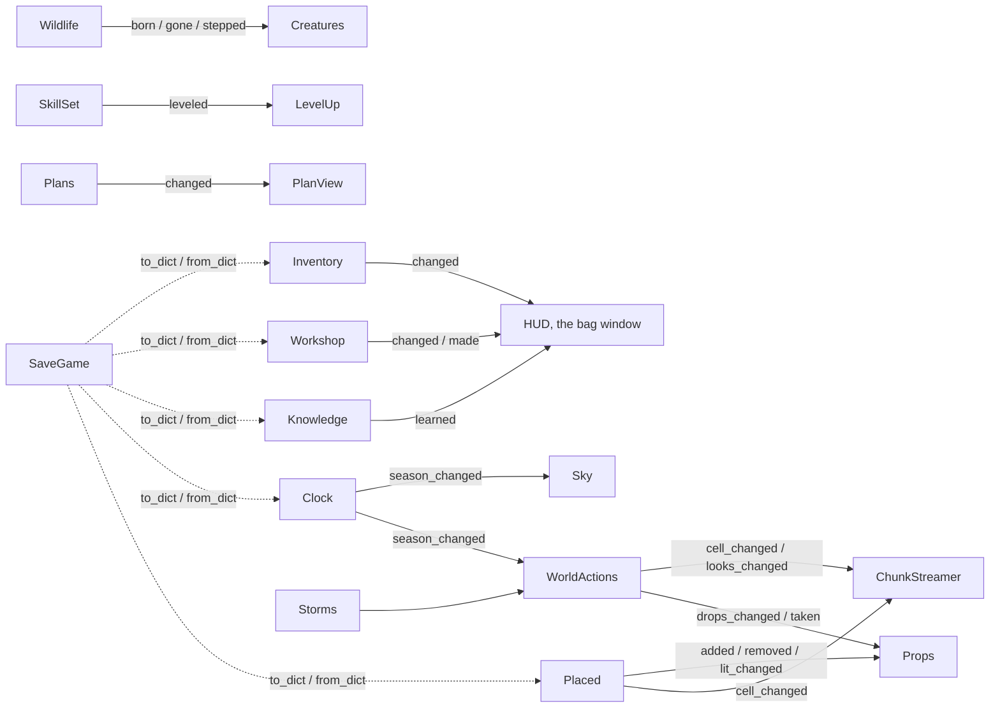

# Dependencies

Status: ACTIVE, checked against the code on 2026-11-09 (PR #457). A Russian copy:
[DEPENDENCIES_RU.md](DEPENDENCIES_RU.md). Two maps: **what each script loads** (`preload` / `extends`; the
table by folder is generated in [generated/code-index.md](generated/code-index.md), by file —
`python3 tools/doc_index.py uses <path>`) and **who is handed to whom during play** (Main hands out objects,
the rules send signals; this is below, by hand).

## Layers

```mermaid
graph LR
  subgraph client["src/client/"]
    main["main.gd"]
    cworld["world/"]
    view["view/"]
    input["input/"]
    cgame["game/"]
    audio["audio/"]
    ui["ui/"]
    cnet["net/"]
  end
  subgraph server["src/server/"]
    requests["runner.gd, requests.gd, player.gd, player_link.gd, server.gd, server_main.gd"]
  end
  subgraph shared["src/shared/"]
    net["net/"]
    game["game/"]
    world["world/"]
    content["content/"]
  end
  main --> cworld & view & input & cgame & audio & ui & cnet
  cnet -. local_host.gd .-> requests
  client --> net & game & world & content
  requests --> net & game & content
  game --> world --> content
  game --> content
  net --> content
```

Forbidden (the test `_test_layers`): `src/shared/` → `src/client/` or `src/server/`; `src/server/` →
`src/client/`; `src/client/` → `src/server/` except `net/local_host.gd`; inside shared the backward arrows
(`content/` loads none of `world/`, `game/`, `net/`; `world/` loads neither `game/` nor `net/`; `net/` loads
only `content/`).

## The nodes most depend on

Over 40 files load `src/shared/world/world_data.gd`, `src/shared/content/materials.gd`,
`src/shared/content/items.gd`, `src/shared/content/lang.gd`, `src/client/ui/ui_style.gd`; over 20 —
`src/client/view/pixel_view.gd`, `src/shared/content/content.gd`, `src/shared/content/trees.gd`,
`src/shared/world/world_gen.gd` (2026-11-09; `uses` gives the exact lists).
Editing their interface touches the generator, meshes, rules, UI and tests: before editing run
`python3 tools/doc_index.py uses <path>`.

## Rules inside shared

| Script | Loads |
|---|---|
| `game/world_actions.gd` ← the chain `actions_base` … `actions_boat` | `world_data`, `materials`, `items`, `tools`, `trees`, `bushes`, `plants`, `grass`, `biomes`, `ai_rules`, `growth`, `felling`, `inventory`, `placed`, `plans`, `clock`, `quality`, `vessels`, `body`, `lang` |
| `game/wildlife.gd` | `world_data`, `body`, `ai_rules`, `materials`, `grass`, `biomes`, `items`, `tools`, `placed`, `lang` |
| `game/placed.gd` | `world_data`, `materials`, `items`, `inventory`, `body`, `tools`, `starts`, `content`, `lang`, `net/protocol` |
| `game/character.gd` | `inventory`, `vitals`, `warmth`, `skill_set`, `items`, `starts`, `world_data`, `ai_rules`, `quality`, `lang` |
| `game/workshop.gd` | `crafting`, `craft_queue`, `knowledge`, `items`, `tools`, `ai_rules`, `inventory`, `quality`, `lang` |
| `game/clock.gd` | `world_gen`, `biomes`, `world_data` |
| `world/world_gen.gd` → `world/land_layout.gd` | `trees`, `bushes`, `growth`; base — `materials`, `biomes`, `world_data` |
| `world/world_data.gd` → `world/world_cells.gd` | `materials`, `trees`, `items`, `content`, `growth` |

## Who is handed to whom during play

Main creates the modules and hands them their neighbours (see [ARCHITECTURE.md](ARCHITECTURE.md), «Main and
the modules»). The shared rules receive objects and do not load their scripts; the world and the rules over
it are made and linked by the session (`src/shared/game/session.gd`: `WorldActions.new(world, clock, rules)`,
`Storms.new(world, clock, actions)`, `Plans`), the player's workshop — by its link on the server
(`src/server/player_link.gd`: `Workshop.new(who, placed, rules)`); `wildlife.world`, `.gen`, `.clock`;
`clock.world`, `.gen`; `character.world`, `.placed`, `.clock` (in `Session.add_player`). The host's rules
(`rules`, `src/shared/game/rules.gd`) are a shared object that a rule only reads; in single player the
client's `settings.gd` fills it, on a server — the config.



On a server `src/server/player_link.gd` is connected to these signals and sends the events; on the client
the views listen to the copies (`src/client/net/remote_*.gd`, `game.character`, `game.plans`) with the same
signals ([systems/network.md](systems/network.md)).

## Data

The mods' records are linked by references (`ref:<kind>`): a recipe → items and a station, an item → a
material, a shrub, a plant, a tree → items, a biome → trees and shrubs, a creature → plants and biomes. A
hard reference links bundles, a soft one only sets the order ([DATA_MODEL.md](DATA_MODEL.md)). The
dependencies of a given bundle: `Content.deps(b)`, with all those it cannot do without — `Content.closure(b)`;
the full registry of records with bundles and links — [generated/content-index.md](generated/content-index.md).
