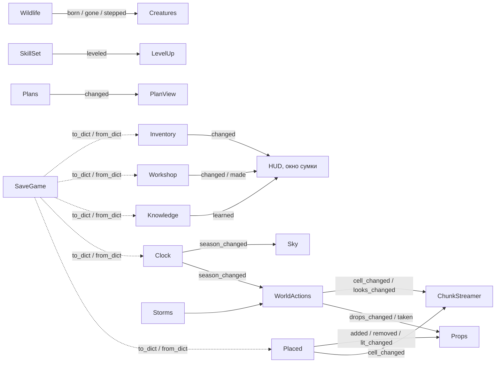

# Зависимости

Английская версия: [DEPENDENCIES.md](DEPENDENCIES.md) (она основная, эта — копия).

Статус: ACTIVE, сверено с кодом 2026-11-09 (PR #457). Две карты: **что какой скрипт грузит** (`preload` / `extends`; таблица по
папкам генерируется в [generated/code-index.md](generated/code-index.md), по файлу —
`python3 tools/doc_index.py uses <путь>`) и **кто кому передан во время игры** (Main раздаёт объекты,
правила шлют сигналы; это ниже, вручную).

## Слои

```mermaid
graph LR
  subgraph client["src/client/"]
    main["main.gd"]
    cworld["world/"]
    view["view/"]
    input["input/"]
    cgame["game/"]
    audio["audio/"]
    ui["ui/"]
    cnet["net/"]
  end
  subgraph server["src/server/"]
    requests["runner.gd, requests.gd, player.gd, player_link.gd, server.gd, server_main.gd"]
  end
  subgraph shared["src/shared/"]
    net["net/"]
    game["game/"]
    world["world/"]
    content["content/"]
  end
  main --> cworld & view & input & cgame & audio & ui & cnet
  cnet -. local_host.gd .-> requests
  client --> net & game & world & content
  requests --> net & game & content
  game --> world --> content
  game --> content
  net --> content
```

Запрещено (тест `_test_layers`): `src/shared/` → `src/client/` или `src/server/`; `src/server/` →
`src/client/`; `src/client/` → `src/server/` кроме `net/local_host.gd`; внутри shared обратные стрелки
(`content/` не грузит `world/`, `game/`, `net/`; `world/` не грузит `game/`, `net/`; `net/` грузит только
`content/`).

## Узлы, от которых зависит больше всего

Больше 40 файлов грузят `src/shared/world/world_data.gd`, `src/shared/content/materials.gd`,
`src/shared/content/items.gd`, `src/shared/content/lang.gd`, `src/client/ui/ui_style.gd`; больше 20 — `src/client/view/pixel_view.gd`,
`src/shared/content/content.gd`, `src/shared/content/trees.gd`, `src/shared/world/world_gen.gd`
(2026-11-09; точные списки даёт `uses`).
Правка их интерфейса затрагивает генератор, меши, правила, UI и тесты: перед правкой
`python3 tools/doc_index.py uses <путь>`.

## Правила внутри shared

| Скрипт | Грузит |
|---|---|
| `game/world_actions.gd` ← цепочка `actions_base` … `actions_boat` | `world_data`, `materials`, `items`, `tools`, `trees`, `bushes`, `plants`, `grass`, `biomes`, `ai_rules`, `growth`, `felling`, `inventory`, `placed`, `plans`, `clock`, `quality`, `vessels`, `body`, `lang` |
| `game/wildlife.gd` | `world_data`, `body`, `ai_rules`, `materials`, `grass`, `biomes`, `items`, `tools`, `placed`, `lang` |
| `game/placed.gd` | `world_data`, `materials`, `items`, `inventory`, `body`, `tools`, `starts`, `content`, `lang`, `net/protocol` |
| `game/character.gd` | `inventory`, `vitals`, `warmth`, `skill_set`, `items`, `starts`, `world_data`, `ai_rules`, `quality`, `lang` |
| `game/workshop.gd` | `crafting`, `craft_queue`, `knowledge`, `items`, `tools`, `ai_rules`, `inventory`, `quality`, `lang` |
| `game/clock.gd` | `world_gen`, `biomes`, `world_data` |
| `world/world_gen.gd` → `world/land_layout.gd` | `trees`, `bushes`, `growth`; база — `materials`, `biomes`, `world_data` |
| `world/world_data.gd` → `world/world_cells.gd` | `materials`, `trees`, `items`, `content`, `growth` |

## Кто кому передан во время игры

Main создаёт модули и раздаёт им соседей (см. [ARCHITECTURE.md](ARCHITECTURE_RU.md), «Main и модули»).
Общие правила получают объекты, а не грузят их скрипты; мир и правила над ним делает и связывает сеанс
(`src/shared/game/session.gd`: `WorldActions.new(world, clock, rules)`, `Storms.new(world, clock, actions)`,
`Plans`), мастерскую игрока — его линк на сервере (`src/server/player_link.gd`: `Workshop.new(who, placed,
rules)`); `wildlife.world`, `.gen`, `.clock`; `clock.world`, `.gen`;
`character.world`, `.placed`, `.clock` (в `Session.add_player`). Правила хозяина (`rules`,
`src/shared/game/rules.gd`) — общий объект, который правило только читает; в одиночной игре его
заполняет клиентский `settings.gd`, у сервера — конфиг.



На сервере к этим сигналам подключён `src/server/player_link.gd` и шлёт события; на клиенте виды слушают
копии (`src/client/net/remote_*.gd`, `game.character`, `game.plans`) с теми же сигналами
([systems/network.md](systems/network.md)).

## Данные

Записи модов связаны ссылками (`ref:<вид>`): рецепт → предметы и станок, предмет → материал,
куст, растение, дерево → предметы, биом → деревья и кусты, существо → растения и биомы. Жёсткая ссылка
связывает бандлы, мягкая только задаёт порядок ([DATA_MODEL.md](DATA_MODEL_RU.md)). Зависимости
конкретного бандла: `Content.deps(b)`, со всеми, без кого он не может, — `Content.closure(b)`; полный
реестр записей с бандлами и связями — [generated/content-index.md](generated/content-index.md).
