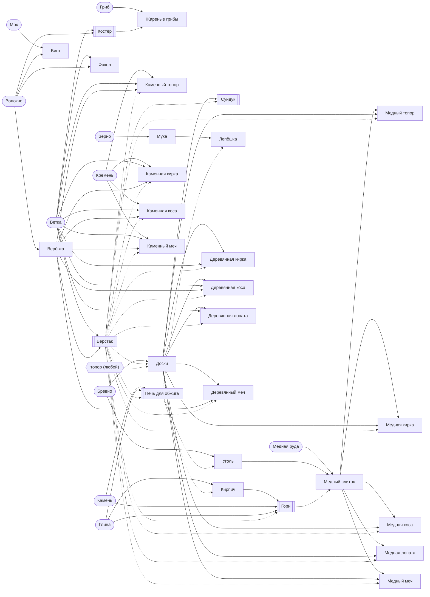

# Граф контента

Создаёт `tools/content_report.gd` из данных всех модов по графу `src/shared/content/content_graph.gd`;
руками не править, CI проверяет, что граф свежий. Правила — раздел 11
[BUNDLE_SYSTEM.md](../specifications/BUNDLE_SYSTEM.md), что нашли проверки — [content-checks.md](content-checks.md),
все записи — [content-index.md](content-index.md).

Граф идёт от старта по правилам рук (`Tools`, тем же, что в игре): мир даёт биомы, клетки, растения, деревья
и кусты; действие над ними инструментом, что уже есть, даёт вещи; рецепты делают из них новые на
поставленных станках; поставленное, посаженное и посеянное даёт своё, пока не перестаёт прибавляться новое.
Глубина — сколько шагов изготовления отделяет вещь от старта: что мир и старт дают голыми руками — 0,
добытое инструментом — глубина самого раннего инструмента, который это может, изделие — на 1 больше
самого глубокого из материалов, станка и инструмента своего рецепта.

## Старт

Новый мир начинается по записи `core:default` «Обычный старт».

- Сумка: пусто.
- У точки появления: Костёр, на 4 клетки к западу и на 4 к югу.
- У точки появления: Сундук, на 4 клетки к востоку и на 2 к югу.

## Предметы по глубине

| Глубина | Предметы |
|---|---|
| 0 | Черника, Клюква, Смородина, Семена трав, Гриб, Светящийся гриб, Малина, Шиповник, Волокно, Мох, Земля, Песок, Глина, Камень, Кремень, Ветка, Яблоко, Жёлудь, Рябина, Шишка, Зерно |
| 1 | Костёр, Жареные грибы, Верёвка, Бинт, Факел, Мука |
| 2 | Верстак |
| 3 | Медная руда, Бревно, Каменный топор, Печь для обжига, Каменная кирка, Каменная коса, Каменный меч |
| 4 | Кирпич, Уголь, Доски, Лепёшка |
| 5 | Кустик черники, Куст смородины, Куст малины, Куст шиповника, Куст, Сундук, Горн, Деревянная кирка, Деревянная коса, Деревянная лопата, Деревянный меч |
| 6 | Медный слиток |
| 7 | Медный топор, Медная кирка, Медная коса, Медная лопата, Медный меч |

## Откуда и куда

Откуда — все пути к предмету, первым тот, что даёт ему глубину. Куда — рецепты, которые его тратят,
рецепты на нём как на станке, что им чинят, и для чего он сам.

| Предмет | Глубина | Откуда | Куда |
|---|---|---|---|
| Костёр `core:campfire` | 1 | рецепт: Костёр | станок рецептов: Жареные грибы |
| Кирпич `materials:brick` | 4 | рецепт: Кирпич; копать: Кирпич | в рецепты: Горн; блок: Кирпич |
| Уголь `materials:charcoal` | 4 | рецепт: Уголь | в рецепты: Медный слиток; топливо |
| Медная руда `materials:copper_ore` | 3 | копать: Медная руда | в рецепты: Медный слиток |
| Медный слиток `materials:copper_bar` | 6 | рецепт: Медный слиток | чинит: Медный топор, Медная кирка, Медная коса, Медная лопата, Медный меч; в рецепты: Медный топор, Медная кирка, Медная коса, Медная лопата, Медный меч |
| Доски `materials:planks` | 4 | рецепт: Доски; копать: Доски | чинит: Деревянная кирка, Деревянная коса, Деревянная лопата, Деревянный меч; в рецепты: Медный топор, Сундук, Деревянная кирка, Медная кирка, Деревянная коса, Медная коса, Деревянная лопата, Медная лопата, Деревянный меч, Медный меч; блок: Доски |
| Черника `plants:blueberry` | 0 | собирать: Черника | еда |
| Кустик черники `plants:blueberry_bush` | 5 | выкопать: Черника | сажает: Черника |
| Клюква `plants:cranberry` | 0 | косить: Клюква | еда |
| Смородина `plants:currant` | 0 | собирать: Смородина | еда |
| Куст смородины `plants:currant_bush` | 5 | выкопать: Смородина | сажает: Смородина |
| Семена трав `plants:grass_seeds` | 0 | косить: Трава, Цветы | засевает: Трава |
| Гриб `plants:mushroom` | 0 | косить: Грибы | в рецепты: Жареные грибы; еда |
| Светящийся гриб `plants:glow_mushroom` | 0 | косить: Светящиеся грибы | еда |
| Жареные грибы `plants:fried_mushrooms` | 1 | рецепт: Жареные грибы | еда |
| Малина `plants:raspberry` | 0 | собирать: Малина | еда |
| Куст малины `plants:raspberry_bush` | 5 | выкопать: Малина | сажает: Малина |
| Шиповник `plants:rosehip` | 0 | собирать: Шиповник | еда |
| Куст шиповника `plants:rosehip_bush` | 5 | выкопать: Шиповник | сажает: Шиповник |
| Куст `plants:shrub_bush` | 5 | выкопать: Куст | сажает: Куст |
| Волокно `resources:fiber` | 0 | копать: Трава; косить: Трава, Папоротник, Высокая трава, Травы, Крапива, Тростник | в рецепты: Верёвка, Бинт, Костёр, Факел |
| Верёвка `materials:cord` | 1 | рецепт: Верёвка | чинит: Каменный топор, Каменная кирка, Каменная коса, Каменный меч; в рецепты: Верстак, Каменный топор, Каменная кирка, Каменная коса, Деревянная коса, Деревянный меч, Каменный меч |
| Мох `plants:moss` | 0 | косить: Мох | в рецепты: Бинт |
| Бинт `plants:bandage` | 1 | рецепт: Бинт | лечит |
| Земля `resources:dirt` | 0 | копать: Трава, Земля | блок: Земля |
| Песок `resources:sand` | 0 | копать: Песок | блок: Песок |
| Глина `resources:clay` | 0 | копать: Глина | в рецепты: Горн, Печь для обжига, Кирпич; блок: Глина |
| Камень `resources:stone` | 0 | копать: Осыпь, Камень | в рецепты: Горн, Печь для обжига; блок: Камень |
| Кремень `resources:flint` | 0 | копать: Земля, Песок, Осыпь | чинит: Каменный топор, Каменная кирка, Каменная коса, Каменный меч; в рецепты: Каменный топор, Каменная кирка, Каменная коса, Каменный меч |
| Ветка `resources:branch` | 0 | собирать: Яблоня, Берёза, Черёмуха, Вишня, Сухое дерево, Пихта, Лиственница, Липа, Клён, Дуб, Сосна, Тополь, Рябина, Ель, Ива, Черника, Смородина, Малина, Шиповник, Куст | в рецепты: Костёр, Факел, Верстак, Каменный топор, Каменная кирка, Деревянная кирка, Каменная коса, Деревянная коса, Деревянная лопата, Каменный меч; топливо |
| Бревно `resources:log` | 3 | рубить: Яблоня, Берёза, Черёмуха, Вишня, Сухое дерево, Пихта, Лиственница, Липа, Клён, Дуб, Сосна, Тополь, Рябина, Ель, Ива; копать: Бревно | в рецепты: Доски, Уголь; блок: Бревно |
| Яблоко `plants:apple` | 0 | собирать: Яблоня | еда |
| Жёлудь `plants:acorn` | 0 | собирать: Дуб | — |
| Рябина `plants:rowan` | 0 | собирать: Рябина | еда |
| Шишка `plants:cone` | 0 | собирать: Сосна, Ель | — |
| Факел `tools:torch` | 1 | рецепт: Факел | свет |
| Верстак `tools:workbench` | 2 | рецепт: Верстак | станок рецептов: Каменный топор, Доски, Медный топор, Сундук, Горн, Печь для обжига, Каменная кирка, Деревянная кирка, Медная кирка, Каменная коса, Деревянная коса, Медная коса, Деревянная лопата, Медная лопата, Деревянный меч, Каменный меч, Медный меч |
| Каменный топор `tools:stone_axe` | 3 | рецепт: Каменный топор | инструмент: топор |
| Медный топор `tools:copper_axe` | 7 | рецепт: Медный топор | инструмент: топор |
| Сундук `tools:chest` | 5 | рецепт: Сундук | хранит вещи |
| Горн `tools:forge` | 5 | рецепт: Горн | станок рецептов: Медный слиток |
| Печь для обжига `tools:kiln` | 3 | рецепт: Печь для обжига | станок рецептов: Кирпич, Уголь, Лепёшка |
| Зерно `plants:grain` | 0 | косить: Колоски | в рецепты: Мука; засевает: Трава; растит: Колоски |
| Мука `plants:flour` | 1 | рецепт: Мука | в рецепты: Лепёшка |
| Лепёшка `plants:flatbread` | 4 | рецепт: Лепёшка | еда |
| Каменная кирка `tools:stone_pickaxe` | 3 | рецепт: Каменная кирка | инструмент: кирка |
| Деревянная кирка `tools:wooden_pickaxe` | 5 | рецепт: Деревянная кирка | инструмент: кирка |
| Медная кирка `tools:copper_pickaxe` | 7 | рецепт: Медная кирка | инструмент: кирка |
| Каменная коса `tools:stone_scythe` | 3 | рецепт: Каменная коса | инструмент: коса |
| Деревянная коса `tools:wooden_scythe` | 5 | рецепт: Деревянная коса | инструмент: коса |
| Медная коса `tools:copper_scythe` | 7 | рецепт: Медная коса | инструмент: коса |
| Деревянная лопата `tools:wooden_shovel` | 5 | рецепт: Деревянная лопата | инструмент: лопата |
| Медная лопата `tools:copper_shovel` | 7 | рецепт: Медная лопата | инструмент: лопата |
| Деревянный меч `tools:wooden_sword` | 5 | рецепт: Деревянный меч | инструмент: меч |
| Каменный меч `tools:stone_sword` | 3 | рецепт: Каменный меч | инструмент: меч |
| Медный меч `tools:copper_sword` | 7 | рецепт: Медный меч | инструмент: меч |

## Общие ресурсы

Предметы, которые тратят два рецепта и больше. На нём держится — всё, что делается из него прямо или
дальше по цепочкам (по путям, которые дают глубину), через станки и инструменты тоже.

| Ресурс | Тратят рецепты | На нём держится |
|---|---|---|
| Медный слиток `materials:copper_bar` | Медный топор, Медная кирка, Медная коса, Медная лопата, Медный меч | Медный топор, Медная кирка, Медная коса, Медная лопата, Медный меч |
| Доски `materials:planks` | Медный топор, Сундук, Деревянная кирка, Медная кирка, Деревянная коса, Медная коса, Деревянная лопата, Медная лопата, Деревянный меч, Медный меч | Сундук, Деревянная кирка, Деревянная коса, Деревянная лопата, Деревянный меч, Медный топор, Медная кирка, Медная коса, Медная лопата, Медный меч, Кустик черники, Куст смородины, Куст малины, Куст шиповника, Куст |
| Волокно `resources:fiber` | Верёвка, Бинт, Костёр, Факел | Верёвка, Бинт, Костёр, Факел, Верстак, Каменный топор, Каменная кирка, Каменная коса, Каменный меч, Деревянная коса, Деревянный меч, Бревно, Медная руда, Печь для обжига, Доски, Горн, Сундук, Деревянная кирка, Деревянная лопата, Медный топор, Медная кирка, Медная коса, Медная лопата, Медный меч, Уголь, Медный слиток, Кустик черники, Куст смородины, Куст малины, Куст шиповника, Куст, Кирпич, Лепёшка |
| Верёвка `materials:cord` | Верстак, Каменный топор, Каменная кирка, Каменная коса, Деревянная коса, Деревянный меч, Каменный меч | Верстак, Каменный топор, Каменная кирка, Каменная коса, Каменный меч, Деревянная коса, Деревянный меч, Бревно, Медная руда, Печь для обжига, Доски, Горн, Сундук, Деревянная кирка, Деревянная лопата, Медный топор, Медная кирка, Медная коса, Медная лопата, Медный меч, Уголь, Медный слиток, Кустик черники, Куст смородины, Куст малины, Куст шиповника, Куст, Кирпич, Лепёшка |
| Глина `resources:clay` | Горн, Печь для обжига, Кирпич | Печь для обжига, Кирпич, Горн, Лепёшка, Уголь, Медный слиток, Медный топор, Медная кирка, Медная коса, Медная лопата, Медный меч |
| Камень `resources:stone` | Горн, Печь для обжига | Печь для обжига, Горн, Кирпич, Лепёшка, Уголь, Медный слиток, Медный топор, Медная кирка, Медная коса, Медная лопата, Медный меч |
| Кремень `resources:flint` | Каменный топор, Каменная кирка, Каменная коса, Каменный меч | Каменный топор, Каменная кирка, Каменная коса, Каменный меч, Бревно, Медная руда, Доски, Уголь, Медный слиток, Сундук, Деревянная кирка, Деревянная коса, Деревянная лопата, Деревянный меч, Медный топор, Медная кирка, Медная коса, Медная лопата, Медный меч, Кустик черники, Куст смородины, Куст малины, Куст шиповника, Куст |
| Ветка `resources:branch` | Костёр, Факел, Верстак, Каменный топор, Каменная кирка, Деревянная кирка, Каменная коса, Деревянная коса, Деревянная лопата, Каменный меч | Костёр, Факел, Верстак, Каменный топор, Каменная кирка, Каменная коса, Каменный меч, Деревянная кирка, Деревянная коса, Деревянная лопата, Бревно, Медная руда, Кустик черники, Куст смородины, Куст малины, Куст шиповника, Куст, Печь для обжига, Доски, Горн, Сундук, Деревянный меч, Медный топор, Медная кирка, Медная коса, Медная лопата, Медный меч, Уголь, Медный слиток, Кирпич, Лепёшка |
| Бревно `resources:log` | Доски, Уголь | Доски, Уголь, Сундук, Деревянная кирка, Деревянная коса, Деревянная лопата, Деревянный меч, Медный топор, Медная кирка, Медная коса, Медная лопата, Медный меч, Медный слиток, Кустик черники, Куст смородины, Куст малины, Куст шиповника, Куст |

## Инструменты и добыча

Что даёт мир каждым действием и чем это сделать: руками или предметом-инструментом (по правилам `Tools`,
тем же, что в игре). Одинаковое у нескольких записей — одной строкой.

### Клетки

| Что | Действие | Даёт | Чем |
|---|---|---|---|
| Бревно | копать | Бревно | Каменный топор, Медный топор |
| Глина | копать | Глина | руки, Каменная кирка, Деревянная кирка, Медная кирка, Деревянная лопата, Медная лопата |
| Доски | копать | Доски | Каменный топор, Медный топор |
| Земля | копать | Земля, Кремень | руки, Каменная кирка, Деревянная кирка, Медная кирка, Деревянная лопата, Медная лопата |
| Камень | копать | Камень | Каменная кирка, Деревянная кирка, Медная кирка |
| Кирпич | копать | Кирпич | Каменная кирка, Деревянная кирка, Медная кирка |
| Медная руда | копать | Медная руда | Каменная кирка, Деревянная кирка, Медная кирка |
| Осыпь | копать | Камень, Кремень | руки, Каменная кирка, Деревянная кирка, Медная кирка, Деревянная лопата, Медная лопата |
| Песок | копать | Песок, Кремень | руки, Каменная кирка, Деревянная кирка, Медная кирка, Деревянная лопата, Медная лопата |
| Трава | копать | Земля, Волокно | руки, Каменная кирка, Деревянная кирка, Медная кирка, Деревянная лопата, Медная лопата |
| Трава | косить | Земля, Волокно | руки, Каменная коса, Деревянная коса, Медная коса |

### Деревья

| Что | Действие | Даёт | Чем |
|---|---|---|---|
| Берёза, Вишня, Дуб, Ель, Ива, Клён, Липа, Лиственница, Пихта, Рябина, Сосна, Сухое дерево, Тополь, Черёмуха, Яблоня | рубить | Бревно | Каменный топор, Медный топор |
| Берёза, Вишня, Ива, Клён, Липа, Лиственница, Пихта, Сухое дерево, Тополь, Черёмуха | собирать | Ветка | руки |
| Дуб | собирать | Жёлудь, Ветка | руки |
| Ель, Сосна | собирать | Шишка, Ветка | руки |
| Рябина | собирать | Рябина, Ветка | руки |
| Яблоня | собирать | Яблоко, Ветка | руки |

### Кусты

| Что | Действие | Даёт | Чем |
|---|---|---|---|
| Куст | выкопать | Куст | Деревянная лопата, Медная лопата |
| Куст | собирать | Ветка | руки |
| Малина | выкопать | Куст малины | Деревянная лопата, Медная лопата |
| Малина | собирать | Малина, Ветка | руки |
| Смородина | выкопать | Куст смородины | Деревянная лопата, Медная лопата |
| Смородина | собирать | Смородина, Ветка | руки |
| Черника | выкопать | Кустик черники | Деревянная лопата, Медная лопата |
| Черника | собирать | Черника, Ветка | руки |
| Шиповник | выкопать | Куст шиповника | Деревянная лопата, Медная лопата |
| Шиповник | собирать | Шиповник, Ветка | руки |

### Растения

| Что | Действие | Даёт | Чем |
|---|---|---|---|
| Высокая трава, Крапива, Папоротник, Травы, Тростник | косить | Волокно | руки, Каменная коса, Деревянная коса, Медная коса, Деревянный меч, Каменный меч, Медный меч |
| Грибы | косить | Гриб | руки, Каменная коса, Деревянная коса, Медная коса, Деревянный меч, Каменный меч, Медный меч |
| Клюква | косить | Клюква | руки, Каменная коса, Деревянная коса, Медная коса, Деревянный меч, Каменный меч, Медный меч |
| Колоски | косить | Зерно | руки, Каменная коса, Деревянная коса, Медная коса, Деревянный меч, Каменный меч, Медный меч |
| Мох | косить | Мох | руки, Каменная коса, Деревянная коса, Медная коса, Деревянный меч, Каменный меч, Медный меч |
| Светящиеся грибы | косить | Светящийся гриб | руки, Каменная коса, Деревянная коса, Медная коса, Деревянный меч, Каменный меч, Медный меч |
| Трава | косить | Семена трав | руки, Каменная коса, Деревянная коса, Медная коса |
| Цветы | косить | Семена трав | руки, Каменная коса, Деревянная коса, Медная коса, Деревянный меч, Каменный меч, Медный меч |

## Станки

| Станок | Глубина | Рецепты |
|---|---|---|
| Руки, без станка | 0 | Верёвка, Бинт, Костёр, Факел, Верстак, Мука |
| Костёр `core:campfire` | 0 | Жареные грибы |
| Верстак `tools:workbench` | 2 | Каменный топор, Доски, Медный топор, Сундук, Горн, Печь для обжига, Каменная кирка, Деревянная кирка, Медная кирка, Каменная коса, Деревянная коса, Медная коса, Деревянная лопата, Медная лопата, Деревянный меч, Каменный меч, Медный меч |
| Горн `tools:forge` | 5 | Медный слиток |
| Печь для обжига `tools:kiln` | 3 | Кирпич, Уголь, Лепёшка |

## Цепочки

Из чего складывается каждое изделие по путям, которые дают ему глубину: сырьё — что даёт мир и старт,
промежуточное — изделия по дороге, станки и инструменты — те, без которых на этом пути не обойтись.

| Изделие | Глубина | Сырьё | Промежуточное | Станки | Инструменты |
|---|---|---|---|---|---|
| Костёр `core:campfire` | 1 | Ветка, Волокно | — | — | — |
| Верёвка `materials:cord` | 1 | Волокно | — | — | — |
| Бинт `plants:bandage` | 1 | Мох, Волокно | — | — | — |
| Мука `plants:flour` | 1 | Зерно | — | — | — |
| Жареные грибы `plants:fried_mushrooms` | 1 | Гриб | — | — | — |
| Факел `tools:torch` | 1 | Ветка, Волокно | — | — | — |
| Верстак `tools:workbench` | 2 | Ветка, Волокно | Верёвка | — | — |
| Печь для обжига `tools:kiln` | 3 | Камень, Глина, Ветка, Волокно | Верёвка | Верстак | — |
| Каменный топор `tools:stone_axe` | 3 | Кремень, Ветка, Волокно | Верёвка | Верстак | — |
| Каменная кирка `tools:stone_pickaxe` | 3 | Кремень, Ветка, Волокно | Верёвка | Верстак | — |
| Каменная коса `tools:stone_scythe` | 3 | Кремень, Ветка, Волокно | Верёвка | Верстак | — |
| Каменный меч `tools:stone_sword` | 3 | Кремень, Ветка, Волокно | Верёвка | Верстак | — |
| Кирпич `materials:brick` | 4 | Глина, Камень, Ветка, Волокно | Верёвка | Печь для обжига, Верстак | — |
| Уголь `materials:charcoal` | 4 | Бревно, Кремень, Ветка, Камень, Глина, Волокно | Верёвка | Печь для обжига, Верстак | Каменный топор |
| Доски `materials:planks` | 4 | Бревно, Кремень, Ветка, Волокно | Верёвка | Верстак | Каменный топор |
| Лепёшка `plants:flatbread` | 4 | Зерно, Камень, Глина, Ветка, Волокно | Мука, Верёвка | Печь для обжига, Верстак | — |
| Сундук `tools:chest` | 5 | Бревно, Ветка, Кремень, Волокно | Доски, Верёвка | Верстак | Каменный топор |
| Горн `tools:forge` | 5 | Камень, Глина, Ветка, Волокно | Кирпич, Верёвка | Верстак, Печь для обжига | — |
| Деревянная кирка `tools:wooden_pickaxe` | 5 | Ветка, Бревно, Кремень, Волокно | Доски, Верёвка | Верстак | Каменный топор |
| Деревянная коса `tools:wooden_scythe` | 5 | Ветка, Бревно, Волокно, Кремень | Доски, Верёвка | Верстак | Каменный топор |
| Деревянная лопата `tools:wooden_shovel` | 5 | Ветка, Бревно, Кремень, Волокно | Доски, Верёвка | Верстак | Каменный топор |
| Деревянный меч `tools:wooden_sword` | 5 | Бревно, Волокно, Ветка, Кремень | Доски, Верёвка | Верстак | Каменный топор |
| Медный слиток `materials:copper_bar` | 6 | Медная руда, Бревно, Кремень, Ветка, Камень, Глина, Волокно | Уголь, Верёвка, Кирпич | Горн, Печь для обжига, Верстак | Каменная кирка, Каменный топор |
| Медный топор `tools:copper_axe` | 7 | Медная руда, Бревно, Ветка, Кремень, Камень, Глина, Волокно | Медный слиток, Доски, Уголь, Верёвка, Кирпич | Верстак, Горн, Печь для обжига | Каменная кирка, Каменный топор |
| Медная кирка `tools:copper_pickaxe` | 7 | Медная руда, Бревно, Ветка, Кремень, Камень, Глина, Волокно | Медный слиток, Доски, Уголь, Верёвка, Кирпич | Верстак, Горн, Печь для обжига | Каменная кирка, Каменный топор |
| Медная коса `tools:copper_scythe` | 7 | Медная руда, Бревно, Ветка, Кремень, Камень, Глина, Волокно | Медный слиток, Доски, Уголь, Верёвка, Кирпич | Верстак, Горн, Печь для обжига | Каменная кирка, Каменный топор |
| Медная лопата `tools:copper_shovel` | 7 | Медная руда, Бревно, Ветка, Кремень, Камень, Глина, Волокно | Медный слиток, Доски, Уголь, Верёвка, Кирпич | Верстак, Горн, Печь для обжига | Каменная кирка, Каменный топор |
| Медный меч `tools:copper_sword` | 7 | Медная руда, Бревно, Ветка, Кремень, Камень, Глина, Волокно | Медный слиток, Доски, Уголь, Верёвка, Кирпич | Верстак, Горн, Печь для обжига | Каменная кирка, Каменный топор |

## Схема рецептов

Сплошная стрелка — материал рецепта, пунктир — станок или инструмент. Скруглено то, что не делает ни один
рецепт (его даёт мир или старт), в рамке — станки, в шестиугольнике — инструмент любого вида.

