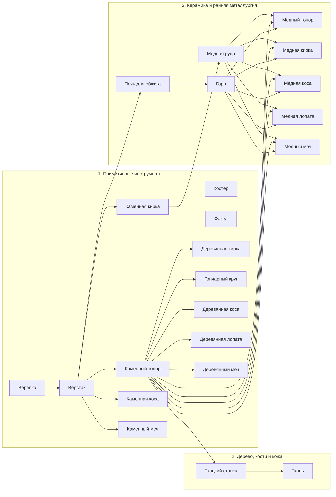
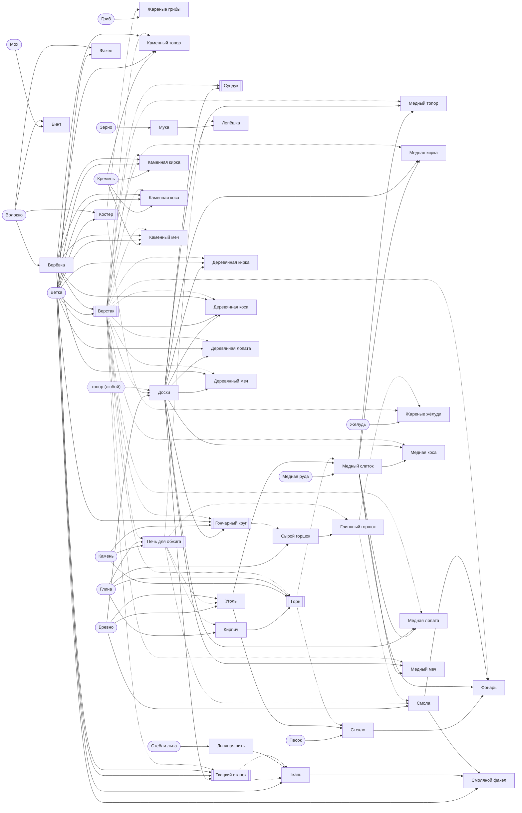

# Граф контента

Создаёт `tools/content_report.gd` из данных всех модов по графу `src/shared/content/content_graph.gd`;
руками не править, CI проверяет, что граф свежий. Правила — раздел 11
[BUNDLE_SYSTEM.md](../specifications/BUNDLE_SYSTEM.md), что нашли проверки — [content-checks.md](content-checks.md),
все записи — [content-index.md](content-index.md).

Граф идёт от старта по правилам рук (`Tools`, тем же, что в игре): мир даёт биомы, клетки, растения, деревья
и кусты; действие над ними инструментом, что уже есть, даёт вещи; рецепты делают из них новые на
поставленных станках; поставленное, посаженное и посеянное даёт своё, пока не перестаёт прибавляться новое.
Глубина — сколько шагов изготовления отделяет вещь от старта: что мир и старт дают голыми руками — 0,
добытое инструментом — глубина самого раннего инструмента, который это может, изделие — на 1 больше
самого глубокого из материалов, станка и инструмента своего рецепта.

## Старт

Новый мир начинается по записи `core:default` «Обычный старт».

- Сумка: пусто.
- У точки появления: Костёр, на 4 клетки к западу и на 4 к югу.
- У точки появления: Сундук, на 4 клетки к востоку и на 2 к югу.

## Предметы по глубине

| Глубина | Предметы |
|---|---|
| 0 | Черника, Клюква, Смородина, Семена трав, Гриб, Светящийся гриб, Малина, Шиповник, Волокно, Мох, Земля, Песок, Глина, Камень, Кремень, Ветка, Яблоко, Жёлудь, Рябина, Шишка, Зерно, Стебли льна |
| 1 | Костёр, Жареные грибы, Верёвка, Бинт, Факел, Мука, Льняная нить |
| 2 | Верстак |
| 3 | Медная руда, Бревно, Каменный топор, Печь для обжига, Каменная кирка, Каменная коса, Каменный меч |
| 4 | Кирпич, Уголь, Доски, Лепёшка |
| 5 | Кустик черники, Куст смородины, Куст малины, Куст шиповника, Куст, Сундук, Горн, Ткацкий станок, Деревянная кирка, Гончарный круг, Деревянная коса, Деревянная лопата, Деревянный меч |
| 6 | Ткань, Медный слиток, Стекло, Сырой горшок |
| 7 | Медный топор, Медная кирка, Глиняный горшок, Медная коса, Медная лопата, Медный меч |
| 8 | Смола, Жареные жёлуди |
| 9 | Фонарь, Смоляной факел |

## Откуда и куда

Откуда — все пути к предмету, первым тот, что даёт ему глубину. Куда — рецепты, которые его тратят,
рецепты на нём как на станке, что им чинят, и для чего он сам.

| Предмет | Глубина | Откуда | Куда |
|---|---|---|---|
| Костёр `core:campfire` | 1 | рецепт: Костёр | станок рецептов: Жареные грибы, Жареные жёлуди; горит: тушится и разжигается топливом |
| Кирпич `materials:brick` | 4 | рецепт: Кирпич; копать: Кирпич | в рецепты: Горн; блок: Кирпич |
| Уголь `materials:charcoal` | 4 | рецепт: Уголь; побочно: Смола | в рецепты: Медный слиток, Стекло; топливо |
| Ткань `materials:cloth` | 6 | рецепт: Грубая ткань, Льняная ткань | в рецепты: Смоляной факел |
| Медная руда `materials:copper_ore` | 3 | копать: Медная руда | в рецепты: Медный слиток |
| Медный слиток `materials:copper_bar` | 6 | рецепт: Медный слиток | чинит: Медный топор, Медная кирка, Медная коса, Медная лопата, Медный меч; в рецепты: Медный топор, Медная кирка, Фонарь, Медная коса, Медная лопата, Медный меч |
| Доски `materials:planks` | 4 | рецепт: Доски; копать: Доски | чинит: Деревянная кирка, Деревянная коса, Деревянная лопата, Деревянный меч; в рецепты: Медный топор, Сундук, Ткацкий станок, Деревянная кирка, Медная кирка, Гончарный круг, Деревянная коса, Медная коса, Деревянная лопата, Медная лопата, Деревянный меч, Медный меч; блок: Доски |
| Черника `plants:blueberry` | 0 | собирать: Черника | еда |
| Кустик черники `plants:blueberry_bush` | 5 | выкопать: Черника | сажает: Черника |
| Клюква `plants:cranberry` | 0 | косить: Клюква | еда |
| Смородина `plants:currant` | 0 | собирать: Смородина | еда |
| Куст смородины `plants:currant_bush` | 5 | выкопать: Смородина | сажает: Смородина |
| Семена трав `plants:grass_seeds` | 0 | косить: Трава, Цветы | засевает: Трава |
| Гриб `plants:mushroom` | 0 | косить: Грибы | в рецепты: Жареные грибы; еда |
| Светящийся гриб `plants:glow_mushroom` | 0 | косить: Светящиеся грибы | еда |
| Жареные грибы `plants:fried_mushrooms` | 1 | рецепт: Жареные грибы | еда |
| Малина `plants:raspberry` | 0 | собирать: Малина | еда |
| Куст малины `plants:raspberry_bush` | 5 | выкопать: Малина | сажает: Малина |
| Шиповник `plants:rosehip` | 0 | собирать: Шиповник | еда |
| Куст шиповника `plants:rosehip_bush` | 5 | выкопать: Шиповник | сажает: Шиповник |
| Куст `plants:shrub_bush` | 5 | выкопать: Куст | сажает: Куст |
| Волокно `resources:fiber` | 0 | копать: Трава; косить: Трава, Папоротник, Высокая трава, Травы, Крапива, Тростник | в рецепты: Верёвка, Бинт, Костёр, Факел |
| Верёвка `materials:cord` | 1 | рецепт: Верёвка | чинит: Каменный топор, Каменная кирка, Каменная коса, Каменный меч; в рецепты: Верстак, Каменный топор, Ткацкий станок, Грубая ткань, Каменная кирка, Каменная коса, Деревянная коса, Деревянный меч, Каменный меч |
| Мох `plants:moss` | 0 | косить: Мох | в рецепты: Бинт |
| Бинт `plants:bandage` | 1 | рецепт: Бинт | лечит |
| Земля `resources:dirt` | 0 | копать: Трава, Земля | блок: Земля |
| Песок `resources:sand` | 0 | копать: Песок | в рецепты: Стекло; блок: Песок |
| Глина `resources:clay` | 0 | копать: Глина | в рецепты: Горн, Печь для обжига, Кирпич, Сырой горшок; блок: Глина |
| Камень `resources:stone` | 0 | копать: Осыпь, Камень | в рецепты: Горн, Печь для обжига, Гончарный круг; блок: Камень |
| Кремень `resources:flint` | 0 | копать: Земля, Песок, Осыпь | чинит: Каменный топор, Каменная кирка, Каменная коса, Каменный меч; в рецепты: Каменный топор, Каменная кирка, Каменная коса, Каменный меч |
| Ветка `resources:branch` | 0 | собирать: Яблоня, Берёза, Черёмуха, Вишня, Сухое дерево, Пихта, Лиственница, Липа, Клён, Дуб, Сосна, Тополь, Рябина, Ель, Ива, Черника, Смородина, Малина, Шиповник, Куст | в рецепты: Костёр, Факел, Верстак, Каменный топор, Ткацкий станок, Каменная кирка, Деревянная кирка, Гончарный круг, Каменная коса, Деревянная коса, Деревянная лопата, Каменный меч, Смоляной факел; топливо |
| Бревно `resources:log` | 3 | рубить: Яблоня, Берёза, Черёмуха, Вишня, Сухое дерево, Пихта, Лиственница, Липа, Клён, Дуб, Сосна, Тополь, Рябина, Ель, Ива; копать: Бревно | в рецепты: Доски, Уголь, Смола; блок: Бревно |
| Яблоко `plants:apple` | 0 | собирать: Яблоня | еда |
| Жёлудь `plants:acorn` | 0 | собирать: Дуб | в рецепты: Жареные жёлуди |
| Рябина `plants:rowan` | 0 | собирать: Рябина | еда |
| Шишка `plants:cone` | 0 | собирать: Сосна, Ель | топливо |
| Факел `tools:torch` | 1 | рецепт: Факел | свет |
| Верстак `tools:workbench` | 2 | рецепт: Верстак | станок рецептов: Каменный топор, Доски, Медный топор, Сундук, Горн, Печь для обжига, Ткацкий станок, Каменная кирка, Деревянная кирка, Медная кирка, Гончарный круг, Фонарь, Каменная коса, Деревянная коса, Медная коса, Деревянная лопата, Медная лопата, Деревянный меч, Каменный меч, Медный меч; здесь чинят инструменты |
| Каменный топор `tools:stone_axe` | 3 | рецепт: Каменный топор | инструмент: топор |
| Медный топор `tools:copper_axe` | 7 | рецепт: Медный топор | инструмент: топор |
| Сундук `tools:chest` | 5 | рецепт: Сундук | хранит вещи: 16 мест |
| Горн `tools:forge` | 5 | рецепт: Горн | станок рецептов: Медный слиток, Стекло |
| Стекло `materials:glass` | 6 | рецепт: Стекло | в рецепты: Фонарь |
| Печь для обжига `tools:kiln` | 3 | рецепт: Печь для обжига | станок рецептов: Кирпич, Уголь, Лепёшка, Глиняный горшок, Смола |
| Зерно `plants:grain` | 0 | косить: Колоски | в рецепты: Мука; засевает: Трава; растит: Колоски |
| Мука `plants:flour` | 1 | рецепт: Мука | в рецепты: Лепёшка |
| Лепёшка `plants:flatbread` | 4 | рецепт: Лепёшка | еда |
| Ткацкий станок `tools:loom` | 5 | рецепт: Ткацкий станок | станок рецептов: Грубая ткань, Льняная ткань |
| Стебли льна `plants:flax_stalks` | 0 | косить: Лён | в рецепты: Льняная нить |
| Льняная нить `plants:linen_thread` | 1 | рецепт: Льняная нить | в рецепты: Льняная ткань |
| Каменная кирка `tools:stone_pickaxe` | 3 | рецепт: Каменная кирка | инструмент: кирка |
| Деревянная кирка `tools:wooden_pickaxe` | 5 | рецепт: Деревянная кирка | инструмент: кирка |
| Медная кирка `tools:copper_pickaxe` | 7 | рецепт: Медная кирка | инструмент: кирка |
| Гончарный круг `tools:potters_wheel` | 5 | рецепт: Гончарный круг | станок рецептов: Сырой горшок |
| Сырой горшок `tools:raw_pot` | 6 | рецепт: Сырой горшок | в рецепты: Глиняный горшок |
| Глиняный горшок `tools:pot` | 7 | рецепт: Глиняный горшок | нужен в сумке рецептам: Смола, Жареные жёлуди |
| Смола `materials:tar` | 8 | рецепт: Смола | в рецепты: Фонарь, Смоляной факел; топливо |
| Жареные жёлуди `plants:roasted_acorns` | 8 | рецепт: Жареные жёлуди | еда |
| Фонарь `tools:lantern` | 9 | рецепт: Фонарь | свет |
| Каменная коса `tools:stone_scythe` | 3 | рецепт: Каменная коса | инструмент: коса |
| Деревянная коса `tools:wooden_scythe` | 5 | рецепт: Деревянная коса | инструмент: коса |
| Медная коса `tools:copper_scythe` | 7 | рецепт: Медная коса | инструмент: коса |
| Деревянная лопата `tools:wooden_shovel` | 5 | рецепт: Деревянная лопата | инструмент: лопата |
| Медная лопата `tools:copper_shovel` | 7 | рецепт: Медная лопата | инструмент: лопата |
| Деревянный меч `tools:wooden_sword` | 5 | рецепт: Деревянный меч | инструмент: меч |
| Каменный меч `tools:stone_sword` | 3 | рецепт: Каменный меч | инструмент: меч |
| Медный меч `tools:copper_sword` | 7 | рецепт: Медный меч | инструмент: меч |
| Смоляной факел `tools:tar_torch` | 9 | рецепт: Смоляной факел | свет |

## Общие ресурсы

Предметы, которые тратят два рецепта и больше. На нём держится — всё, что делается из него прямо или
дальше по цепочкам (по путям, которые дают глубину), через станки и инструменты тоже.

| Ресурс | Тратят рецепты | На нём держится |
|---|---|---|
| Уголь `materials:charcoal` | Медный слиток, Стекло | Медный слиток, Стекло, Медный топор, Медная кирка, Медная коса, Медная лопата, Медный меч, Фонарь |
| Медный слиток `materials:copper_bar` | Медный топор, Медная кирка, Фонарь, Медная коса, Медная лопата, Медный меч | Медный топор, Медная кирка, Медная коса, Медная лопата, Медный меч, Фонарь |
| Доски `materials:planks` | Медный топор, Сундук, Ткацкий станок, Деревянная кирка, Медная кирка, Гончарный круг, Деревянная коса, Медная коса, Деревянная лопата, Медная лопата, Деревянный меч, Медный меч | Сундук, Ткацкий станок, Деревянная кирка, Гончарный круг, Деревянная коса, Деревянная лопата, Деревянный меч, Медный топор, Медная кирка, Медная коса, Медная лопата, Медный меч, Кустик черники, Куст смородины, Куст малины, Куст шиповника, Куст, Ткань, Сырой горшок, Смоляной факел, Глиняный горшок, Смола, Жареные жёлуди, Фонарь |
| Волокно `resources:fiber` | Верёвка, Бинт, Костёр, Факел | Верёвка, Бинт, Костёр, Факел, Верстак, Каменный топор, Каменная кирка, Каменная коса, Каменный меч, Ткацкий станок, Деревянная коса, Деревянный меч, Ткань, Бревно, Медная руда, Смоляной факел, Печь для обжига, Доски, Горн, Сундук, Деревянная кирка, Гончарный круг, Деревянная лопата, Медный топор, Медная кирка, Медная коса, Медная лопата, Медный меч, Фонарь, Уголь, Смола, Медный слиток, Кустик черники, Куст смородины, Куст малины, Куст шиповника, Куст, Стекло, Кирпич, Лепёшка, Глиняный горшок, Сырой горшок, Жареные жёлуди |
| Верёвка `materials:cord` | Верстак, Каменный топор, Ткацкий станок, Грубая ткань, Каменная кирка, Каменная коса, Деревянная коса, Деревянный меч, Каменный меч | Верстак, Каменный топор, Каменная кирка, Каменная коса, Каменный меч, Ткацкий станок, Деревянная коса, Деревянный меч, Ткань, Бревно, Медная руда, Смоляной факел, Печь для обжига, Доски, Горн, Сундук, Деревянная кирка, Гончарный круг, Деревянная лопата, Медный топор, Медная кирка, Медная коса, Медная лопата, Медный меч, Фонарь, Уголь, Смола, Медный слиток, Кустик черники, Куст смородины, Куст малины, Куст шиповника, Куст, Стекло, Кирпич, Лепёшка, Глиняный горшок, Сырой горшок, Жареные жёлуди |
| Глина `resources:clay` | Горн, Печь для обжига, Кирпич, Сырой горшок | Печь для обжига, Кирпич, Горн, Сырой горшок, Глиняный горшок, Лепёшка, Уголь, Смола, Медный слиток, Стекло, Жареные жёлуди, Фонарь, Смоляной факел, Медный топор, Медная кирка, Медная коса, Медная лопата, Медный меч |
| Камень `resources:stone` | Горн, Печь для обжига, Гончарный круг | Печь для обжига, Горн, Гончарный круг, Кирпич, Лепёшка, Уголь, Глиняный горшок, Смола, Медный слиток, Стекло, Сырой горшок, Жареные жёлуди, Фонарь, Смоляной факел, Медный топор, Медная кирка, Медная коса, Медная лопата, Медный меч |
| Кремень `resources:flint` | Каменный топор, Каменная кирка, Каменная коса, Каменный меч | Каменный топор, Каменная кирка, Каменная коса, Каменный меч, Бревно, Медная руда, Доски, Уголь, Смола, Медный слиток, Сундук, Ткацкий станок, Деревянная кирка, Гончарный круг, Деревянная коса, Деревянная лопата, Деревянный меч, Медный топор, Медная кирка, Медная коса, Медная лопата, Медный меч, Стекло, Фонарь, Смоляной факел, Кустик черники, Куст смородины, Куст малины, Куст шиповника, Куст, Ткань, Сырой горшок, Глиняный горшок, Жареные жёлуди |
| Ветка `resources:branch` | Костёр, Факел, Верстак, Каменный топор, Ткацкий станок, Каменная кирка, Деревянная кирка, Гончарный круг, Каменная коса, Деревянная коса, Деревянная лопата, Каменный меч, Смоляной факел | Костёр, Факел, Верстак, Каменный топор, Каменная кирка, Каменная коса, Каменный меч, Ткацкий станок, Деревянная кирка, Гончарный круг, Деревянная коса, Деревянная лопата, Смоляной факел, Бревно, Медная руда, Кустик черники, Куст смородины, Куст малины, Куст шиповника, Куст, Печь для обжига, Доски, Горн, Сундук, Деревянный меч, Медный топор, Медная кирка, Медная коса, Медная лопата, Медный меч, Фонарь, Уголь, Смола, Медный слиток, Ткань, Сырой горшок, Стекло, Глиняный горшок, Кирпич, Лепёшка, Жареные жёлуди |
| Бревно `resources:log` | Доски, Уголь, Смола | Доски, Уголь, Смола, Сундук, Ткацкий станок, Деревянная кирка, Гончарный круг, Деревянная коса, Деревянная лопата, Деревянный меч, Медный топор, Медная кирка, Медная коса, Медная лопата, Медный меч, Медный слиток, Стекло, Фонарь, Смоляной факел, Кустик черники, Куст смородины, Куст малины, Куст шиповника, Куст, Ткань, Сырой горшок, Глиняный горшок, Жареные жёлуди |
| Смола `materials:tar` | Фонарь, Смоляной факел | Фонарь, Смоляной факел |

## Инструменты и добыча

Что даёт мир каждым действием и чем это сделать: руками или предметом-инструментом (по правилам `Tools`,
тем же, что в игре). Одинаковое у нескольких записей — одной строкой.

### Клетки

| Что | Действие | Даёт | Чем |
|---|---|---|---|
| Бревно | копать | Бревно | Каменный топор, Медный топор |
| Глина | копать | Глина | руки, Каменная кирка, Деревянная кирка, Медная кирка, Деревянная лопата, Медная лопата |
| Доски | копать | Доски | Каменный топор, Медный топор |
| Земля | копать | Земля, Кремень | руки, Каменная кирка, Деревянная кирка, Медная кирка, Деревянная лопата, Медная лопата |
| Камень | копать | Камень | Каменная кирка, Деревянная кирка, Медная кирка |
| Кирпич | копать | Кирпич | Каменная кирка, Деревянная кирка, Медная кирка |
| Медная руда | копать | Медная руда | Каменная кирка, Деревянная кирка, Медная кирка |
| Осыпь | копать | Камень, Кремень | руки, Каменная кирка, Деревянная кирка, Медная кирка, Деревянная лопата, Медная лопата |
| Песок | копать | Песок, Кремень | руки, Каменная кирка, Деревянная кирка, Медная кирка, Деревянная лопата, Медная лопата |
| Трава | копать | Земля, Волокно | руки, Каменная кирка, Деревянная кирка, Медная кирка, Деревянная лопата, Медная лопата |
| Трава | косить | Земля, Волокно | руки, Каменная коса, Деревянная коса, Медная коса |

### Деревья

| Что | Действие | Даёт | Чем |
|---|---|---|---|
| Берёза, Вишня, Дуб, Ель, Ива, Клён, Липа, Лиственница, Пихта, Рябина, Сосна, Сухое дерево, Тополь, Черёмуха, Яблоня | рубить | Бревно | Каменный топор, Медный топор |
| Берёза, Вишня, Ива, Клён, Липа, Лиственница, Пихта, Сухое дерево, Тополь, Черёмуха | собирать | Ветка | руки |
| Дуб | собирать | Жёлудь, Ветка | руки |
| Ель, Сосна | собирать | Шишка, Ветка | руки |
| Рябина | собирать | Рябина, Ветка | руки |
| Яблоня | собирать | Яблоко, Ветка | руки |

### Кусты

| Что | Действие | Даёт | Чем |
|---|---|---|---|
| Куст | выкопать | Куст | Деревянная лопата, Медная лопата |
| Куст | собирать | Ветка | руки |
| Малина | выкопать | Куст малины | Деревянная лопата, Медная лопата |
| Малина | собирать | Малина, Ветка | руки |
| Смородина | выкопать | Куст смородины | Деревянная лопата, Медная лопата |
| Смородина | собирать | Смородина, Ветка | руки |
| Черника | выкопать | Кустик черники | Деревянная лопата, Медная лопата |
| Черника | собирать | Черника, Ветка | руки |
| Шиповник | выкопать | Куст шиповника | Деревянная лопата, Медная лопата |
| Шиповник | собирать | Шиповник, Ветка | руки |

### Растения

| Что | Действие | Даёт | Чем |
|---|---|---|---|
| Высокая трава, Крапива, Папоротник, Травы, Тростник | косить | Волокно | руки, Каменная коса, Деревянная коса, Медная коса, Деревянный меч, Каменный меч, Медный меч |
| Грибы | косить | Гриб | руки, Каменная коса, Деревянная коса, Медная коса, Деревянный меч, Каменный меч, Медный меч |
| Клюква | косить | Клюква | руки, Каменная коса, Деревянная коса, Медная коса, Деревянный меч, Каменный меч, Медный меч |
| Колоски | косить | Зерно | руки, Каменная коса, Деревянная коса, Медная коса, Деревянный меч, Каменный меч, Медный меч |
| Лён | косить | Стебли льна | руки, Каменная коса, Деревянная коса, Медная коса, Деревянный меч, Каменный меч, Медный меч |
| Мох | косить | Мох | руки, Каменная коса, Деревянная коса, Медная коса, Деревянный меч, Каменный меч, Медный меч |
| Светящиеся грибы | косить | Светящийся гриб | руки, Каменная коса, Деревянная коса, Медная коса, Деревянный меч, Каменный меч, Медный меч |
| Трава | косить | Семена трав | руки, Каменная коса, Деревянная коса, Медная коса |
| Цветы | косить | Семена трав | руки, Каменная коса, Деревянная коса, Медная коса, Деревянный меч, Каменный меч, Медный меч |

## Станки

| Станок | Класс | Глубина | Рецепты | Ещё |
|---|---|---|---|---|
| Руки, без станка | — | 0 | Верёвка, Бинт, Костёр, Факел, Верстак, Мука, Льняная нить, Смоляной факел | — |
| Костёр `core:campfire` | `campfire` | 0 | Жареные грибы, Жареные жёлуди | горит: тушится и разжигается топливом |
| Верстак `tools:workbench` | `workbench` | 2 | Каменный топор, Доски, Медный топор, Сундук, Горн, Печь для обжига, Ткацкий станок, Каменная кирка, Деревянная кирка, Медная кирка, Гончарный круг, Фонарь, Каменная коса, Деревянная коса, Медная коса, Деревянная лопата, Медная лопата, Деревянный меч, Каменный меч, Медный меч | здесь чинят инструменты |
| Горн `tools:forge` | `forge` | 5 | Медный слиток, Стекло | — |
| Печь для обжига `tools:kiln` | `kiln` | 3 | Кирпич, Уголь, Лепёшка, Глиняный горшок, Смола | — |
| Ткацкий станок `tools:loom` | `loom` | 5 | Грубая ткань, Льняная ткань | — |
| Гончарный круг `tools:potters_wheel` | `potters_wheel` | 5 | Сырой горшок | — |

## Цепочки

Из чего складывается каждое изделие по путям, которые дают ему глубину: сырьё — что даёт мир и старт,
промежуточное — изделия по дороге, станки и инструменты — те, без которых на этом пути не обойтись.

| Изделие | Глубина | Сырьё | Промежуточное | Станки | Инструменты |
|---|---|---|---|---|---|
| Костёр `core:campfire` | 1 | Ветка, Волокно | — | — | — |
| Верёвка `materials:cord` | 1 | Волокно | — | — | — |
| Бинт `plants:bandage` | 1 | Мох, Волокно | — | — | — |
| Мука `plants:flour` | 1 | Зерно | — | — | — |
| Жареные грибы `plants:fried_mushrooms` | 1 | Гриб | — | — | — |
| Льняная нить `plants:linen_thread` | 1 | Стебли льна | — | — | — |
| Факел `tools:torch` | 1 | Ветка, Волокно | — | — | — |
| Верстак `tools:workbench` | 2 | Ветка, Волокно | Верёвка | — | — |
| Печь для обжига `tools:kiln` | 3 | Камень, Глина, Ветка, Волокно | Верёвка | Верстак | — |
| Каменный топор `tools:stone_axe` | 3 | Кремень, Ветка, Волокно | Верёвка | Верстак | — |
| Каменная кирка `tools:stone_pickaxe` | 3 | Кремень, Ветка, Волокно | Верёвка | Верстак | — |
| Каменная коса `tools:stone_scythe` | 3 | Кремень, Ветка, Волокно | Верёвка | Верстак | — |
| Каменный меч `tools:stone_sword` | 3 | Кремень, Ветка, Волокно | Верёвка | Верстак | — |
| Кирпич `materials:brick` | 4 | Глина, Камень, Ветка, Волокно | Верёвка | Печь для обжига, Верстак | — |
| Уголь `materials:charcoal` | 4 | Бревно, Кремень, Ветка, Камень, Глина, Волокно | Верёвка | Печь для обжига, Верстак | Каменный топор |
| Доски `materials:planks` | 4 | Бревно, Кремень, Ветка, Волокно | Верёвка | Верстак | Каменный топор |
| Лепёшка `plants:flatbread` | 4 | Зерно, Камень, Глина, Ветка, Волокно | Мука, Верёвка | Печь для обжига, Верстак | — |
| Сундук `tools:chest` | 5 | Бревно, Ветка, Кремень, Волокно | Доски, Верёвка | Верстак | Каменный топор |
| Горн `tools:forge` | 5 | Камень, Глина, Ветка, Волокно | Кирпич, Верёвка | Верстак, Печь для обжига | — |
| Ткацкий станок `tools:loom` | 5 | Ветка, Бревно, Волокно, Кремень | Доски, Верёвка | Верстак | Каменный топор |
| Гончарный круг `tools:potters_wheel` | 5 | Камень, Ветка, Бревно, Кремень, Волокно | Доски, Верёвка | Верстак | Каменный топор |
| Деревянная кирка `tools:wooden_pickaxe` | 5 | Ветка, Бревно, Кремень, Волокно | Доски, Верёвка | Верстак | Каменный топор |
| Деревянная коса `tools:wooden_scythe` | 5 | Ветка, Бревно, Волокно, Кремень | Доски, Верёвка | Верстак | Каменный топор |
| Деревянная лопата `tools:wooden_shovel` | 5 | Ветка, Бревно, Кремень, Волокно | Доски, Верёвка | Верстак | Каменный топор |
| Деревянный меч `tools:wooden_sword` | 5 | Бревно, Волокно, Ветка, Кремень | Доски, Верёвка | Верстак | Каменный топор |
| Ткань `materials:cloth` | 6 | Волокно, Ветка, Бревно, Кремень | Верёвка, Доски | Ткацкий станок, Верстак | Каменный топор |
| Медный слиток `materials:copper_bar` | 6 | Медная руда, Бревно, Кремень, Ветка, Камень, Глина, Волокно | Уголь, Верёвка, Кирпич | Горн, Печь для обжига, Верстак | Каменная кирка, Каменный топор |
| Стекло `materials:glass` | 6 | Песок, Бревно, Камень, Глина, Кремень, Ветка, Волокно | Уголь, Кирпич, Верёвка | Горн, Печь для обжига, Верстак | Каменный топор |
| Сырой горшок `tools:raw_pot` | 6 | Глина, Камень, Ветка, Бревно, Кремень, Волокно | Доски, Верёвка | Гончарный круг, Верстак | Каменный топор |
| Медный топор `tools:copper_axe` | 7 | Медная руда, Бревно, Ветка, Кремень, Камень, Глина, Волокно | Медный слиток, Доски, Уголь, Верёвка, Кирпич | Верстак, Горн, Печь для обжига | Каменная кирка, Каменный топор |
| Медная кирка `tools:copper_pickaxe` | 7 | Медная руда, Бревно, Ветка, Кремень, Камень, Глина, Волокно | Медный слиток, Доски, Уголь, Верёвка, Кирпич | Верстак, Горн, Печь для обжига | Каменная кирка, Каменный топор |
| Медная коса `tools:copper_scythe` | 7 | Медная руда, Бревно, Ветка, Кремень, Камень, Глина, Волокно | Медный слиток, Доски, Уголь, Верёвка, Кирпич | Верстак, Горн, Печь для обжига | Каменная кирка, Каменный топор |
| Медная лопата `tools:copper_shovel` | 7 | Медная руда, Бревно, Ветка, Кремень, Камень, Глина, Волокно | Медный слиток, Доски, Уголь, Верёвка, Кирпич | Верстак, Горн, Печь для обжига | Каменная кирка, Каменный топор |
| Медный меч `tools:copper_sword` | 7 | Медная руда, Бревно, Ветка, Кремень, Камень, Глина, Волокно | Медный слиток, Доски, Уголь, Верёвка, Кирпич | Верстак, Горн, Печь для обжига | Каменная кирка, Каменный топор |
| Глиняный горшок `tools:pot` | 7 | Глина, Камень, Ветка, Бревно, Волокно, Кремень | Сырой горшок, Доски, Верёвка | Печь для обжига, Гончарный круг, Верстак | Каменный топор |
| Смола `materials:tar` | 8 | Бревно, Кремень, Ветка, Камень, Глина, Волокно | Глиняный горшок, Сырой горшок, Верёвка, Доски | Печь для обжига, Верстак, Гончарный круг | Каменный топор |
| Жареные жёлуди `plants:roasted_acorns` | 8 | Жёлудь, Глина, Камень, Ветка, Бревно, Волокно, Кремень | Глиняный горшок, Сырой горшок, Доски, Верёвка | Печь для обжига, Гончарный круг, Верстак | Каменный топор |
| Фонарь `tools:lantern` | 9 | Песок, Медная руда, Бревно, Ветка, Камень, Глина, Кремень, Волокно | Стекло, Медный слиток, Смола, Уголь, Глиняный горшок, Верёвка, Сырой горшок, Кирпич, Доски | Верстак, Горн, Печь для обжига, Гончарный круг | Каменная кирка, Каменный топор |
| Смоляной факел `tools:tar_torch` | 9 | Ветка, Бревно, Волокно, Кремень, Камень, Глина | Ткань, Смола, Верёвка, Глиняный горшок, Сырой горшок, Доски | Ткацкий станок, Печь для обжига, Верстак, Гончарный круг | Каменный топор |

## Карта эпох

Эпоха — ступень прогресса (`core/data/eras.yaml`, раздел 9 [BUNDLE_SYSTEM.md](../specifications/BUNDLE_SYSTEM.md));
в игре она ничего не запрещает. Эпоха вещи — самая ранняя, в которой её можно получить: изделие — самая
поздняя эпоха того, что требует рецепт (материалы, вещь в сумке, станок, инструменты), добытое — эпоха
самого раннего инструмента, который это может, поставленное по старту — первая; но не раньше эпохи,
записанной у предмета (`era`). Жирным — предметы, у которых эпоха записана: они открывают ступень. В
каждой эпохе вещи по видам, от меньшей глубины к большей.

### 0. Выживание без инструментов `core:foraging`

Сбор руками, ветки, волокно, камни, ягоды и грибы; простые вещи из них руками. Цепочки — до 2 шагов от старта.

- Материалы: Волокно, Мох, Кремень, Ветка, Жёлудь, Шишка, Стебли льна, Мука, Льняная нить.
- Блоки: Земля, Песок, Глина, Камень.
- Еда: Черника, Клюква, Смородина, Гриб, Светящийся гриб, Малина, Шиповник, Яблоко, Рябина, Жареные грибы.
- Лечение: Бинт.
- Посадки: Семена трав, Зерно.

### 1. Примитивные инструменты `core:primitive`

Верёвка, костёр, верстак, каменные и деревянные инструменты, брёвна и доски, сундук. Цепочки — до 6 шагов от старта.

- Инструменты: Каменный топор, Каменная кирка, Каменная коса, Каменный меч, Деревянная кирка, Деревянная коса, Деревянная лопата, Деревянный меч.
- Станки: **Костёр**, **Верстак**, Сундук, Гончарный круг.
- Материалы: **Верёвка**, **Факел**, Сырой горшок.
- Блоки: Бревно, Доски.
- Посадки: Кустик черники, Куст смородины, Куст малины, Куст шиповника, Куст.

### 2. Дерево, кости и кожа `core:bone_leather`

Разделка зверей, шкуры и кости, простые луки, ткань. Контента пока нет. Цепочки — до 8 шагов от старта.

- Станки: **Ткацкий станок**.
- Материалы: **Ткань**.

### 3. Керамика и ранняя металлургия `core:bronze`

Печь для обжига, кирпич, уголь, горн, медь и медные инструменты. Цепочки — до 10 шагов от старта.

- Инструменты: Медный топор, Медная кирка, Медная коса, Медная лопата, Медный меч.
- Станки: **Печь для обжига**, **Горн**.
- Материалы: **Медная руда**, Уголь, Медный слиток, Стекло, Глиняный горшок, Смола, Фонарь, Смоляной факел.
- Блоки: Кирпич.
- Еда: Лепёшка, Жареные жёлуди.

### Ветки

Инструменты, станки и то, что открывает эпоху, по эпохам; стрелка — из чего вещь выходит прямо (через
материалы и прочее, что не показано). Ветки, что идут рядом, не зависят друг от друга.

## Схема рецептов

Сплошная стрелка — материал рецепта (к изделию и побочному), пунктир — то, что не тратится: станок,
инструмент, вещь в сумке. Скруглено то, что не делает ни один рецепт (его даёт мир или старт), в рамке —
станки, в шестиугольнике — инструмент любого вида.

