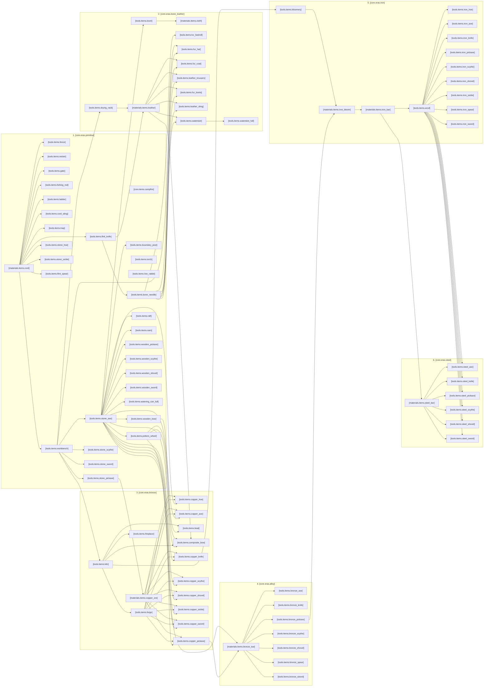

# Граф контента

Создаёт `tools/content_report.gd` из данных всех модов по графу `src/shared/content/content_graph.gd`;
руками не править, CI проверяет, что граф свежий. Правила — раздел 11
[BUNDLE_SYSTEM.md](../specifications/BUNDLE_SYSTEM.md), что нашли проверки — [content-checks.md](content-checks.md),
все записи — [content-index.md](content-index.md).

Граф идёт от старта по правилам рук (`Tools`, тем же, что в игре): мир даёт биомы, клетки, растения, деревья
и кусты; действие над ними инструментом, что уже есть, даёт вещи; рецепты делают из них новые на
поставленных станках; поставленное, посаженное и посеянное даёт своё, пока не перестаёт прибавляться новое.
Глубина — сколько шагов изготовления отделяет вещь от старта: что мир и старт дают голыми руками — 0,
добытое инструментом — глубина самого раннего инструмента, который это может, изделие — на 1 больше
самого глубокого из материалов, станка и инструмента своего рецепта.

## Старт

Новый мир начинается по записи `core:default` «[core.starts.default]».

- Сумка: [empty_n2].
- У точки появления: [core.items.campfire], на 4 клетки к западу и на 4 к югу.
- У точки появления: [tools.items.chest], на 4 клетки к востоку и на 2 к югу.

## Предметы по глубине

| Глубина | Предметы |
|---|---|
| 0 | [core.items.rot], [plants.items.blueberry], [plants.items.cranberry], [plants.items.currant], [plants.items.grass_seeds], [plants.items.carrot_seeds], [plants.items.carrot], [plants.items.mushroom], [plants.items.glow_mushroom], [plants.items.peas], [plants.items.raspberry], [plants.items.rosehip], [plants.items.turnip_seeds], [plants.items.turnip], [resources.items.fiber], [plants.items.moss], [resources.items.peat], [resources.items.salt], [resources.items.snow], [resources.items.dirt], [resources.items.sand], [resources.items.clay], [resources.items.stone], [resources.items.flint], [resources.items.branch], [plants.items.apple], [plants.items.banana], [plants.items.acorn], [plants.items.coconut], [plants.items.rowan], [plants.items.cone], [tools.items.stairs], [tools.items.live_rabbit], [animals.items.small_carcass], [animals.items.carcass], [plants.items.grain], [animals.items.rabbit_fluff], [plants.items.flax_seeds], [plants.items.flax_stalks] |
| 1 | [core.items.campfire], [plants.items.fried_mushrooms], [materials.items.cord], [plants.items.bandage], [materials.items.wattle], [tools.items.fiber_hat], [tools.items.bait], [tools.items.sling_stone], [tools.items.torch], [animals.items.raw_meat], [animals.items.hide], [animals.items.bone], [plants.items.flour], [animals.items.wool_yarn], [plants.items.linen_thread] |
| 2 | [plants.items.poultice], [animals.items.roach], [animals.items.pike], [animals.items.salmon], [animals.items.cod], [animals.items.parrotfish], [animals.items.catfish], [animals.items.perch], [tools.items.fence], [tools.items.wicket], [tools.items.gate], [tools.items.grass_cape], [tools.items.leg_wraps], [tools.items.bast_shoes], [tools.items.fishing_rod], [tools.items.ladder], [tools.items.cord_sling], [tools.items.trap], [tools.items.wicker_bag], [tools.items.workbench], [animals.items.roasted_meat], [tools.items.grass_mat], [tools.items.stone_hoe], [tools.items.flint_knife], [tools.items.stone_sickle], [tools.items.flint_spear] |
| 3 | [materials.items.copper_ore], [resources.items.ice], [resources.items.log], [animals.items.roasted_fish], [tools.items.arrow], [tools.items.drying_rack], [animals.items.fat], [tools.items.kiln], [tools.items.bone_needle], [tools.items.stone_axe], [tools.items.stone_pickaxe], [tools.items.stone_scythe], [tools.items.stone_sword] |
| 4 | [materials.items.brick], [materials.items.charcoal], [materials.items.planks], [materials.items.log_wall], [tools.items.boundary_post], [materials.items.cut_stone], [animals.items.jerky], [materials.items.leather], [tools.items.fur_bedroll], [tools.items.tallow_candle], [tools.items.fur_hat], [plants.items.flatbread], [tools.items.raft] |
| 5 | [plants.items.blueberry_bush], [plants.items.currant_bush], [plants.items.raspberry_bush], [plants.items.rosehip_bush], [plants.items.shrub_bush], [plants.items.banana_bush], [tools.items.big_chest], [tools.items.bloomery], [tools.items.wooden_bow], [tools.items.chest], [tools.items.door], [tools.items.door_2x2], [tools.items.door_2x3], [tools.items.door_3x3], [tools.items.fireplace], [tools.items.forge], [tools.items.hatch], [tools.items.hatch_2x2], [tools.items.fur_coat], [tools.items.leather_trousers], [tools.items.fur_boots], [tools.items.leather_bag], [tools.items.leather_sling], [tools.items.loom], [tools.items.table], [tools.items.stool], [tools.items.cupboard], [tools.items.wide_cupboard], [tools.items.barrel], [tools.items.potters_wheel], [tools.items.oars], [tools.items.wooden_pickaxe], [tools.items.wooden_scythe], [tools.items.wooden_shovel], [tools.items.sign], [tools.items.signpost], [tools.items.notice_board], [tools.items.wooden_sword], [tools.items.watering_can], [tools.items.watering_can_full], [tools.items.waterskin], [tools.items.waterskin_full] |
| 6 | [materials.items.cloth], [materials.items.copper_bar], [materials.items.glass], [tools.items.raw_pot], [materials.items.raw_crucible] |
| 7 | [tools.items.canvas_backpack], [materials.items.tin_ore], [tools.items.copper_hoe], [tools.items.wooden_bed], [tools.items.rug], [tools.items.pot], [materials.items.crucible], [tools.items.copper_axe], [tools.items.copper_knife], [tools.items.copper_pickaxe], [tools.items.copper_scythe], [tools.items.copper_shovel], [tools.items.copper_sickle], [tools.items.copper_sword], [tools.items.window], [tools.items.window_1x2], [tools.items.window_2x1], [tools.items.window_2x2], [tools.items.window_3x2] |
| 8 | [materials.items.tin_bar], [materials.items.bone_glue], [materials.items.tar], [plants.items.roasted_acorns] |
| 9 | [materials.items.bronze_bar], [tools.items.boat], [tools.items.composite_bow], [tools.items.lantern], [tools.items.tar_torch] |
| 10 | [materials.items.iron_ore], [materials.items.gold_ore], [materials.items.platinum_ore], [materials.items.silver_ore], [tools.items.bronze_axe], [tools.items.bronze_knife], [tools.items.bronze_pickaxe], [tools.items.bronze_scythe], [tools.items.bronze_shovel], [tools.items.bronze_spear], [tools.items.bronze_sword] |
| 11 | [materials.items.iron_bloom], [materials.items.gold_bar], [materials.items.platinum_bar], [materials.items.silver_bar] |
| 12 | [materials.items.iron_bar] |
| 13 | [tools.items.anvil], [materials.items.steel_bar] |
| 14 | [materials.items.gold_block], [materials.items.platinum_block], [materials.items.silver_block], [tools.items.iron_hoe], [tools.items.iron_axe], [tools.items.steel_axe], [tools.items.iron_knife], [tools.items.steel_knife], [tools.items.iron_pickaxe], [tools.items.steel_pickaxe], [tools.items.iron_scythe], [tools.items.steel_scythe], [tools.items.iron_shovel], [tools.items.steel_shovel], [tools.items.iron_sickle], [tools.items.iron_spear], [tools.items.iron_sword], [tools.items.steel_sword] |

## Откуда и куда

Откуда — все пути к предмету, первым тот, что даёт ему глубину. Куда — рецепты, которые его тратят,
рецепты на нём как на станке, что им чинят, и для чего он сам.

| Предмет | Глубина | Откуда | Куда |
|---|---|---|---|
| [core.items.campfire] `core:campfire` | 1 | рецепт: [resources.recipes.campfire] | станок рецептов: [plants.recipes.fried_mushrooms], [plants.recipes.poultice], [animals.recipes.roasted_fish_from_roach], [animals.recipes.roasted_fish_from_pike], [animals.recipes.roasted_fish_from_salmon], [animals.recipes.roasted_fish_from_cod], [animals.recipes.roasted_fish_from_parrotfish], [animals.recipes.roasted_fish_from_catfish], [animals.recipes.roasted_fish_from_perch], [animals.recipes.roasted_meat], [materials.recipes.bone_glue], [plants.recipes.roasted_acorns]; горит: тушится и разжигается топливом |
| [core.items.rot] `core:rot` | 0 | особый источник; spoil: [plants.items.blueberry], [plants.items.cranberry], [plants.items.currant], [plants.items.carrot], [plants.items.mushroom], [plants.items.glow_mushroom], [plants.items.fried_mushrooms], [plants.items.raspberry], [plants.items.rosehip], [plants.items.turnip], [animals.items.roach], [animals.items.pike], [animals.items.salmon], [animals.items.cod], [animals.items.parrotfish], [animals.items.catfish], [animals.items.perch], [animals.items.roasted_fish], [plants.items.apple], [plants.items.banana], [plants.items.rowan], [animals.items.raw_meat], [animals.items.roasted_meat] | — |
| [materials.items.brick] `materials:brick` | 4 | рецепт: [tools.recipes.brick]; копать: [materials.materials.brick] | в рецепты: [tools.recipes.bloomery], [tools.recipes.fireplace], [tools.recipes.forge]; [block]: [materials.materials.brick] |
| [materials.items.charcoal] `materials:charcoal` | 4 | рецепт: [tools.recipes.charcoal]; побочно: [materials.recipes.tar] | в рецепты: [tools.recipes.copper_bar], [materials.recipes.glass], [materials.recipes.iron_bloom], [materials.recipes.iron_bar], [materials.recipes.tin_bar], [materials.recipes.gold_bar], [materials.recipes.platinum_bar], [materials.recipes.silver_bar], [materials.recipes.bronze_bar], [materials.recipes.steel_bar]; топливо |
| [materials.items.cloth] `materials:cloth` | 6 | рецепт: [tools.recipes.cloth_from_cord], [animals.recipes.cloth_from_wool_yarn], [plants.recipes.cloth] | в рецепты: [tools.recipes.canvas_backpack], [tools.recipes.wooden_bed], [tools.recipes.rug], [tools.recipes.tar_torch] |
| [materials.items.copper_ore] `materials:copper_ore` | 3 | копать: [materials.materials.copper_ore] | в рецепты: [tools.recipes.copper_bar] |
| [materials.items.copper_bar] `materials:copper_bar` | 6 | рецепт: [tools.recipes.copper_bar] | чинит: [tools.items.copper_hoe], [tools.items.copper_axe], [tools.items.copper_knife], [tools.items.copper_pickaxe], [tools.items.copper_scythe], [tools.items.copper_shovel], [tools.items.copper_sickle], [tools.items.copper_sword]; в рецепты: [tools.recipes.copper_hoe], [materials.recipes.bronze_bar], [tools.recipes.copper_axe], [tools.recipes.copper_knife], [tools.recipes.lantern], [tools.recipes.copper_pickaxe], [tools.recipes.copper_scythe], [tools.recipes.copper_shovel], [tools.recipes.copper_sickle], [tools.recipes.copper_sword] |
| [materials.items.planks] `materials:planks` | 4 | рецепт: [tools.recipes.planks]; копать: [materials.materials.planks] | чинит: [tools.items.wooden_pickaxe], [tools.items.wooden_scythe], [tools.items.wooden_shovel], [tools.items.wooden_sword]; в рецепты: [tools.recipes.big_chest], [tools.recipes.wooden_bow], [tools.recipes.chest], [tools.recipes.door], [tools.recipes.door_2x2], [tools.recipes.door_2x3], [tools.recipes.door_3x3], [tools.recipes.hatch], [tools.recipes.hatch_2x2], [tools.recipes.copper_hoe], [tools.recipes.iron_hoe], [tools.recipes.loom], [tools.recipes.table], [tools.recipes.stool], [tools.recipes.wooden_bed], [tools.recipes.cupboard], [tools.recipes.wide_cupboard], [tools.recipes.barrel], [tools.recipes.potters_wheel], [tools.recipes.copper_axe], [tools.recipes.bronze_axe], [tools.recipes.iron_axe], [tools.recipes.steel_axe], [tools.recipes.boat], [tools.recipes.oars], [tools.recipes.copper_knife], [tools.recipes.bronze_knife], [tools.recipes.iron_knife], [tools.recipes.steel_knife], [tools.recipes.wooden_pickaxe], [tools.recipes.copper_pickaxe], [tools.recipes.bronze_pickaxe], [tools.recipes.iron_pickaxe], [tools.recipes.steel_pickaxe], [tools.recipes.wooden_scythe], [tools.recipes.copper_scythe], [tools.recipes.bronze_scythe], [tools.recipes.iron_scythe], [tools.recipes.steel_scythe], [tools.recipes.wooden_shovel], [tools.recipes.copper_shovel], [tools.recipes.bronze_shovel], [tools.recipes.iron_shovel], [tools.recipes.steel_shovel], [tools.recipes.sign], [tools.recipes.signpost], [tools.recipes.notice_board], [tools.recipes.bronze_spear], [tools.recipes.iron_spear], [tools.recipes.wooden_sword], [tools.recipes.copper_sword], [tools.recipes.bronze_sword], [tools.recipes.iron_sword], [tools.recipes.steel_sword], [tools.recipes.watering_can], [tools.recipes.window], [tools.recipes.window_1x2], [tools.recipes.window_2x1], [tools.recipes.window_2x2], [tools.recipes.window_3x2]; [block]: [materials.materials.planks] |
| [plants.items.blueberry] `plants:blueberry` | 0 | собирать: [plants.bushes.blueberry] | еда |
| [plants.items.blueberry_bush] `plants:blueberry_bush` | 5 | выкопать: [plants.bushes.blueberry] | сажает: [plants.bushes.blueberry] |
| [plants.items.cranberry] `plants:cranberry` | 0 | [mow_n2]: [plants.plants.cranberry] | еда |
| [plants.items.currant] `plants:currant` | 0 | собирать: [plants.bushes.currant] | еда |
| [plants.items.currant_bush] `plants:currant_bush` | 5 | выкопать: [plants.bushes.currant] | сажает: [plants.bushes.currant] |
| [plants.items.grass_seeds] `plants:grass_seeds` | 0 | [mow_n2]: [plants.plants.tuft], [plants.plants.flowers] | засевает: [core.materials.grass] |
| [plants.items.carrot_seeds] `plants:carrot_seeds` | 0 | [mow_n2]: [plants.plants.carrot], [plants.plants.herbs] | растит: [plants.plants.carrot] |
| [plants.items.carrot] `plants:carrot` | 0 | [mow_n2]: [plants.plants.carrot] | feeds_on: [animals.creatures.rabbit]; еда |
| [plants.items.mushroom] `plants:mushroom` | 0 | [mow_n2]: [plants.plants.mushrooms] | в рецепты: [plants.recipes.fried_mushrooms]; еда |
| [plants.items.glow_mushroom] `plants:glow_mushroom` | 0 | [mow_n2]: [plants.plants.glow_mushrooms] | еда |
| [plants.items.fried_mushrooms] `plants:fried_mushrooms` | 1 | рецепт: [plants.recipes.fried_mushrooms] | еда; лечит |
| [plants.items.peas] `plants:peas` | 0 | [mow_n2]: [plants.plants.peas], [plants.plants.flowers] | растит: [plants.plants.peas]; еда |
| [plants.items.raspberry] `plants:raspberry` | 0 | собирать: [plants.bushes.raspberry] | еда |
| [plants.items.raspberry_bush] `plants:raspberry_bush` | 5 | выкопать: [plants.bushes.raspberry] | сажает: [plants.bushes.raspberry] |
| [plants.items.rosehip] `plants:rosehip` | 0 | собирать: [plants.bushes.rosehip] | еда |
| [plants.items.rosehip_bush] `plants:rosehip_bush` | 5 | выкопать: [plants.bushes.rosehip] | сажает: [plants.bushes.rosehip] |
| [plants.items.shrub_bush] `plants:shrub_bush` | 5 | выкопать: [plants.bushes.shrub] | сажает: [plants.bushes.shrub] |
| [plants.items.turnip_seeds] `plants:turnip_seeds` | 0 | [mow_n2]: [plants.plants.turnip], [plants.plants.tall_grass] | растит: [plants.plants.turnip] |
| [plants.items.turnip] `plants:turnip` | 0 | [mow_n2]: [plants.plants.turnip] | feeds_on: [animals.creatures.rabbit]; еда |
| [resources.items.fiber] `resources:fiber` | 0 | копать: [core.materials.grass]; [mow_n2]: [core.materials.grass], [plants.plants.fern], [plants.plants.tall_grass], [plants.plants.herbs], [plants.plants.monstera], [plants.plants.nettle], [plants.plants.reeds] | в рецепты: [materials.recipes.cord], [plants.recipes.bandage], [resources.recipes.campfire], [tools.recipes.fiber_hat], [tools.recipes.grass_cape], [tools.recipes.leg_wraps], [tools.recipes.bast_shoes], [tools.recipes.cord_sling], [tools.recipes.torch], [tools.recipes.wicker_bag], [tools.recipes.arrow], [tools.recipes.grass_mat], [tools.recipes.tallow_candle], [tools.recipes.arrow_from_bone] |
| [materials.items.cord] `materials:cord` | 1 | рецепт: [materials.recipes.cord] | чинит: [tools.items.fishing_rod], [tools.items.cord_sling], [tools.items.wooden_bow], [tools.items.stone_hoe], [tools.items.stone_axe], [tools.items.stone_pickaxe], [tools.items.stone_scythe], [tools.items.stone_sickle], [tools.items.stone_sword]; в рецепты: [tools.recipes.boundary_post], [tools.recipes.fence], [tools.recipes.wicket], [tools.recipes.gate], [tools.recipes.grass_cape], [tools.recipes.leg_wraps], [tools.recipes.bast_shoes], [tools.recipes.fishing_rod], [tools.recipes.ladder], [tools.recipes.cord_sling], [tools.recipes.trap], [tools.recipes.wicker_bag], [tools.recipes.workbench], [tools.recipes.big_chest], [tools.recipes.wooden_bow], [tools.recipes.drying_rack], [tools.recipes.grass_mat], [tools.recipes.fur_bedroll], [tools.recipes.canvas_backpack], [tools.recipes.fur_hat], [tools.recipes.fur_coat], [tools.recipes.leather_trousers], [tools.recipes.fur_boots], [tools.recipes.stone_hoe], [tools.recipes.leather_bag], [tools.recipes.leather_sling], [tools.recipes.loom], [tools.recipes.cloth_from_cord], [tools.recipes.barrel], [tools.recipes.stone_axe], [tools.recipes.raft], [tools.recipes.flint_knife], [tools.recipes.stone_pickaxe], [tools.recipes.stone_scythe], [tools.recipes.wooden_scythe], [tools.recipes.stone_sickle], [tools.recipes.flint_spear], [tools.recipes.wooden_sword], [tools.recipes.stone_sword], [tools.recipes.watering_can], [tools.recipes.waterskin] |
| [plants.items.moss] `plants:moss` | 0 | [mow_n2]: [plants.plants.moss] | в рецепты: [plants.recipes.bandage], [plants.recipes.poultice] |
| [plants.items.bandage] `plants:bandage` | 1 | рецепт: [plants.recipes.bandage] | в рецепты: [plants.recipes.poultice]; лечит |
| [plants.items.poultice] `plants:poultice` | 2 | рецепт: [plants.recipes.poultice] | лечит |
| [resources.items.peat] `resources:peat` | 0 | копать: [resources.materials.peat] | [block]: [resources.materials.peat]; топливо |
| [resources.items.salt] `resources:salt` | 0 | копать: [resources.materials.salt] | [block]: [resources.materials.salt] |
| [resources.items.snow] `resources:snow` | 0 | копать: [resources.materials.snow] | [block]: [resources.materials.snow] |
| [resources.items.ice] `resources:ice` | 3 | копать: [resources.materials.ice] | [block]: [resources.materials.ice] |
| [resources.items.dirt] `resources:dirt` | 0 | копать: [core.materials.grass], [core.materials.dirt], [resources.materials.bed], [resources.materials.bed_wet] | в рецепты: [tools.recipes.bait]; [block]: [core.materials.dirt] |
| [resources.items.sand] `resources:sand` | 0 | копать: [resources.materials.sand] | в рецепты: [materials.recipes.glass], [materials.recipes.raw_crucible]; [block]: [resources.materials.sand] |
| [resources.items.clay] `resources:clay` | 0 | копать: [resources.materials.clay] | в рецепты: [tools.recipes.bloomery], [tools.recipes.fireplace], [tools.recipes.forge], [tools.recipes.kiln], [tools.recipes.brick], [tools.recipes.raw_pot], [materials.recipes.raw_crucible]; [block]: [resources.materials.clay] |
| [resources.items.stone] `resources:stone` | 0 | копать: [resources.materials.scree], [core.materials.stone] | в рецепты: [tools.recipes.sling_stone], [materials.recipes.cut_stone], [tools.recipes.bloomery], [tools.recipes.fireplace], [tools.recipes.forge], [tools.recipes.kiln], [tools.recipes.potters_wheel]; [block]: [core.materials.stone] |
| [resources.items.flint] `resources:flint` | 0 | копать: [core.materials.dirt], [resources.materials.sand], [resources.materials.scree] | чинит: [tools.items.stone_hoe], [tools.items.stone_axe], [tools.items.flint_knife], [tools.items.stone_pickaxe], [tools.items.stone_scythe], [tools.items.stone_sickle], [tools.items.flint_spear], [tools.items.stone_sword]; в рецепты: [tools.recipes.fishing_rod], [tools.recipes.arrow], [tools.recipes.stone_hoe], [tools.recipes.stone_axe], [tools.recipes.flint_knife], [tools.recipes.stone_pickaxe], [tools.recipes.stone_scythe], [tools.recipes.stone_sickle], [tools.recipes.flint_spear], [tools.recipes.stone_sword] |
| [resources.items.branch] `resources:branch` | 0 | собирать: [plants.trees.acacia], [plants.trees.apple], [plants.trees.birch], [plants.trees.bird_cherry], [plants.trees.ceiba], [plants.trees.cherry], [plants.trees.deadwood], [plants.trees.fir], [plants.trees.larch], [plants.trees.linden], [plants.trees.mangrove], [plants.trees.maple], [plants.trees.oak], [plants.trees.palm], [plants.trees.pine], [plants.trees.poplar], [plants.trees.red_maple], [plants.trees.rowan], [plants.trees.spruce], [plants.trees.willow], [plants.bushes.blueberry], [plants.bushes.currant], [plants.bushes.raspberry], [plants.bushes.rosehip], [plants.bushes.shrub], [plants.bushes.banana] | в рецепты: [resources.recipes.campfire], [animals.recipes.roasted_fish_from_roach], [animals.recipes.roasted_fish_from_pike], [animals.recipes.roasted_fish_from_salmon], [animals.recipes.roasted_fish_from_cod], [animals.recipes.roasted_fish_from_parrotfish], [animals.recipes.roasted_fish_from_catfish], [animals.recipes.roasted_fish_from_perch], [materials.recipes.wattle], [tools.recipes.boundary_post], [tools.recipes.fence], [tools.recipes.wicket], [tools.recipes.gate], [tools.recipes.fishing_rod], [tools.recipes.ladder], [tools.recipes.torch], [tools.recipes.trap], [tools.recipes.workbench], [tools.recipes.arrow], [tools.recipes.drying_rack], [animals.recipes.roasted_meat], [tools.recipes.stone_hoe], [tools.recipes.loom], [tools.recipes.potters_wheel], [materials.recipes.bone_glue], [tools.recipes.stone_axe], [tools.recipes.arrow_from_bone], [tools.recipes.flint_knife], [tools.recipes.stone_pickaxe], [tools.recipes.wooden_pickaxe], [tools.recipes.stone_scythe], [tools.recipes.wooden_scythe], [tools.recipes.wooden_shovel], [tools.recipes.stone_sickle], [tools.recipes.copper_sickle], [tools.recipes.iron_sickle], [tools.recipes.sign], [tools.recipes.signpost], [tools.recipes.flint_spear], [tools.recipes.stone_sword], [tools.recipes.tar_torch]; топливо |
| [resources.items.log] `resources:log` | 3 | [chop_n2]: [plants.trees.acacia], [plants.trees.apple], [plants.trees.birch], [plants.trees.bird_cherry], [plants.trees.ceiba], [plants.trees.cherry], [plants.trees.deadwood], [plants.trees.fir], [plants.trees.larch], [plants.trees.linden], [plants.trees.mangrove], [plants.trees.maple], [plants.trees.oak], [plants.trees.palm], [plants.trees.pine], [plants.trees.poplar], [plants.trees.red_maple], [plants.trees.rowan], [plants.trees.spruce], [plants.trees.willow]; копать: [plants.materials.log] | в рецепты: [materials.recipes.log_wall], [tools.recipes.boundary_post], [tools.recipes.anvil], [tools.recipes.charcoal], [materials.recipes.tar], [tools.recipes.planks], [tools.recipes.raft]; [block]: [plants.materials.log]; топливо |
| [animals.items.roach] `animals:roach` | 2 | fish: [animals.creatures.roach] | в рецепты: [animals.recipes.roasted_fish_from_roach]; еда |
| [animals.items.pike] `animals:pike` | 2 | fish: [animals.creatures.pike] | в рецепты: [animals.recipes.roasted_fish_from_pike]; еда |
| [animals.items.salmon] `animals:salmon` | 2 | fish: [animals.creatures.salmon] | в рецепты: [animals.recipes.roasted_fish_from_salmon]; еда |
| [animals.items.cod] `animals:cod` | 2 | fish: [animals.creatures.cod] | в рецепты: [animals.recipes.roasted_fish_from_cod]; еда |
| [animals.items.parrotfish] `animals:parrotfish` | 2 | fish: [animals.creatures.parrotfish] | в рецепты: [animals.recipes.roasted_fish_from_parrotfish]; еда |
| [animals.items.catfish] `animals:catfish` | 2 | fish: [animals.creatures.catfish] | в рецепты: [animals.recipes.roasted_fish_from_catfish]; еда |
| [animals.items.perch] `animals:perch` | 2 | fish: [animals.creatures.perch] | в рецепты: [animals.recipes.roasted_fish_from_perch]; еда |
| [animals.items.roasted_fish] `animals:roasted_fish` | 3 | рецепт: [animals.recipes.roasted_fish_from_roach], [animals.recipes.roasted_fish_from_pike], [animals.recipes.roasted_fish_from_salmon], [animals.recipes.roasted_fish_from_cod], [animals.recipes.roasted_fish_from_parrotfish], [animals.recipes.roasted_fish_from_catfish], [animals.recipes.roasted_fish_from_perch] | еда; лечит |
| [materials.items.log_wall] `materials:log_wall` | 4 | рецепт: [materials.recipes.log_wall]; копать: [materials.materials.log_wall] | [block]: [materials.materials.log_wall] |
| [materials.items.wattle] `materials:wattle` | 1 | рецепт: [materials.recipes.wattle]; копать: [materials.materials.wattle] | [block]: [materials.materials.wattle] |
| [plants.items.apple] `plants:apple` | 0 | собирать: [plants.trees.apple] | еда |
| [plants.items.banana] `plants:banana` | 0 | собирать: [plants.bushes.banana] | еда |
| [plants.items.banana_bush] `plants:banana_bush` | 5 | выкопать: [plants.bushes.banana] | сажает: [plants.bushes.banana] |
| [plants.items.acorn] `plants:acorn` | 0 | [mow_n2]: [plants.plants.oak_sapling]; собирать: [plants.trees.oak] | в рецепты: [plants.recipes.roasted_acorns]; растит: [plants.plants.oak_sapling] |
| [plants.items.coconut] `plants:coconut` | 0 | собирать: [plants.trees.palm] | еда |
| [plants.items.rowan] `plants:rowan` | 0 | собирать: [plants.trees.rowan] | еда |
| [plants.items.cone] `plants:cone` | 0 | [mow_n2]: [plants.plants.spruce_sapling]; собирать: [plants.trees.pine], [plants.trees.spruce] | растит: [plants.plants.spruce_sapling]; топливо |
| [tools.items.boundary_post] `tools:boundary_post` | 4 | рецепт: [tools.recipes.boundary_post] | станок |
| [tools.items.fence] `tools:fence` | 2 | рецепт: [tools.recipes.fence] | станок |
| [tools.items.wicket] `tools:wicket` | 2 | рецепт: [tools.recipes.wicket] | станок |
| [tools.items.gate] `tools:gate` | 2 | рецепт: [tools.recipes.gate] | станок |
| [tools.items.fiber_hat] `tools:fiber_hat` | 1 | рецепт: [tools.recipes.fiber_hat] | — |
| [tools.items.grass_cape] `tools:grass_cape` | 2 | рецепт: [tools.recipes.grass_cape] | — |
| [tools.items.leg_wraps] `tools:leg_wraps` | 2 | рецепт: [tools.recipes.leg_wraps] | — |
| [tools.items.bast_shoes] `tools:bast_shoes` | 2 | рецепт: [tools.recipes.bast_shoes] | — |
| [tools.items.fishing_rod] `tools:fishing_rod` | 2 | рецепт: [tools.recipes.fishing_rod] | инструмент: [tool.rod] |
| [tools.items.bait] `tools:bait` | 1 | рецепт: [tools.recipes.bait] | в рецепты: [tools.items.fishing_rod] |
| [tools.items.ladder] `tools:ladder` | 2 | рецепт: [tools.recipes.ladder] | станок |
| [tools.items.cord_sling] `tools:cord_sling` | 2 | рецепт: [tools.recipes.cord_sling] | инструмент: [tool.sling] |
| [tools.items.sling_stone] `tools:sling_stone` | 1 | рецепт: [tools.recipes.sling_stone] | в рецепты: [tools.items.cord_sling], [tools.items.leather_sling] |
| [tools.items.stairs] `tools:stairs` | 0 | особый источник | станок |
| [tools.items.torch] `tools:torch` | 1 | рецепт: [tools.recipes.torch] | свет |
| [tools.items.trap] `tools:trap` | 2 | рецепт: [tools.recipes.trap] | хранит вещи: 2 мест |
| [tools.items.live_rabbit] `tools:live_rabbit` | 0 | trap: [animals.creatures.rabbit] | — |
| [tools.items.wicker_bag] `tools:wicker_bag` | 2 | рецепт: [tools.recipes.wicker_bag] | — |
| [tools.items.workbench] `tools:workbench` | 2 | рецепт: [tools.recipes.workbench] | станок рецептов: [materials.recipes.cut_stone], [tools.recipes.big_chest], [tools.recipes.bloomery], [tools.recipes.wooden_bow], [tools.recipes.arrow], [tools.recipes.chest], [tools.recipes.door], [tools.recipes.door_2x2], [tools.recipes.door_2x3], [tools.recipes.door_3x3], [tools.recipes.drying_rack], [tools.recipes.fireplace], [tools.recipes.forge], [tools.recipes.anvil], [tools.recipes.hatch], [tools.recipes.hatch_2x2], [tools.recipes.fur_hat], [tools.recipes.fur_coat], [tools.recipes.leather_trousers], [tools.recipes.fur_boots], [tools.recipes.copper_hoe], [tools.recipes.kiln], [tools.recipes.loom], [tools.recipes.table], [tools.recipes.stool], [tools.recipes.wooden_bed], [tools.recipes.cupboard], [tools.recipes.wide_cupboard], [tools.recipes.barrel], [tools.recipes.potters_wheel], [tools.recipes.stone_axe], [tools.recipes.planks], [tools.recipes.copper_axe], [tools.recipes.bronze_axe], [tools.recipes.boat], [tools.recipes.oars], [tools.recipes.composite_bow], [tools.recipes.arrow_from_bone], [tools.recipes.copper_knife], [tools.recipes.bronze_knife], [tools.recipes.lantern], [tools.recipes.stone_pickaxe], [tools.recipes.wooden_pickaxe], [tools.recipes.copper_pickaxe], [tools.recipes.bronze_pickaxe], [tools.recipes.stone_scythe], [tools.recipes.wooden_scythe], [tools.recipes.copper_scythe], [tools.recipes.bronze_scythe], [tools.recipes.wooden_shovel], [tools.recipes.copper_shovel], [tools.recipes.bronze_shovel], [tools.recipes.copper_sickle], [tools.recipes.notice_board], [tools.recipes.bronze_spear], [tools.recipes.wooden_sword], [tools.recipes.stone_sword], [tools.recipes.copper_sword], [tools.recipes.bronze_sword], [tools.recipes.watering_can], [tools.recipes.window], [tools.recipes.window_1x2], [tools.recipes.window_2x1], [tools.recipes.window_2x2], [tools.recipes.window_3x2]; здесь чинят инструменты |
| [materials.items.cut_stone] `materials:cut_stone` | 4 | рецепт: [materials.recipes.cut_stone]; копать: [materials.materials.cut_stone] | [block]: [materials.materials.cut_stone] |
| [tools.items.big_chest] `tools:big_chest` | 5 | рецепт: [tools.recipes.big_chest] | хранит вещи: 40 мест |
| [tools.items.bloomery] `tools:bloomery` | 5 | рецепт: [tools.recipes.bloomery] | станок рецептов: [materials.recipes.iron_bloom], [materials.recipes.steel_bar] |
| [tools.items.wooden_bow] `tools:wooden_bow` | 5 | рецепт: [tools.recipes.wooden_bow] | в рецепты: [tools.recipes.composite_bow]; инструмент: [tool.bow] |
| [tools.items.arrow] `tools:arrow` | 3 | рецепт: [tools.recipes.arrow], [tools.recipes.arrow_from_bone] | в рецепты: [tools.items.wooden_bow], [tools.items.composite_bow] |
| [tools.items.chest] `tools:chest` | 5 | рецепт: [tools.recipes.chest] | хранит вещи: 16 мест |
| [tools.items.door] `tools:door` | 5 | рецепт: [tools.recipes.door] | станок |
| [tools.items.door_2x2] `tools:door_2x2` | 5 | рецепт: [tools.recipes.door_2x2] | станок |
| [tools.items.door_2x3] `tools:door_2x3` | 5 | рецепт: [tools.recipes.door_2x3] | станок |
| [tools.items.door_3x3] `tools:door_3x3` | 5 | рецепт: [tools.recipes.door_3x3] | станок |
| [tools.items.drying_rack] `tools:drying_rack` | 3 | рецепт: [tools.recipes.drying_rack] | станок рецептов: [animals.recipes.jerky], [materials.recipes.leather] |
| [animals.items.small_carcass] `animals:small_carcass` | 0 | hunt: [animals.creatures.cat], [animals.creatures.crow], [animals.creatures.duck], [animals.creatures.fox], [animals.creatures.hedgehog], [animals.creatures.owl], [animals.creatures.rabbit], [animals.creatures.squirrel] | в рецепты: [animals.recipes.raw_meat_from_small_carcass] |
| [animals.items.carcass] `animals:carcass` | 0 | hunt: [animals.creatures.bear], [animals.creatures.boar], [animals.creatures.deer], [animals.creatures.wolf] | в рецепты: [animals.recipes.raw_meat_from_carcass] |
| [animals.items.raw_meat] `animals:raw_meat` | 1 | рецепт: [animals.recipes.raw_meat_from_small_carcass], [animals.recipes.raw_meat_from_carcass] | в рецепты: [animals.recipes.roasted_meat], [animals.recipes.jerky]; еда |
| [animals.items.roasted_meat] `animals:roasted_meat` | 2 | рецепт: [animals.recipes.roasted_meat] | еда; лечит |
| [animals.items.hide] `animals:hide` | 1 | побочно: [animals.recipes.raw_meat_from_small_carcass], [animals.recipes.raw_meat_from_carcass] | в рецепты: [materials.recipes.leather], [tools.recipes.fur_bedroll], [tools.recipes.fur_hat], [tools.recipes.fur_coat], [tools.recipes.fur_boots] |
| [animals.items.bone] `animals:bone` | 1 | побочно: [animals.recipes.raw_meat_from_small_carcass], [animals.recipes.raw_meat_from_carcass] | в рецепты: [tools.recipes.bone_needle], [materials.recipes.bone_glue], [tools.recipes.composite_bow], [tools.recipes.arrow_from_bone] |
| [animals.items.fat] `animals:fat` | 3 | побочно: [animals.recipes.raw_meat_from_carcass] | в рецепты: [materials.recipes.leather], [tools.recipes.tallow_candle] |
| [animals.items.jerky] `animals:jerky` | 4 | рецепт: [animals.recipes.jerky] | еда; лечит |
| [materials.items.leather] `materials:leather` | 4 | рецепт: [materials.recipes.leather] | чинит: [tools.items.leather_sling]; в рецепты: [tools.recipes.canvas_backpack], [tools.recipes.fur_coat], [tools.recipes.leather_trousers], [tools.recipes.fur_boots], [tools.recipes.leather_bag], [tools.recipes.leather_sling], [tools.recipes.composite_bow], [tools.recipes.waterskin] |
| [tools.items.grass_mat] `tools:grass_mat` | 2 | рецепт: [tools.recipes.grass_mat] | станок |
| [tools.items.fur_bedroll] `tools:fur_bedroll` | 4 | рецепт: [tools.recipes.fur_bedroll] | станок |
| [tools.items.tallow_candle] `tools:tallow_candle` | 4 | рецепт: [tools.recipes.tallow_candle] | свет |
| [tools.items.canvas_backpack] `tools:canvas_backpack` | 7 | рецепт: [tools.recipes.canvas_backpack] | — |
| [tools.items.fireplace] `tools:fireplace` | 5 | рецепт: [tools.recipes.fireplace] | станок; горит: тушится и разжигается топливом; заменяет: [core.items.campfire] |
| [tools.items.forge] `tools:forge` | 5 | рецепт: [tools.recipes.forge] | станок рецептов: [tools.recipes.copper_bar], [materials.recipes.glass], [materials.recipes.iron_bar], [materials.recipes.tin_bar], [materials.recipes.gold_bar], [materials.recipes.platinum_bar], [materials.recipes.silver_bar], [materials.recipes.bronze_bar] |
| [materials.items.glass] `materials:glass` | 6 | рецепт: [materials.recipes.glass] | в рецепты: [tools.recipes.lantern], [tools.recipes.window], [tools.recipes.window_1x2], [tools.recipes.window_2x1], [tools.recipes.window_2x2], [tools.recipes.window_3x2] |
| [materials.items.iron_ore] `materials:iron_ore` | 10 | копать: [materials.materials.iron_ore] | в рецепты: [materials.recipes.iron_bloom] |
| [materials.items.iron_bloom] `materials:iron_bloom` | 11 | рецепт: [materials.recipes.iron_bloom] | в рецепты: [materials.recipes.iron_bar] |
| [materials.items.iron_bar] `materials:iron_bar` | 12 | рецепт: [materials.recipes.iron_bar] | чинит: [tools.items.iron_hoe], [tools.items.iron_axe], [tools.items.iron_knife], [tools.items.iron_pickaxe], [tools.items.iron_scythe], [tools.items.iron_shovel], [tools.items.iron_sickle], [tools.items.iron_spear], [tools.items.iron_sword]; в рецепты: [tools.recipes.anvil], [tools.recipes.iron_hoe], [materials.recipes.steel_bar], [tools.recipes.iron_axe], [tools.recipes.iron_knife], [tools.recipes.iron_pickaxe], [tools.recipes.iron_scythe], [tools.recipes.iron_shovel], [tools.recipes.iron_sickle], [tools.recipes.iron_spear], [tools.recipes.iron_sword] |
| [materials.items.tin_ore] `materials:tin_ore` | 7 | копать: [materials.materials.tin_ore] | в рецепты: [materials.recipes.tin_bar] |
| [materials.items.tin_bar] `materials:tin_bar` | 8 | рецепт: [materials.recipes.tin_bar] | в рецепты: [materials.recipes.bronze_bar] |
| [tools.items.anvil] `tools:anvil` | 13 | рецепт: [tools.recipes.anvil] | станок рецептов: [materials.recipes.gold_block], [materials.recipes.platinum_block], [materials.recipes.silver_block], [tools.recipes.iron_hoe], [tools.recipes.iron_axe], [tools.recipes.steel_axe], [tools.recipes.iron_knife], [tools.recipes.steel_knife], [tools.recipes.iron_pickaxe], [tools.recipes.steel_pickaxe], [tools.recipes.iron_scythe], [tools.recipes.steel_scythe], [tools.recipes.iron_shovel], [tools.recipes.steel_shovel], [tools.recipes.iron_sickle], [tools.recipes.iron_spear], [tools.recipes.iron_sword], [tools.recipes.steel_sword] |
| [materials.items.gold_ore] `materials:gold_ore` | 10 | копать: [materials.materials.gold_ore] | в рецепты: [materials.recipes.gold_bar] |
| [materials.items.gold_bar] `materials:gold_bar` | 11 | рецепт: [materials.recipes.gold_bar] | в рецепты: [materials.recipes.gold_block] |
| [materials.items.gold_block] `materials:gold_block` | 14 | рецепт: [materials.recipes.gold_block]; копать: [materials.materials.gold_block] | [block]: [materials.materials.gold_block] |
| [materials.items.platinum_ore] `materials:platinum_ore` | 10 | копать: [materials.materials.platinum_ore] | в рецепты: [materials.recipes.platinum_bar] |
| [materials.items.platinum_bar] `materials:platinum_bar` | 11 | рецепт: [materials.recipes.platinum_bar] | в рецепты: [materials.recipes.platinum_block] |
| [materials.items.platinum_block] `materials:platinum_block` | 14 | рецепт: [materials.recipes.platinum_block]; копать: [materials.materials.platinum_block] | [block]: [materials.materials.platinum_block] |
| [materials.items.silver_ore] `materials:silver_ore` | 10 | копать: [materials.materials.silver_ore] | в рецепты: [materials.recipes.silver_bar] |
| [materials.items.silver_bar] `materials:silver_bar` | 11 | рецепт: [materials.recipes.silver_bar] | в рецепты: [materials.recipes.silver_block] |
| [materials.items.silver_block] `materials:silver_block` | 14 | рецепт: [materials.recipes.silver_block]; копать: [materials.materials.silver_block] | [block]: [materials.materials.silver_block] |
| [tools.items.hatch] `tools:hatch` | 5 | рецепт: [tools.recipes.hatch] | станок |
| [tools.items.hatch_2x2] `tools:hatch_2x2` | 5 | рецепт: [tools.recipes.hatch_2x2] | станок |
| [tools.items.fur_hat] `tools:fur_hat` | 4 | рецепт: [tools.recipes.fur_hat] | — |
| [tools.items.fur_coat] `tools:fur_coat` | 5 | рецепт: [tools.recipes.fur_coat] | — |
| [tools.items.leather_trousers] `tools:leather_trousers` | 5 | рецепт: [tools.recipes.leather_trousers] | — |
| [tools.items.fur_boots] `tools:fur_boots` | 5 | рецепт: [tools.recipes.fur_boots] | — |
| [tools.items.stone_hoe] `tools:stone_hoe` | 2 | рецепт: [tools.recipes.stone_hoe] | инструмент: [tool.hoe] |
| [tools.items.copper_hoe] `tools:copper_hoe` | 7 | рецепт: [tools.recipes.copper_hoe] | инструмент: [tool.hoe] |
| [tools.items.iron_hoe] `tools:iron_hoe` | 14 | рецепт: [tools.recipes.iron_hoe] | инструмент: [tool.hoe] |
| [tools.items.kiln] `tools:kiln` | 3 | рецепт: [tools.recipes.kiln] | станок рецептов: [tools.recipes.brick], [tools.recipes.charcoal], [plants.recipes.flatbread], [tools.recipes.pot], [materials.recipes.crucible], [materials.recipes.tar] |
| [plants.items.grain] `plants:grain` | 0 | [mow_n2]: [plants.plants.ears], [plants.plants.wheat] | в рецепты: [plants.recipes.flour]; растит: [plants.plants.wheat] |
| [plants.items.flour] `plants:flour` | 1 | рецепт: [plants.recipes.flour] | в рецепты: [plants.recipes.flatbread] |
| [plants.items.flatbread] `plants:flatbread` | 4 | рецепт: [plants.recipes.flatbread] | еда; лечит |
| [tools.items.leather_bag] `tools:leather_bag` | 5 | рецепт: [tools.recipes.leather_bag] | — |
| [tools.items.leather_sling] `tools:leather_sling` | 5 | рецепт: [tools.recipes.leather_sling] | инструмент: [tool.sling] |
| [tools.items.loom] `tools:loom` | 5 | рецепт: [tools.recipes.loom] | станок рецептов: [tools.recipes.cloth_from_cord], [animals.recipes.cloth_from_wool_yarn], [plants.recipes.cloth], [tools.recipes.rug] |
| [animals.items.rabbit_fluff] `animals:rabbit_fluff` | 0 | shear: [animals.creatures.rabbit] | в рецепты: [animals.recipes.wool_yarn] |
| [animals.items.wool_yarn] `animals:wool_yarn` | 1 | рецепт: [animals.recipes.wool_yarn] | в рецепты: [animals.recipes.cloth_from_wool_yarn] |
| [plants.items.flax_seeds] `plants:flax_seeds` | 0 | [mow_n2]: [plants.plants.sown_flax], [plants.plants.flax] | растит: [plants.plants.sown_flax] |
| [plants.items.flax_stalks] `plants:flax_stalks` | 0 | [mow_n2]: [plants.plants.flax], [plants.plants.sown_flax] | в рецепты: [plants.recipes.linen_thread] |
| [plants.items.linen_thread] `plants:linen_thread` | 1 | рецепт: [plants.recipes.linen_thread] | в рецепты: [plants.recipes.cloth] |
| [tools.items.table] `tools:table` | 5 | рецепт: [tools.recipes.table] | станок |
| [tools.items.stool] `tools:stool` | 5 | рецепт: [tools.recipes.stool] | станок |
| [tools.items.wooden_bed] `tools:wooden_bed` | 7 | рецепт: [tools.recipes.wooden_bed] | станок |
| [tools.items.cupboard] `tools:cupboard` | 5 | рецепт: [tools.recipes.cupboard] | хранит вещи: 24 мест |
| [tools.items.wide_cupboard] `tools:wide_cupboard` | 5 | рецепт: [tools.recipes.wide_cupboard] | хранит вещи: 48 мест |
| [tools.items.barrel] `tools:barrel` | 5 | рецепт: [tools.recipes.barrel] | хранит вещи: 8 мест |
| [tools.items.rug] `tools:rug` | 7 | рецепт: [tools.recipes.rug] | станок |
| [tools.items.bone_needle] `tools:bone_needle` | 3 | рецепт: [tools.recipes.bone_needle] | инструмент: [tool.needle] |
| [tools.items.potters_wheel] `tools:potters_wheel` | 5 | рецепт: [tools.recipes.potters_wheel] | станок рецептов: [tools.recipes.raw_pot], [materials.recipes.raw_crucible] |
| [tools.items.raw_pot] `tools:raw_pot` | 6 | рецепт: [tools.recipes.raw_pot] | в рецепты: [tools.recipes.pot] |
| [tools.items.pot] `tools:pot` | 7 | рецепт: [tools.recipes.pot] | нужен в сумке рецептам: [materials.recipes.bone_glue], [materials.recipes.tar], [plants.recipes.roasted_acorns] |
| [materials.items.bone_glue] `materials:bone_glue` | 8 | рецепт: [materials.recipes.bone_glue] | чинит: [tools.items.composite_bow]; в рецепты: [tools.recipes.composite_bow] |
| [materials.items.raw_crucible] `materials:raw_crucible` | 6 | рецепт: [materials.recipes.raw_crucible] | в рецепты: [materials.recipes.crucible] |
| [materials.items.crucible] `materials:crucible` | 7 | рецепт: [materials.recipes.crucible] | нужен в сумке рецептам: [materials.recipes.bronze_bar], [materials.recipes.steel_bar] |
| [materials.items.bronze_bar] `materials:bronze_bar` | 9 | рецепт: [materials.recipes.bronze_bar] | чинит: [tools.items.bronze_axe], [tools.items.bronze_knife], [tools.items.bronze_pickaxe], [tools.items.bronze_scythe], [tools.items.bronze_shovel], [tools.items.bronze_spear], [tools.items.bronze_sword]; в рецепты: [tools.recipes.bronze_axe], [tools.recipes.bronze_knife], [tools.recipes.bronze_pickaxe], [tools.recipes.bronze_scythe], [tools.recipes.bronze_shovel], [tools.recipes.bronze_spear], [tools.recipes.bronze_sword] |
| [materials.items.steel_bar] `materials:steel_bar` | 13 | рецепт: [materials.recipes.steel_bar] | чинит: [tools.items.steel_axe], [tools.items.steel_knife], [tools.items.steel_pickaxe], [tools.items.steel_scythe], [tools.items.steel_shovel], [tools.items.steel_sword]; в рецепты: [tools.recipes.steel_axe], [tools.recipes.steel_knife], [tools.recipes.steel_pickaxe], [tools.recipes.steel_scythe], [tools.recipes.steel_shovel], [tools.recipes.steel_sword] |
| [materials.items.tar] `materials:tar` | 8 | рецепт: [materials.recipes.tar] | в рецепты: [tools.recipes.boat], [tools.recipes.lantern], [tools.recipes.tar_torch]; топливо |
| [plants.items.roasted_acorns] `plants:roasted_acorns` | 8 | рецепт: [plants.recipes.roasted_acorns] | еда; лечит |
| [tools.items.stone_axe] `tools:stone_axe` | 3 | рецепт: [tools.recipes.stone_axe] | инструмент: [tool.axe] |
| [tools.items.copper_axe] `tools:copper_axe` | 7 | рецепт: [tools.recipes.copper_axe] | инструмент: [tool.axe] |
| [tools.items.bronze_axe] `tools:bronze_axe` | 10 | рецепт: [tools.recipes.bronze_axe] | инструмент: [tool.axe] |
| [tools.items.iron_axe] `tools:iron_axe` | 14 | рецепт: [tools.recipes.iron_axe] | инструмент: [tool.axe] |
| [tools.items.steel_axe] `tools:steel_axe` | 14 | рецепт: [tools.recipes.steel_axe] | инструмент: [tool.axe] |
| [tools.items.raft] `tools:raft` | 4 | рецепт: [tools.recipes.raft] | — |
| [tools.items.boat] `tools:boat` | 9 | рецепт: [tools.recipes.boat] | — |
| [tools.items.oars] `tools:oars` | 5 | рецепт: [tools.recipes.oars] | нужен в сумке рецептам: [tools.items.boat] |
| [tools.items.composite_bow] `tools:composite_bow` | 9 | рецепт: [tools.recipes.composite_bow] | инструмент: [tool.bow] |
| [tools.items.flint_knife] `tools:flint_knife` | 2 | рецепт: [tools.recipes.flint_knife] | инструмент: [tool.knife] |
| [tools.items.copper_knife] `tools:copper_knife` | 7 | рецепт: [tools.recipes.copper_knife] | инструмент: [tool.knife] |
| [tools.items.bronze_knife] `tools:bronze_knife` | 10 | рецепт: [tools.recipes.bronze_knife] | инструмент: [tool.knife] |
| [tools.items.iron_knife] `tools:iron_knife` | 14 | рецепт: [tools.recipes.iron_knife] | инструмент: [tool.knife] |
| [tools.items.steel_knife] `tools:steel_knife` | 14 | рецепт: [tools.recipes.steel_knife] | инструмент: [tool.knife] |
| [tools.items.lantern] `tools:lantern` | 9 | рецепт: [tools.recipes.lantern] | свет |
| [tools.items.stone_pickaxe] `tools:stone_pickaxe` | 3 | рецепт: [tools.recipes.stone_pickaxe] | инструмент: [tool.pickaxe] |
| [tools.items.wooden_pickaxe] `tools:wooden_pickaxe` | 5 | рецепт: [tools.recipes.wooden_pickaxe] | инструмент: [tool.pickaxe] |
| [tools.items.copper_pickaxe] `tools:copper_pickaxe` | 7 | рецепт: [tools.recipes.copper_pickaxe] | инструмент: [tool.pickaxe] |
| [tools.items.bronze_pickaxe] `tools:bronze_pickaxe` | 10 | рецепт: [tools.recipes.bronze_pickaxe] | инструмент: [tool.pickaxe] |
| [tools.items.iron_pickaxe] `tools:iron_pickaxe` | 14 | рецепт: [tools.recipes.iron_pickaxe] | инструмент: [tool.pickaxe] |
| [tools.items.steel_pickaxe] `tools:steel_pickaxe` | 14 | рецепт: [tools.recipes.steel_pickaxe] | инструмент: [tool.pickaxe] |
| [tools.items.stone_scythe] `tools:stone_scythe` | 3 | рецепт: [tools.recipes.stone_scythe] | инструмент: [tool.scythe] |
| [tools.items.wooden_scythe] `tools:wooden_scythe` | 5 | рецепт: [tools.recipes.wooden_scythe] | инструмент: [tool.scythe] |
| [tools.items.copper_scythe] `tools:copper_scythe` | 7 | рецепт: [tools.recipes.copper_scythe] | инструмент: [tool.scythe] |
| [tools.items.bronze_scythe] `tools:bronze_scythe` | 10 | рецепт: [tools.recipes.bronze_scythe] | инструмент: [tool.scythe] |
| [tools.items.iron_scythe] `tools:iron_scythe` | 14 | рецепт: [tools.recipes.iron_scythe] | инструмент: [tool.scythe] |
| [tools.items.steel_scythe] `tools:steel_scythe` | 14 | рецепт: [tools.recipes.steel_scythe] | инструмент: [tool.scythe] |
| [tools.items.wooden_shovel] `tools:wooden_shovel` | 5 | рецепт: [tools.recipes.wooden_shovel] | инструмент: [tool.shovel] |
| [tools.items.copper_shovel] `tools:copper_shovel` | 7 | рецепт: [tools.recipes.copper_shovel] | инструмент: [tool.shovel] |
| [tools.items.bronze_shovel] `tools:bronze_shovel` | 10 | рецепт: [tools.recipes.bronze_shovel] | инструмент: [tool.shovel] |
| [tools.items.iron_shovel] `tools:iron_shovel` | 14 | рецепт: [tools.recipes.iron_shovel] | инструмент: [tool.shovel] |
| [tools.items.steel_shovel] `tools:steel_shovel` | 14 | рецепт: [tools.recipes.steel_shovel] | инструмент: [tool.shovel] |
| [tools.items.stone_sickle] `tools:stone_sickle` | 2 | рецепт: [tools.recipes.stone_sickle] | инструмент: [tool.sickle] |
| [tools.items.copper_sickle] `tools:copper_sickle` | 7 | рецепт: [tools.recipes.copper_sickle] | инструмент: [tool.sickle] |
| [tools.items.iron_sickle] `tools:iron_sickle` | 14 | рецепт: [tools.recipes.iron_sickle] | инструмент: [tool.sickle] |
| [tools.items.sign] `tools:sign` | 5 | рецепт: [tools.recipes.sign] | станок |
| [tools.items.signpost] `tools:signpost` | 5 | рецепт: [tools.recipes.signpost] | станок |
| [tools.items.notice_board] `tools:notice_board` | 5 | рецепт: [tools.recipes.notice_board] | станок |
| [tools.items.flint_spear] `tools:flint_spear` | 2 | рецепт: [tools.recipes.flint_spear] | инструмент: [tool.spear] |
| [tools.items.bronze_spear] `tools:bronze_spear` | 10 | рецепт: [tools.recipes.bronze_spear] | инструмент: [tool.spear] |
| [tools.items.iron_spear] `tools:iron_spear` | 14 | рецепт: [tools.recipes.iron_spear] | инструмент: [tool.spear] |
| [tools.items.wooden_sword] `tools:wooden_sword` | 5 | рецепт: [tools.recipes.wooden_sword] | инструмент: [tool.sword] |
| [tools.items.stone_sword] `tools:stone_sword` | 3 | рецепт: [tools.recipes.stone_sword] | инструмент: [tool.sword] |
| [tools.items.copper_sword] `tools:copper_sword` | 7 | рецепт: [tools.recipes.copper_sword] | инструмент: [tool.sword] |
| [tools.items.bronze_sword] `tools:bronze_sword` | 10 | рецепт: [tools.recipes.bronze_sword] | инструмент: [tool.sword] |
| [tools.items.iron_sword] `tools:iron_sword` | 14 | рецепт: [tools.recipes.iron_sword] | инструмент: [tool.sword] |
| [tools.items.steel_sword] `tools:steel_sword` | 14 | рецепт: [tools.recipes.steel_sword] | инструмент: [tool.sword] |
| [tools.items.tar_torch] `tools:tar_torch` | 9 | рецепт: [tools.recipes.tar_torch] | свет |
| [tools.items.watering_can] `tools:watering_can` | 5 | рецепт: [tools.recipes.watering_can]; empty: [tools.items.watering_can_full] | — |
| [tools.items.watering_can_full] `tools:watering_can_full` | 5 | fill: [tools.items.watering_can] | инструмент: [tool.can] |
| [tools.items.waterskin] `tools:waterskin` | 5 | рецепт: [tools.recipes.waterskin]; empty: [tools.items.waterskin_full] | — |
| [tools.items.waterskin_full] `tools:waterskin_full` | 5 | fill: [tools.items.waterskin] | — |
| [tools.items.window] `tools:window` | 7 | рецепт: [tools.recipes.window] | станок |
| [tools.items.window_1x2] `tools:window_1x2` | 7 | рецепт: [tools.recipes.window_1x2] | станок |
| [tools.items.window_2x1] `tools:window_2x1` | 7 | рецепт: [tools.recipes.window_2x1] | станок |
| [tools.items.window_2x2] `tools:window_2x2` | 7 | рецепт: [tools.recipes.window_2x2] | станок |
| [tools.items.window_3x2] `tools:window_3x2` | 7 | рецепт: [tools.recipes.window_3x2] | станок |

## Общие ресурсы

Предметы, которые тратят два рецепта и больше. На нём держится — всё, что делается из него прямо или
дальше по цепочкам (по путям, которые дают глубину), через станки и инструменты тоже.

| Ресурс | Тратят рецепты | На нём держится |
|---|---|---|
| [materials.items.brick] `materials:brick` | [tools.recipes.bloomery], [tools.recipes.fireplace], [tools.recipes.forge] | [tools.items.bloomery], [tools.items.fireplace], [tools.items.forge], [materials.items.iron_bloom], [materials.items.steel_bar], [materials.items.copper_bar], [materials.items.glass], [materials.items.tin_bar], [materials.items.bronze_bar], [materials.items.gold_bar], [materials.items.platinum_bar], [materials.items.silver_bar], [materials.items.iron_bar], [tools.items.steel_axe], [tools.items.steel_knife], [tools.items.steel_pickaxe], [tools.items.steel_scythe], [tools.items.steel_shovel], [tools.items.steel_sword], [tools.items.copper_hoe], [tools.items.copper_axe], [tools.items.copper_knife], [tools.items.copper_pickaxe], [tools.items.copper_scythe], [tools.items.copper_shovel], [tools.items.copper_sickle], [tools.items.copper_sword], [tools.items.lantern], [tools.items.window], [tools.items.window_1x2], [tools.items.window_2x1], [tools.items.window_2x2], [tools.items.window_3x2], [tools.items.bronze_axe], [tools.items.bronze_knife], [tools.items.bronze_pickaxe], [tools.items.bronze_scythe], [tools.items.bronze_shovel], [tools.items.bronze_spear], [tools.items.bronze_sword], [materials.items.gold_block], [materials.items.platinum_block], [materials.items.silver_block], [tools.items.anvil], [tools.items.iron_hoe], [tools.items.iron_axe], [tools.items.iron_knife], [tools.items.iron_pickaxe], [tools.items.iron_scythe], [tools.items.iron_shovel], [tools.items.iron_sickle], [tools.items.iron_spear], [tools.items.iron_sword], [materials.items.tin_ore], [materials.items.iron_ore], [materials.items.gold_ore], [materials.items.platinum_ore], [materials.items.silver_ore] |
| [materials.items.charcoal] `materials:charcoal` | [tools.recipes.copper_bar], [materials.recipes.glass], [materials.recipes.iron_bloom], [materials.recipes.iron_bar], [materials.recipes.tin_bar], [materials.recipes.gold_bar], [materials.recipes.platinum_bar], [materials.recipes.silver_bar], [materials.recipes.bronze_bar], [materials.recipes.steel_bar] | [materials.items.copper_bar], [materials.items.glass], [materials.items.tin_bar], [materials.items.bronze_bar], [materials.items.iron_bloom], [materials.items.gold_bar], [materials.items.platinum_bar], [materials.items.silver_bar], [materials.items.iron_bar], [materials.items.steel_bar], [tools.items.copper_hoe], [tools.items.copper_axe], [tools.items.copper_knife], [tools.items.copper_pickaxe], [tools.items.copper_scythe], [tools.items.copper_shovel], [tools.items.copper_sickle], [tools.items.copper_sword], [tools.items.lantern], [tools.items.window], [tools.items.window_1x2], [tools.items.window_2x1], [tools.items.window_2x2], [tools.items.window_3x2], [tools.items.bronze_axe], [tools.items.bronze_knife], [tools.items.bronze_pickaxe], [tools.items.bronze_scythe], [tools.items.bronze_shovel], [tools.items.bronze_spear], [tools.items.bronze_sword], [materials.items.gold_block], [materials.items.platinum_block], [materials.items.silver_block], [tools.items.anvil], [tools.items.iron_hoe], [tools.items.iron_axe], [tools.items.iron_knife], [tools.items.iron_pickaxe], [tools.items.iron_scythe], [tools.items.iron_shovel], [tools.items.iron_sickle], [tools.items.iron_spear], [tools.items.iron_sword], [tools.items.steel_axe], [tools.items.steel_knife], [tools.items.steel_pickaxe], [tools.items.steel_scythe], [tools.items.steel_shovel], [tools.items.steel_sword], [materials.items.tin_ore], [materials.items.iron_ore], [materials.items.gold_ore], [materials.items.platinum_ore], [materials.items.silver_ore] |
| [materials.items.cloth] `materials:cloth` | [tools.recipes.canvas_backpack], [tools.recipes.wooden_bed], [tools.recipes.rug], [tools.recipes.tar_torch] | [tools.items.canvas_backpack], [tools.items.wooden_bed], [tools.items.rug], [tools.items.tar_torch] |
| [materials.items.copper_bar] `materials:copper_bar` | [tools.recipes.copper_hoe], [materials.recipes.bronze_bar], [tools.recipes.copper_axe], [tools.recipes.copper_knife], [tools.recipes.lantern], [tools.recipes.copper_pickaxe], [tools.recipes.copper_scythe], [tools.recipes.copper_shovel], [tools.recipes.copper_sickle], [tools.recipes.copper_sword] | [tools.items.copper_hoe], [tools.items.copper_axe], [tools.items.copper_knife], [tools.items.copper_pickaxe], [tools.items.copper_scythe], [tools.items.copper_shovel], [tools.items.copper_sickle], [tools.items.copper_sword], [materials.items.bronze_bar], [tools.items.lantern], [materials.items.tin_ore], [tools.items.bronze_axe], [tools.items.bronze_knife], [tools.items.bronze_pickaxe], [tools.items.bronze_scythe], [tools.items.bronze_shovel], [tools.items.bronze_spear], [tools.items.bronze_sword], [materials.items.tin_bar], [materials.items.iron_ore], [materials.items.gold_ore], [materials.items.platinum_ore], [materials.items.silver_ore], [materials.items.iron_bloom], [materials.items.gold_bar], [materials.items.platinum_bar], [materials.items.silver_bar], [materials.items.iron_bar], [materials.items.gold_block], [materials.items.platinum_block], [materials.items.silver_block], [tools.items.anvil], [materials.items.steel_bar], [tools.items.iron_hoe], [tools.items.iron_axe], [tools.items.iron_knife], [tools.items.iron_pickaxe], [tools.items.iron_scythe], [tools.items.iron_shovel], [tools.items.iron_sickle], [tools.items.iron_spear], [tools.items.iron_sword], [tools.items.steel_axe], [tools.items.steel_knife], [tools.items.steel_pickaxe], [tools.items.steel_scythe], [tools.items.steel_shovel], [tools.items.steel_sword] |
| [materials.items.planks] `materials:planks` | [tools.recipes.big_chest], [tools.recipes.wooden_bow], [tools.recipes.chest], [tools.recipes.door], [tools.recipes.door_2x2], [tools.recipes.door_2x3], [tools.recipes.door_3x3], [tools.recipes.hatch], [tools.recipes.hatch_2x2], [tools.recipes.copper_hoe], [tools.recipes.iron_hoe], [tools.recipes.loom], [tools.recipes.table], [tools.recipes.stool], [tools.recipes.wooden_bed], [tools.recipes.cupboard], [tools.recipes.wide_cupboard], [tools.recipes.barrel], [tools.recipes.potters_wheel], [tools.recipes.copper_axe], [tools.recipes.bronze_axe], [tools.recipes.iron_axe], [tools.recipes.steel_axe], [tools.recipes.boat], [tools.recipes.oars], [tools.recipes.copper_knife], [tools.recipes.bronze_knife], [tools.recipes.iron_knife], [tools.recipes.steel_knife], [tools.recipes.wooden_pickaxe], [tools.recipes.copper_pickaxe], [tools.recipes.bronze_pickaxe], [tools.recipes.iron_pickaxe], [tools.recipes.steel_pickaxe], [tools.recipes.wooden_scythe], [tools.recipes.copper_scythe], [tools.recipes.bronze_scythe], [tools.recipes.iron_scythe], [tools.recipes.steel_scythe], [tools.recipes.wooden_shovel], [tools.recipes.copper_shovel], [tools.recipes.bronze_shovel], [tools.recipes.iron_shovel], [tools.recipes.steel_shovel], [tools.recipes.sign], [tools.recipes.signpost], [tools.recipes.notice_board], [tools.recipes.bronze_spear], [tools.recipes.iron_spear], [tools.recipes.wooden_sword], [tools.recipes.copper_sword], [tools.recipes.bronze_sword], [tools.recipes.iron_sword], [tools.recipes.steel_sword], [tools.recipes.watering_can], [tools.recipes.window], [tools.recipes.window_1x2], [tools.recipes.window_2x1], [tools.recipes.window_2x2], [tools.recipes.window_3x2] | [tools.items.big_chest], [tools.items.wooden_bow], [tools.items.chest], [tools.items.door], [tools.items.door_2x2], [tools.items.door_2x3], [tools.items.door_3x3], [tools.items.hatch], [tools.items.hatch_2x2], [tools.items.loom], [tools.items.table], [tools.items.stool], [tools.items.cupboard], [tools.items.wide_cupboard], [tools.items.barrel], [tools.items.potters_wheel], [tools.items.oars], [tools.items.wooden_pickaxe], [tools.items.wooden_scythe], [tools.items.wooden_shovel], [tools.items.sign], [tools.items.signpost], [tools.items.notice_board], [tools.items.wooden_sword], [tools.items.watering_can], [tools.items.copper_hoe], [tools.items.copper_axe], [tools.items.copper_knife], [tools.items.copper_pickaxe], [tools.items.copper_scythe], [tools.items.copper_shovel], [tools.items.copper_sword], [tools.items.window], [tools.items.window_1x2], [tools.items.window_2x1], [tools.items.window_2x2], [tools.items.window_3x2], [tools.items.wooden_bed], [tools.items.boat], [tools.items.bronze_axe], [tools.items.bronze_knife], [tools.items.bronze_pickaxe], [tools.items.bronze_scythe], [tools.items.bronze_shovel], [tools.items.bronze_spear], [tools.items.bronze_sword], [tools.items.iron_hoe], [tools.items.iron_axe], [tools.items.steel_axe], [tools.items.iron_knife], [tools.items.steel_knife], [tools.items.iron_pickaxe], [tools.items.steel_pickaxe], [tools.items.iron_scythe], [tools.items.steel_scythe], [tools.items.iron_shovel], [tools.items.steel_shovel], [tools.items.iron_spear], [tools.items.iron_sword], [tools.items.steel_sword], [plants.items.blueberry_bush], [plants.items.currant_bush], [plants.items.raspberry_bush], [plants.items.rosehip_bush], [plants.items.shrub_bush], [plants.items.banana_bush], [tools.items.watering_can_full], [materials.items.tin_ore], [materials.items.iron_ore], [materials.items.gold_ore], [materials.items.platinum_ore], [materials.items.silver_ore], [tools.items.composite_bow], [materials.items.cloth], [tools.items.rug], [tools.items.raw_pot], [materials.items.raw_crucible], [materials.items.tin_bar], [materials.items.iron_bloom], [materials.items.gold_bar], [materials.items.platinum_bar], [materials.items.silver_bar], [tools.items.canvas_backpack], [tools.items.tar_torch], [tools.items.pot], [materials.items.crucible], [materials.items.bronze_bar], [materials.items.iron_bar], [materials.items.gold_block], [materials.items.platinum_block], [materials.items.silver_block], [materials.items.bone_glue], [materials.items.tar], [plants.items.roasted_acorns], [materials.items.steel_bar], [tools.items.anvil], [tools.items.iron_sickle], [tools.items.lantern] |
| [resources.items.fiber] `resources:fiber` | [materials.recipes.cord], [plants.recipes.bandage], [resources.recipes.campfire], [tools.recipes.fiber_hat], [tools.recipes.grass_cape], [tools.recipes.leg_wraps], [tools.recipes.bast_shoes], [tools.recipes.cord_sling], [tools.recipes.torch], [tools.recipes.wicker_bag], [tools.recipes.arrow], [tools.recipes.grass_mat], [tools.recipes.tallow_candle], [tools.recipes.arrow_from_bone] | [materials.items.cord], [plants.items.bandage], [tools.items.fiber_hat], [core.items.campfire], [tools.items.grass_cape], [tools.items.leg_wraps], [tools.items.bast_shoes], [tools.items.cord_sling], [tools.items.torch], [tools.items.wicker_bag], [tools.items.grass_mat], [tools.items.arrow], [tools.items.tallow_candle], [tools.items.fence], [tools.items.wicket], [tools.items.gate], [tools.items.fishing_rod], [tools.items.ladder], [tools.items.trap], [tools.items.workbench], [tools.items.stone_hoe], [tools.items.flint_knife], [tools.items.stone_sickle], [tools.items.flint_spear], [tools.items.drying_rack], [tools.items.stone_axe], [tools.items.stone_pickaxe], [tools.items.stone_scythe], [tools.items.stone_sword], [tools.items.fur_bedroll], [tools.items.fur_hat], [tools.items.boundary_post], [tools.items.fur_coat], [tools.items.leather_trousers], [tools.items.fur_boots], [tools.items.leather_bag], [tools.items.leather_sling], [tools.items.raft], [tools.items.waterskin], [tools.items.big_chest], [tools.items.wooden_bow], [tools.items.loom], [tools.items.barrel], [tools.items.wooden_scythe], [tools.items.wooden_sword], [tools.items.watering_can], [materials.items.cloth], [tools.items.canvas_backpack], [plants.items.poultice], [animals.items.perch], [animals.items.roach], [animals.items.pike], [animals.items.salmon], [animals.items.cod], [animals.items.parrotfish], [animals.items.catfish], [resources.items.log], [materials.items.copper_ore], [resources.items.ice], [tools.items.waterskin_full], [tools.items.watering_can_full], [tools.items.composite_bow], [tools.items.wooden_bed], [tools.items.rug], [tools.items.tar_torch], [animals.items.roasted_fish], [tools.items.kiln], [materials.items.cut_stone], [tools.items.bloomery], [tools.items.fireplace], [tools.items.forge], [materials.items.planks], [tools.items.chest], [tools.items.door], [tools.items.door_2x2], [tools.items.door_2x3], [tools.items.door_3x3], [tools.items.hatch], [tools.items.hatch_2x2], [tools.items.table], [tools.items.stool], [tools.items.cupboard], [tools.items.wide_cupboard], [tools.items.potters_wheel], [tools.items.oars], [tools.items.wooden_pickaxe], [tools.items.wooden_shovel], [tools.items.notice_board], [tools.items.copper_hoe], [tools.items.copper_axe], [tools.items.copper_knife], [tools.items.copper_pickaxe], [tools.items.copper_scythe], [tools.items.copper_shovel], [tools.items.copper_sickle], [tools.items.copper_sword], [tools.items.window], [tools.items.window_1x2], [tools.items.window_2x1], [tools.items.window_2x2], [tools.items.window_3x2], [tools.items.boat], [tools.items.lantern], [tools.items.bronze_axe], [tools.items.bronze_knife], [tools.items.bronze_pickaxe], [tools.items.bronze_scythe], [tools.items.bronze_shovel], [tools.items.bronze_spear], [tools.items.bronze_sword], [tools.items.anvil], [animals.items.fat], [tools.items.bone_needle], [animals.items.jerky], [materials.items.leather], [materials.items.log_wall], [materials.items.charcoal], [materials.items.tar], [materials.items.copper_bar], [plants.items.blueberry_bush], [plants.items.currant_bush], [plants.items.raspberry_bush], [plants.items.rosehip_bush], [plants.items.shrub_bush], [plants.items.banana_bush], [materials.items.tin_ore], [materials.items.iron_ore], [materials.items.gold_ore], [materials.items.platinum_ore], [materials.items.silver_ore], [tools.items.sign], [tools.items.signpost], [tools.items.iron_hoe], [tools.items.iron_axe], [tools.items.steel_axe], [tools.items.iron_knife], [tools.items.steel_knife], [tools.items.iron_pickaxe], [tools.items.steel_pickaxe], [tools.items.iron_scythe], [tools.items.steel_scythe], [tools.items.iron_shovel], [tools.items.steel_shovel], [tools.items.iron_spear], [tools.items.iron_sword], [tools.items.steel_sword], [materials.items.glass], [materials.items.tin_bar], [materials.items.bronze_bar], [materials.items.iron_bloom], [materials.items.gold_bar], [materials.items.platinum_bar], [materials.items.silver_bar], [materials.items.iron_bar], [materials.items.steel_bar], [materials.items.brick], [plants.items.flatbread], [tools.items.pot], [materials.items.crucible], [tools.items.raw_pot], [materials.items.raw_crucible], [materials.items.gold_block], [materials.items.platinum_block], [materials.items.silver_block], [tools.items.iron_sickle], [materials.items.bone_glue], [plants.items.roasted_acorns] |
| [materials.items.cord] `materials:cord` | [tools.recipes.boundary_post], [tools.recipes.fence], [tools.recipes.wicket], [tools.recipes.gate], [tools.recipes.grass_cape], [tools.recipes.leg_wraps], [tools.recipes.bast_shoes], [tools.recipes.fishing_rod], [tools.recipes.ladder], [tools.recipes.cord_sling], [tools.recipes.trap], [tools.recipes.wicker_bag], [tools.recipes.workbench], [tools.recipes.big_chest], [tools.recipes.wooden_bow], [tools.recipes.drying_rack], [tools.recipes.grass_mat], [tools.recipes.fur_bedroll], [tools.recipes.canvas_backpack], [tools.recipes.fur_hat], [tools.recipes.fur_coat], [tools.recipes.leather_trousers], [tools.recipes.fur_boots], [tools.recipes.stone_hoe], [tools.recipes.leather_bag], [tools.recipes.leather_sling], [tools.recipes.loom], [tools.recipes.cloth_from_cord], [tools.recipes.barrel], [tools.recipes.stone_axe], [tools.recipes.raft], [tools.recipes.flint_knife], [tools.recipes.stone_pickaxe], [tools.recipes.stone_scythe], [tools.recipes.wooden_scythe], [tools.recipes.stone_sickle], [tools.recipes.flint_spear], [tools.recipes.wooden_sword], [tools.recipes.stone_sword], [tools.recipes.watering_can], [tools.recipes.waterskin] | [tools.items.fence], [tools.items.wicket], [tools.items.gate], [tools.items.grass_cape], [tools.items.leg_wraps], [tools.items.bast_shoes], [tools.items.fishing_rod], [tools.items.ladder], [tools.items.cord_sling], [tools.items.trap], [tools.items.wicker_bag], [tools.items.workbench], [tools.items.grass_mat], [tools.items.stone_hoe], [tools.items.flint_knife], [tools.items.stone_sickle], [tools.items.flint_spear], [tools.items.drying_rack], [tools.items.stone_axe], [tools.items.stone_pickaxe], [tools.items.stone_scythe], [tools.items.stone_sword], [tools.items.fur_bedroll], [tools.items.fur_hat], [tools.items.boundary_post], [tools.items.fur_coat], [tools.items.leather_trousers], [tools.items.fur_boots], [tools.items.leather_bag], [tools.items.leather_sling], [tools.items.raft], [tools.items.waterskin], [tools.items.big_chest], [tools.items.wooden_bow], [tools.items.loom], [tools.items.barrel], [tools.items.wooden_scythe], [tools.items.wooden_sword], [tools.items.watering_can], [materials.items.cloth], [tools.items.canvas_backpack], [animals.items.perch], [animals.items.roach], [animals.items.pike], [animals.items.salmon], [animals.items.cod], [animals.items.parrotfish], [animals.items.catfish], [resources.items.log], [materials.items.copper_ore], [resources.items.ice], [tools.items.waterskin_full], [tools.items.watering_can_full], [tools.items.composite_bow], [tools.items.wooden_bed], [tools.items.rug], [tools.items.tar_torch], [animals.items.roasted_fish], [tools.items.arrow], [tools.items.kiln], [materials.items.cut_stone], [tools.items.bloomery], [tools.items.fireplace], [tools.items.forge], [materials.items.planks], [tools.items.chest], [tools.items.door], [tools.items.door_2x2], [tools.items.door_2x3], [tools.items.door_3x3], [tools.items.hatch], [tools.items.hatch_2x2], [tools.items.table], [tools.items.stool], [tools.items.cupboard], [tools.items.wide_cupboard], [tools.items.potters_wheel], [tools.items.oars], [tools.items.wooden_pickaxe], [tools.items.wooden_shovel], [tools.items.notice_board], [tools.items.copper_hoe], [tools.items.copper_axe], [tools.items.copper_knife], [tools.items.copper_pickaxe], [tools.items.copper_scythe], [tools.items.copper_shovel], [tools.items.copper_sickle], [tools.items.copper_sword], [tools.items.window], [tools.items.window_1x2], [tools.items.window_2x1], [tools.items.window_2x2], [tools.items.window_3x2], [tools.items.boat], [tools.items.lantern], [tools.items.bronze_axe], [tools.items.bronze_knife], [tools.items.bronze_pickaxe], [tools.items.bronze_scythe], [tools.items.bronze_shovel], [tools.items.bronze_spear], [tools.items.bronze_sword], [tools.items.anvil], [animals.items.fat], [tools.items.bone_needle], [animals.items.jerky], [materials.items.leather], [materials.items.log_wall], [materials.items.charcoal], [materials.items.tar], [materials.items.copper_bar], [plants.items.blueberry_bush], [plants.items.currant_bush], [plants.items.raspberry_bush], [plants.items.rosehip_bush], [plants.items.shrub_bush], [plants.items.banana_bush], [materials.items.tin_ore], [materials.items.iron_ore], [materials.items.gold_ore], [materials.items.platinum_ore], [materials.items.silver_ore], [tools.items.sign], [tools.items.signpost], [tools.items.iron_hoe], [tools.items.iron_axe], [tools.items.steel_axe], [tools.items.iron_knife], [tools.items.steel_knife], [tools.items.iron_pickaxe], [tools.items.steel_pickaxe], [tools.items.iron_scythe], [tools.items.steel_scythe], [tools.items.iron_shovel], [tools.items.steel_shovel], [tools.items.iron_spear], [tools.items.iron_sword], [tools.items.steel_sword], [tools.items.tallow_candle], [materials.items.glass], [materials.items.tin_bar], [materials.items.bronze_bar], [materials.items.iron_bloom], [materials.items.gold_bar], [materials.items.platinum_bar], [materials.items.silver_bar], [materials.items.iron_bar], [materials.items.steel_bar], [materials.items.brick], [plants.items.flatbread], [tools.items.pot], [materials.items.crucible], [tools.items.raw_pot], [materials.items.raw_crucible], [materials.items.gold_block], [materials.items.platinum_block], [materials.items.silver_block], [tools.items.iron_sickle], [materials.items.bone_glue], [plants.items.roasted_acorns] |
| [plants.items.moss] `plants:moss` | [plants.recipes.bandage], [plants.recipes.poultice] | [plants.items.bandage], [plants.items.poultice] |
| [resources.items.sand] `resources:sand` | [materials.recipes.glass], [materials.recipes.raw_crucible] | [materials.items.glass], [materials.items.raw_crucible], [tools.items.window], [tools.items.window_1x2], [tools.items.window_2x1], [tools.items.window_2x2], [tools.items.window_3x2], [tools.items.lantern], [materials.items.crucible], [materials.items.bronze_bar], [materials.items.steel_bar], [tools.items.bronze_axe], [tools.items.bronze_knife], [tools.items.bronze_pickaxe], [tools.items.bronze_scythe], [tools.items.bronze_shovel], [tools.items.bronze_spear], [tools.items.bronze_sword], [tools.items.steel_axe], [tools.items.steel_knife], [tools.items.steel_pickaxe], [tools.items.steel_scythe], [tools.items.steel_shovel], [tools.items.steel_sword], [materials.items.iron_ore], [materials.items.gold_ore], [materials.items.platinum_ore], [materials.items.silver_ore], [materials.items.iron_bloom], [materials.items.gold_bar], [materials.items.platinum_bar], [materials.items.silver_bar], [materials.items.iron_bar], [materials.items.gold_block], [materials.items.platinum_block], [materials.items.silver_block], [tools.items.anvil], [tools.items.iron_hoe], [tools.items.iron_axe], [tools.items.iron_knife], [tools.items.iron_pickaxe], [tools.items.iron_scythe], [tools.items.iron_shovel], [tools.items.iron_sickle], [tools.items.iron_spear], [tools.items.iron_sword] |
| [resources.items.clay] `resources:clay` | [tools.recipes.bloomery], [tools.recipes.fireplace], [tools.recipes.forge], [tools.recipes.kiln], [tools.recipes.brick], [tools.recipes.raw_pot], [materials.recipes.raw_crucible] | [tools.items.kiln], [materials.items.brick], [tools.items.bloomery], [tools.items.fireplace], [tools.items.forge], [tools.items.raw_pot], [materials.items.raw_crucible], [tools.items.pot], [materials.items.crucible], [plants.items.flatbread], [materials.items.charcoal], [materials.items.tar], [materials.items.iron_bloom], [materials.items.steel_bar], [materials.items.copper_bar], [materials.items.glass], [materials.items.tin_bar], [materials.items.bronze_bar], [materials.items.gold_bar], [materials.items.platinum_bar], [materials.items.silver_bar], [materials.items.iron_bar], [materials.items.bone_glue], [plants.items.roasted_acorns], [tools.items.boat], [tools.items.lantern], [tools.items.tar_torch], [tools.items.steel_axe], [tools.items.steel_knife], [tools.items.steel_pickaxe], [tools.items.steel_scythe], [tools.items.steel_shovel], [tools.items.steel_sword], [tools.items.copper_hoe], [tools.items.copper_axe], [tools.items.copper_knife], [tools.items.copper_pickaxe], [tools.items.copper_scythe], [tools.items.copper_shovel], [tools.items.copper_sickle], [tools.items.copper_sword], [tools.items.window], [tools.items.window_1x2], [tools.items.window_2x1], [tools.items.window_2x2], [tools.items.window_3x2], [tools.items.bronze_axe], [tools.items.bronze_knife], [tools.items.bronze_pickaxe], [tools.items.bronze_scythe], [tools.items.bronze_shovel], [tools.items.bronze_spear], [tools.items.bronze_sword], [materials.items.gold_block], [materials.items.platinum_block], [materials.items.silver_block], [tools.items.anvil], [tools.items.iron_hoe], [tools.items.iron_axe], [tools.items.iron_knife], [tools.items.iron_pickaxe], [tools.items.iron_scythe], [tools.items.iron_shovel], [tools.items.iron_sickle], [tools.items.iron_spear], [tools.items.iron_sword], [materials.items.tin_ore], [materials.items.iron_ore], [materials.items.gold_ore], [materials.items.platinum_ore], [materials.items.silver_ore], [tools.items.composite_bow] |
| [resources.items.stone] `resources:stone` | [tools.recipes.sling_stone], [materials.recipes.cut_stone], [tools.recipes.bloomery], [tools.recipes.fireplace], [tools.recipes.forge], [tools.recipes.kiln], [tools.recipes.potters_wheel] | [tools.items.sling_stone], [tools.items.kiln], [materials.items.cut_stone], [tools.items.bloomery], [tools.items.fireplace], [tools.items.forge], [tools.items.potters_wheel], [materials.items.brick], [plants.items.flatbread], [materials.items.charcoal], [tools.items.pot], [materials.items.crucible], [materials.items.tar], [materials.items.iron_bloom], [materials.items.steel_bar], [materials.items.copper_bar], [materials.items.glass], [materials.items.tin_bar], [materials.items.bronze_bar], [materials.items.gold_bar], [materials.items.platinum_bar], [materials.items.silver_bar], [materials.items.iron_bar], [tools.items.raw_pot], [materials.items.raw_crucible], [materials.items.bone_glue], [plants.items.roasted_acorns], [tools.items.boat], [tools.items.lantern], [tools.items.tar_torch], [tools.items.steel_axe], [tools.items.steel_knife], [tools.items.steel_pickaxe], [tools.items.steel_scythe], [tools.items.steel_shovel], [tools.items.steel_sword], [tools.items.copper_hoe], [tools.items.copper_axe], [tools.items.copper_knife], [tools.items.copper_pickaxe], [tools.items.copper_scythe], [tools.items.copper_shovel], [tools.items.copper_sickle], [tools.items.copper_sword], [tools.items.window], [tools.items.window_1x2], [tools.items.window_2x1], [tools.items.window_2x2], [tools.items.window_3x2], [tools.items.bronze_axe], [tools.items.bronze_knife], [tools.items.bronze_pickaxe], [tools.items.bronze_scythe], [tools.items.bronze_shovel], [tools.items.bronze_spear], [tools.items.bronze_sword], [materials.items.gold_block], [materials.items.platinum_block], [materials.items.silver_block], [tools.items.anvil], [tools.items.iron_hoe], [tools.items.iron_axe], [tools.items.iron_knife], [tools.items.iron_pickaxe], [tools.items.iron_scythe], [tools.items.iron_shovel], [tools.items.iron_sickle], [tools.items.iron_spear], [tools.items.iron_sword], [materials.items.tin_ore], [materials.items.iron_ore], [materials.items.gold_ore], [materials.items.platinum_ore], [materials.items.silver_ore], [tools.items.composite_bow] |
| [resources.items.flint] `resources:flint` | [tools.recipes.fishing_rod], [tools.recipes.arrow], [tools.recipes.stone_hoe], [tools.recipes.stone_axe], [tools.recipes.flint_knife], [tools.recipes.stone_pickaxe], [tools.recipes.stone_scythe], [tools.recipes.stone_sickle], [tools.recipes.flint_spear], [tools.recipes.stone_sword] | [tools.items.fishing_rod], [tools.items.stone_hoe], [tools.items.flint_knife], [tools.items.stone_sickle], [tools.items.flint_spear], [tools.items.arrow], [tools.items.stone_axe], [tools.items.stone_pickaxe], [tools.items.stone_scythe], [tools.items.stone_sword], [animals.items.perch], [animals.items.roach], [animals.items.pike], [animals.items.salmon], [animals.items.cod], [animals.items.parrotfish], [animals.items.catfish], [resources.items.log], [materials.items.copper_ore], [resources.items.ice], [animals.items.roasted_fish], [animals.items.fat], [tools.items.bone_needle], [materials.items.log_wall], [materials.items.planks], [tools.items.boundary_post], [materials.items.charcoal], [tools.items.raft], [materials.items.tar], [tools.items.anvil], [materials.items.cut_stone], [materials.items.copper_bar], [materials.items.leather], [tools.items.tallow_candle], [tools.items.big_chest], [tools.items.wooden_bow], [tools.items.chest], [tools.items.door], [tools.items.door_2x2], [tools.items.door_2x3], [tools.items.door_3x3], [tools.items.hatch], [tools.items.hatch_2x2], [tools.items.loom], [tools.items.table], [tools.items.stool], [tools.items.cupboard], [tools.items.wide_cupboard], [tools.items.barrel], [tools.items.potters_wheel], [tools.items.oars], [tools.items.wooden_pickaxe], [tools.items.wooden_scythe], [tools.items.wooden_shovel], [tools.items.sign], [tools.items.signpost], [tools.items.notice_board], [tools.items.wooden_sword], [tools.items.watering_can], [tools.items.copper_hoe], [tools.items.copper_axe], [tools.items.copper_knife], [tools.items.copper_pickaxe], [tools.items.copper_scythe], [tools.items.copper_shovel], [tools.items.copper_sword], [tools.items.window], [tools.items.window_1x2], [tools.items.window_2x1], [tools.items.window_2x2], [tools.items.window_3x2], [tools.items.wooden_bed], [tools.items.boat], [tools.items.bronze_axe], [tools.items.bronze_knife], [tools.items.bronze_pickaxe], [tools.items.bronze_scythe], [tools.items.bronze_shovel], [tools.items.bronze_spear], [tools.items.bronze_sword], [tools.items.iron_hoe], [tools.items.iron_axe], [tools.items.steel_axe], [tools.items.iron_knife], [tools.items.steel_knife], [tools.items.iron_pickaxe], [tools.items.steel_pickaxe], [tools.items.iron_scythe], [tools.items.steel_scythe], [tools.items.iron_shovel], [tools.items.steel_shovel], [tools.items.iron_spear], [tools.items.iron_sword], [tools.items.steel_sword], [materials.items.glass], [materials.items.tin_bar], [materials.items.bronze_bar], [materials.items.iron_bloom], [materials.items.gold_bar], [materials.items.platinum_bar], [materials.items.silver_bar], [materials.items.iron_bar], [materials.items.steel_bar], [tools.items.lantern], [tools.items.tar_torch], [tools.items.copper_sickle], [tools.items.fur_bedroll], [tools.items.fur_hat], [tools.items.fur_coat], [tools.items.leather_trousers], [tools.items.fur_boots], [tools.items.leather_bag], [tools.items.leather_sling], [tools.items.waterskin], [tools.items.canvas_backpack], [plants.items.blueberry_bush], [plants.items.currant_bush], [plants.items.raspberry_bush], [plants.items.rosehip_bush], [plants.items.shrub_bush], [plants.items.banana_bush], [tools.items.watering_can_full], [materials.items.tin_ore], [materials.items.iron_ore], [materials.items.gold_ore], [materials.items.platinum_ore], [materials.items.silver_ore], [materials.items.gold_block], [materials.items.platinum_block], [materials.items.silver_block], [tools.items.iron_sickle], [tools.items.composite_bow], [tools.items.waterskin_full], [materials.items.cloth], [tools.items.rug], [tools.items.raw_pot], [materials.items.raw_crucible], [tools.items.pot], [materials.items.crucible], [materials.items.bone_glue], [plants.items.roasted_acorns] |
| [resources.items.branch] `resources:branch` | [resources.recipes.campfire], [animals.recipes.roasted_fish_from_roach], [animals.recipes.roasted_fish_from_pike], [animals.recipes.roasted_fish_from_salmon], [animals.recipes.roasted_fish_from_cod], [animals.recipes.roasted_fish_from_parrotfish], [animals.recipes.roasted_fish_from_catfish], [animals.recipes.roasted_fish_from_perch], [materials.recipes.wattle], [tools.recipes.boundary_post], [tools.recipes.fence], [tools.recipes.wicket], [tools.recipes.gate], [tools.recipes.fishing_rod], [tools.recipes.ladder], [tools.recipes.torch], [tools.recipes.trap], [tools.recipes.workbench], [tools.recipes.arrow], [tools.recipes.drying_rack], [animals.recipes.roasted_meat], [tools.recipes.stone_hoe], [tools.recipes.loom], [tools.recipes.potters_wheel], [materials.recipes.bone_glue], [tools.recipes.stone_axe], [tools.recipes.arrow_from_bone], [tools.recipes.flint_knife], [tools.recipes.stone_pickaxe], [tools.recipes.wooden_pickaxe], [tools.recipes.stone_scythe], [tools.recipes.wooden_scythe], [tools.recipes.wooden_shovel], [tools.recipes.stone_sickle], [tools.recipes.copper_sickle], [tools.recipes.iron_sickle], [tools.recipes.sign], [tools.recipes.signpost], [tools.recipes.flint_spear], [tools.recipes.stone_sword], [tools.recipes.tar_torch] | [core.items.campfire], [materials.items.wattle], [tools.items.fence], [tools.items.wicket], [tools.items.gate], [tools.items.fishing_rod], [tools.items.ladder], [tools.items.torch], [tools.items.trap], [tools.items.workbench], [animals.items.roasted_meat], [tools.items.stone_hoe], [tools.items.flint_knife], [tools.items.stone_sickle], [tools.items.flint_spear], [tools.items.arrow], [tools.items.drying_rack], [tools.items.stone_axe], [tools.items.stone_pickaxe], [tools.items.stone_scythe], [tools.items.stone_sword], [animals.items.roasted_fish], [tools.items.boundary_post], [tools.items.loom], [tools.items.potters_wheel], [tools.items.wooden_pickaxe], [tools.items.wooden_scythe], [tools.items.wooden_shovel], [tools.items.sign], [tools.items.signpost], [tools.items.copper_sickle], [materials.items.bone_glue], [tools.items.tar_torch], [tools.items.iron_sickle], [animals.items.perch], [animals.items.roach], [animals.items.pike], [animals.items.salmon], [animals.items.cod], [animals.items.parrotfish], [animals.items.catfish], [resources.items.log], [materials.items.copper_ore], [resources.items.ice], [plants.items.blueberry_bush], [plants.items.currant_bush], [plants.items.raspberry_bush], [plants.items.rosehip_bush], [plants.items.shrub_bush], [plants.items.banana_bush], [tools.items.composite_bow], [tools.items.kiln], [materials.items.cut_stone], [tools.items.fur_hat], [tools.items.bloomery], [tools.items.fireplace], [tools.items.forge], [tools.items.fur_coat], [tools.items.leather_trousers], [tools.items.fur_boots], [materials.items.planks], [tools.items.big_chest], [tools.items.wooden_bow], [tools.items.chest], [tools.items.door], [tools.items.door_2x2], [tools.items.door_2x3], [tools.items.door_3x3], [tools.items.hatch], [tools.items.hatch_2x2], [tools.items.table], [tools.items.stool], [tools.items.cupboard], [tools.items.wide_cupboard], [tools.items.barrel], [tools.items.oars], [tools.items.notice_board], [tools.items.wooden_sword], [tools.items.watering_can], [tools.items.copper_hoe], [tools.items.copper_axe], [tools.items.copper_knife], [tools.items.copper_pickaxe], [tools.items.copper_scythe], [tools.items.copper_shovel], [tools.items.copper_sword], [tools.items.window], [tools.items.window_1x2], [tools.items.window_2x1], [tools.items.window_2x2], [tools.items.window_3x2], [tools.items.wooden_bed], [tools.items.boat], [tools.items.lantern], [tools.items.bronze_axe], [tools.items.bronze_knife], [tools.items.bronze_pickaxe], [tools.items.bronze_scythe], [tools.items.bronze_shovel], [tools.items.bronze_spear], [tools.items.bronze_sword], [tools.items.anvil], [animals.items.fat], [tools.items.bone_needle], [animals.items.jerky], [materials.items.leather], [materials.items.log_wall], [materials.items.charcoal], [tools.items.raft], [materials.items.tar], [materials.items.copper_bar], [materials.items.cloth], [tools.items.rug], [tools.items.raw_pot], [materials.items.raw_crucible], [tools.items.watering_can_full], [materials.items.tin_ore], [materials.items.iron_ore], [materials.items.gold_ore], [materials.items.platinum_ore], [materials.items.silver_ore], [tools.items.iron_hoe], [tools.items.iron_axe], [tools.items.steel_axe], [tools.items.iron_knife], [tools.items.steel_knife], [tools.items.iron_pickaxe], [tools.items.steel_pickaxe], [tools.items.iron_scythe], [tools.items.steel_scythe], [tools.items.iron_shovel], [tools.items.steel_shovel], [tools.items.iron_spear], [tools.items.iron_sword], [tools.items.steel_sword], [tools.items.tallow_candle], [tools.items.leather_bag], [tools.items.leather_sling], [tools.items.waterskin], [tools.items.canvas_backpack], [materials.items.glass], [materials.items.tin_bar], [materials.items.bronze_bar], [materials.items.iron_bloom], [materials.items.gold_bar], [materials.items.platinum_bar], [materials.items.silver_bar], [materials.items.iron_bar], [materials.items.steel_bar], [tools.items.pot], [materials.items.crucible], [materials.items.brick], [plants.items.flatbread], [materials.items.gold_block], [materials.items.platinum_block], [materials.items.silver_block], [tools.items.fur_bedroll], [tools.items.waterskin_full], [plants.items.roasted_acorns] |
| [resources.items.log] `resources:log` | [materials.recipes.log_wall], [tools.recipes.boundary_post], [tools.recipes.anvil], [tools.recipes.charcoal], [materials.recipes.tar], [tools.recipes.planks], [tools.recipes.raft] | [materials.items.log_wall], [tools.items.boundary_post], [materials.items.charcoal], [materials.items.planks], [tools.items.raft], [materials.items.tar], [tools.items.anvil], [materials.items.copper_bar], [materials.items.glass], [materials.items.tin_bar], [materials.items.bronze_bar], [materials.items.iron_bloom], [materials.items.gold_bar], [materials.items.platinum_bar], [materials.items.silver_bar], [materials.items.iron_bar], [materials.items.steel_bar], [tools.items.big_chest], [tools.items.wooden_bow], [tools.items.chest], [tools.items.door], [tools.items.door_2x2], [tools.items.door_2x3], [tools.items.door_3x3], [tools.items.hatch], [tools.items.hatch_2x2], [tools.items.loom], [tools.items.table], [tools.items.stool], [tools.items.cupboard], [tools.items.wide_cupboard], [tools.items.barrel], [tools.items.potters_wheel], [tools.items.oars], [tools.items.wooden_pickaxe], [tools.items.wooden_scythe], [tools.items.wooden_shovel], [tools.items.sign], [tools.items.signpost], [tools.items.notice_board], [tools.items.wooden_sword], [tools.items.watering_can], [tools.items.copper_hoe], [tools.items.copper_axe], [tools.items.copper_knife], [tools.items.copper_pickaxe], [tools.items.copper_scythe], [tools.items.copper_shovel], [tools.items.copper_sword], [tools.items.window], [tools.items.window_1x2], [tools.items.window_2x1], [tools.items.window_2x2], [tools.items.window_3x2], [tools.items.wooden_bed], [tools.items.boat], [tools.items.bronze_axe], [tools.items.bronze_knife], [tools.items.bronze_pickaxe], [tools.items.bronze_scythe], [tools.items.bronze_shovel], [tools.items.bronze_spear], [tools.items.bronze_sword], [tools.items.iron_hoe], [tools.items.iron_axe], [tools.items.steel_axe], [tools.items.iron_knife], [tools.items.steel_knife], [tools.items.iron_pickaxe], [tools.items.steel_pickaxe], [tools.items.iron_scythe], [tools.items.steel_scythe], [tools.items.iron_shovel], [tools.items.steel_shovel], [tools.items.iron_spear], [tools.items.iron_sword], [tools.items.steel_sword], [tools.items.lantern], [tools.items.tar_torch], [plants.items.blueberry_bush], [plants.items.currant_bush], [plants.items.raspberry_bush], [plants.items.rosehip_bush], [plants.items.shrub_bush], [plants.items.banana_bush], [tools.items.watering_can_full], [materials.items.tin_ore], [materials.items.iron_ore], [materials.items.gold_ore], [materials.items.platinum_ore], [materials.items.silver_ore], [materials.items.gold_block], [materials.items.platinum_block], [materials.items.silver_block], [tools.items.iron_sickle], [tools.items.copper_sickle], [tools.items.composite_bow], [materials.items.cloth], [tools.items.rug], [tools.items.raw_pot], [materials.items.raw_crucible], [tools.items.canvas_backpack], [tools.items.pot], [materials.items.crucible], [materials.items.bone_glue], [plants.items.roasted_acorns] |
| [tools.items.sling_stone] `tools:sling_stone` | [tools.items.cord_sling], [tools.items.leather_sling] | — |
| [tools.items.arrow] `tools:arrow` | [tools.items.wooden_bow], [tools.items.composite_bow] | — |
| [animals.items.raw_meat] `animals:raw_meat` | [animals.recipes.roasted_meat], [animals.recipes.jerky] | [animals.items.roasted_meat], [animals.items.jerky] |
| [animals.items.hide] `animals:hide` | [materials.recipes.leather], [tools.recipes.fur_bedroll], [tools.recipes.fur_hat], [tools.recipes.fur_coat], [tools.recipes.fur_boots] | [materials.items.leather], [tools.items.fur_bedroll], [tools.items.fur_hat], [tools.items.fur_coat], [tools.items.fur_boots], [tools.items.leather_trousers], [tools.items.leather_bag], [tools.items.leather_sling], [tools.items.waterskin], [tools.items.canvas_backpack], [tools.items.composite_bow], [tools.items.waterskin_full] |
| [animals.items.bone] `animals:bone` | [tools.recipes.bone_needle], [materials.recipes.bone_glue], [tools.recipes.composite_bow], [tools.recipes.arrow_from_bone] | [tools.items.bone_needle], [materials.items.bone_glue], [tools.items.composite_bow], [tools.items.fur_bedroll], [tools.items.fur_hat], [tools.items.fur_coat], [tools.items.leather_trousers], [tools.items.fur_boots], [tools.items.leather_bag], [tools.items.leather_sling], [tools.items.waterskin], [tools.items.canvas_backpack], [tools.items.waterskin_full] |
| [animals.items.fat] `animals:fat` | [materials.recipes.leather], [tools.recipes.tallow_candle] | [materials.items.leather], [tools.items.tallow_candle], [tools.items.fur_coat], [tools.items.leather_trousers], [tools.items.fur_boots], [tools.items.leather_bag], [tools.items.leather_sling], [tools.items.waterskin], [tools.items.canvas_backpack], [tools.items.composite_bow], [tools.items.waterskin_full] |
| [materials.items.leather] `materials:leather` | [tools.recipes.canvas_backpack], [tools.recipes.fur_coat], [tools.recipes.leather_trousers], [tools.recipes.fur_boots], [tools.recipes.leather_bag], [tools.recipes.leather_sling], [tools.recipes.composite_bow], [tools.recipes.waterskin] | [tools.items.fur_coat], [tools.items.leather_trousers], [tools.items.fur_boots], [tools.items.leather_bag], [tools.items.leather_sling], [tools.items.waterskin], [tools.items.canvas_backpack], [tools.items.composite_bow], [tools.items.waterskin_full] |
| [materials.items.glass] `materials:glass` | [tools.recipes.lantern], [tools.recipes.window], [tools.recipes.window_1x2], [tools.recipes.window_2x1], [tools.recipes.window_2x2], [tools.recipes.window_3x2] | [tools.items.window], [tools.items.window_1x2], [tools.items.window_2x1], [tools.items.window_2x2], [tools.items.window_3x2], [tools.items.lantern] |
| [materials.items.iron_bar] `materials:iron_bar` | [tools.recipes.anvil], [tools.recipes.iron_hoe], [materials.recipes.steel_bar], [tools.recipes.iron_axe], [tools.recipes.iron_knife], [tools.recipes.iron_pickaxe], [tools.recipes.iron_scythe], [tools.recipes.iron_shovel], [tools.recipes.iron_sickle], [tools.recipes.iron_spear], [tools.recipes.iron_sword] | [tools.items.anvil], [materials.items.steel_bar], [tools.items.iron_hoe], [tools.items.iron_axe], [tools.items.iron_knife], [tools.items.iron_pickaxe], [tools.items.iron_scythe], [tools.items.iron_shovel], [tools.items.iron_sickle], [tools.items.iron_spear], [tools.items.iron_sword], [tools.items.steel_axe], [tools.items.steel_knife], [tools.items.steel_pickaxe], [tools.items.steel_scythe], [tools.items.steel_shovel], [tools.items.steel_sword], [materials.items.gold_block], [materials.items.platinum_block], [materials.items.silver_block] |
| [materials.items.bronze_bar] `materials:bronze_bar` | [tools.recipes.bronze_axe], [tools.recipes.bronze_knife], [tools.recipes.bronze_pickaxe], [tools.recipes.bronze_scythe], [tools.recipes.bronze_shovel], [tools.recipes.bronze_spear], [tools.recipes.bronze_sword] | [tools.items.bronze_axe], [tools.items.bronze_knife], [tools.items.bronze_pickaxe], [tools.items.bronze_scythe], [tools.items.bronze_shovel], [tools.items.bronze_spear], [tools.items.bronze_sword], [materials.items.iron_ore], [materials.items.gold_ore], [materials.items.platinum_ore], [materials.items.silver_ore], [materials.items.iron_bloom], [materials.items.gold_bar], [materials.items.platinum_bar], [materials.items.silver_bar], [materials.items.iron_bar], [materials.items.gold_block], [materials.items.platinum_block], [materials.items.silver_block], [tools.items.anvil], [materials.items.steel_bar], [tools.items.iron_hoe], [tools.items.iron_axe], [tools.items.iron_knife], [tools.items.iron_pickaxe], [tools.items.iron_scythe], [tools.items.iron_shovel], [tools.items.iron_sickle], [tools.items.iron_spear], [tools.items.iron_sword], [tools.items.steel_axe], [tools.items.steel_knife], [tools.items.steel_pickaxe], [tools.items.steel_scythe], [tools.items.steel_shovel], [tools.items.steel_sword] |
| [materials.items.steel_bar] `materials:steel_bar` | [tools.recipes.steel_axe], [tools.recipes.steel_knife], [tools.recipes.steel_pickaxe], [tools.recipes.steel_scythe], [tools.recipes.steel_shovel], [tools.recipes.steel_sword] | [tools.items.steel_axe], [tools.items.steel_knife], [tools.items.steel_pickaxe], [tools.items.steel_scythe], [tools.items.steel_shovel], [tools.items.steel_sword] |
| [materials.items.tar] `materials:tar` | [tools.recipes.boat], [tools.recipes.lantern], [tools.recipes.tar_torch] | [tools.items.boat], [tools.items.lantern], [tools.items.tar_torch] |

## Инструменты и добыча

Что даёт мир каждым действием и чем это сделать: руками или предметом-инструментом (по правилам `Tools`,
тем же, что в игре). Одинаковое у нескольких записей — одной строкой.

### Клетки

| Что | Действие | Даёт | Чем |
|---|---|---|---|
| [core.materials.dirt] | копать | [resources.items.dirt], [resources.items.flint] | руки, [tools.items.stone_pickaxe], [tools.items.wooden_pickaxe], [tools.items.copper_pickaxe], [tools.items.bronze_pickaxe], [tools.items.iron_pickaxe], [tools.items.steel_pickaxe], [tools.items.wooden_shovel], [tools.items.copper_shovel], [tools.items.bronze_shovel], [tools.items.iron_shovel], [tools.items.steel_shovel] |
| [core.materials.grass] | копать | [resources.items.dirt], [resources.items.fiber] | руки, [tools.items.stone_pickaxe], [tools.items.wooden_pickaxe], [tools.items.copper_pickaxe], [tools.items.bronze_pickaxe], [tools.items.iron_pickaxe], [tools.items.steel_pickaxe], [tools.items.wooden_shovel], [tools.items.copper_shovel], [tools.items.bronze_shovel], [tools.items.iron_shovel], [tools.items.steel_shovel] |
| [core.materials.grass] | [mow_n2] | [core.materials.dirt], [resources.items.fiber] | руки, [tools.items.stone_scythe], [tools.items.wooden_scythe], [tools.items.copper_scythe], [tools.items.bronze_scythe], [tools.items.iron_scythe], [tools.items.steel_scythe] |
| [core.materials.stone] | копать | [resources.items.stone] | [tools.items.stone_pickaxe], [tools.items.wooden_pickaxe], [tools.items.copper_pickaxe], [tools.items.bronze_pickaxe], [tools.items.iron_pickaxe], [tools.items.steel_pickaxe] |
| [materials.materials.brick] | копать | [materials.items.brick] | [tools.items.stone_pickaxe], [tools.items.wooden_pickaxe], [tools.items.copper_pickaxe], [tools.items.bronze_pickaxe], [tools.items.iron_pickaxe], [tools.items.steel_pickaxe] |
| [materials.materials.copper_ore] | копать | [materials.items.copper_ore] | [tools.items.stone_pickaxe], [tools.items.wooden_pickaxe], [tools.items.copper_pickaxe], [tools.items.bronze_pickaxe], [tools.items.iron_pickaxe], [tools.items.steel_pickaxe] |
| [materials.materials.cut_stone] | копать | [materials.items.cut_stone] | [tools.items.stone_pickaxe], [tools.items.wooden_pickaxe], [tools.items.copper_pickaxe], [tools.items.bronze_pickaxe], [tools.items.iron_pickaxe], [tools.items.steel_pickaxe] |
| [materials.materials.gold_block] | копать | [materials.items.gold_block] | [tools.items.copper_pickaxe], [tools.items.bronze_pickaxe], [tools.items.iron_pickaxe], [tools.items.steel_pickaxe] |
| [materials.materials.gold_ore] | копать | [materials.items.gold_ore] | [tools.items.bronze_pickaxe], [tools.items.iron_pickaxe], [tools.items.steel_pickaxe] |
| [materials.materials.iron_ore] | копать | [materials.items.iron_ore] | [tools.items.bronze_pickaxe], [tools.items.iron_pickaxe], [tools.items.steel_pickaxe] |
| [materials.materials.log_wall] | копать | [materials.items.log_wall] | [tools.items.stone_axe], [tools.items.copper_axe], [tools.items.bronze_axe], [tools.items.iron_axe], [tools.items.steel_axe] |
| [materials.materials.planks] | копать | [materials.items.planks] | [tools.items.stone_axe], [tools.items.copper_axe], [tools.items.bronze_axe], [tools.items.iron_axe], [tools.items.steel_axe] |
| [materials.materials.platinum_block] | копать | [materials.items.platinum_block] | [tools.items.copper_pickaxe], [tools.items.bronze_pickaxe], [tools.items.iron_pickaxe], [tools.items.steel_pickaxe] |
| [materials.materials.platinum_ore] | копать | [materials.items.platinum_ore] | [tools.items.bronze_pickaxe], [tools.items.iron_pickaxe], [tools.items.steel_pickaxe] |
| [materials.materials.silver_block] | копать | [materials.items.silver_block] | [tools.items.copper_pickaxe], [tools.items.bronze_pickaxe], [tools.items.iron_pickaxe], [tools.items.steel_pickaxe] |
| [materials.materials.silver_ore] | копать | [materials.items.silver_ore] | [tools.items.bronze_pickaxe], [tools.items.iron_pickaxe], [tools.items.steel_pickaxe] |
| [materials.materials.tin_ore] | копать | [materials.items.tin_ore] | [tools.items.copper_pickaxe], [tools.items.bronze_pickaxe], [tools.items.iron_pickaxe], [tools.items.steel_pickaxe] |
| [materials.materials.wattle] | копать | [materials.items.wattle] | руки, [tools.items.fishing_rod], [tools.items.stone_hoe], [tools.items.copper_hoe], [tools.items.iron_hoe], [tools.items.stone_axe], [tools.items.copper_axe], [tools.items.bronze_axe], [tools.items.iron_axe], [tools.items.steel_axe], [tools.items.stone_pickaxe], [tools.items.wooden_pickaxe], [tools.items.copper_pickaxe], [tools.items.bronze_pickaxe], [tools.items.iron_pickaxe], [tools.items.steel_pickaxe], [tools.items.stone_scythe], [tools.items.wooden_scythe], [tools.items.copper_scythe], [tools.items.bronze_scythe], [tools.items.iron_scythe], [tools.items.steel_scythe], [tools.items.wooden_shovel], [tools.items.copper_shovel], [tools.items.bronze_shovel], [tools.items.iron_shovel], [tools.items.steel_shovel], [tools.items.stone_sickle], [tools.items.copper_sickle], [tools.items.iron_sickle], [tools.items.wooden_sword], [tools.items.stone_sword], [tools.items.copper_sword], [tools.items.bronze_sword], [tools.items.iron_sword], [tools.items.steel_sword], [tools.items.watering_can_full] |
| [plants.materials.log] | копать | [resources.items.log] | [tools.items.stone_axe], [tools.items.copper_axe], [tools.items.bronze_axe], [tools.items.iron_axe], [tools.items.steel_axe] |
| [resources.materials.bed], [resources.materials.bed_wet] | копать | [resources.items.dirt] | руки, [tools.items.stone_pickaxe], [tools.items.wooden_pickaxe], [tools.items.copper_pickaxe], [tools.items.bronze_pickaxe], [tools.items.iron_pickaxe], [tools.items.steel_pickaxe], [tools.items.wooden_shovel], [tools.items.copper_shovel], [tools.items.bronze_shovel], [tools.items.iron_shovel], [tools.items.steel_shovel] |
| [resources.materials.clay] | копать | [resources.items.clay] | руки, [tools.items.stone_pickaxe], [tools.items.wooden_pickaxe], [tools.items.copper_pickaxe], [tools.items.bronze_pickaxe], [tools.items.iron_pickaxe], [tools.items.steel_pickaxe], [tools.items.wooden_shovel], [tools.items.copper_shovel], [tools.items.bronze_shovel], [tools.items.iron_shovel], [tools.items.steel_shovel] |
| [resources.materials.ice] | копать | [resources.items.ice] | [tools.items.stone_pickaxe], [tools.items.wooden_pickaxe], [tools.items.copper_pickaxe], [tools.items.bronze_pickaxe], [tools.items.iron_pickaxe], [tools.items.steel_pickaxe] |
| [resources.materials.peat] | копать | [resources.items.peat] | руки, [tools.items.stone_pickaxe], [tools.items.wooden_pickaxe], [tools.items.copper_pickaxe], [tools.items.bronze_pickaxe], [tools.items.iron_pickaxe], [tools.items.steel_pickaxe], [tools.items.wooden_shovel], [tools.items.copper_shovel], [tools.items.bronze_shovel], [tools.items.iron_shovel], [tools.items.steel_shovel] |
| [resources.materials.salt] | копать | [resources.items.salt] | руки, [tools.items.stone_pickaxe], [tools.items.wooden_pickaxe], [tools.items.copper_pickaxe], [tools.items.bronze_pickaxe], [tools.items.iron_pickaxe], [tools.items.steel_pickaxe], [tools.items.wooden_shovel], [tools.items.copper_shovel], [tools.items.bronze_shovel], [tools.items.iron_shovel], [tools.items.steel_shovel] |
| [resources.materials.sand] | копать | [resources.items.sand], [resources.items.flint] | руки, [tools.items.stone_pickaxe], [tools.items.wooden_pickaxe], [tools.items.copper_pickaxe], [tools.items.bronze_pickaxe], [tools.items.iron_pickaxe], [tools.items.steel_pickaxe], [tools.items.wooden_shovel], [tools.items.copper_shovel], [tools.items.bronze_shovel], [tools.items.iron_shovel], [tools.items.steel_shovel] |
| [resources.materials.scree] | копать | [resources.items.stone], [resources.items.flint] | руки, [tools.items.stone_pickaxe], [tools.items.wooden_pickaxe], [tools.items.copper_pickaxe], [tools.items.bronze_pickaxe], [tools.items.iron_pickaxe], [tools.items.steel_pickaxe], [tools.items.wooden_shovel], [tools.items.copper_shovel], [tools.items.bronze_shovel], [tools.items.iron_shovel], [tools.items.steel_shovel] |
| [resources.materials.snow] | копать | [resources.items.snow] | руки, [tools.items.stone_pickaxe], [tools.items.wooden_pickaxe], [tools.items.copper_pickaxe], [tools.items.bronze_pickaxe], [tools.items.iron_pickaxe], [tools.items.steel_pickaxe], [tools.items.wooden_shovel], [tools.items.copper_shovel], [tools.items.bronze_shovel], [tools.items.iron_shovel], [tools.items.steel_shovel] |

### Деревья

| Что | Действие | Даёт | Чем |
|---|---|---|---|
| [plants.trees.acacia], [plants.trees.apple], [plants.trees.birch], [plants.trees.bird_cherry], [plants.trees.ceiba], [plants.trees.cherry], [plants.trees.deadwood], [plants.trees.fir], [plants.trees.larch], [plants.trees.linden], [plants.trees.mangrove], [plants.trees.maple], [plants.trees.oak], [plants.trees.palm], [plants.trees.pine], [plants.trees.poplar], [plants.trees.red_maple], [plants.trees.rowan], [plants.trees.spruce], [plants.trees.willow] | [chop_n2] | [resources.items.log] | [tools.items.stone_axe], [tools.items.copper_axe], [tools.items.bronze_axe], [tools.items.iron_axe], [tools.items.steel_axe] |
| [plants.trees.acacia], [plants.trees.birch], [plants.trees.bird_cherry], [plants.trees.ceiba], [plants.trees.cherry], [plants.trees.deadwood], [plants.trees.fir], [plants.trees.larch], [plants.trees.linden], [plants.trees.mangrove], [plants.trees.maple], [plants.trees.poplar], [plants.trees.red_maple], [plants.trees.willow] | собирать | [resources.items.branch] | руки |
| [plants.trees.apple] | собирать | [plants.items.apple], [resources.items.branch] | руки |
| [plants.trees.oak] | собирать | [plants.items.acorn], [resources.items.branch] | руки |
| [plants.trees.palm] | собирать | [plants.items.coconut], [resources.items.branch] | руки |
| [plants.trees.pine], [plants.trees.spruce] | собирать | [plants.items.cone], [resources.items.branch] | руки |
| [plants.trees.rowan] | собирать | [plants.items.rowan], [resources.items.branch] | руки |

### [bushes]

| Что | Действие | Даёт | Чем |
|---|---|---|---|
| [plants.bushes.banana] | выкопать | [plants.items.banana_bush] | [tools.items.wooden_shovel], [tools.items.copper_shovel], [tools.items.bronze_shovel], [tools.items.iron_shovel], [tools.items.steel_shovel] |
| [plants.bushes.banana] | собирать | [plants.items.banana], [resources.items.branch] | руки |
| [plants.bushes.blueberry] | выкопать | [plants.items.blueberry_bush] | [tools.items.wooden_shovel], [tools.items.copper_shovel], [tools.items.bronze_shovel], [tools.items.iron_shovel], [tools.items.steel_shovel] |
| [plants.bushes.blueberry] | собирать | [plants.items.blueberry], [resources.items.branch] | руки |
| [plants.bushes.currant] | выкопать | [plants.items.currant_bush] | [tools.items.wooden_shovel], [tools.items.copper_shovel], [tools.items.bronze_shovel], [tools.items.iron_shovel], [tools.items.steel_shovel] |
| [plants.bushes.currant] | собирать | [plants.items.currant], [resources.items.branch] | руки |
| [plants.bushes.raspberry] | выкопать | [plants.items.raspberry_bush] | [tools.items.wooden_shovel], [tools.items.copper_shovel], [tools.items.bronze_shovel], [tools.items.iron_shovel], [tools.items.steel_shovel] |
| [plants.bushes.raspberry] | собирать | [plants.items.raspberry], [resources.items.branch] | руки |
| [plants.bushes.rosehip] | выкопать | [plants.items.rosehip_bush] | [tools.items.wooden_shovel], [tools.items.copper_shovel], [tools.items.bronze_shovel], [tools.items.iron_shovel], [tools.items.steel_shovel] |
| [plants.bushes.rosehip] | собирать | [plants.items.rosehip], [resources.items.branch] | руки |
| [plants.bushes.shrub] | выкопать | [plants.items.shrub_bush] | [tools.items.wooden_shovel], [tools.items.copper_shovel], [tools.items.bronze_shovel], [tools.items.iron_shovel], [tools.items.steel_shovel] |
| [plants.bushes.shrub] | собирать | [resources.items.branch] | руки |

### [plants]

| Что | Действие | Даёт | Чем |
|---|---|---|---|
| [plants.plants.carrot] | [mow_n2] | [plants.items.carrot], [plants.items.carrot_seeds] | руки, [tools.items.stone_scythe], [tools.items.wooden_scythe], [tools.items.copper_scythe], [tools.items.bronze_scythe], [tools.items.iron_scythe], [tools.items.steel_scythe], [tools.items.stone_sickle], [tools.items.copper_sickle], [tools.items.iron_sickle], [tools.items.wooden_sword], [tools.items.stone_sword], [tools.items.copper_sword], [tools.items.bronze_sword], [tools.items.iron_sword], [tools.items.steel_sword] |
| [plants.plants.cranberry] | [mow_n2] | [plants.items.cranberry] | руки, [tools.items.stone_scythe], [tools.items.wooden_scythe], [tools.items.copper_scythe], [tools.items.bronze_scythe], [tools.items.iron_scythe], [tools.items.steel_scythe], [tools.items.stone_sickle], [tools.items.copper_sickle], [tools.items.iron_sickle], [tools.items.wooden_sword], [tools.items.stone_sword], [tools.items.copper_sword], [tools.items.bronze_sword], [tools.items.iron_sword], [tools.items.steel_sword] |
| [plants.plants.ears], [plants.plants.wheat] | [mow_n2] | [plants.items.grain] | руки, [tools.items.stone_scythe], [tools.items.wooden_scythe], [tools.items.copper_scythe], [tools.items.bronze_scythe], [tools.items.iron_scythe], [tools.items.steel_scythe], [tools.items.stone_sickle], [tools.items.copper_sickle], [tools.items.iron_sickle], [tools.items.wooden_sword], [tools.items.stone_sword], [tools.items.copper_sword], [tools.items.bronze_sword], [tools.items.iron_sword], [tools.items.steel_sword] |
| [plants.plants.fern], [plants.plants.monstera], [plants.plants.nettle], [plants.plants.reeds] | [mow_n2] | [resources.items.fiber] | руки, [tools.items.stone_scythe], [tools.items.wooden_scythe], [tools.items.copper_scythe], [tools.items.bronze_scythe], [tools.items.iron_scythe], [tools.items.steel_scythe], [tools.items.stone_sickle], [tools.items.copper_sickle], [tools.items.iron_sickle], [tools.items.wooden_sword], [tools.items.stone_sword], [tools.items.copper_sword], [tools.items.bronze_sword], [tools.items.iron_sword], [tools.items.steel_sword] |
| [plants.plants.flax], [plants.plants.sown_flax] | [mow_n2] | [plants.items.flax_stalks], [plants.items.flax_seeds] | руки, [tools.items.stone_scythe], [tools.items.wooden_scythe], [tools.items.copper_scythe], [tools.items.bronze_scythe], [tools.items.iron_scythe], [tools.items.steel_scythe], [tools.items.stone_sickle], [tools.items.copper_sickle], [tools.items.iron_sickle], [tools.items.wooden_sword], [tools.items.stone_sword], [tools.items.copper_sword], [tools.items.bronze_sword], [tools.items.iron_sword], [tools.items.steel_sword] |
| [plants.plants.flowers] | [mow_n2] | [plants.items.grass_seeds], [plants.items.peas] | руки, [tools.items.stone_scythe], [tools.items.wooden_scythe], [tools.items.copper_scythe], [tools.items.bronze_scythe], [tools.items.iron_scythe], [tools.items.steel_scythe], [tools.items.stone_sickle], [tools.items.copper_sickle], [tools.items.iron_sickle], [tools.items.wooden_sword], [tools.items.stone_sword], [tools.items.copper_sword], [tools.items.bronze_sword], [tools.items.iron_sword], [tools.items.steel_sword] |
| [plants.plants.glow_mushrooms] | [mow_n2] | [plants.items.glow_mushroom] | руки, [tools.items.stone_scythe], [tools.items.wooden_scythe], [tools.items.copper_scythe], [tools.items.bronze_scythe], [tools.items.iron_scythe], [tools.items.steel_scythe], [tools.items.stone_sickle], [tools.items.copper_sickle], [tools.items.iron_sickle], [tools.items.wooden_sword], [tools.items.stone_sword], [tools.items.copper_sword], [tools.items.bronze_sword], [tools.items.iron_sword], [tools.items.steel_sword] |
| [plants.plants.herbs] | [mow_n2] | [resources.items.fiber], [plants.items.carrot_seeds] | руки, [tools.items.stone_scythe], [tools.items.wooden_scythe], [tools.items.copper_scythe], [tools.items.bronze_scythe], [tools.items.iron_scythe], [tools.items.steel_scythe], [tools.items.stone_sickle], [tools.items.copper_sickle], [tools.items.iron_sickle], [tools.items.wooden_sword], [tools.items.stone_sword], [tools.items.copper_sword], [tools.items.bronze_sword], [tools.items.iron_sword], [tools.items.steel_sword] |
| [plants.plants.moss] | [mow_n2] | [plants.items.moss] | руки, [tools.items.stone_scythe], [tools.items.wooden_scythe], [tools.items.copper_scythe], [tools.items.bronze_scythe], [tools.items.iron_scythe], [tools.items.steel_scythe], [tools.items.stone_sickle], [tools.items.copper_sickle], [tools.items.iron_sickle], [tools.items.wooden_sword], [tools.items.stone_sword], [tools.items.copper_sword], [tools.items.bronze_sword], [tools.items.iron_sword], [tools.items.steel_sword] |
| [plants.plants.mushrooms] | [mow_n2] | [plants.items.mushroom] | руки, [tools.items.stone_scythe], [tools.items.wooden_scythe], [tools.items.copper_scythe], [tools.items.bronze_scythe], [tools.items.iron_scythe], [tools.items.steel_scythe], [tools.items.stone_sickle], [tools.items.copper_sickle], [tools.items.iron_sickle], [tools.items.wooden_sword], [tools.items.stone_sword], [tools.items.copper_sword], [tools.items.bronze_sword], [tools.items.iron_sword], [tools.items.steel_sword] |
| [plants.plants.oak_sapling] | [mow_n2] | [plants.items.acorn] | руки, [tools.items.stone_scythe], [tools.items.wooden_scythe], [tools.items.copper_scythe], [tools.items.bronze_scythe], [tools.items.iron_scythe], [tools.items.steel_scythe], [tools.items.stone_sickle], [tools.items.copper_sickle], [tools.items.iron_sickle], [tools.items.wooden_sword], [tools.items.stone_sword], [tools.items.copper_sword], [tools.items.bronze_sword], [tools.items.iron_sword], [tools.items.steel_sword] |
| [plants.plants.peas] | [mow_n2] | [plants.items.peas] | руки, [tools.items.stone_scythe], [tools.items.wooden_scythe], [tools.items.copper_scythe], [tools.items.bronze_scythe], [tools.items.iron_scythe], [tools.items.steel_scythe], [tools.items.stone_sickle], [tools.items.copper_sickle], [tools.items.iron_sickle], [tools.items.wooden_sword], [tools.items.stone_sword], [tools.items.copper_sword], [tools.items.bronze_sword], [tools.items.iron_sword], [tools.items.steel_sword] |
| [plants.plants.spruce_sapling] | [mow_n2] | [plants.items.cone] | руки, [tools.items.stone_scythe], [tools.items.wooden_scythe], [tools.items.copper_scythe], [tools.items.bronze_scythe], [tools.items.iron_scythe], [tools.items.steel_scythe], [tools.items.stone_sickle], [tools.items.copper_sickle], [tools.items.iron_sickle], [tools.items.wooden_sword], [tools.items.stone_sword], [tools.items.copper_sword], [tools.items.bronze_sword], [tools.items.iron_sword], [tools.items.steel_sword] |
| [plants.plants.tall_grass] | [mow_n2] | [resources.items.fiber], [plants.items.turnip_seeds] | руки, [tools.items.stone_scythe], [tools.items.wooden_scythe], [tools.items.copper_scythe], [tools.items.bronze_scythe], [tools.items.iron_scythe], [tools.items.steel_scythe], [tools.items.stone_sickle], [tools.items.copper_sickle], [tools.items.iron_sickle], [tools.items.wooden_sword], [tools.items.stone_sword], [tools.items.copper_sword], [tools.items.bronze_sword], [tools.items.iron_sword], [tools.items.steel_sword] |
| [plants.plants.tuft] | [mow_n2] | [plants.items.grass_seeds] | руки, [tools.items.stone_scythe], [tools.items.wooden_scythe], [tools.items.copper_scythe], [tools.items.bronze_scythe], [tools.items.iron_scythe], [tools.items.steel_scythe] |
| [plants.plants.turnip] | [mow_n2] | [plants.items.turnip], [plants.items.turnip_seeds] | руки, [tools.items.stone_scythe], [tools.items.wooden_scythe], [tools.items.copper_scythe], [tools.items.bronze_scythe], [tools.items.iron_scythe], [tools.items.steel_scythe], [tools.items.stone_sickle], [tools.items.copper_sickle], [tools.items.iron_sickle], [tools.items.wooden_sword], [tools.items.stone_sword], [tools.items.copper_sword], [tools.items.bronze_sword], [tools.items.iron_sword], [tools.items.steel_sword] |

## Станки

| Станок | Класс | Глубина | Рецепты | Ещё |
|---|---|---|---|---|
| Руки, без станка | — | 0 | [materials.recipes.cord], [plants.recipes.bandage], [resources.recipes.campfire], [materials.recipes.log_wall], [materials.recipes.wattle], [tools.recipes.boundary_post], [tools.recipes.fence], [tools.recipes.wicket], [tools.recipes.gate], [tools.recipes.fiber_hat], [tools.recipes.grass_cape], [tools.recipes.leg_wraps], [tools.recipes.bast_shoes], [tools.recipes.fishing_rod], [tools.recipes.bait], [tools.recipes.ladder], [tools.recipes.cord_sling], [tools.recipes.sling_stone], [tools.recipes.torch], [tools.recipes.trap], [tools.recipes.wicker_bag], [tools.recipes.workbench], [animals.recipes.raw_meat_from_small_carcass], [animals.recipes.raw_meat_from_carcass], [tools.recipes.grass_mat], [tools.recipes.fur_bedroll], [tools.recipes.tallow_candle], [tools.recipes.canvas_backpack], [tools.recipes.stone_hoe], [plants.recipes.flour], [tools.recipes.leather_bag], [tools.recipes.leather_sling], [animals.recipes.wool_yarn], [plants.recipes.linen_thread], [tools.recipes.bone_needle], [tools.recipes.raft], [tools.recipes.flint_knife], [tools.recipes.stone_sickle], [tools.recipes.sign], [tools.recipes.signpost], [tools.recipes.flint_spear], [tools.recipes.tar_torch], [tools.recipes.waterskin] | — |
| [core.items.campfire] `core:campfire` | `campfire` | 0 | [plants.recipes.fried_mushrooms], [plants.recipes.poultice], [animals.recipes.roasted_fish_from_roach], [animals.recipes.roasted_fish_from_pike], [animals.recipes.roasted_fish_from_salmon], [animals.recipes.roasted_fish_from_cod], [animals.recipes.roasted_fish_from_parrotfish], [animals.recipes.roasted_fish_from_catfish], [animals.recipes.roasted_fish_from_perch], [animals.recipes.roasted_meat], [materials.recipes.bone_glue], [plants.recipes.roasted_acorns] | горит: тушится и разжигается топливом |
| [tools.items.workbench] `tools:workbench` | `workbench` | 2 | [materials.recipes.cut_stone], [tools.recipes.big_chest], [tools.recipes.bloomery], [tools.recipes.wooden_bow], [tools.recipes.arrow], [tools.recipes.chest], [tools.recipes.door], [tools.recipes.door_2x2], [tools.recipes.door_2x3], [tools.recipes.door_3x3], [tools.recipes.drying_rack], [tools.recipes.fireplace], [tools.recipes.forge], [tools.recipes.anvil], [tools.recipes.hatch], [tools.recipes.hatch_2x2], [tools.recipes.fur_hat], [tools.recipes.fur_coat], [tools.recipes.leather_trousers], [tools.recipes.fur_boots], [tools.recipes.copper_hoe], [tools.recipes.kiln], [tools.recipes.loom], [tools.recipes.table], [tools.recipes.stool], [tools.recipes.wooden_bed], [tools.recipes.cupboard], [tools.recipes.wide_cupboard], [tools.recipes.barrel], [tools.recipes.potters_wheel], [tools.recipes.stone_axe], [tools.recipes.planks], [tools.recipes.copper_axe], [tools.recipes.bronze_axe], [tools.recipes.boat], [tools.recipes.oars], [tools.recipes.composite_bow], [tools.recipes.arrow_from_bone], [tools.recipes.copper_knife], [tools.recipes.bronze_knife], [tools.recipes.lantern], [tools.recipes.stone_pickaxe], [tools.recipes.wooden_pickaxe], [tools.recipes.copper_pickaxe], [tools.recipes.bronze_pickaxe], [tools.recipes.stone_scythe], [tools.recipes.wooden_scythe], [tools.recipes.copper_scythe], [tools.recipes.bronze_scythe], [tools.recipes.wooden_shovel], [tools.recipes.copper_shovel], [tools.recipes.bronze_shovel], [tools.recipes.copper_sickle], [tools.recipes.notice_board], [tools.recipes.bronze_spear], [tools.recipes.wooden_sword], [tools.recipes.stone_sword], [tools.recipes.copper_sword], [tools.recipes.bronze_sword], [tools.recipes.watering_can], [tools.recipes.window], [tools.recipes.window_1x2], [tools.recipes.window_2x1], [tools.recipes.window_2x2], [tools.recipes.window_3x2] | здесь чинят инструменты |
| [tools.items.bloomery] `tools:bloomery` | `bloomery` | 5 | [materials.recipes.iron_bloom], [materials.recipes.steel_bar] | — |
| [tools.items.drying_rack] `tools:drying_rack` | `drying_rack` | 3 | [animals.recipes.jerky], [materials.recipes.leather] | — |
| [tools.items.fireplace] `tools:fireplace` | `fireplace` | 5 | — | горит: тушится и разжигается топливом; заменяет: [core.items.campfire] |
| [tools.items.forge] `tools:forge` | `forge` | 5 | [tools.recipes.copper_bar], [materials.recipes.glass], [materials.recipes.iron_bar], [materials.recipes.tin_bar], [materials.recipes.gold_bar], [materials.recipes.platinum_bar], [materials.recipes.silver_bar], [materials.recipes.bronze_bar] | — |
| [tools.items.anvil] `tools:anvil` | `anvil` | 13 | [materials.recipes.gold_block], [materials.recipes.platinum_block], [materials.recipes.silver_block], [tools.recipes.iron_hoe], [tools.recipes.iron_axe], [tools.recipes.steel_axe], [tools.recipes.iron_knife], [tools.recipes.steel_knife], [tools.recipes.iron_pickaxe], [tools.recipes.steel_pickaxe], [tools.recipes.iron_scythe], [tools.recipes.steel_scythe], [tools.recipes.iron_shovel], [tools.recipes.steel_shovel], [tools.recipes.iron_sickle], [tools.recipes.iron_spear], [tools.recipes.iron_sword], [tools.recipes.steel_sword] | — |
| [tools.items.kiln] `tools:kiln` | `kiln` | 3 | [tools.recipes.brick], [tools.recipes.charcoal], [plants.recipes.flatbread], [tools.recipes.pot], [materials.recipes.crucible], [materials.recipes.tar] | — |
| [tools.items.loom] `tools:loom` | `loom` | 5 | [tools.recipes.cloth_from_cord], [animals.recipes.cloth_from_wool_yarn], [plants.recipes.cloth], [tools.recipes.rug] | — |
| [tools.items.potters_wheel] `tools:potters_wheel` | `potters_wheel` | 5 | [tools.recipes.raw_pot], [materials.recipes.raw_crucible] | — |

## Цепочки

Из чего складывается каждое изделие по путям, которые дают ему глубину: сырьё — что даёт мир и старт,
промежуточное — изделия по дороге, станки и инструменты — те, без которых на этом пути не обойтись.

| Изделие | Глубина | Сырьё | Промежуточное | Станки | Инструменты |
|---|---|---|---|---|---|
| [animals.items.bone] `animals:bone` | 1 | [animals.items.small_carcass] | — | — | — |
| [animals.items.hide] `animals:hide` | 1 | [animals.items.small_carcass] | — | — | — |
| [animals.items.raw_meat] `animals:raw_meat` | 1 | [animals.items.small_carcass] | — | — | — |
| [animals.items.wool_yarn] `animals:wool_yarn` | 1 | [animals.items.rabbit_fluff] | — | — | — |
| [core.items.campfire] `core:campfire` | 1 | [resources.items.branch], [resources.items.fiber] | — | — | — |
| [materials.items.cord] `materials:cord` | 1 | [resources.items.fiber] | — | — | — |
| [materials.items.wattle] `materials:wattle` | 1 | [resources.items.branch] | — | — | — |
| [plants.items.bandage] `plants:bandage` | 1 | [plants.items.moss], [resources.items.fiber] | — | — | — |
| [plants.items.flour] `plants:flour` | 1 | [plants.items.grain] | — | — | — |
| [plants.items.fried_mushrooms] `plants:fried_mushrooms` | 1 | [plants.items.mushroom] | — | — | — |
| [plants.items.linen_thread] `plants:linen_thread` | 1 | [plants.items.flax_stalks] | — | — | — |
| [tools.items.bait] `tools:bait` | 1 | [resources.items.dirt] | — | — | — |
| [tools.items.fiber_hat] `tools:fiber_hat` | 1 | [resources.items.fiber] | — | — | — |
| [tools.items.sling_stone] `tools:sling_stone` | 1 | [resources.items.stone] | — | — | — |
| [tools.items.torch] `tools:torch` | 1 | [resources.items.branch], [resources.items.fiber] | — | — | — |
| [animals.items.roasted_meat] `animals:roasted_meat` | 2 | [resources.items.branch], [animals.items.small_carcass] | [animals.items.raw_meat] | — | — |
| [plants.items.poultice] `plants:poultice` | 2 | [plants.items.moss], [resources.items.fiber] | [plants.items.bandage] | — | — |
| [tools.items.bast_shoes] `tools:bast_shoes` | 2 | [resources.items.fiber] | [materials.items.cord] | — | — |
| [tools.items.cord_sling] `tools:cord_sling` | 2 | [resources.items.fiber] | [materials.items.cord] | — | — |
| [tools.items.fence] `tools:fence` | 2 | [resources.items.branch], [resources.items.fiber] | [materials.items.cord] | — | — |
| [tools.items.fishing_rod] `tools:fishing_rod` | 2 | [resources.items.branch], [resources.items.flint], [resources.items.fiber] | [materials.items.cord] | — | — |
| [tools.items.flint_knife] `tools:flint_knife` | 2 | [resources.items.flint], [resources.items.branch], [resources.items.fiber] | [materials.items.cord] | — | — |
| [tools.items.flint_spear] `tools:flint_spear` | 2 | [resources.items.branch], [resources.items.flint], [resources.items.fiber] | [materials.items.cord] | — | — |
| [tools.items.gate] `tools:gate` | 2 | [resources.items.branch], [resources.items.fiber] | [materials.items.cord] | — | — |
| [tools.items.grass_cape] `tools:grass_cape` | 2 | [resources.items.fiber] | [materials.items.cord] | — | — |
| [tools.items.grass_mat] `tools:grass_mat` | 2 | [resources.items.fiber] | [materials.items.cord] | — | — |
| [tools.items.ladder] `tools:ladder` | 2 | [resources.items.branch], [resources.items.fiber] | [materials.items.cord] | — | — |
| [tools.items.leg_wraps] `tools:leg_wraps` | 2 | [resources.items.fiber] | [materials.items.cord] | — | — |
| [tools.items.stone_hoe] `tools:stone_hoe` | 2 | [resources.items.flint], [resources.items.branch], [resources.items.fiber] | [materials.items.cord] | — | — |
| [tools.items.stone_sickle] `tools:stone_sickle` | 2 | [resources.items.flint], [resources.items.branch], [resources.items.fiber] | [materials.items.cord] | — | — |
| [tools.items.trap] `tools:trap` | 2 | [resources.items.branch], [resources.items.fiber] | [materials.items.cord] | — | — |
| [tools.items.wicker_bag] `tools:wicker_bag` | 2 | [resources.items.fiber] | [materials.items.cord] | — | — |
| [tools.items.wicket] `tools:wicket` | 2 | [resources.items.branch], [resources.items.fiber] | [materials.items.cord] | — | — |
| [tools.items.workbench] `tools:workbench` | 2 | [resources.items.branch], [resources.items.fiber] | [materials.items.cord] | — | — |
| [animals.items.fat] `animals:fat` | 3 | [animals.items.carcass], [resources.items.flint], [resources.items.branch], [resources.items.fiber] | [materials.items.cord] | — | [tools.items.flint_knife] |
| [animals.items.roasted_fish] `animals:roasted_fish` | 3 | [animals.items.roach], [resources.items.branch], [resources.items.flint], [resources.items.fiber] | [materials.items.cord] | — | [tools.items.fishing_rod] |
| [tools.items.arrow] `tools:arrow` | 3 | [resources.items.branch], [resources.items.flint], [resources.items.fiber] | [materials.items.cord] | [tools.items.workbench] | — |
| [tools.items.bone_needle] `tools:bone_needle` | 3 | [animals.items.small_carcass], [resources.items.flint], [resources.items.branch], [resources.items.fiber] | [animals.items.bone], [materials.items.cord] | — | [tools.items.flint_knife] |
| [tools.items.drying_rack] `tools:drying_rack` | 3 | [resources.items.branch], [resources.items.fiber] | [materials.items.cord] | [tools.items.workbench] | — |
| [tools.items.kiln] `tools:kiln` | 3 | [resources.items.stone], [resources.items.clay], [resources.items.branch], [resources.items.fiber] | [materials.items.cord] | [tools.items.workbench] | — |
| [tools.items.stone_axe] `tools:stone_axe` | 3 | [resources.items.flint], [resources.items.branch], [resources.items.fiber] | [materials.items.cord] | [tools.items.workbench] | — |
| [tools.items.stone_pickaxe] `tools:stone_pickaxe` | 3 | [resources.items.flint], [resources.items.branch], [resources.items.fiber] | [materials.items.cord] | [tools.items.workbench] | — |
| [tools.items.stone_scythe] `tools:stone_scythe` | 3 | [resources.items.flint], [resources.items.branch], [resources.items.fiber] | [materials.items.cord] | [tools.items.workbench] | — |
| [tools.items.stone_sword] `tools:stone_sword` | 3 | [resources.items.flint], [resources.items.branch], [resources.items.fiber] | [materials.items.cord] | [tools.items.workbench] | — |
| [animals.items.jerky] `animals:jerky` | 4 | [animals.items.small_carcass], [resources.items.branch], [resources.items.fiber] | [animals.items.raw_meat], [materials.items.cord] | [tools.items.drying_rack], [tools.items.workbench] | — |
| [materials.items.brick] `materials:brick` | 4 | [resources.items.clay], [resources.items.stone], [resources.items.branch], [resources.items.fiber] | [materials.items.cord] | [tools.items.kiln], [tools.items.workbench] | — |
| [materials.items.charcoal] `materials:charcoal` | 4 | [resources.items.log], [resources.items.flint], [resources.items.branch], [resources.items.stone], [resources.items.clay], [resources.items.fiber] | [materials.items.cord] | [tools.items.kiln], [tools.items.workbench] | [tools.items.stone_axe] |
| [materials.items.cut_stone] `materials:cut_stone` | 4 | [resources.items.stone], [resources.items.branch], [resources.items.flint], [resources.items.fiber] | [materials.items.cord] | [tools.items.workbench] | [tools.items.stone_pickaxe] |
| [materials.items.leather] `materials:leather` | 4 | [animals.items.small_carcass], [animals.items.carcass], [resources.items.branch], [resources.items.flint], [resources.items.fiber] | [animals.items.hide], [animals.items.fat], [materials.items.cord] | [tools.items.drying_rack], [tools.items.workbench] | [tools.items.flint_knife] |
| [materials.items.log_wall] `materials:log_wall` | 4 | [resources.items.log], [resources.items.flint], [resources.items.branch], [resources.items.fiber] | [materials.items.cord] | [tools.items.workbench] | [tools.items.stone_axe] |
| [materials.items.planks] `materials:planks` | 4 | [resources.items.log], [resources.items.flint], [resources.items.branch], [resources.items.fiber] | [materials.items.cord] | [tools.items.workbench] | [tools.items.stone_axe] |
| [plants.items.flatbread] `plants:flatbread` | 4 | [plants.items.grain], [resources.items.stone], [resources.items.clay], [resources.items.branch], [resources.items.fiber] | [plants.items.flour], [materials.items.cord] | [tools.items.kiln], [tools.items.workbench] | — |
| [tools.items.boundary_post] `tools:boundary_post` | 4 | [resources.items.log], [resources.items.branch], [resources.items.fiber], [resources.items.flint] | [materials.items.cord] | [tools.items.workbench] | [tools.items.stone_axe] |
| [tools.items.fur_bedroll] `tools:fur_bedroll` | 4 | [animals.items.small_carcass], [resources.items.fiber], [resources.items.flint], [resources.items.branch] | [animals.items.hide], [materials.items.cord], [animals.items.bone] | — | [tools.items.bone_needle], [tools.items.flint_knife] |
| [tools.items.fur_hat] `tools:fur_hat` | 4 | [animals.items.small_carcass], [resources.items.fiber], [resources.items.branch], [resources.items.flint] | [animals.items.hide], [materials.items.cord], [animals.items.bone] | [tools.items.workbench] | [tools.items.bone_needle], [tools.items.flint_knife] |
| [tools.items.raft] `tools:raft` | 4 | [resources.items.log], [resources.items.fiber], [resources.items.flint], [resources.items.branch] | [materials.items.cord] | [tools.items.workbench] | [tools.items.stone_axe] |
| [tools.items.tallow_candle] `tools:tallow_candle` | 4 | [resources.items.fiber], [animals.items.carcass], [resources.items.flint], [resources.items.branch] | [animals.items.fat], [materials.items.cord] | — | [tools.items.flint_knife] |
| [tools.items.barrel] `tools:barrel` | 5 | [resources.items.log], [resources.items.fiber], [resources.items.branch], [resources.items.flint] | [materials.items.planks], [materials.items.cord] | [tools.items.workbench] | [tools.items.stone_axe] |
| [tools.items.big_chest] `tools:big_chest` | 5 | [resources.items.log], [resources.items.fiber], [resources.items.branch], [resources.items.flint] | [materials.items.planks], [materials.items.cord] | [tools.items.workbench] | [tools.items.stone_axe] |
| [tools.items.bloomery] `tools:bloomery` | 5 | [resources.items.clay], [resources.items.stone], [resources.items.branch], [resources.items.fiber] | [materials.items.brick], [materials.items.cord] | [tools.items.workbench], [tools.items.kiln] | — |
| [tools.items.chest] `tools:chest` | 5 | [resources.items.log], [resources.items.branch], [resources.items.flint], [resources.items.fiber] | [materials.items.planks], [materials.items.cord] | [tools.items.workbench] | [tools.items.stone_axe] |
| [tools.items.cupboard] `tools:cupboard` | 5 | [resources.items.log], [resources.items.branch], [resources.items.flint], [resources.items.fiber] | [materials.items.planks], [materials.items.cord] | [tools.items.workbench] | [tools.items.stone_axe] |
| [tools.items.door] `tools:door` | 5 | [resources.items.log], [resources.items.branch], [resources.items.flint], [resources.items.fiber] | [materials.items.planks], [materials.items.cord] | [tools.items.workbench] | [tools.items.stone_axe] |
| [tools.items.door_2x2] `tools:door_2x2` | 5 | [resources.items.log], [resources.items.branch], [resources.items.flint], [resources.items.fiber] | [materials.items.planks], [materials.items.cord] | [tools.items.workbench] | [tools.items.stone_axe] |
| [tools.items.door_2x3] `tools:door_2x3` | 5 | [resources.items.log], [resources.items.branch], [resources.items.flint], [resources.items.fiber] | [materials.items.planks], [materials.items.cord] | [tools.items.workbench] | [tools.items.stone_axe] |
| [tools.items.door_3x3] `tools:door_3x3` | 5 | [resources.items.log], [resources.items.branch], [resources.items.flint], [resources.items.fiber] | [materials.items.planks], [materials.items.cord] | [tools.items.workbench] | [tools.items.stone_axe] |
| [tools.items.fireplace] `tools:fireplace` | 5 | [resources.items.stone], [resources.items.clay], [resources.items.branch], [resources.items.fiber] | [materials.items.brick], [materials.items.cord] | [tools.items.workbench], [tools.items.kiln] | — |
| [tools.items.forge] `tools:forge` | 5 | [resources.items.stone], [resources.items.clay], [resources.items.branch], [resources.items.fiber] | [materials.items.brick], [materials.items.cord] | [tools.items.workbench], [tools.items.kiln] | — |
| [tools.items.fur_boots] `tools:fur_boots` | 5 | [animals.items.small_carcass], [resources.items.fiber], [resources.items.branch], [animals.items.carcass], [resources.items.flint] | [animals.items.hide], [materials.items.leather], [materials.items.cord], [animals.items.fat], [animals.items.bone] | [tools.items.workbench], [tools.items.drying_rack] | [tools.items.bone_needle], [tools.items.flint_knife] |
| [tools.items.fur_coat] `tools:fur_coat` | 5 | [animals.items.small_carcass], [resources.items.fiber], [resources.items.branch], [animals.items.carcass], [resources.items.flint] | [animals.items.hide], [materials.items.leather], [materials.items.cord], [animals.items.fat], [animals.items.bone] | [tools.items.workbench], [tools.items.drying_rack] | [tools.items.bone_needle], [tools.items.flint_knife] |
| [tools.items.hatch] `tools:hatch` | 5 | [resources.items.log], [resources.items.branch], [resources.items.flint], [resources.items.fiber] | [materials.items.planks], [materials.items.cord] | [tools.items.workbench] | [tools.items.stone_axe] |
| [tools.items.hatch_2x2] `tools:hatch_2x2` | 5 | [resources.items.log], [resources.items.branch], [resources.items.flint], [resources.items.fiber] | [materials.items.planks], [materials.items.cord] | [tools.items.workbench] | [tools.items.stone_axe] |
| [tools.items.leather_bag] `tools:leather_bag` | 5 | [resources.items.fiber], [animals.items.small_carcass], [animals.items.carcass], [resources.items.branch], [resources.items.flint] | [materials.items.leather], [materials.items.cord], [animals.items.hide], [animals.items.fat], [animals.items.bone] | [tools.items.drying_rack], [tools.items.workbench] | [tools.items.bone_needle], [tools.items.flint_knife] |
| [tools.items.leather_sling] `tools:leather_sling` | 5 | [resources.items.fiber], [animals.items.small_carcass], [animals.items.carcass], [resources.items.branch], [resources.items.flint] | [materials.items.leather], [materials.items.cord], [animals.items.hide], [animals.items.fat], [animals.items.bone] | [tools.items.drying_rack], [tools.items.workbench] | [tools.items.bone_needle], [tools.items.flint_knife] |
| [tools.items.leather_trousers] `tools:leather_trousers` | 5 | [resources.items.fiber], [resources.items.branch], [animals.items.small_carcass], [animals.items.carcass], [resources.items.flint] | [materials.items.leather], [materials.items.cord], [animals.items.hide], [animals.items.fat], [animals.items.bone] | [tools.items.workbench], [tools.items.drying_rack] | [tools.items.bone_needle], [tools.items.flint_knife] |
| [tools.items.loom] `tools:loom` | 5 | [resources.items.branch], [resources.items.log], [resources.items.fiber], [resources.items.flint] | [materials.items.planks], [materials.items.cord] | [tools.items.workbench] | [tools.items.stone_axe] |
| [tools.items.notice_board] `tools:notice_board` | 5 | [resources.items.log], [resources.items.branch], [resources.items.flint], [resources.items.fiber] | [materials.items.planks], [materials.items.cord] | [tools.items.workbench] | [tools.items.stone_axe] |
| [tools.items.oars] `tools:oars` | 5 | [resources.items.log], [resources.items.branch], [resources.items.flint], [resources.items.fiber] | [materials.items.planks], [materials.items.cord] | [tools.items.workbench] | [tools.items.stone_axe] |
| [tools.items.potters_wheel] `tools:potters_wheel` | 5 | [resources.items.stone], [resources.items.branch], [resources.items.log], [resources.items.flint], [resources.items.fiber] | [materials.items.planks], [materials.items.cord] | [tools.items.workbench] | [tools.items.stone_axe] |
| [tools.items.sign] `tools:sign` | 5 | [resources.items.branch], [resources.items.log], [resources.items.flint], [resources.items.fiber] | [materials.items.planks], [materials.items.cord] | [tools.items.workbench] | [tools.items.stone_axe] |
| [tools.items.signpost] `tools:signpost` | 5 | [resources.items.branch], [resources.items.log], [resources.items.flint], [resources.items.fiber] | [materials.items.planks], [materials.items.cord] | [tools.items.workbench] | [tools.items.stone_axe] |
| [tools.items.stool] `tools:stool` | 5 | [resources.items.log], [resources.items.branch], [resources.items.flint], [resources.items.fiber] | [materials.items.planks], [materials.items.cord] | [tools.items.workbench] | [tools.items.stone_axe] |
| [tools.items.table] `tools:table` | 5 | [resources.items.log], [resources.items.branch], [resources.items.flint], [resources.items.fiber] | [materials.items.planks], [materials.items.cord] | [tools.items.workbench] | [tools.items.stone_axe] |
| [tools.items.watering_can] `tools:watering_can` | 5 | [resources.items.log], [resources.items.fiber], [resources.items.branch], [resources.items.flint] | [materials.items.planks], [materials.items.cord] | [tools.items.workbench] | [tools.items.stone_axe] |
| [tools.items.waterskin] `tools:waterskin` | 5 | [resources.items.fiber], [animals.items.small_carcass], [animals.items.carcass], [resources.items.branch], [resources.items.flint] | [materials.items.leather], [materials.items.cord], [animals.items.hide], [animals.items.fat], [animals.items.bone] | [tools.items.drying_rack], [tools.items.workbench] | [tools.items.bone_needle], [tools.items.flint_knife] |
| [tools.items.wide_cupboard] `tools:wide_cupboard` | 5 | [resources.items.log], [resources.items.branch], [resources.items.flint], [resources.items.fiber] | [materials.items.planks], [materials.items.cord] | [tools.items.workbench] | [tools.items.stone_axe] |
| [tools.items.wooden_bow] `tools:wooden_bow` | 5 | [resources.items.log], [resources.items.fiber], [resources.items.branch], [resources.items.flint] | [materials.items.planks], [materials.items.cord] | [tools.items.workbench] | [tools.items.stone_axe] |
| [tools.items.wooden_pickaxe] `tools:wooden_pickaxe` | 5 | [resources.items.branch], [resources.items.log], [resources.items.flint], [resources.items.fiber] | [materials.items.planks], [materials.items.cord] | [tools.items.workbench] | [tools.items.stone_axe] |
| [tools.items.wooden_scythe] `tools:wooden_scythe` | 5 | [resources.items.branch], [resources.items.log], [resources.items.fiber], [resources.items.flint] | [materials.items.planks], [materials.items.cord] | [tools.items.workbench] | [tools.items.stone_axe] |
| [tools.items.wooden_shovel] `tools:wooden_shovel` | 5 | [resources.items.branch], [resources.items.log], [resources.items.flint], [resources.items.fiber] | [materials.items.planks], [materials.items.cord] | [tools.items.workbench] | [tools.items.stone_axe] |
| [tools.items.wooden_sword] `tools:wooden_sword` | 5 | [resources.items.log], [resources.items.fiber], [resources.items.branch], [resources.items.flint] | [materials.items.planks], [materials.items.cord] | [tools.items.workbench] | [tools.items.stone_axe] |
| [materials.items.cloth] `materials:cloth` | 6 | [resources.items.fiber], [resources.items.branch], [resources.items.log], [resources.items.flint] | [materials.items.cord], [materials.items.planks] | [tools.items.loom], [tools.items.workbench] | [tools.items.stone_axe] |
| [materials.items.copper_bar] `materials:copper_bar` | 6 | [materials.items.copper_ore], [resources.items.log], [resources.items.flint], [resources.items.branch], [resources.items.stone], [resources.items.clay], [resources.items.fiber] | [materials.items.charcoal], [materials.items.cord], [materials.items.brick] | [tools.items.forge], [tools.items.kiln], [tools.items.workbench] | [tools.items.stone_pickaxe], [tools.items.stone_axe] |
| [materials.items.glass] `materials:glass` | 6 | [resources.items.sand], [resources.items.log], [resources.items.stone], [resources.items.clay], [resources.items.flint], [resources.items.branch], [resources.items.fiber] | [materials.items.charcoal], [materials.items.brick], [materials.items.cord] | [tools.items.forge], [tools.items.kiln], [tools.items.workbench] | [tools.items.stone_axe] |
| [materials.items.raw_crucible] `materials:raw_crucible` | 6 | [resources.items.clay], [resources.items.sand], [resources.items.stone], [resources.items.branch], [resources.items.log], [resources.items.flint], [resources.items.fiber] | [materials.items.planks], [materials.items.cord] | [tools.items.potters_wheel], [tools.items.workbench] | [tools.items.stone_axe] |
| [tools.items.raw_pot] `tools:raw_pot` | 6 | [resources.items.clay], [resources.items.stone], [resources.items.branch], [resources.items.log], [resources.items.flint], [resources.items.fiber] | [materials.items.planks], [materials.items.cord] | [tools.items.potters_wheel], [tools.items.workbench] | [tools.items.stone_axe] |
| [materials.items.crucible] `materials:crucible` | 7 | [resources.items.clay], [resources.items.sand], [resources.items.stone], [resources.items.branch], [resources.items.log], [resources.items.fiber], [resources.items.flint] | [materials.items.raw_crucible], [materials.items.planks], [materials.items.cord] | [tools.items.kiln], [tools.items.potters_wheel], [tools.items.workbench] | [tools.items.stone_axe] |
| [tools.items.canvas_backpack] `tools:canvas_backpack` | 7 | [resources.items.fiber], [animals.items.small_carcass], [animals.items.carcass], [resources.items.branch], [resources.items.flint], [resources.items.log] | [materials.items.cloth], [materials.items.leather], [materials.items.cord], [animals.items.hide], [animals.items.fat], [animals.items.bone], [materials.items.planks] | [tools.items.loom], [tools.items.drying_rack], [tools.items.workbench] | [tools.items.bone_needle], [tools.items.flint_knife], [tools.items.stone_axe] |
| [tools.items.copper_axe] `tools:copper_axe` | 7 | [materials.items.copper_ore], [resources.items.log], [resources.items.branch], [resources.items.flint], [resources.items.stone], [resources.items.clay], [resources.items.fiber] | [materials.items.copper_bar], [materials.items.planks], [materials.items.charcoal], [materials.items.cord], [materials.items.brick] | [tools.items.workbench], [tools.items.forge], [tools.items.kiln] | [tools.items.stone_pickaxe], [tools.items.stone_axe] |
| [tools.items.copper_hoe] `tools:copper_hoe` | 7 | [materials.items.copper_ore], [resources.items.log], [resources.items.branch], [resources.items.flint], [resources.items.stone], [resources.items.clay], [resources.items.fiber] | [materials.items.copper_bar], [materials.items.planks], [materials.items.charcoal], [materials.items.cord], [materials.items.brick] | [tools.items.workbench], [tools.items.forge], [tools.items.kiln] | [tools.items.stone_pickaxe], [tools.items.stone_axe] |
| [tools.items.copper_knife] `tools:copper_knife` | 7 | [materials.items.copper_ore], [resources.items.log], [resources.items.branch], [resources.items.flint], [resources.items.stone], [resources.items.clay], [resources.items.fiber] | [materials.items.copper_bar], [materials.items.planks], [materials.items.charcoal], [materials.items.cord], [materials.items.brick] | [tools.items.workbench], [tools.items.forge], [tools.items.kiln] | [tools.items.stone_pickaxe], [tools.items.stone_axe] |
| [tools.items.copper_pickaxe] `tools:copper_pickaxe` | 7 | [materials.items.copper_ore], [resources.items.log], [resources.items.branch], [resources.items.flint], [resources.items.stone], [resources.items.clay], [resources.items.fiber] | [materials.items.copper_bar], [materials.items.planks], [materials.items.charcoal], [materials.items.cord], [materials.items.brick] | [tools.items.workbench], [tools.items.forge], [tools.items.kiln] | [tools.items.stone_pickaxe], [tools.items.stone_axe] |
| [tools.items.copper_scythe] `tools:copper_scythe` | 7 | [materials.items.copper_ore], [resources.items.log], [resources.items.branch], [resources.items.flint], [resources.items.stone], [resources.items.clay], [resources.items.fiber] | [materials.items.copper_bar], [materials.items.planks], [materials.items.charcoal], [materials.items.cord], [materials.items.brick] | [tools.items.workbench], [tools.items.forge], [tools.items.kiln] | [tools.items.stone_pickaxe], [tools.items.stone_axe] |
| [tools.items.copper_shovel] `tools:copper_shovel` | 7 | [materials.items.copper_ore], [resources.items.log], [resources.items.branch], [resources.items.flint], [resources.items.stone], [resources.items.clay], [resources.items.fiber] | [materials.items.copper_bar], [materials.items.planks], [materials.items.charcoal], [materials.items.cord], [materials.items.brick] | [tools.items.workbench], [tools.items.forge], [tools.items.kiln] | [tools.items.stone_pickaxe], [tools.items.stone_axe] |
| [tools.items.copper_sickle] `tools:copper_sickle` | 7 | [resources.items.branch], [materials.items.copper_ore], [resources.items.log], [resources.items.flint], [resources.items.stone], [resources.items.clay], [resources.items.fiber] | [materials.items.copper_bar], [materials.items.charcoal], [materials.items.cord], [materials.items.brick] | [tools.items.workbench], [tools.items.forge], [tools.items.kiln] | [tools.items.stone_pickaxe], [tools.items.stone_axe] |
| [tools.items.copper_sword] `tools:copper_sword` | 7 | [materials.items.copper_ore], [resources.items.log], [resources.items.branch], [resources.items.flint], [resources.items.stone], [resources.items.clay], [resources.items.fiber] | [materials.items.copper_bar], [materials.items.planks], [materials.items.charcoal], [materials.items.cord], [materials.items.brick] | [tools.items.workbench], [tools.items.forge], [tools.items.kiln] | [tools.items.stone_pickaxe], [tools.items.stone_axe] |
| [tools.items.pot] `tools:pot` | 7 | [resources.items.clay], [resources.items.stone], [resources.items.branch], [resources.items.log], [resources.items.fiber], [resources.items.flint] | [tools.items.raw_pot], [materials.items.planks], [materials.items.cord] | [tools.items.kiln], [tools.items.potters_wheel], [tools.items.workbench] | [tools.items.stone_axe] |
| [tools.items.rug] `tools:rug` | 7 | [resources.items.branch], [resources.items.fiber], [resources.items.log], [resources.items.flint] | [materials.items.cloth], [materials.items.cord], [materials.items.planks] | [tools.items.loom], [tools.items.workbench] | [tools.items.stone_axe] |
| [tools.items.window] `tools:window` | 7 | [resources.items.log], [resources.items.sand], [resources.items.branch], [resources.items.flint], [resources.items.stone], [resources.items.clay], [resources.items.fiber] | [materials.items.planks], [materials.items.glass], [materials.items.charcoal], [materials.items.cord], [materials.items.brick] | [tools.items.workbench], [tools.items.forge], [tools.items.kiln] | [tools.items.stone_axe] |
| [tools.items.window_1x2] `tools:window_1x2` | 7 | [resources.items.log], [resources.items.sand], [resources.items.branch], [resources.items.flint], [resources.items.stone], [resources.items.clay], [resources.items.fiber] | [materials.items.planks], [materials.items.glass], [materials.items.charcoal], [materials.items.cord], [materials.items.brick] | [tools.items.workbench], [tools.items.forge], [tools.items.kiln] | [tools.items.stone_axe] |
| [tools.items.window_2x1] `tools:window_2x1` | 7 | [resources.items.log], [resources.items.sand], [resources.items.branch], [resources.items.flint], [resources.items.stone], [resources.items.clay], [resources.items.fiber] | [materials.items.planks], [materials.items.glass], [materials.items.charcoal], [materials.items.cord], [materials.items.brick] | [tools.items.workbench], [tools.items.forge], [tools.items.kiln] | [tools.items.stone_axe] |
| [tools.items.window_2x2] `tools:window_2x2` | 7 | [resources.items.log], [resources.items.sand], [resources.items.branch], [resources.items.flint], [resources.items.stone], [resources.items.clay], [resources.items.fiber] | [materials.items.planks], [materials.items.glass], [materials.items.charcoal], [materials.items.cord], [materials.items.brick] | [tools.items.workbench], [tools.items.forge], [tools.items.kiln] | [tools.items.stone_axe] |
| [tools.items.window_3x2] `tools:window_3x2` | 7 | [resources.items.log], [resources.items.sand], [resources.items.branch], [resources.items.flint], [resources.items.stone], [resources.items.clay], [resources.items.fiber] | [materials.items.planks], [materials.items.glass], [materials.items.charcoal], [materials.items.cord], [materials.items.brick] | [tools.items.workbench], [tools.items.forge], [tools.items.kiln] | [tools.items.stone_axe] |
| [tools.items.wooden_bed] `tools:wooden_bed` | 7 | [resources.items.log], [resources.items.branch], [resources.items.fiber], [resources.items.flint] | [materials.items.planks], [materials.items.cloth], [materials.items.cord] | [tools.items.workbench], [tools.items.loom] | [tools.items.stone_axe] |
| [materials.items.bone_glue] `materials:bone_glue` | 8 | [resources.items.branch], [animals.items.small_carcass], [resources.items.clay], [resources.items.stone], [resources.items.log], [resources.items.fiber], [resources.items.flint] | [animals.items.bone], [tools.items.pot], [tools.items.raw_pot], [materials.items.planks], [materials.items.cord] | [tools.items.kiln], [tools.items.potters_wheel], [tools.items.workbench] | [tools.items.stone_axe] |
| [materials.items.tar] `materials:tar` | 8 | [resources.items.log], [resources.items.flint], [resources.items.branch], [resources.items.stone], [resources.items.clay], [resources.items.fiber] | [tools.items.pot], [tools.items.raw_pot], [materials.items.cord], [materials.items.planks] | [tools.items.kiln], [tools.items.workbench], [tools.items.potters_wheel] | [tools.items.stone_axe] |
| [materials.items.tin_bar] `materials:tin_bar` | 8 | [materials.items.tin_ore], [resources.items.log], [resources.items.stone], [resources.items.clay], [materials.items.copper_ore], [resources.items.flint], [resources.items.branch], [resources.items.fiber] | [materials.items.charcoal], [materials.items.copper_bar], [materials.items.planks], [materials.items.brick], [materials.items.cord] | [tools.items.forge], [tools.items.kiln], [tools.items.workbench] | [tools.items.copper_pickaxe], [tools.items.stone_axe], [tools.items.stone_pickaxe] |
| [plants.items.roasted_acorns] `plants:roasted_acorns` | 8 | [plants.items.acorn], [resources.items.clay], [resources.items.stone], [resources.items.branch], [resources.items.log], [resources.items.fiber], [resources.items.flint] | [tools.items.pot], [tools.items.raw_pot], [materials.items.planks], [materials.items.cord] | [tools.items.kiln], [tools.items.potters_wheel], [tools.items.workbench] | [tools.items.stone_axe] |
| [materials.items.bronze_bar] `materials:bronze_bar` | 9 | [materials.items.copper_ore], [materials.items.tin_ore], [resources.items.log], [resources.items.stone], [resources.items.clay], [resources.items.sand], [resources.items.flint], [resources.items.branch], [resources.items.fiber] | [materials.items.copper_bar], [materials.items.tin_bar], [materials.items.charcoal], [materials.items.crucible], [materials.items.raw_crucible], [materials.items.brick], [materials.items.cord], [materials.items.planks] | [tools.items.forge], [tools.items.kiln], [tools.items.workbench], [tools.items.potters_wheel] | [tools.items.stone_pickaxe], [tools.items.copper_pickaxe], [tools.items.stone_axe] |
| [tools.items.boat] `tools:boat` | 9 | [resources.items.log], [resources.items.branch], [resources.items.flint], [resources.items.stone], [resources.items.clay], [resources.items.fiber] | [materials.items.planks], [materials.items.tar], [tools.items.pot], [materials.items.cord], [tools.items.raw_pot] | [tools.items.workbench], [tools.items.kiln], [tools.items.potters_wheel] | [tools.items.stone_axe] |
| [tools.items.composite_bow] `tools:composite_bow` | 9 | [animals.items.small_carcass], [resources.items.branch], [resources.items.log], [resources.items.fiber], [animals.items.carcass], [resources.items.clay], [resources.items.flint], [resources.items.stone] | [animals.items.bone], [materials.items.bone_glue], [materials.items.leather], [materials.items.planks], [materials.items.cord], [tools.items.pot], [animals.items.hide], [animals.items.fat], [tools.items.raw_pot] | [tools.items.workbench], [tools.items.drying_rack], [tools.items.kiln], [tools.items.potters_wheel] | [tools.items.wooden_bow], [tools.items.stone_axe], [tools.items.flint_knife] |
| [tools.items.lantern] `tools:lantern` | 9 | [resources.items.sand], [materials.items.copper_ore], [resources.items.log], [resources.items.branch], [resources.items.stone], [resources.items.clay], [resources.items.flint], [resources.items.fiber] | [materials.items.glass], [materials.items.copper_bar], [materials.items.tar], [materials.items.charcoal], [tools.items.pot], [materials.items.cord], [tools.items.raw_pot], [materials.items.brick], [materials.items.planks] | [tools.items.workbench], [tools.items.forge], [tools.items.kiln], [tools.items.potters_wheel] | [tools.items.stone_pickaxe], [tools.items.stone_axe] |
| [tools.items.tar_torch] `tools:tar_torch` | 9 | [resources.items.branch], [resources.items.log], [resources.items.fiber], [resources.items.flint], [resources.items.stone], [resources.items.clay] | [materials.items.cloth], [materials.items.tar], [materials.items.cord], [tools.items.pot], [tools.items.raw_pot], [materials.items.planks] | [tools.items.loom], [tools.items.kiln], [tools.items.workbench], [tools.items.potters_wheel] | [tools.items.stone_axe] |
| [tools.items.bronze_axe] `tools:bronze_axe` | 10 | [resources.items.log], [resources.items.branch], [materials.items.copper_ore], [materials.items.tin_ore], [resources.items.stone], [resources.items.clay], [resources.items.flint], [resources.items.fiber], [resources.items.sand] | [materials.items.bronze_bar], [materials.items.planks], [materials.items.copper_bar], [materials.items.tin_bar], [materials.items.charcoal], [materials.items.crucible], [materials.items.cord], [materials.items.raw_crucible], [materials.items.brick] | [tools.items.workbench], [tools.items.forge], [tools.items.kiln], [tools.items.potters_wheel] | [tools.items.stone_axe], [tools.items.stone_pickaxe], [tools.items.copper_pickaxe] |
| [tools.items.bronze_knife] `tools:bronze_knife` | 10 | [resources.items.log], [resources.items.branch], [materials.items.copper_ore], [materials.items.tin_ore], [resources.items.stone], [resources.items.clay], [resources.items.flint], [resources.items.fiber], [resources.items.sand] | [materials.items.bronze_bar], [materials.items.planks], [materials.items.copper_bar], [materials.items.tin_bar], [materials.items.charcoal], [materials.items.crucible], [materials.items.cord], [materials.items.raw_crucible], [materials.items.brick] | [tools.items.workbench], [tools.items.forge], [tools.items.kiln], [tools.items.potters_wheel] | [tools.items.stone_axe], [tools.items.stone_pickaxe], [tools.items.copper_pickaxe] |
| [tools.items.bronze_pickaxe] `tools:bronze_pickaxe` | 10 | [resources.items.log], [resources.items.branch], [materials.items.copper_ore], [materials.items.tin_ore], [resources.items.stone], [resources.items.clay], [resources.items.flint], [resources.items.fiber], [resources.items.sand] | [materials.items.bronze_bar], [materials.items.planks], [materials.items.copper_bar], [materials.items.tin_bar], [materials.items.charcoal], [materials.items.crucible], [materials.items.cord], [materials.items.raw_crucible], [materials.items.brick] | [tools.items.workbench], [tools.items.forge], [tools.items.kiln], [tools.items.potters_wheel] | [tools.items.stone_axe], [tools.items.stone_pickaxe], [tools.items.copper_pickaxe] |
| [tools.items.bronze_scythe] `tools:bronze_scythe` | 10 | [resources.items.log], [resources.items.branch], [materials.items.copper_ore], [materials.items.tin_ore], [resources.items.stone], [resources.items.clay], [resources.items.flint], [resources.items.fiber], [resources.items.sand] | [materials.items.bronze_bar], [materials.items.planks], [materials.items.copper_bar], [materials.items.tin_bar], [materials.items.charcoal], [materials.items.crucible], [materials.items.cord], [materials.items.raw_crucible], [materials.items.brick] | [tools.items.workbench], [tools.items.forge], [tools.items.kiln], [tools.items.potters_wheel] | [tools.items.stone_axe], [tools.items.stone_pickaxe], [tools.items.copper_pickaxe] |
| [tools.items.bronze_shovel] `tools:bronze_shovel` | 10 | [resources.items.log], [resources.items.branch], [materials.items.copper_ore], [materials.items.tin_ore], [resources.items.stone], [resources.items.clay], [resources.items.flint], [resources.items.fiber], [resources.items.sand] | [materials.items.bronze_bar], [materials.items.planks], [materials.items.copper_bar], [materials.items.tin_bar], [materials.items.charcoal], [materials.items.crucible], [materials.items.cord], [materials.items.raw_crucible], [materials.items.brick] | [tools.items.workbench], [tools.items.forge], [tools.items.kiln], [tools.items.potters_wheel] | [tools.items.stone_axe], [tools.items.stone_pickaxe], [tools.items.copper_pickaxe] |
| [tools.items.bronze_spear] `tools:bronze_spear` | 10 | [resources.items.log], [resources.items.branch], [materials.items.copper_ore], [materials.items.tin_ore], [resources.items.stone], [resources.items.clay], [resources.items.flint], [resources.items.fiber], [resources.items.sand] | [materials.items.bronze_bar], [materials.items.planks], [materials.items.copper_bar], [materials.items.tin_bar], [materials.items.charcoal], [materials.items.crucible], [materials.items.cord], [materials.items.raw_crucible], [materials.items.brick] | [tools.items.workbench], [tools.items.forge], [tools.items.kiln], [tools.items.potters_wheel] | [tools.items.stone_axe], [tools.items.stone_pickaxe], [tools.items.copper_pickaxe] |
| [tools.items.bronze_sword] `tools:bronze_sword` | 10 | [resources.items.log], [resources.items.branch], [materials.items.copper_ore], [materials.items.tin_ore], [resources.items.stone], [resources.items.clay], [resources.items.flint], [resources.items.fiber], [resources.items.sand] | [materials.items.bronze_bar], [materials.items.planks], [materials.items.copper_bar], [materials.items.tin_bar], [materials.items.charcoal], [materials.items.crucible], [materials.items.cord], [materials.items.raw_crucible], [materials.items.brick] | [tools.items.workbench], [tools.items.forge], [tools.items.kiln], [tools.items.potters_wheel] | [tools.items.stone_axe], [tools.items.stone_pickaxe], [tools.items.copper_pickaxe] |
| [materials.items.gold_bar] `materials:gold_bar` | 11 | [materials.items.gold_ore], [resources.items.log], [resources.items.stone], [resources.items.clay], [resources.items.flint], [resources.items.branch], [materials.items.copper_ore], [materials.items.tin_ore], [resources.items.fiber], [resources.items.sand] | [materials.items.charcoal], [materials.items.bronze_bar], [materials.items.planks], [materials.items.brick], [materials.items.copper_bar], [materials.items.tin_bar], [materials.items.crucible], [materials.items.cord], [materials.items.raw_crucible] | [tools.items.forge], [tools.items.kiln], [tools.items.workbench], [tools.items.potters_wheel] | [tools.items.bronze_pickaxe], [tools.items.stone_axe], [tools.items.stone_pickaxe], [tools.items.copper_pickaxe] |
| [materials.items.iron_bloom] `materials:iron_bloom` | 11 | [materials.items.iron_ore], [resources.items.log], [resources.items.clay], [resources.items.stone], [resources.items.flint], [resources.items.branch], [materials.items.copper_ore], [materials.items.tin_ore], [resources.items.fiber], [resources.items.sand] | [materials.items.charcoal], [materials.items.bronze_bar], [materials.items.planks], [materials.items.brick], [materials.items.copper_bar], [materials.items.tin_bar], [materials.items.crucible], [materials.items.cord], [materials.items.raw_crucible] | [tools.items.bloomery], [tools.items.kiln], [tools.items.workbench], [tools.items.forge], [tools.items.potters_wheel] | [tools.items.bronze_pickaxe], [tools.items.stone_axe], [tools.items.stone_pickaxe], [tools.items.copper_pickaxe] |
| [materials.items.platinum_bar] `materials:platinum_bar` | 11 | [materials.items.platinum_ore], [resources.items.log], [resources.items.stone], [resources.items.clay], [resources.items.flint], [resources.items.branch], [materials.items.copper_ore], [materials.items.tin_ore], [resources.items.fiber], [resources.items.sand] | [materials.items.charcoal], [materials.items.bronze_bar], [materials.items.planks], [materials.items.brick], [materials.items.copper_bar], [materials.items.tin_bar], [materials.items.crucible], [materials.items.cord], [materials.items.raw_crucible] | [tools.items.forge], [tools.items.kiln], [tools.items.workbench], [tools.items.potters_wheel] | [tools.items.bronze_pickaxe], [tools.items.stone_axe], [tools.items.stone_pickaxe], [tools.items.copper_pickaxe] |
| [materials.items.silver_bar] `materials:silver_bar` | 11 | [materials.items.silver_ore], [resources.items.log], [resources.items.stone], [resources.items.clay], [resources.items.flint], [resources.items.branch], [materials.items.copper_ore], [materials.items.tin_ore], [resources.items.fiber], [resources.items.sand] | [materials.items.charcoal], [materials.items.bronze_bar], [materials.items.planks], [materials.items.brick], [materials.items.copper_bar], [materials.items.tin_bar], [materials.items.crucible], [materials.items.cord], [materials.items.raw_crucible] | [tools.items.forge], [tools.items.kiln], [tools.items.workbench], [tools.items.potters_wheel] | [tools.items.bronze_pickaxe], [tools.items.stone_axe], [tools.items.stone_pickaxe], [tools.items.copper_pickaxe] |
| [materials.items.iron_bar] `materials:iron_bar` | 12 | [materials.items.iron_ore], [resources.items.log], [resources.items.stone], [resources.items.clay], [resources.items.flint], [resources.items.branch], [resources.items.fiber], [materials.items.copper_ore], [materials.items.tin_ore], [resources.items.sand] | [materials.items.iron_bloom], [materials.items.charcoal], [materials.items.brick], [materials.items.bronze_bar], [materials.items.planks], [materials.items.cord], [materials.items.copper_bar], [materials.items.tin_bar], [materials.items.crucible], [materials.items.raw_crucible] | [tools.items.forge], [tools.items.bloomery], [tools.items.kiln], [tools.items.workbench], [tools.items.potters_wheel] | [tools.items.bronze_pickaxe], [tools.items.stone_axe], [tools.items.stone_pickaxe], [tools.items.copper_pickaxe] |
| [materials.items.steel_bar] `materials:steel_bar` | 13 | [resources.items.log], [resources.items.clay], [resources.items.stone], [materials.items.iron_ore], [resources.items.sand], [resources.items.flint], [resources.items.branch], [resources.items.fiber], [materials.items.copper_ore], [materials.items.tin_ore] | [materials.items.iron_bar], [materials.items.charcoal], [materials.items.crucible], [materials.items.iron_bloom], [materials.items.raw_crucible], [materials.items.brick], [materials.items.cord], [materials.items.bronze_bar], [materials.items.planks], [materials.items.copper_bar], [materials.items.tin_bar] | [tools.items.bloomery], [tools.items.forge], [tools.items.kiln], [tools.items.workbench], [tools.items.potters_wheel] | [tools.items.stone_axe], [tools.items.bronze_pickaxe], [tools.items.stone_pickaxe], [tools.items.copper_pickaxe] |
| [tools.items.anvil] `tools:anvil` | 13 | [resources.items.log], [resources.items.flint], [resources.items.branch], [materials.items.iron_ore], [resources.items.stone], [resources.items.clay], [resources.items.fiber], [materials.items.copper_ore], [materials.items.tin_ore], [resources.items.sand] | [materials.items.iron_bar], [materials.items.iron_bloom], [materials.items.charcoal], [materials.items.cord], [materials.items.brick], [materials.items.bronze_bar], [materials.items.planks], [materials.items.copper_bar], [materials.items.tin_bar], [materials.items.crucible], [materials.items.raw_crucible] | [tools.items.workbench], [tools.items.forge], [tools.items.bloomery], [tools.items.kiln], [tools.items.potters_wheel] | [tools.items.stone_axe], [tools.items.bronze_pickaxe], [tools.items.stone_pickaxe], [tools.items.copper_pickaxe] |
| [materials.items.gold_block] `materials:gold_block` | 14 | [materials.items.gold_ore], [resources.items.log], [resources.items.stone], [resources.items.clay], [resources.items.flint], [resources.items.branch], [materials.items.iron_ore], [resources.items.fiber], [materials.items.copper_ore], [materials.items.tin_ore], [resources.items.sand] | [materials.items.gold_bar], [materials.items.charcoal], [materials.items.iron_bar], [materials.items.bronze_bar], [materials.items.planks], [materials.items.brick], [materials.items.iron_bloom], [materials.items.cord], [materials.items.copper_bar], [materials.items.tin_bar], [materials.items.crucible], [materials.items.raw_crucible] | [tools.items.anvil], [tools.items.forge], [tools.items.workbench], [tools.items.kiln], [tools.items.bloomery], [tools.items.potters_wheel] | [tools.items.bronze_pickaxe], [tools.items.stone_axe], [tools.items.stone_pickaxe], [tools.items.copper_pickaxe] |
| [materials.items.platinum_block] `materials:platinum_block` | 14 | [materials.items.platinum_ore], [resources.items.log], [resources.items.stone], [resources.items.clay], [resources.items.flint], [resources.items.branch], [materials.items.iron_ore], [resources.items.fiber], [materials.items.copper_ore], [materials.items.tin_ore], [resources.items.sand] | [materials.items.platinum_bar], [materials.items.charcoal], [materials.items.iron_bar], [materials.items.bronze_bar], [materials.items.planks], [materials.items.brick], [materials.items.iron_bloom], [materials.items.cord], [materials.items.copper_bar], [materials.items.tin_bar], [materials.items.crucible], [materials.items.raw_crucible] | [tools.items.anvil], [tools.items.forge], [tools.items.workbench], [tools.items.kiln], [tools.items.bloomery], [tools.items.potters_wheel] | [tools.items.bronze_pickaxe], [tools.items.stone_axe], [tools.items.stone_pickaxe], [tools.items.copper_pickaxe] |
| [materials.items.silver_block] `materials:silver_block` | 14 | [materials.items.silver_ore], [resources.items.log], [resources.items.stone], [resources.items.clay], [resources.items.flint], [resources.items.branch], [materials.items.iron_ore], [resources.items.fiber], [materials.items.copper_ore], [materials.items.tin_ore], [resources.items.sand] | [materials.items.silver_bar], [materials.items.charcoal], [materials.items.iron_bar], [materials.items.bronze_bar], [materials.items.planks], [materials.items.brick], [materials.items.iron_bloom], [materials.items.cord], [materials.items.copper_bar], [materials.items.tin_bar], [materials.items.crucible], [materials.items.raw_crucible] | [tools.items.anvil], [tools.items.forge], [tools.items.workbench], [tools.items.kiln], [tools.items.bloomery], [tools.items.potters_wheel] | [tools.items.bronze_pickaxe], [tools.items.stone_axe], [tools.items.stone_pickaxe], [tools.items.copper_pickaxe] |
| [tools.items.iron_axe] `tools:iron_axe` | 14 | [resources.items.log], [materials.items.iron_ore], [resources.items.stone], [resources.items.clay], [resources.items.flint], [resources.items.branch], [resources.items.fiber], [materials.items.copper_ore], [materials.items.tin_ore], [resources.items.sand] | [materials.items.iron_bar], [materials.items.planks], [materials.items.iron_bloom], [materials.items.charcoal], [materials.items.brick], [materials.items.cord], [materials.items.bronze_bar], [materials.items.copper_bar], [materials.items.tin_bar], [materials.items.crucible], [materials.items.raw_crucible] | [tools.items.anvil], [tools.items.forge], [tools.items.workbench], [tools.items.bloomery], [tools.items.kiln], [tools.items.potters_wheel] | [tools.items.stone_axe], [tools.items.bronze_pickaxe], [tools.items.stone_pickaxe], [tools.items.copper_pickaxe] |
| [tools.items.iron_hoe] `tools:iron_hoe` | 14 | [resources.items.log], [materials.items.iron_ore], [resources.items.stone], [resources.items.clay], [resources.items.flint], [resources.items.branch], [resources.items.fiber], [materials.items.copper_ore], [materials.items.tin_ore], [resources.items.sand] | [materials.items.iron_bar], [materials.items.planks], [materials.items.iron_bloom], [materials.items.charcoal], [materials.items.brick], [materials.items.cord], [materials.items.bronze_bar], [materials.items.copper_bar], [materials.items.tin_bar], [materials.items.crucible], [materials.items.raw_crucible] | [tools.items.anvil], [tools.items.forge], [tools.items.workbench], [tools.items.bloomery], [tools.items.kiln], [tools.items.potters_wheel] | [tools.items.stone_axe], [tools.items.bronze_pickaxe], [tools.items.stone_pickaxe], [tools.items.copper_pickaxe] |
| [tools.items.iron_knife] `tools:iron_knife` | 14 | [resources.items.log], [materials.items.iron_ore], [resources.items.stone], [resources.items.clay], [resources.items.flint], [resources.items.branch], [resources.items.fiber], [materials.items.copper_ore], [materials.items.tin_ore], [resources.items.sand] | [materials.items.iron_bar], [materials.items.planks], [materials.items.iron_bloom], [materials.items.charcoal], [materials.items.brick], [materials.items.cord], [materials.items.bronze_bar], [materials.items.copper_bar], [materials.items.tin_bar], [materials.items.crucible], [materials.items.raw_crucible] | [tools.items.anvil], [tools.items.forge], [tools.items.workbench], [tools.items.bloomery], [tools.items.kiln], [tools.items.potters_wheel] | [tools.items.stone_axe], [tools.items.bronze_pickaxe], [tools.items.stone_pickaxe], [tools.items.copper_pickaxe] |
| [tools.items.iron_pickaxe] `tools:iron_pickaxe` | 14 | [resources.items.log], [materials.items.iron_ore], [resources.items.stone], [resources.items.clay], [resources.items.flint], [resources.items.branch], [resources.items.fiber], [materials.items.copper_ore], [materials.items.tin_ore], [resources.items.sand] | [materials.items.iron_bar], [materials.items.planks], [materials.items.iron_bloom], [materials.items.charcoal], [materials.items.brick], [materials.items.cord], [materials.items.bronze_bar], [materials.items.copper_bar], [materials.items.tin_bar], [materials.items.crucible], [materials.items.raw_crucible] | [tools.items.anvil], [tools.items.forge], [tools.items.workbench], [tools.items.bloomery], [tools.items.kiln], [tools.items.potters_wheel] | [tools.items.stone_axe], [tools.items.bronze_pickaxe], [tools.items.stone_pickaxe], [tools.items.copper_pickaxe] |
| [tools.items.iron_scythe] `tools:iron_scythe` | 14 | [resources.items.log], [materials.items.iron_ore], [resources.items.stone], [resources.items.clay], [resources.items.flint], [resources.items.branch], [resources.items.fiber], [materials.items.copper_ore], [materials.items.tin_ore], [resources.items.sand] | [materials.items.iron_bar], [materials.items.planks], [materials.items.iron_bloom], [materials.items.charcoal], [materials.items.brick], [materials.items.cord], [materials.items.bronze_bar], [materials.items.copper_bar], [materials.items.tin_bar], [materials.items.crucible], [materials.items.raw_crucible] | [tools.items.anvil], [tools.items.forge], [tools.items.workbench], [tools.items.bloomery], [tools.items.kiln], [tools.items.potters_wheel] | [tools.items.stone_axe], [tools.items.bronze_pickaxe], [tools.items.stone_pickaxe], [tools.items.copper_pickaxe] |
| [tools.items.iron_shovel] `tools:iron_shovel` | 14 | [resources.items.log], [materials.items.iron_ore], [resources.items.stone], [resources.items.clay], [resources.items.flint], [resources.items.branch], [resources.items.fiber], [materials.items.copper_ore], [materials.items.tin_ore], [resources.items.sand] | [materials.items.iron_bar], [materials.items.planks], [materials.items.iron_bloom], [materials.items.charcoal], [materials.items.brick], [materials.items.cord], [materials.items.bronze_bar], [materials.items.copper_bar], [materials.items.tin_bar], [materials.items.crucible], [materials.items.raw_crucible] | [tools.items.anvil], [tools.items.forge], [tools.items.workbench], [tools.items.bloomery], [tools.items.kiln], [tools.items.potters_wheel] | [tools.items.stone_axe], [tools.items.bronze_pickaxe], [tools.items.stone_pickaxe], [tools.items.copper_pickaxe] |
| [tools.items.iron_sickle] `tools:iron_sickle` | 14 | [resources.items.branch], [resources.items.log], [materials.items.iron_ore], [resources.items.stone], [resources.items.clay], [resources.items.flint], [resources.items.fiber], [materials.items.copper_ore], [materials.items.tin_ore], [resources.items.sand] | [materials.items.iron_bar], [materials.items.iron_bloom], [materials.items.charcoal], [materials.items.brick], [materials.items.cord], [materials.items.bronze_bar], [materials.items.planks], [materials.items.copper_bar], [materials.items.tin_bar], [materials.items.crucible], [materials.items.raw_crucible] | [tools.items.anvil], [tools.items.forge], [tools.items.workbench], [tools.items.bloomery], [tools.items.kiln], [tools.items.potters_wheel] | [tools.items.stone_axe], [tools.items.bronze_pickaxe], [tools.items.stone_pickaxe], [tools.items.copper_pickaxe] |
| [tools.items.iron_spear] `tools:iron_spear` | 14 | [resources.items.log], [materials.items.iron_ore], [resources.items.stone], [resources.items.clay], [resources.items.flint], [resources.items.branch], [resources.items.fiber], [materials.items.copper_ore], [materials.items.tin_ore], [resources.items.sand] | [materials.items.iron_bar], [materials.items.planks], [materials.items.iron_bloom], [materials.items.charcoal], [materials.items.brick], [materials.items.cord], [materials.items.bronze_bar], [materials.items.copper_bar], [materials.items.tin_bar], [materials.items.crucible], [materials.items.raw_crucible] | [tools.items.anvil], [tools.items.forge], [tools.items.workbench], [tools.items.bloomery], [tools.items.kiln], [tools.items.potters_wheel] | [tools.items.stone_axe], [tools.items.bronze_pickaxe], [tools.items.stone_pickaxe], [tools.items.copper_pickaxe] |
| [tools.items.iron_sword] `tools:iron_sword` | 14 | [resources.items.log], [materials.items.iron_ore], [resources.items.stone], [resources.items.clay], [resources.items.flint], [resources.items.branch], [resources.items.fiber], [materials.items.copper_ore], [materials.items.tin_ore], [resources.items.sand] | [materials.items.iron_bar], [materials.items.planks], [materials.items.iron_bloom], [materials.items.charcoal], [materials.items.brick], [materials.items.cord], [materials.items.bronze_bar], [materials.items.copper_bar], [materials.items.tin_bar], [materials.items.crucible], [materials.items.raw_crucible] | [tools.items.anvil], [tools.items.forge], [tools.items.workbench], [tools.items.bloomery], [tools.items.kiln], [tools.items.potters_wheel] | [tools.items.stone_axe], [tools.items.bronze_pickaxe], [tools.items.stone_pickaxe], [tools.items.copper_pickaxe] |
| [tools.items.steel_axe] `tools:steel_axe` | 14 | [resources.items.log], [resources.items.clay], [resources.items.stone], [resources.items.flint], [resources.items.branch], [materials.items.iron_ore], [resources.items.sand], [resources.items.fiber], [materials.items.copper_ore], [materials.items.tin_ore] | [materials.items.steel_bar], [materials.items.planks], [materials.items.iron_bar], [materials.items.charcoal], [materials.items.crucible], [materials.items.iron_bloom], [materials.items.raw_crucible], [materials.items.brick], [materials.items.cord], [materials.items.bronze_bar], [materials.items.copper_bar], [materials.items.tin_bar] | [tools.items.anvil], [tools.items.bloomery], [tools.items.workbench], [tools.items.forge], [tools.items.kiln], [tools.items.potters_wheel] | [tools.items.stone_axe], [tools.items.bronze_pickaxe], [tools.items.stone_pickaxe], [tools.items.copper_pickaxe] |
| [tools.items.steel_knife] `tools:steel_knife` | 14 | [resources.items.log], [resources.items.clay], [resources.items.stone], [resources.items.flint], [resources.items.branch], [materials.items.iron_ore], [resources.items.sand], [resources.items.fiber], [materials.items.copper_ore], [materials.items.tin_ore] | [materials.items.steel_bar], [materials.items.planks], [materials.items.iron_bar], [materials.items.charcoal], [materials.items.crucible], [materials.items.iron_bloom], [materials.items.raw_crucible], [materials.items.brick], [materials.items.cord], [materials.items.bronze_bar], [materials.items.copper_bar], [materials.items.tin_bar] | [tools.items.anvil], [tools.items.bloomery], [tools.items.workbench], [tools.items.forge], [tools.items.kiln], [tools.items.potters_wheel] | [tools.items.stone_axe], [tools.items.bronze_pickaxe], [tools.items.stone_pickaxe], [tools.items.copper_pickaxe] |
| [tools.items.steel_pickaxe] `tools:steel_pickaxe` | 14 | [resources.items.log], [resources.items.clay], [resources.items.stone], [resources.items.flint], [resources.items.branch], [materials.items.iron_ore], [resources.items.sand], [resources.items.fiber], [materials.items.copper_ore], [materials.items.tin_ore] | [materials.items.steel_bar], [materials.items.planks], [materials.items.iron_bar], [materials.items.charcoal], [materials.items.crucible], [materials.items.iron_bloom], [materials.items.raw_crucible], [materials.items.brick], [materials.items.cord], [materials.items.bronze_bar], [materials.items.copper_bar], [materials.items.tin_bar] | [tools.items.anvil], [tools.items.bloomery], [tools.items.workbench], [tools.items.forge], [tools.items.kiln], [tools.items.potters_wheel] | [tools.items.stone_axe], [tools.items.bronze_pickaxe], [tools.items.stone_pickaxe], [tools.items.copper_pickaxe] |
| [tools.items.steel_scythe] `tools:steel_scythe` | 14 | [resources.items.log], [resources.items.clay], [resources.items.stone], [resources.items.flint], [resources.items.branch], [materials.items.iron_ore], [resources.items.sand], [resources.items.fiber], [materials.items.copper_ore], [materials.items.tin_ore] | [materials.items.steel_bar], [materials.items.planks], [materials.items.iron_bar], [materials.items.charcoal], [materials.items.crucible], [materials.items.iron_bloom], [materials.items.raw_crucible], [materials.items.brick], [materials.items.cord], [materials.items.bronze_bar], [materials.items.copper_bar], [materials.items.tin_bar] | [tools.items.anvil], [tools.items.bloomery], [tools.items.workbench], [tools.items.forge], [tools.items.kiln], [tools.items.potters_wheel] | [tools.items.stone_axe], [tools.items.bronze_pickaxe], [tools.items.stone_pickaxe], [tools.items.copper_pickaxe] |
| [tools.items.steel_shovel] `tools:steel_shovel` | 14 | [resources.items.log], [resources.items.clay], [resources.items.stone], [resources.items.flint], [resources.items.branch], [materials.items.iron_ore], [resources.items.sand], [resources.items.fiber], [materials.items.copper_ore], [materials.items.tin_ore] | [materials.items.steel_bar], [materials.items.planks], [materials.items.iron_bar], [materials.items.charcoal], [materials.items.crucible], [materials.items.iron_bloom], [materials.items.raw_crucible], [materials.items.brick], [materials.items.cord], [materials.items.bronze_bar], [materials.items.copper_bar], [materials.items.tin_bar] | [tools.items.anvil], [tools.items.bloomery], [tools.items.workbench], [tools.items.forge], [tools.items.kiln], [tools.items.potters_wheel] | [tools.items.stone_axe], [tools.items.bronze_pickaxe], [tools.items.stone_pickaxe], [tools.items.copper_pickaxe] |
| [tools.items.steel_sword] `tools:steel_sword` | 14 | [resources.items.log], [resources.items.clay], [resources.items.stone], [resources.items.flint], [resources.items.branch], [materials.items.iron_ore], [resources.items.sand], [resources.items.fiber], [materials.items.copper_ore], [materials.items.tin_ore] | [materials.items.steel_bar], [materials.items.planks], [materials.items.iron_bar], [materials.items.charcoal], [materials.items.crucible], [materials.items.iron_bloom], [materials.items.raw_crucible], [materials.items.brick], [materials.items.cord], [materials.items.bronze_bar], [materials.items.copper_bar], [materials.items.tin_bar] | [tools.items.anvil], [tools.items.bloomery], [tools.items.workbench], [tools.items.forge], [tools.items.kiln], [tools.items.potters_wheel] | [tools.items.stone_axe], [tools.items.bronze_pickaxe], [tools.items.stone_pickaxe], [tools.items.copper_pickaxe] |

## Карта эпох

Эпоха — ступень прогресса (`core/data/eras.yaml`, раздел 9 [BUNDLE_SYSTEM.md](../specifications/BUNDLE_SYSTEM.md));
в игре она ничего не запрещает. Эпоха вещи — самая ранняя, в которой её можно получить: изделие — самая
поздняя эпоха того, что требует рецепт (материалы, вещь в сумке, станок, инструменты), добытое — эпоха
самого раннего инструмента, который это может, поставленное по старту — первая; но не раньше эпохи,
записанной у предмета (`era`). Жирным — предметы, у которых эпоха записана: они открывают ступень. В
каждой эпохе вещи по видам, от меньшей глубины к большей.

### 0. [core.eras.foraging] `core:foraging`

[core.eras.foraging.about] Цепочки — до 2 шагов от старта.

- [stations]: [tools.items.stairs].
- [clothes_and_bags]: [tools.items.fiber_hat].
- [materials]: [core.items.rot], [resources.items.fiber], [plants.items.moss], [resources.items.flint], [resources.items.branch], [animals.items.small_carcass], [animals.items.carcass], [animals.items.rabbit_fluff], [plants.items.flax_stalks], [tools.items.bait], [tools.items.sling_stone], [animals.items.hide], [animals.items.bone], [plants.items.flour], [animals.items.wool_yarn], [plants.items.linen_thread].
- [blocks]: [resources.items.peat], [resources.items.salt], [resources.items.snow], [resources.items.dirt], [resources.items.sand], [resources.items.clay], [resources.items.stone], [materials.items.wattle].
- [food]: [plants.items.blueberry], [plants.items.cranberry], [plants.items.currant], [plants.items.carrot], [plants.items.mushroom], [plants.items.glow_mushroom], [plants.items.peas], [plants.items.raspberry], [plants.items.rosehip], [plants.items.turnip], [plants.items.apple], [plants.items.banana], [plants.items.coconut], [plants.items.rowan], [plants.items.fried_mushrooms], [animals.items.raw_meat], [animals.items.roasted_meat].
- [healing]: [plants.items.bandage], [plants.items.poultice].
- [planting]: [plants.items.grass_seeds], [plants.items.carrot_seeds], [plants.items.turnip_seeds], [plants.items.acorn], [plants.items.cone], [plants.items.grain], [plants.items.flax_seeds].

### 1. [core.eras.primitive] `core:primitive`

[core.eras.primitive.about] Цепочки — до 6 шагов от старта.

- [stations]: **[core.items.campfire]**, **[tools.items.fence]**, **[tools.items.wicket]**, **[tools.items.gate]**, **[tools.items.ladder]**, **[tools.items.trap]**, **[tools.items.workbench]**, [tools.items.grass_mat], **[tools.items.boundary_post]**, [tools.items.big_chest], [tools.items.chest], [tools.items.door], [tools.items.door_2x2], [tools.items.door_2x3], [tools.items.door_3x3], [tools.items.hatch], [tools.items.hatch_2x2], [tools.items.table], [tools.items.stool], [tools.items.cupboard], [tools.items.wide_cupboard], [tools.items.barrel], [tools.items.potters_wheel], [tools.items.sign], [tools.items.signpost], [tools.items.notice_board].
- [tools]: [tools.items.fishing_rod], [tools.items.cord_sling], [tools.items.stone_hoe], [tools.items.flint_knife], [tools.items.stone_sickle], [tools.items.flint_spear], [tools.items.bone_needle], [tools.items.stone_axe], [tools.items.stone_pickaxe], [tools.items.stone_scythe], [tools.items.stone_sword], [tools.items.wooden_bow], [tools.items.wooden_pickaxe], [tools.items.wooden_scythe], [tools.items.wooden_shovel], [tools.items.wooden_sword], [tools.items.watering_can_full].
- [light]: **[tools.items.torch]**, [tools.items.tallow_candle].
- [clothes_and_bags]: [tools.items.grass_cape], [tools.items.leg_wraps], [tools.items.bast_shoes], [tools.items.wicker_bag].
- [materials]: **[tools.items.live_rabbit]**, **[materials.items.cord]**, [tools.items.arrow], [animals.items.fat], **[tools.items.raft]**, **[tools.items.oars]**, [tools.items.watering_can], [tools.items.raw_pot], [materials.items.raw_crucible].
- [blocks]: [resources.items.ice], [resources.items.log], [materials.items.planks], [materials.items.log_wall], [materials.items.cut_stone].
- [food]: [animals.items.roach], [animals.items.pike], [animals.items.salmon], [animals.items.cod], [animals.items.parrotfish], [animals.items.catfish], [animals.items.perch], [animals.items.roasted_fish].
- [planting]: [plants.items.blueberry_bush], [plants.items.currant_bush], [plants.items.raspberry_bush], [plants.items.rosehip_bush], [plants.items.shrub_bush], [plants.items.banana_bush].

### 2. [core.eras.bone_leather] `core:bone_leather`

[core.eras.bone_leather.about] Цепочки — до 8 шагов от старта.

- [stations]: **[tools.items.drying_rack]**, **[tools.items.fur_bedroll]**, **[tools.items.loom]**, [tools.items.wooden_bed], [tools.items.rug].
- [tools]: [tools.items.leather_sling].
- [clothes_and_bags]: **[tools.items.fur_hat]**, **[tools.items.fur_coat]**, **[tools.items.leather_trousers]**, **[tools.items.fur_boots]**, [tools.items.leather_bag], [tools.items.canvas_backpack].
- [materials]: **[materials.items.leather]**, **[tools.items.waterskin]**, **[tools.items.waterskin_full]**, **[materials.items.cloth]**.
- [food]: [animals.items.jerky].

### 3. [core.eras.bronze] `core:bronze`

[core.eras.bronze.about] Цепочки — до 10 шагов от старта.

- [stations]: **[tools.items.kiln]**, [tools.items.fireplace], **[tools.items.forge]**, [tools.items.window], [tools.items.window_1x2], [tools.items.window_2x1], [tools.items.window_2x2], [tools.items.window_3x2].
- [tools]: [tools.items.copper_hoe], [tools.items.copper_axe], [tools.items.copper_knife], [tools.items.copper_pickaxe], [tools.items.copper_scythe], [tools.items.copper_shovel], [tools.items.copper_sickle], [tools.items.copper_sword], [tools.items.composite_bow].
- [light]: [tools.items.lantern], [tools.items.tar_torch].
- [materials]: **[materials.items.copper_ore]**, [materials.items.charcoal], [materials.items.copper_bar], [materials.items.glass], [materials.items.tin_ore], [tools.items.pot], [materials.items.crucible], [materials.items.tin_bar], [materials.items.bone_glue], [materials.items.tar], **[tools.items.boat]**.
- [blocks]: [materials.items.brick].
- [food]: [plants.items.flatbread], [plants.items.roasted_acorns].

### 4. [core.eras.alloy] `core:alloy`

[core.eras.alloy.about] Цепочки — до 13 шагов от старта.

- [tools]: [tools.items.bronze_axe], [tools.items.bronze_knife], [tools.items.bronze_pickaxe], [tools.items.bronze_scythe], [tools.items.bronze_shovel], [tools.items.bronze_spear], [tools.items.bronze_sword].
- [materials]: **[materials.items.bronze_bar]**, [materials.items.iron_ore], [materials.items.gold_ore], [materials.items.platinum_ore], [materials.items.silver_ore], [materials.items.gold_bar], [materials.items.platinum_bar], [materials.items.silver_bar].

### 5. [core.eras.iron] `core:iron`

[core.eras.iron.about] Цепочки — до 14 шагов от старта.

- [stations]: **[tools.items.bloomery]**, **[tools.items.anvil]**.
- [tools]: [tools.items.iron_hoe], [tools.items.iron_axe], [tools.items.iron_knife], [tools.items.iron_pickaxe], [tools.items.iron_scythe], [tools.items.iron_shovel], [tools.items.iron_sickle], [tools.items.iron_spear], [tools.items.iron_sword].
- [materials]: **[materials.items.iron_bloom]**, **[materials.items.iron_bar]**.
- [blocks]: [materials.items.gold_block], [materials.items.platinum_block], [materials.items.silver_block].

### 6. [core.eras.steel] `core:steel`

[core.eras.steel.about] Цепочки — до 15 шагов от старта.

- [tools]: [tools.items.steel_axe], [tools.items.steel_knife], [tools.items.steel_pickaxe], [tools.items.steel_scythe], [tools.items.steel_shovel], [tools.items.steel_sword].
- [materials]: **[materials.items.steel_bar]**.

### Ветки

Инструменты, станки и то, что открывает эпоху, по эпохам; стрелка — из чего вещь выходит прямо (через
материалы и прочее, что не показано). Ветки, что идут рядом, не зависят друг от друга.

## Схема рецептов

Сплошная стрелка — материал рецепта (к изделию и побочному), пунктир — то, что не тратится: станок,
инструмент, вещь в сумке. Скруглено то, что не делает ни один рецепт (его даёт мир или старт), в рамке —
станки, в шестиугольнике — инструмент любого вида.

```mermaid
flowchart LR
  n0["[plants.items.fried_mushrooms]"]
  n1(["[plants.items.mushroom]"])
  n1 --> n0
  n2[["[core.items.campfire]"]]
  n2 -.-> n0
  n3["[materials.items.cord]"]
  n4(["[resources.items.fiber]"])
  n4 --> n3
  n5["[plants.items.bandage]"]
  n6(["[plants.items.moss]"])
  n6 --> n5
  n4 --> n5
  n7["[plants.items.poultice]"]
  n6 --> n7
  n5 --> n7
  n2 -.-> n7
  n8(["[resources.items.branch]"])
  n8 --> n2
  n4 --> n2
  n9["[animals.items.roasted_fish]"]
  n10(["[animals.items.roach]"])
  n10 --> n9
  n8 --> n9
  n2 -.-> n9
  n11(["[animals.items.pike]"])
  n11 --> n9
  n8 --> n9
  n2 -.-> n9
  n12(["[animals.items.salmon]"])
  n12 --> n9
  n8 --> n9
  n2 -.-> n9
  n13(["[animals.items.cod]"])
  n13 --> n9
  n8 --> n9
  n2 -.-> n9
  n14(["[animals.items.parrotfish]"])
  n14 --> n9
  n8 --> n9
  n2 -.-> n9
  n15(["[animals.items.catfish]"])
  n15 --> n9
  n8 --> n9
  n2 -.-> n9
  n16(["[animals.items.perch]"])
  n16 --> n9
  n8 --> n9
  n2 -.-> n9
  n17["[materials.items.log_wall]"]
  n18(["[resources.items.log]"])
  n18 --> n17
  n19{{"[tool.axe] (любой)"}}
  n19 -.-> n17
  n20["[materials.items.wattle]"]
  n8 --> n20
  n21[["[tools.items.boundary_post]"]]
  n18 --> n21
  n8 --> n21
  n3 --> n21
  n22[["[tools.items.fence]"]]
  n8 --> n22
  n3 --> n22
  n23[["[tools.items.wicket]"]]
  n8 --> n23
  n3 --> n23
  n24[["[tools.items.gate]"]]
  n8 --> n24
  n3 --> n24
  n25["[tools.items.fiber_hat]"]
  n4 --> n25
  n26["[tools.items.grass_cape]"]
  n4 --> n26
  n3 --> n26
  n27["[tools.items.leg_wraps]"]
  n4 --> n27
  n3 --> n27
  n28["[tools.items.bast_shoes]"]
  n4 --> n28
  n3 --> n28
  n29["[tools.items.fishing_rod]"]
  n8 --> n29
  n3 --> n29
  n30(["[resources.items.flint]"])
  n30 --> n29
  n31["[tools.items.bait]"]
  n32(["[resources.items.dirt]"])
  n32 --> n31
  n33[["[tools.items.ladder]"]]
  n8 --> n33
  n3 --> n33
  n34["[tools.items.cord_sling]"]
  n3 --> n34
  n4 --> n34
  n35["[tools.items.sling_stone]"]
  n36(["[resources.items.stone]"])
  n36 --> n35
  n37["[tools.items.torch]"]
  n8 --> n37
  n4 --> n37
  n38[["[tools.items.trap]"]]
  n8 --> n38
  n3 --> n38
  n39["[tools.items.wicker_bag]"]
  n4 --> n39
  n3 --> n39
  n40[["[tools.items.workbench]"]]
  n8 --> n40
  n3 --> n40
  n41["[materials.items.cut_stone]"]
  n36 --> n41
  n40 -.-> n41
  n42{{"[tool.pickaxe] (любой)"}}
  n42 -.-> n41
  n43[["[tools.items.big_chest]"]]
  n44["[materials.items.planks]"]
  n44 --> n43
  n3 --> n43
  n40 -.-> n43
  n45[["[tools.items.bloomery]"]]
  n46(["[resources.items.clay]"])
  n46 --> n45
  n36 --> n45
  n47["[materials.items.brick]"]
  n47 --> n45
  n40 -.-> n45
  n48["[tools.items.wooden_bow]"]
  n44 --> n48
  n3 --> n48
  n40 -.-> n48
  n49["[tools.items.arrow]"]
  n8 --> n49
  n30 --> n49
  n4 --> n49
  n40 -.-> n49
  n50[["[tools.items.chest]"]]
  n44 --> n50
  n40 -.-> n50
  n51[["[tools.items.door]"]]
  n44 --> n51
  n40 -.-> n51
  n52[["[tools.items.door_2x2]"]]
  n44 --> n52
  n40 -.-> n52
  n53[["[tools.items.door_2x3]"]]
  n44 --> n53
  n40 -.-> n53
  n54[["[tools.items.door_3x3]"]]
  n44 --> n54
  n40 -.-> n54
  n55[["[tools.items.drying_rack]"]]
  n8 --> n55
  n3 --> n55
  n40 -.-> n55
  n56["[animals.items.raw_meat]"]
  n57(["[animals.items.small_carcass]"])
  n57 --> n56
  n58["[animals.items.bone]"]
  n57 --> n58
  n59["[animals.items.hide]"]
  n57 --> n59
  n60(["[animals.items.carcass]"])
  n60 --> n56
  n60 --> n59
  n60 --> n58
  n61["[animals.items.fat]"]
  n60 --> n61
  n62{{"[tool.knife] (любой)"}}
  n62 -.-> n56
  n63["[animals.items.roasted_meat]"]
  n56 --> n63
  n8 --> n63
  n2 -.-> n63
  n64["[animals.items.jerky]"]
  n56 --> n64
  n55 -.-> n64
  n65["[materials.items.leather]"]
  n59 --> n65
  n61 --> n65
  n55 -.-> n65
  n66[["[tools.items.grass_mat]"]]
  n4 --> n66
  n3 --> n66
  n67[["[tools.items.fur_bedroll]"]]
  n59 --> n67
  n3 --> n67
  n68{{"[tool.needle] (любой)"}}
  n68 -.-> n67
  n69["[tools.items.tallow_candle]"]
  n61 --> n69
  n4 --> n69
  n70["[tools.items.canvas_backpack]"]
  n71["[materials.items.cloth]"]
  n71 --> n70
  n65 --> n70
  n3 --> n70
  n68 -.-> n70
  n72[["[tools.items.fireplace]"]]
  n47 --> n72
  n36 --> n72
  n46 --> n72
  n40 -.-> n72
  n73[["[tools.items.forge]"]]
  n47 --> n73
  n36 --> n73
  n46 --> n73
  n40 -.-> n73
  n74["[materials.items.copper_bar]"]
  n75(["[materials.items.copper_ore]"])
  n75 --> n74
  n76["[materials.items.charcoal]"]
  n76 --> n74
  n73 -.-> n74
  n77["[materials.items.glass]"]
  n78(["[resources.items.sand]"])
  n78 --> n77
  n76 --> n77
  n73 -.-> n77
  n79["[materials.items.iron_bloom]"]
  n80(["[materials.items.iron_ore]"])
  n80 --> n79
  n76 --> n79
  n45 -.-> n79
  n81["[materials.items.iron_bar]"]
  n79 --> n81
  n76 --> n81
  n73 -.-> n81
  n82["[materials.items.tin_bar]"]
  n83(["[materials.items.tin_ore]"])
  n83 --> n82
  n76 --> n82
  n73 -.-> n82
  n84[["[tools.items.anvil]"]]
  n81 --> n84
  n18 --> n84
  n40 -.-> n84
  n85["[materials.items.gold_bar]"]
  n86(["[materials.items.gold_ore]"])
  n86 --> n85
  n76 --> n85
  n73 -.-> n85
  n87["[materials.items.gold_block]"]
  n85 --> n87
  n84 -.-> n87
  n88["[materials.items.platinum_bar]"]
  n89(["[materials.items.platinum_ore]"])
  n89 --> n88
  n76 --> n88
  n73 -.-> n88
  n90["[materials.items.platinum_block]"]
  n88 --> n90
  n84 -.-> n90
  n91["[materials.items.silver_bar]"]
  n92(["[materials.items.silver_ore]"])
  n92 --> n91
  n76 --> n91
  n73 -.-> n91
  n93["[materials.items.silver_block]"]
  n91 --> n93
  n84 -.-> n93
  n94[["[tools.items.hatch]"]]
  n44 --> n94
  n40 -.-> n94
  n95[["[tools.items.hatch_2x2]"]]
  n44 --> n95
  n40 -.-> n95
  n96["[tools.items.fur_hat]"]
  n59 --> n96
  n3 --> n96
  n40 -.-> n96
  n68 -.-> n96
  n97["[tools.items.fur_coat]"]
  n59 --> n97
  n65 --> n97
  n3 --> n97
  n40 -.-> n97
  n68 -.-> n97
  n98["[tools.items.leather_trousers]"]
  n65 --> n98
  n3 --> n98
  n40 -.-> n98
  n68 -.-> n98
  n99["[tools.items.fur_boots]"]
  n59 --> n99
  n65 --> n99
  n3 --> n99
  n40 -.-> n99
  n68 -.-> n99
  n100["[tools.items.stone_hoe]"]
  n30 --> n100
  n8 --> n100
  n3 --> n100
  n101["[tools.items.copper_hoe]"]
  n74 --> n101
  n44 --> n101
  n40 -.-> n101
  n102["[tools.items.iron_hoe]"]
  n81 --> n102
  n44 --> n102
  n84 -.-> n102
  n103[["[tools.items.kiln]"]]
  n36 --> n103
  n46 --> n103
  n40 -.-> n103
  n46 --> n47
  n103 -.-> n47
  n18 --> n76
  n103 -.-> n76
  n104["[plants.items.flour]"]
  n105(["[plants.items.grain]"])
  n105 --> n104
  n106["[plants.items.flatbread]"]
  n104 --> n106
  n103 -.-> n106
  n107["[tools.items.leather_bag]"]
  n65 --> n107
  n3 --> n107
  n68 -.-> n107
  n108["[tools.items.leather_sling]"]
  n65 --> n108
  n3 --> n108
  n68 -.-> n108
  n109[["[tools.items.loom]"]]
  n44 --> n109
  n8 --> n109
  n3 --> n109
  n40 -.-> n109
  n3 --> n71
  n109 -.-> n71
  n110["[animals.items.wool_yarn]"]
  n111(["[animals.items.rabbit_fluff]"])
  n111 --> n110
  n110 --> n71
  n109 -.-> n71
  n112["[plants.items.linen_thread]"]
  n113(["[plants.items.flax_stalks]"])
  n113 --> n112
  n112 --> n71
  n109 -.-> n71
  n114[["[tools.items.table]"]]
  n44 --> n114
  n40 -.-> n114
  n115[["[tools.items.stool]"]]
  n44 --> n115
  n40 -.-> n115
  n116[["[tools.items.wooden_bed]"]]
  n44 --> n116
  n71 --> n116
  n40 -.-> n116
  n117[["[tools.items.cupboard]"]]
  n44 --> n117
  n40 -.-> n117
  n118[["[tools.items.wide_cupboard]"]]
  n44 --> n118
  n40 -.-> n118
  n119[["[tools.items.barrel]"]]
  n44 --> n119
  n3 --> n119
  n40 -.-> n119
  n120[["[tools.items.rug]"]]
  n71 --> n120
  n109 -.-> n120
  n121["[tools.items.bone_needle]"]
  n58 --> n121
  n62 -.-> n121
  n122[["[tools.items.potters_wheel]"]]
  n44 --> n122
  n36 --> n122
  n8 --> n122
  n40 -.-> n122
  n123["[tools.items.raw_pot]"]
  n46 --> n123
  n122 -.-> n123
  n124["[tools.items.pot]"]
  n123 --> n124
  n103 -.-> n124
  n125["[materials.items.bone_glue]"]
  n58 --> n125
  n8 --> n125
  n2 -.-> n125
  n124 -.-> n125
  n126["[materials.items.raw_crucible]"]
  n46 --> n126
  n78 --> n126
  n122 -.-> n126
  n127["[materials.items.crucible]"]
  n126 --> n127
  n103 -.-> n127
  n128["[materials.items.bronze_bar]"]
  n74 --> n128
  n82 --> n128
  n76 --> n128
  n73 -.-> n128
  n127 -.-> n128
  n129["[materials.items.steel_bar]"]
  n81 --> n129
  n76 --> n129
  n45 -.-> n129
  n127 -.-> n129
  n130["[materials.items.tar]"]
  n18 --> n130
  n18 --> n76
  n103 -.-> n130
  n124 -.-> n130
  n131["[plants.items.roasted_acorns]"]
  n132(["[plants.items.acorn]"])
  n132 --> n131
  n2 -.-> n131
  n124 -.-> n131
  n133["[tools.items.stone_axe]"]
  n30 --> n133
  n8 --> n133
  n3 --> n133
  n40 -.-> n133
  n18 --> n44
  n40 -.-> n44
  n19 -.-> n44
  n134["[tools.items.copper_axe]"]
  n74 --> n134
  n44 --> n134
  n40 -.-> n134
  n135["[tools.items.bronze_axe]"]
  n128 --> n135
  n44 --> n135
  n40 -.-> n135
  n136["[tools.items.iron_axe]"]
  n81 --> n136
  n44 --> n136
  n84 -.-> n136
  n137["[tools.items.steel_axe]"]
  n129 --> n137
  n44 --> n137
  n84 -.-> n137
  n138["[tools.items.raft]"]
  n18 --> n138
  n3 --> n138
  n139["[tools.items.boat]"]
  n44 --> n139
  n130 --> n139
  n40 -.-> n139
  n140["[tools.items.oars]"]
  n44 --> n140
  n40 -.-> n140
  n141["[tools.items.composite_bow]"]
  n48 --> n141
  n58 --> n141
  n125 --> n141
  n65 --> n141
  n40 -.-> n141
  n8 --> n49
  n58 --> n49
  n4 --> n49
  n40 -.-> n49
  n142["[tools.items.flint_knife]"]
  n30 --> n142
  n8 --> n142
  n3 --> n142
  n143["[tools.items.copper_knife]"]
  n74 --> n143
  n44 --> n143
  n40 -.-> n143
  n144["[tools.items.bronze_knife]"]
  n128 --> n144
  n44 --> n144
  n40 -.-> n144
  n145["[tools.items.iron_knife]"]
  n81 --> n145
  n44 --> n145
  n84 -.-> n145
  n146["[tools.items.steel_knife]"]
  n129 --> n146
  n44 --> n146
  n84 -.-> n146
  n147["[tools.items.lantern]"]
  n77 --> n147
  n74 --> n147
  n130 --> n147
  n40 -.-> n147
  n148["[tools.items.stone_pickaxe]"]
  n30 --> n148
  n8 --> n148
  n3 --> n148
  n40 -.-> n148
  n149["[tools.items.wooden_pickaxe]"]
  n44 --> n149
  n8 --> n149
  n40 -.-> n149
  n150["[tools.items.copper_pickaxe]"]
  n74 --> n150
  n44 --> n150
  n40 -.-> n150
  n151["[tools.items.bronze_pickaxe]"]
  n128 --> n151
  n44 --> n151
  n40 -.-> n151
  n152["[tools.items.iron_pickaxe]"]
  n81 --> n152
  n44 --> n152
  n84 -.-> n152
  n153["[tools.items.steel_pickaxe]"]
  n129 --> n153
  n44 --> n153
  n84 -.-> n153
  n154["[tools.items.stone_scythe]"]
  n30 --> n154
  n8 --> n154
  n3 --> n154
  n40 -.-> n154
  n155["[tools.items.wooden_scythe]"]
  n44 --> n155
  n8 --> n155
  n3 --> n155
  n40 -.-> n155
  n156["[tools.items.copper_scythe]"]
  n74 --> n156
  n44 --> n156
  n40 -.-> n156
  n157["[tools.items.bronze_scythe]"]
  n128 --> n157
  n44 --> n157
  n40 -.-> n157
  n158["[tools.items.iron_scythe]"]
  n81 --> n158
  n44 --> n158
  n84 -.-> n158
  n159["[tools.items.steel_scythe]"]
  n129 --> n159
  n44 --> n159
  n84 -.-> n159
  n160["[tools.items.wooden_shovel]"]
  n44 --> n160
  n8 --> n160
  n40 -.-> n160
  n161["[tools.items.copper_shovel]"]
  n74 --> n161
  n44 --> n161
  n40 -.-> n161
  n162["[tools.items.bronze_shovel]"]
  n128 --> n162
  n44 --> n162
  n40 -.-> n162
  n163["[tools.items.iron_shovel]"]
  n81 --> n163
  n44 --> n163
  n84 -.-> n163
  n164["[tools.items.steel_shovel]"]
  n129 --> n164
  n44 --> n164
  n84 -.-> n164
  n165["[tools.items.stone_sickle]"]
  n30 --> n165
  n8 --> n165
  n3 --> n165
  n166["[tools.items.copper_sickle]"]
  n74 --> n166
  n8 --> n166
  n40 -.-> n166
  n167["[tools.items.iron_sickle]"]
  n81 --> n167
  n8 --> n167
  n84 -.-> n167
  n168[["[tools.items.sign]"]]
  n44 --> n168
  n8 --> n168
  n169[["[tools.items.signpost]"]]
  n44 --> n169
  n8 --> n169
  n170[["[tools.items.notice_board]"]]
  n44 --> n170
  n40 -.-> n170
  n171["[tools.items.flint_spear]"]
  n8 --> n171
  n30 --> n171
  n3 --> n171
  n172["[tools.items.bronze_spear]"]
  n128 --> n172
  n44 --> n172
  n40 -.-> n172
  n173["[tools.items.iron_spear]"]
  n81 --> n173
  n44 --> n173
  n84 -.-> n173
  n174["[tools.items.wooden_sword]"]
  n44 --> n174
  n3 --> n174
  n40 -.-> n174
  n175["[tools.items.stone_sword]"]
  n30 --> n175
  n8 --> n175
  n3 --> n175
  n40 -.-> n175
  n176["[tools.items.copper_sword]"]
  n74 --> n176
  n44 --> n176
  n40 -.-> n176
  n177["[tools.items.bronze_sword]"]
  n128 --> n177
  n44 --> n177
  n40 -.-> n177
  n178["[tools.items.iron_sword]"]
  n81 --> n178
  n44 --> n178
  n84 -.-> n178
  n179["[tools.items.steel_sword]"]
  n129 --> n179
  n44 --> n179
  n84 -.-> n179
  n180["[tools.items.tar_torch]"]
  n8 --> n180
  n71 --> n180
  n130 --> n180
  n181["[tools.items.watering_can]"]
  n44 --> n181
  n3 --> n181
  n40 -.-> n181
  n182["[tools.items.waterskin]"]
  n65 --> n182
  n3 --> n182
  n68 -.-> n182
  n183[["[tools.items.window]"]]
  n44 --> n183
  n77 --> n183
  n40 -.-> n183
  n184[["[tools.items.window_1x2]"]]
  n44 --> n184
  n77 --> n184
  n40 -.-> n184
  n185[["[tools.items.window_2x1]"]]
  n44 --> n185
  n77 --> n185
  n40 -.-> n185
  n186[["[tools.items.window_2x2]"]]
  n44 --> n186
  n77 --> n186
  n40 -.-> n186
  n187[["[tools.items.window_3x2]"]]
  n44 --> n187
  n77 --> n187
  n40 -.-> n187
```

