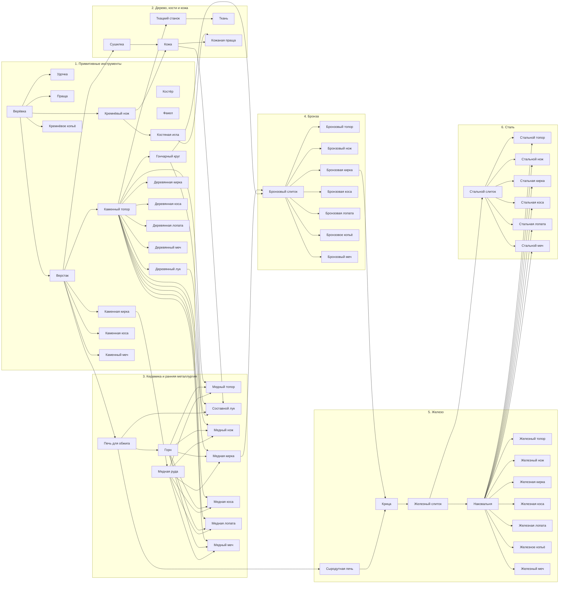

# Граф контента

Создаёт `tools/content_report.gd` из данных всех модов по графу `src/shared/content/content_graph.gd`;
руками не править, CI проверяет, что граф свежий. Правила — раздел 11
[BUNDLE_SYSTEM.md](../specifications/BUNDLE_SYSTEM.md), что нашли проверки — [content-checks.md](content-checks.md),
все записи — [content-index.md](content-index.md).

Граф идёт от старта по правилам рук (`Tools`, тем же, что в игре): мир даёт биомы, клетки, растения, деревья
и кусты; действие над ними инструментом, что уже есть, даёт вещи; рецепты делают из них новые на
поставленных станках; поставленное, посаженное и посеянное даёт своё, пока не перестаёт прибавляться новое.
Глубина — сколько шагов изготовления отделяет вещь от старта: что мир и старт дают голыми руками — 0,
добытое инструментом — глубина самого раннего инструмента, который это может, изделие — на 1 больше
самого глубокого из материалов, станка и инструмента своего рецепта.

## Старт

Новый мир начинается по записи `core:default` «Обычный старт».

- Сумка: пусто.
- У точки появления: Костёр, на 4 клетки к западу и на 4 к югу.
- У точки появления: Сундук, на 4 клетки к востоку и на 2 к югу.

## Предметы по глубине

| Глубина | Предметы |
|---|---|
| 0 | Черника, Клюква, Смородина, Семена трав, Гриб, Светящийся гриб, Малина, Шиповник, Волокно, Мох, Торф, Соль, Снег, Земля, Песок, Глина, Камень, Кремень, Ветка, Яблоко, Банан, Жёлудь, Кокос, Рябина, Шишка, Тушка, Туша, Зерно, Стебли льна |
| 1 | Костёр, Жареные грибы, Верёвка, Бинт, Камешки, Факел, Сырое мясо, Шкура, Кость, Мука, Льняная нить |
| 2 | Плотва, Щука, Лосось, Треска, Рыба-попугай, Сом, Удочка, Праща, Верстак, Жареное мясо, Кремнёвый нож, Кремнёвое копьё |
| 3 | Медная руда, Лёд, Бревно, Жареная рыба, Стрела, Сушилка, Жир, Печь для обжига, Костяная игла, Каменный топор, Каменная кирка, Каменная коса, Каменный меч |
| 4 | Кирпич, Уголь, Доски, Вяленое мясо, Кожа, Сальная свеча, Лепёшка |
| 5 | Кустик черники, Куст смородины, Куст малины, Куст шиповника, Куст, Куст банана, Сыродутная печь, Деревянный лук, Сундук, Горн, Кожаная праща, Ткацкий станок, Гончарный круг, Деревянная кирка, Деревянная коса, Деревянная лопата, Деревянный меч |
| 6 | Ткань, Медный слиток, Стекло, Сырой горшок, Сырой тигель |
| 7 | Оловянная руда, Глиняный горшок, Тигель, Медный топор, Медный нож, Медная кирка, Медная коса, Медная лопата, Медный меч |
| 8 | Слиток олова, Костный клей, Смола, Жареные жёлуди |
| 9 | Бронзовый слиток, Составной лук, Фонарь, Смоляной факел |
| 10 | Железная руда, Золотая руда, Платиновая руда, Серебряная руда, Бронзовый топор, Бронзовый нож, Бронзовая кирка, Бронзовая коса, Бронзовая лопата, Бронзовое копьё, Бронзовый меч |
| 11 | Крица, Золотой слиток, Платиновый слиток, Серебряный слиток |
| 12 | Железный слиток |
| 13 | Наковальня, Стальной слиток |
| 14 | Золотой блок, Платиновый блок, Серебряный блок, Железный топор, Стальной топор, Железный нож, Стальной нож, Железная кирка, Стальная кирка, Железная коса, Стальная коса, Железная лопата, Стальная лопата, Железное копьё, Железный меч, Стальной меч |

## Откуда и куда

Откуда — все пути к предмету, первым тот, что даёт ему глубину. Куда — рецепты, которые его тратят,
рецепты на нём как на станке, что им чинят, и для чего он сам.

| Предмет | Глубина | Откуда | Куда |
|---|---|---|---|
| Костёр `core:campfire` | 1 | рецепт: Костёр | станок рецептов: Жареные грибы, Жареная рыба, Жареная рыба, Жареная рыба, Жареная рыба, Жареная рыба, Жареная рыба, Жареное мясо, Костный клей, Жареные жёлуди; горит: тушится и разжигается топливом |
| Кирпич `materials:brick` | 4 | рецепт: Кирпич; копать: Кирпич | в рецепты: Сыродутная печь, Горн; блок: Кирпич |
| Уголь `materials:charcoal` | 4 | рецепт: Уголь; побочно: Смола | в рецепты: Медный слиток, Стекло, Крица, Железный слиток, Слиток олова, Золотой слиток, Платиновый слиток, Серебряный слиток, Бронзовый слиток, Стальной слиток; топливо |
| Ткань `materials:cloth` | 6 | рецепт: Грубая ткань, Льняная ткань | в рецепты: Смоляной факел |
| Медная руда `materials:copper_ore` | 3 | копать: Медная руда | в рецепты: Медный слиток |
| Медный слиток `materials:copper_bar` | 6 | рецепт: Медный слиток | чинит: Медный топор, Медный нож, Медная кирка, Медная коса, Медная лопата, Медный меч; в рецепты: Бронзовый слиток, Медный топор, Медный нож, Фонарь, Медная кирка, Медная коса, Медная лопата, Медный меч |
| Доски `materials:planks` | 4 | рецепт: Доски; копать: Доски | чинит: Деревянная кирка, Деревянная коса, Деревянная лопата, Деревянный меч; в рецепты: Деревянный лук, Сундук, Ткацкий станок, Гончарный круг, Медный топор, Бронзовый топор, Железный топор, Стальной топор, Медный нож, Бронзовый нож, Железный нож, Стальной нож, Деревянная кирка, Медная кирка, Бронзовая кирка, Железная кирка, Стальная кирка, Деревянная коса, Медная коса, Бронзовая коса, Железная коса, Стальная коса, Деревянная лопата, Медная лопата, Бронзовая лопата, Железная лопата, Стальная лопата, Бронзовое копьё, Железное копьё, Деревянный меч, Медный меч, Бронзовый меч, Железный меч, Стальной меч; блок: Доски |
| Черника `plants:blueberry` | 0 | собирать: Черника | еда |
| Кустик черники `plants:blueberry_bush` | 5 | выкопать: Черника | сажает: Черника |
| Клюква `plants:cranberry` | 0 | косить: Клюква | еда |
| Смородина `plants:currant` | 0 | собирать: Смородина | еда |
| Куст смородины `plants:currant_bush` | 5 | выкопать: Смородина | сажает: Смородина |
| Семена трав `plants:grass_seeds` | 0 | косить: Трава, Цветы | засевает: Трава |
| Гриб `plants:mushroom` | 0 | косить: Грибы | в рецепты: Жареные грибы; еда |
| Светящийся гриб `plants:glow_mushroom` | 0 | косить: Светящиеся грибы | еда |
| Жареные грибы `plants:fried_mushrooms` | 1 | рецепт: Жареные грибы | еда |
| Малина `plants:raspberry` | 0 | собирать: Малина | еда |
| Куст малины `plants:raspberry_bush` | 5 | выкопать: Малина | сажает: Малина |
| Шиповник `plants:rosehip` | 0 | собирать: Шиповник | еда |
| Куст шиповника `plants:rosehip_bush` | 5 | выкопать: Шиповник | сажает: Шиповник |
| Куст `plants:shrub_bush` | 5 | выкопать: Куст | сажает: Куст |
| Волокно `resources:fiber` | 0 | копать: Трава; косить: Трава, Папоротник, Высокая трава, Травы, Монстера, Крапива, Тростник | в рецепты: Верёвка, Бинт, Костёр, Праща, Факел, Стрелы, Сальная свеча, Стрелы с костяным наконечником |
| Верёвка `materials:cord` | 1 | рецепт: Верёвка | чинит: Удочка, Праща, Деревянный лук, Каменный топор, Каменная кирка, Каменная коса, Каменный меч; в рецепты: Удочка, Праща, Верстак, Деревянный лук, Сушилка, Кожаная праща, Ткацкий станок, Грубая ткань, Каменный топор, Кремнёвый нож, Каменная кирка, Каменная коса, Деревянная коса, Кремнёвое копьё, Деревянный меч, Каменный меч |
| Мох `plants:moss` | 0 | косить: Мох | в рецепты: Бинт |
| Бинт `plants:bandage` | 1 | рецепт: Бинт | лечит |
| Торф `resources:peat` | 0 | копать: Торф | блок: Торф; топливо |
| Соль `resources:salt` | 0 | копать: Соль | блок: Соль |
| Снег `resources:snow` | 0 | копать: Снег | блок: Снег |
| Лёд `resources:ice` | 3 | копать: Лёд | блок: Лёд |
| Земля `resources:dirt` | 0 | копать: Трава, Земля | блок: Земля |
| Песок `resources:sand` | 0 | копать: Песок | в рецепты: Стекло, Сырой тигель; блок: Песок |
| Глина `resources:clay` | 0 | копать: Глина | в рецепты: Сыродутная печь, Горн, Печь для обжига, Кирпич, Сырой горшок, Сырой тигель; блок: Глина |
| Камень `resources:stone` | 0 | копать: Осыпь, Камень | в рецепты: Камешки, Сыродутная печь, Горн, Печь для обжига, Гончарный круг; блок: Камень |
| Кремень `resources:flint` | 0 | копать: Земля, Песок, Осыпь | чинит: Каменный топор, Кремнёвый нож, Каменная кирка, Каменная коса, Кремнёвое копьё, Каменный меч; в рецепты: Удочка, Стрелы, Каменный топор, Кремнёвый нож, Каменная кирка, Каменная коса, Кремнёвое копьё, Каменный меч |
| Ветка `resources:branch` | 0 | собирать: Акация, Яблоня, Берёза, Черёмуха, Сейба, Вишня, Сухое дерево, Пихта, Лиственница, Липа, Мангр, Клён, Дуб, Пальма, Сосна, Тополь, Клён красный, Рябина, Ель, Ива, Черника, Смородина, Малина, Шиповник, Куст, Банан | в рецепты: Костёр, Жареная рыба, Жареная рыба, Жареная рыба, Жареная рыба, Жареная рыба, Жареная рыба, Удочка, Факел, Верстак, Стрелы, Сушилка, Жареное мясо, Ткацкий станок, Гончарный круг, Костный клей, Каменный топор, Стрелы с костяным наконечником, Кремнёвый нож, Каменная кирка, Деревянная кирка, Каменная коса, Деревянная коса, Деревянная лопата, Кремнёвое копьё, Каменный меч, Смоляной факел; топливо |
| Бревно `resources:log` | 3 | рубить: Акация, Яблоня, Берёза, Черёмуха, Сейба, Вишня, Сухое дерево, Пихта, Лиственница, Липа, Мангр, Клён, Дуб, Пальма, Сосна, Тополь, Клён красный, Рябина, Ель, Ива; копать: Бревно | в рецепты: Наковальня, Уголь, Смола, Доски; блок: Бревно |
| Плотва `animals:roach` | 2 | fish: Альпийский луг, Берег, Берёзовая роща, Пустыня, Пойма, Лес, Лесостепь, Джунгли, Кленовник, Луг, Торфяное болото, Бор, Плато, Красные скалы, Скалы, Солончак, Саванна, Степь, Болото, Тайга | в рецепты: Жареная рыба; еда |
| Щука `animals:pike` | 2 | fish: Альпийский луг, Берёзовая роща, Пойма, Лес, Лесостепь, Ледник, Кленовник, Луг, Торфяное болото, Бор, Плато, Скалы, Степь, Каменистая тундра, Болото, Тайга, Тундра | в рецепты: Жареная рыба; еда |
| Лосось `animals:salmon` | 2 | fish: Альпийский луг, Ледник, Ледяная пустошь, Торфяное болото, Бор, Плато, Скалы, Каменистая тундра, Тайга, Тундра | в рецепты: Жареная рыба; еда |
| Треска `animals:cod` | 2 | fish: Берег, Ледяная пустошь, Море, Тропический берег, Тропическое море | в рецепты: Жареная рыба; еда |
| Рыба-попугай `animals:parrotfish` | 2 | fish: Мангровые заросли, Тропический берег, Тропическое море | в рецепты: Жареная рыба; еда |
| Сом `animals:catfish` | 2 | fish: Берёзовая роща, Пустыня, Пойма, Лес, Лесостепь, Джунгли, Мангровые заросли, Кленовник, Луг, Красные скалы, Солончак, Саванна, Степь, Болото | в рецепты: Жареная рыба; еда |
| Жареная рыба `animals:roasted_fish` | 3 | рецепт: Жареная рыба | еда |
| Яблоко `plants:apple` | 0 | собирать: Яблоня | еда |
| Банан `plants:banana` | 0 | собирать: Банан | еда |
| Куст банана `plants:banana_bush` | 5 | выкопать: Банан | сажает: Банан |
| Жёлудь `plants:acorn` | 0 | собирать: Дуб | в рецепты: Жареные жёлуди |
| Кокос `plants:coconut` | 0 | собирать: Пальма | еда |
| Рябина `plants:rowan` | 0 | собирать: Рябина | еда |
| Шишка `plants:cone` | 0 | собирать: Сосна, Ель | топливо |
| Удочка `tools:fishing_rod` | 2 | рецепт: Удочка | инструмент: удочка |
| Праща `tools:cord_sling` | 2 | рецепт: Праща | инструмент: праща |
| Камешки `tools:sling_stone` | 1 | рецепт: Камешки | в рецепты: Праща, Кожаная праща |
| Факел `tools:torch` | 1 | рецепт: Факел | свет |
| Верстак `tools:workbench` | 2 | рецепт: Верстак | станок рецептов: Сыродутная печь, Деревянный лук, Стрелы, Сундук, Сушилка, Горн, Наковальня, Печь для обжига, Ткацкий станок, Гончарный круг, Каменный топор, Доски, Медный топор, Бронзовый топор, Составной лук, Стрелы с костяным наконечником, Медный нож, Бронзовый нож, Фонарь, Каменная кирка, Деревянная кирка, Медная кирка, Бронзовая кирка, Каменная коса, Деревянная коса, Медная коса, Бронзовая коса, Деревянная лопата, Медная лопата, Бронзовая лопата, Бронзовое копьё, Деревянный меч, Каменный меч, Медный меч, Бронзовый меч; здесь чинят инструменты |
| Сыродутная печь `tools:bloomery` | 5 | рецепт: Сыродутная печь | станок рецептов: Крица, Стальной слиток |
| Деревянный лук `tools:wooden_bow` | 5 | рецепт: Деревянный лук | в рецепты: Составной лук; инструмент: лук |
| Стрела `tools:arrow` | 3 | рецепт: Стрелы, Стрелы с костяным наконечником | в рецепты: Деревянный лук, Составной лук |
| Сундук `tools:chest` | 5 | рецепт: Сундук | хранит вещи: 16 мест |
| Сушилка `tools:drying_rack` | 3 | рецепт: Сушилка | станок рецептов: Вяленое мясо, Кожа |
| Тушка `animals:small_carcass` | 0 | hunt: Дикая кошка, Ворона, Утка, Лиса, Ёж, Сова, Заяц, Белка | в рецепты: Разделать тушку |
| Туша `animals:carcass` | 0 | hunt: Медведь, Кабан, Олень, Волк | в рецепты: Разделать тушу |
| Сырое мясо `animals:raw_meat` | 1 | рецепт: Разделать тушку, Разделать тушу | в рецепты: Жареное мясо, Вяленое мясо; еда |
| Жареное мясо `animals:roasted_meat` | 2 | рецепт: Жареное мясо | еда |
| Шкура `animals:hide` | 1 | побочно: Разделать тушку, Разделать тушу | в рецепты: Кожа |
| Кость `animals:bone` | 1 | побочно: Разделать тушку, Разделать тушу | в рецепты: Костяная игла, Костный клей, Составной лук, Стрелы с костяным наконечником |
| Жир `animals:fat` | 3 | побочно: Разделать тушу | в рецепты: Кожа, Сальная свеча |
| Вяленое мясо `animals:jerky` | 4 | рецепт: Вяленое мясо | еда |
| Кожа `materials:leather` | 4 | рецепт: Кожа | чинит: Кожаная праща; в рецепты: Кожаная праща, Составной лук |
| Сальная свеча `tools:tallow_candle` | 4 | рецепт: Сальная свеча | свет |
| Горн `tools:forge` | 5 | рецепт: Горн | станок рецептов: Медный слиток, Стекло, Железный слиток, Слиток олова, Золотой слиток, Платиновый слиток, Серебряный слиток, Бронзовый слиток |
| Стекло `materials:glass` | 6 | рецепт: Стекло | в рецепты: Фонарь |
| Железная руда `materials:iron_ore` | 10 | копать: Железная руда | в рецепты: Крица |
| Крица `materials:iron_bloom` | 11 | рецепт: Крица | в рецепты: Железный слиток |
| Железный слиток `materials:iron_bar` | 12 | рецепт: Железный слиток | чинит: Железный топор, Железный нож, Железная кирка, Железная коса, Железная лопата, Железное копьё, Железный меч; в рецепты: Наковальня, Стальной слиток, Железный топор, Железный нож, Железная кирка, Железная коса, Железная лопата, Железное копьё, Железный меч |
| Оловянная руда `materials:tin_ore` | 7 | копать: Оловянная руда | в рецепты: Слиток олова |
| Слиток олова `materials:tin_bar` | 8 | рецепт: Слиток олова | в рецепты: Бронзовый слиток |
| Наковальня `tools:anvil` | 13 | рецепт: Наковальня | станок рецептов: Золотой блок, Платиновый блок, Серебряный блок, Железный топор, Стальной топор, Железный нож, Стальной нож, Железная кирка, Стальная кирка, Железная коса, Стальная коса, Железная лопата, Стальная лопата, Железное копьё, Железный меч, Стальной меч |
| Золотая руда `materials:gold_ore` | 10 | копать: Золотая руда | в рецепты: Золотой слиток |
| Золотой слиток `materials:gold_bar` | 11 | рецепт: Золотой слиток | в рецепты: Золотой блок |
| Золотой блок `materials:gold_block` | 14 | рецепт: Золотой блок; копать: Золотой блок | блок: Золотой блок |
| Платиновая руда `materials:platinum_ore` | 10 | копать: Платиновая руда | в рецепты: Платиновый слиток |
| Платиновый слиток `materials:platinum_bar` | 11 | рецепт: Платиновый слиток | в рецепты: Платиновый блок |
| Платиновый блок `materials:platinum_block` | 14 | рецепт: Платиновый блок; копать: Платиновый блок | блок: Платиновый блок |
| Серебряная руда `materials:silver_ore` | 10 | копать: Серебряная руда | в рецепты: Серебряный слиток |
| Серебряный слиток `materials:silver_bar` | 11 | рецепт: Серебряный слиток | в рецепты: Серебряный блок |
| Серебряный блок `materials:silver_block` | 14 | рецепт: Серебряный блок; копать: Серебряный блок | блок: Серебряный блок |
| Печь для обжига `tools:kiln` | 3 | рецепт: Печь для обжига | станок рецептов: Кирпич, Уголь, Лепёшка, Глиняный горшок, Тигель, Смола |
| Зерно `plants:grain` | 0 | косить: Колоски | в рецепты: Мука; засевает: Трава; растит: Колоски |
| Мука `plants:flour` | 1 | рецепт: Мука | в рецепты: Лепёшка |
| Лепёшка `plants:flatbread` | 4 | рецепт: Лепёшка | еда |
| Кожаная праща `tools:leather_sling` | 5 | рецепт: Кожаная праща | инструмент: праща |
| Ткацкий станок `tools:loom` | 5 | рецепт: Ткацкий станок | станок рецептов: Грубая ткань, Льняная ткань |
| Стебли льна `plants:flax_stalks` | 0 | косить: Лён | в рецепты: Льняная нить |
| Льняная нить `plants:linen_thread` | 1 | рецепт: Льняная нить | в рецепты: Льняная ткань |
| Костяная игла `tools:bone_needle` | 3 | рецепт: Костяная игла | инструмент: костяная игла |
| Гончарный круг `tools:potters_wheel` | 5 | рецепт: Гончарный круг | станок рецептов: Сырой горшок, Сырой тигель |
| Сырой горшок `tools:raw_pot` | 6 | рецепт: Сырой горшок | в рецепты: Глиняный горшок |
| Глиняный горшок `tools:pot` | 7 | рецепт: Глиняный горшок | нужен в сумке рецептам: Костный клей, Смола, Жареные жёлуди |
| Костный клей `materials:bone_glue` | 8 | рецепт: Костный клей | чинит: Составной лук; в рецепты: Составной лук |
| Сырой тигель `materials:raw_crucible` | 6 | рецепт: Сырой тигель | в рецепты: Тигель |
| Тигель `materials:crucible` | 7 | рецепт: Тигель | нужен в сумке рецептам: Бронзовый слиток, Стальной слиток |
| Бронзовый слиток `materials:bronze_bar` | 9 | рецепт: Бронзовый слиток | чинит: Бронзовый топор, Бронзовый нож, Бронзовая кирка, Бронзовая коса, Бронзовая лопата, Бронзовое копьё, Бронзовый меч; в рецепты: Бронзовый топор, Бронзовый нож, Бронзовая кирка, Бронзовая коса, Бронзовая лопата, Бронзовое копьё, Бронзовый меч |
| Стальной слиток `materials:steel_bar` | 13 | рецепт: Стальной слиток | чинит: Стальной топор, Стальной нож, Стальная кирка, Стальная коса, Стальная лопата, Стальной меч; в рецепты: Стальной топор, Стальной нож, Стальная кирка, Стальная коса, Стальная лопата, Стальной меч |
| Смола `materials:tar` | 8 | рецепт: Смола | в рецепты: Фонарь, Смоляной факел; топливо |
| Жареные жёлуди `plants:roasted_acorns` | 8 | рецепт: Жареные жёлуди | еда |
| Каменный топор `tools:stone_axe` | 3 | рецепт: Каменный топор | инструмент: топор |
| Медный топор `tools:copper_axe` | 7 | рецепт: Медный топор | инструмент: топор |
| Бронзовый топор `tools:bronze_axe` | 10 | рецепт: Бронзовый топор | инструмент: топор |
| Железный топор `tools:iron_axe` | 14 | рецепт: Железный топор | инструмент: топор |
| Стальной топор `tools:steel_axe` | 14 | рецепт: Стальной топор | инструмент: топор |
| Составной лук `tools:composite_bow` | 9 | рецепт: Составной лук | инструмент: лук |
| Кремнёвый нож `tools:flint_knife` | 2 | рецепт: Кремнёвый нож | инструмент: нож |
| Медный нож `tools:copper_knife` | 7 | рецепт: Медный нож | инструмент: нож |
| Бронзовый нож `tools:bronze_knife` | 10 | рецепт: Бронзовый нож | инструмент: нож |
| Железный нож `tools:iron_knife` | 14 | рецепт: Железный нож | инструмент: нож |
| Стальной нож `tools:steel_knife` | 14 | рецепт: Стальной нож | инструмент: нож |
| Фонарь `tools:lantern` | 9 | рецепт: Фонарь | свет |
| Каменная кирка `tools:stone_pickaxe` | 3 | рецепт: Каменная кирка | инструмент: кирка |
| Деревянная кирка `tools:wooden_pickaxe` | 5 | рецепт: Деревянная кирка | инструмент: кирка |
| Медная кирка `tools:copper_pickaxe` | 7 | рецепт: Медная кирка | инструмент: кирка |
| Бронзовая кирка `tools:bronze_pickaxe` | 10 | рецепт: Бронзовая кирка | инструмент: кирка |
| Железная кирка `tools:iron_pickaxe` | 14 | рецепт: Железная кирка | инструмент: кирка |
| Стальная кирка `tools:steel_pickaxe` | 14 | рецепт: Стальная кирка | инструмент: кирка |
| Каменная коса `tools:stone_scythe` | 3 | рецепт: Каменная коса | инструмент: коса |
| Деревянная коса `tools:wooden_scythe` | 5 | рецепт: Деревянная коса | инструмент: коса |
| Медная коса `tools:copper_scythe` | 7 | рецепт: Медная коса | инструмент: коса |
| Бронзовая коса `tools:bronze_scythe` | 10 | рецепт: Бронзовая коса | инструмент: коса |
| Железная коса `tools:iron_scythe` | 14 | рецепт: Железная коса | инструмент: коса |
| Стальная коса `tools:steel_scythe` | 14 | рецепт: Стальная коса | инструмент: коса |
| Деревянная лопата `tools:wooden_shovel` | 5 | рецепт: Деревянная лопата | инструмент: лопата |
| Медная лопата `tools:copper_shovel` | 7 | рецепт: Медная лопата | инструмент: лопата |
| Бронзовая лопата `tools:bronze_shovel` | 10 | рецепт: Бронзовая лопата | инструмент: лопата |
| Железная лопата `tools:iron_shovel` | 14 | рецепт: Железная лопата | инструмент: лопата |
| Стальная лопата `tools:steel_shovel` | 14 | рецепт: Стальная лопата | инструмент: лопата |
| Кремнёвое копьё `tools:flint_spear` | 2 | рецепт: Кремнёвое копьё | инструмент: копьё |
| Бронзовое копьё `tools:bronze_spear` | 10 | рецепт: Бронзовое копьё | инструмент: копьё |
| Железное копьё `tools:iron_spear` | 14 | рецепт: Железное копьё | инструмент: копьё |
| Деревянный меч `tools:wooden_sword` | 5 | рецепт: Деревянный меч | инструмент: меч |
| Каменный меч `tools:stone_sword` | 3 | рецепт: Каменный меч | инструмент: меч |
| Медный меч `tools:copper_sword` | 7 | рецепт: Медный меч | инструмент: меч |
| Бронзовый меч `tools:bronze_sword` | 10 | рецепт: Бронзовый меч | инструмент: меч |
| Железный меч `tools:iron_sword` | 14 | рецепт: Железный меч | инструмент: меч |
| Стальной меч `tools:steel_sword` | 14 | рецепт: Стальной меч | инструмент: меч |
| Смоляной факел `tools:tar_torch` | 9 | рецепт: Смоляной факел | свет |

## Общие ресурсы

Предметы, которые тратят два рецепта и больше. На нём держится — всё, что делается из него прямо или
дальше по цепочкам (по путям, которые дают глубину), через станки и инструменты тоже.

| Ресурс | Тратят рецепты | На нём держится |
|---|---|---|
| Кирпич `materials:brick` | Сыродутная печь, Горн | Сыродутная печь, Горн, Крица, Стальной слиток, Медный слиток, Стекло, Слиток олова, Бронзовый слиток, Золотой слиток, Платиновый слиток, Серебряный слиток, Железный слиток, Стальной топор, Стальной нож, Стальная кирка, Стальная коса, Стальная лопата, Стальной меч, Медный топор, Медный нож, Медная кирка, Медная коса, Медная лопата, Медный меч, Фонарь, Бронзовый топор, Бронзовый нож, Бронзовая кирка, Бронзовая коса, Бронзовая лопата, Бронзовое копьё, Бронзовый меч, Золотой блок, Платиновый блок, Серебряный блок, Наковальня, Железный топор, Железный нож, Железная кирка, Железная коса, Железная лопата, Железное копьё, Железный меч, Оловянная руда, Железная руда, Золотая руда, Платиновая руда, Серебряная руда |
| Уголь `materials:charcoal` | Медный слиток, Стекло, Крица, Железный слиток, Слиток олова, Золотой слиток, Платиновый слиток, Серебряный слиток, Бронзовый слиток, Стальной слиток | Медный слиток, Стекло, Слиток олова, Бронзовый слиток, Крица, Золотой слиток, Платиновый слиток, Серебряный слиток, Железный слиток, Стальной слиток, Медный топор, Медный нож, Медная кирка, Медная коса, Медная лопата, Медный меч, Фонарь, Бронзовый топор, Бронзовый нож, Бронзовая кирка, Бронзовая коса, Бронзовая лопата, Бронзовое копьё, Бронзовый меч, Золотой блок, Платиновый блок, Серебряный блок, Наковальня, Железный топор, Железный нож, Железная кирка, Железная коса, Железная лопата, Железное копьё, Железный меч, Стальной топор, Стальной нож, Стальная кирка, Стальная коса, Стальная лопата, Стальной меч, Оловянная руда, Железная руда, Золотая руда, Платиновая руда, Серебряная руда |
| Медный слиток `materials:copper_bar` | Бронзовый слиток, Медный топор, Медный нож, Фонарь, Медная кирка, Медная коса, Медная лопата, Медный меч | Медный топор, Медный нож, Медная кирка, Медная коса, Медная лопата, Медный меч, Бронзовый слиток, Фонарь, Оловянная руда, Бронзовый топор, Бронзовый нож, Бронзовая кирка, Бронзовая коса, Бронзовая лопата, Бронзовое копьё, Бронзовый меч, Слиток олова, Железная руда, Золотая руда, Платиновая руда, Серебряная руда, Крица, Золотой слиток, Платиновый слиток, Серебряный слиток, Железный слиток, Золотой блок, Платиновый блок, Серебряный блок, Наковальня, Стальной слиток, Железный топор, Железный нож, Железная кирка, Железная коса, Железная лопата, Железное копьё, Железный меч, Стальной топор, Стальной нож, Стальная кирка, Стальная коса, Стальная лопата, Стальной меч |
| Доски `materials:planks` | Деревянный лук, Сундук, Ткацкий станок, Гончарный круг, Медный топор, Бронзовый топор, Железный топор, Стальной топор, Медный нож, Бронзовый нож, Железный нож, Стальной нож, Деревянная кирка, Медная кирка, Бронзовая кирка, Железная кирка, Стальная кирка, Деревянная коса, Медная коса, Бронзовая коса, Железная коса, Стальная коса, Деревянная лопата, Медная лопата, Бронзовая лопата, Железная лопата, Стальная лопата, Бронзовое копьё, Железное копьё, Деревянный меч, Медный меч, Бронзовый меч, Железный меч, Стальной меч | Деревянный лук, Сундук, Ткацкий станок, Гончарный круг, Деревянная кирка, Деревянная коса, Деревянная лопата, Деревянный меч, Медный топор, Медный нож, Медная кирка, Медная коса, Медная лопата, Медный меч, Бронзовый топор, Бронзовый нож, Бронзовая кирка, Бронзовая коса, Бронзовая лопата, Бронзовое копьё, Бронзовый меч, Железный топор, Стальной топор, Железный нож, Стальной нож, Железная кирка, Стальная кирка, Железная коса, Стальная коса, Железная лопата, Стальная лопата, Железное копьё, Железный меч, Стальной меч, Кустик черники, Куст смородины, Куст малины, Куст шиповника, Куст, Куст банана, Оловянная руда, Железная руда, Золотая руда, Платиновая руда, Серебряная руда, Составной лук, Ткань, Сырой горшок, Сырой тигель, Слиток олова, Крица, Золотой слиток, Платиновый слиток, Серебряный слиток, Смоляной факел, Глиняный горшок, Тигель, Бронзовый слиток, Железный слиток, Золотой блок, Платиновый блок, Серебряный блок, Костный клей, Смола, Жареные жёлуди, Стальной слиток, Наковальня, Фонарь |
| Волокно `resources:fiber` | Верёвка, Бинт, Костёр, Праща, Факел, Стрелы, Сальная свеча, Стрелы с костяным наконечником | Верёвка, Бинт, Костёр, Праща, Факел, Стрела, Сальная свеча, Удочка, Верстак, Кремнёвый нож, Кремнёвое копьё, Сушилка, Каменный топор, Каменная кирка, Каменная коса, Каменный меч, Кожаная праща, Деревянный лук, Ткацкий станок, Деревянная коса, Деревянный меч, Ткань, Лосось, Щука, Плотва, Треска, Сом, Рыба-попугай, Бревно, Медная руда, Лёд, Составной лук, Смоляной факел, Жареная рыба, Печь для обжига, Сыродутная печь, Горн, Доски, Сундук, Гончарный круг, Деревянная кирка, Деревянная лопата, Медный топор, Медный нож, Медная кирка, Медная коса, Медная лопата, Медный меч, Фонарь, Бронзовый топор, Бронзовый нож, Бронзовая кирка, Бронзовая коса, Бронзовая лопата, Бронзовое копьё, Бронзовый меч, Наковальня, Жир, Костяная игла, Вяленое мясо, Кожа, Уголь, Смола, Медный слиток, Кустик черники, Куст смородины, Куст малины, Куст шиповника, Куст, Куст банана, Оловянная руда, Железная руда, Золотая руда, Платиновая руда, Серебряная руда, Железный топор, Стальной топор, Железный нож, Стальной нож, Железная кирка, Стальная кирка, Железная коса, Стальная коса, Железная лопата, Стальная лопата, Железное копьё, Железный меч, Стальной меч, Стекло, Слиток олова, Бронзовый слиток, Крица, Золотой слиток, Платиновый слиток, Серебряный слиток, Железный слиток, Стальной слиток, Кирпич, Лепёшка, Глиняный горшок, Тигель, Сырой горшок, Сырой тигель, Золотой блок, Платиновый блок, Серебряный блок, Костный клей, Жареные жёлуди |
| Верёвка `materials:cord` | Удочка, Праща, Верстак, Деревянный лук, Сушилка, Кожаная праща, Ткацкий станок, Грубая ткань, Каменный топор, Кремнёвый нож, Каменная кирка, Каменная коса, Деревянная коса, Кремнёвое копьё, Деревянный меч, Каменный меч | Удочка, Праща, Верстак, Кремнёвый нож, Кремнёвое копьё, Сушилка, Каменный топор, Каменная кирка, Каменная коса, Каменный меч, Кожаная праща, Деревянный лук, Ткацкий станок, Деревянная коса, Деревянный меч, Ткань, Лосось, Щука, Плотва, Треска, Сом, Рыба-попугай, Бревно, Медная руда, Лёд, Составной лук, Смоляной факел, Жареная рыба, Стрела, Печь для обжига, Сыродутная печь, Горн, Доски, Сундук, Гончарный круг, Деревянная кирка, Деревянная лопата, Медный топор, Медный нож, Медная кирка, Медная коса, Медная лопата, Медный меч, Фонарь, Бронзовый топор, Бронзовый нож, Бронзовая кирка, Бронзовая коса, Бронзовая лопата, Бронзовое копьё, Бронзовый меч, Наковальня, Жир, Костяная игла, Вяленое мясо, Кожа, Уголь, Смола, Медный слиток, Кустик черники, Куст смородины, Куст малины, Куст шиповника, Куст, Куст банана, Оловянная руда, Железная руда, Золотая руда, Платиновая руда, Серебряная руда, Железный топор, Стальной топор, Железный нож, Стальной нож, Железная кирка, Стальная кирка, Железная коса, Стальная коса, Железная лопата, Стальная лопата, Железное копьё, Железный меч, Стальной меч, Сальная свеча, Стекло, Слиток олова, Бронзовый слиток, Крица, Золотой слиток, Платиновый слиток, Серебряный слиток, Железный слиток, Стальной слиток, Кирпич, Лепёшка, Глиняный горшок, Тигель, Сырой горшок, Сырой тигель, Золотой блок, Платиновый блок, Серебряный блок, Костный клей, Жареные жёлуди |
| Песок `resources:sand` | Стекло, Сырой тигель | Стекло, Сырой тигель, Фонарь, Тигель, Бронзовый слиток, Стальной слиток, Бронзовый топор, Бронзовый нож, Бронзовая кирка, Бронзовая коса, Бронзовая лопата, Бронзовое копьё, Бронзовый меч, Стальной топор, Стальной нож, Стальная кирка, Стальная коса, Стальная лопата, Стальной меч, Железная руда, Золотая руда, Платиновая руда, Серебряная руда, Крица, Золотой слиток, Платиновый слиток, Серебряный слиток, Железный слиток, Золотой блок, Платиновый блок, Серебряный блок, Наковальня, Железный топор, Железный нож, Железная кирка, Железная коса, Железная лопата, Железное копьё, Железный меч |
| Глина `resources:clay` | Сыродутная печь, Горн, Печь для обжига, Кирпич, Сырой горшок, Сырой тигель | Печь для обжига, Кирпич, Сыродутная печь, Горн, Сырой горшок, Сырой тигель, Глиняный горшок, Тигель, Лепёшка, Уголь, Смола, Крица, Стальной слиток, Медный слиток, Стекло, Слиток олова, Бронзовый слиток, Золотой слиток, Платиновый слиток, Серебряный слиток, Железный слиток, Костный клей, Жареные жёлуди, Фонарь, Смоляной факел, Стальной топор, Стальной нож, Стальная кирка, Стальная коса, Стальная лопата, Стальной меч, Медный топор, Медный нож, Медная кирка, Медная коса, Медная лопата, Медный меч, Бронзовый топор, Бронзовый нож, Бронзовая кирка, Бронзовая коса, Бронзовая лопата, Бронзовое копьё, Бронзовый меч, Золотой блок, Платиновый блок, Серебряный блок, Наковальня, Железный топор, Железный нож, Железная кирка, Железная коса, Железная лопата, Железное копьё, Железный меч, Оловянная руда, Железная руда, Золотая руда, Платиновая руда, Серебряная руда, Составной лук |
| Камень `resources:stone` | Камешки, Сыродутная печь, Горн, Печь для обжига, Гончарный круг | Камешки, Печь для обжига, Сыродутная печь, Горн, Гончарный круг, Кирпич, Лепёшка, Уголь, Глиняный горшок, Тигель, Смола, Крица, Стальной слиток, Медный слиток, Стекло, Слиток олова, Бронзовый слиток, Золотой слиток, Платиновый слиток, Серебряный слиток, Железный слиток, Сырой горшок, Сырой тигель, Костный клей, Жареные жёлуди, Фонарь, Смоляной факел, Стальной топор, Стальной нож, Стальная кирка, Стальная коса, Стальная лопата, Стальной меч, Медный топор, Медный нож, Медная кирка, Медная коса, Медная лопата, Медный меч, Бронзовый топор, Бронзовый нож, Бронзовая кирка, Бронзовая коса, Бронзовая лопата, Бронзовое копьё, Бронзовый меч, Золотой блок, Платиновый блок, Серебряный блок, Наковальня, Железный топор, Железный нож, Железная кирка, Железная коса, Железная лопата, Железное копьё, Железный меч, Оловянная руда, Железная руда, Золотая руда, Платиновая руда, Серебряная руда, Составной лук |
| Кремень `resources:flint` | Удочка, Стрелы, Каменный топор, Кремнёвый нож, Каменная кирка, Каменная коса, Кремнёвое копьё, Каменный меч | Удочка, Кремнёвый нож, Кремнёвое копьё, Стрела, Каменный топор, Каменная кирка, Каменная коса, Каменный меч, Лосось, Щука, Плотва, Треска, Сом, Рыба-попугай, Бревно, Медная руда, Лёд, Жареная рыба, Жир, Костяная игла, Доски, Уголь, Смола, Наковальня, Медный слиток, Кожа, Сальная свеча, Деревянный лук, Сундук, Ткацкий станок, Гончарный круг, Деревянная кирка, Деревянная коса, Деревянная лопата, Деревянный меч, Медный топор, Медный нож, Медная кирка, Медная коса, Медная лопата, Медный меч, Бронзовый топор, Бронзовый нож, Бронзовая кирка, Бронзовая коса, Бронзовая лопата, Бронзовое копьё, Бронзовый меч, Железный топор, Стальной топор, Железный нож, Стальной нож, Железная кирка, Стальная кирка, Железная коса, Стальная коса, Железная лопата, Стальная лопата, Железное копьё, Железный меч, Стальной меч, Стекло, Слиток олова, Бронзовый слиток, Крица, Золотой слиток, Платиновый слиток, Серебряный слиток, Железный слиток, Стальной слиток, Фонарь, Смоляной факел, Кожаная праща, Кустик черники, Куст смородины, Куст малины, Куст шиповника, Куст, Куст банана, Оловянная руда, Железная руда, Золотая руда, Платиновая руда, Серебряная руда, Золотой блок, Платиновый блок, Серебряный блок, Составной лук, Ткань, Сырой горшок, Сырой тигель, Глиняный горшок, Тигель, Костный клей, Жареные жёлуди |
| Ветка `resources:branch` | Костёр, Жареная рыба, Жареная рыба, Жареная рыба, Жареная рыба, Жареная рыба, Жареная рыба, Удочка, Факел, Верстак, Стрелы, Сушилка, Жареное мясо, Ткацкий станок, Гончарный круг, Костный клей, Каменный топор, Стрелы с костяным наконечником, Кремнёвый нож, Каменная кирка, Деревянная кирка, Каменная коса, Деревянная коса, Деревянная лопата, Кремнёвое копьё, Каменный меч, Смоляной факел | Костёр, Удочка, Факел, Верстак, Жареное мясо, Кремнёвый нож, Кремнёвое копьё, Стрела, Сушилка, Каменный топор, Каменная кирка, Каменная коса, Каменный меч, Жареная рыба, Ткацкий станок, Гончарный круг, Деревянная кирка, Деревянная коса, Деревянная лопата, Костный клей, Смоляной факел, Лосось, Щука, Плотва, Треска, Сом, Рыба-попугай, Бревно, Медная руда, Лёд, Кустик черники, Куст смородины, Куст малины, Куст шиповника, Куст, Куст банана, Составной лук, Печь для обжига, Сыродутная печь, Горн, Доски, Деревянный лук, Сундук, Деревянный меч, Медный топор, Медный нож, Медная кирка, Медная коса, Медная лопата, Медный меч, Фонарь, Бронзовый топор, Бронзовый нож, Бронзовая кирка, Бронзовая коса, Бронзовая лопата, Бронзовое копьё, Бронзовый меч, Наковальня, Жир, Костяная игла, Вяленое мясо, Кожа, Уголь, Смола, Медный слиток, Ткань, Сырой горшок, Сырой тигель, Оловянная руда, Железная руда, Золотая руда, Платиновая руда, Серебряная руда, Железный топор, Стальной топор, Железный нож, Стальной нож, Железная кирка, Стальная кирка, Железная коса, Стальная коса, Железная лопата, Стальная лопата, Железное копьё, Железный меч, Стальной меч, Сальная свеча, Кожаная праща, Стекло, Слиток олова, Бронзовый слиток, Крица, Золотой слиток, Платиновый слиток, Серебряный слиток, Железный слиток, Стальной слиток, Глиняный горшок, Тигель, Кирпич, Лепёшка, Золотой блок, Платиновый блок, Серебряный блок, Жареные жёлуди |
| Бревно `resources:log` | Наковальня, Уголь, Смола, Доски | Уголь, Доски, Смола, Наковальня, Медный слиток, Стекло, Слиток олова, Бронзовый слиток, Крица, Золотой слиток, Платиновый слиток, Серебряный слиток, Железный слиток, Стальной слиток, Деревянный лук, Сундук, Ткацкий станок, Гончарный круг, Деревянная кирка, Деревянная коса, Деревянная лопата, Деревянный меч, Медный топор, Медный нож, Медная кирка, Медная коса, Медная лопата, Медный меч, Бронзовый топор, Бронзовый нож, Бронзовая кирка, Бронзовая коса, Бронзовая лопата, Бронзовое копьё, Бронзовый меч, Железный топор, Стальной топор, Железный нож, Стальной нож, Железная кирка, Стальная кирка, Железная коса, Стальная коса, Железная лопата, Стальная лопата, Железное копьё, Железный меч, Стальной меч, Фонарь, Смоляной факел, Кустик черники, Куст смородины, Куст малины, Куст шиповника, Куст, Куст банана, Оловянная руда, Железная руда, Золотая руда, Платиновая руда, Серебряная руда, Золотой блок, Платиновый блок, Серебряный блок, Составной лук, Ткань, Сырой горшок, Сырой тигель, Глиняный горшок, Тигель, Костный клей, Жареные жёлуди |
| Камешки `tools:sling_stone` | Праща, Кожаная праща | — |
| Стрела `tools:arrow` | Деревянный лук, Составной лук | — |
| Сырое мясо `animals:raw_meat` | Жареное мясо, Вяленое мясо | Жареное мясо, Вяленое мясо |
| Кость `animals:bone` | Костяная игла, Костный клей, Составной лук, Стрелы с костяным наконечником | Костяная игла, Костный клей, Составной лук, Кожаная праща |
| Жир `animals:fat` | Кожа, Сальная свеча | Кожа, Сальная свеча, Кожаная праща, Составной лук |
| Кожа `materials:leather` | Кожаная праща, Составной лук | Кожаная праща, Составной лук |
| Железный слиток `materials:iron_bar` | Наковальня, Стальной слиток, Железный топор, Железный нож, Железная кирка, Железная коса, Железная лопата, Железное копьё, Железный меч | Наковальня, Стальной слиток, Железный топор, Железный нож, Железная кирка, Железная коса, Железная лопата, Железное копьё, Железный меч, Стальной топор, Стальной нож, Стальная кирка, Стальная коса, Стальная лопата, Стальной меч, Золотой блок, Платиновый блок, Серебряный блок |
| Бронзовый слиток `materials:bronze_bar` | Бронзовый топор, Бронзовый нож, Бронзовая кирка, Бронзовая коса, Бронзовая лопата, Бронзовое копьё, Бронзовый меч | Бронзовый топор, Бронзовый нож, Бронзовая кирка, Бронзовая коса, Бронзовая лопата, Бронзовое копьё, Бронзовый меч, Железная руда, Золотая руда, Платиновая руда, Серебряная руда, Крица, Золотой слиток, Платиновый слиток, Серебряный слиток, Железный слиток, Золотой блок, Платиновый блок, Серебряный блок, Наковальня, Стальной слиток, Железный топор, Железный нож, Железная кирка, Железная коса, Железная лопата, Железное копьё, Железный меч, Стальной топор, Стальной нож, Стальная кирка, Стальная коса, Стальная лопата, Стальной меч |
| Стальной слиток `materials:steel_bar` | Стальной топор, Стальной нож, Стальная кирка, Стальная коса, Стальная лопата, Стальной меч | Стальной топор, Стальной нож, Стальная кирка, Стальная коса, Стальная лопата, Стальной меч |
| Смола `materials:tar` | Фонарь, Смоляной факел | Фонарь, Смоляной факел |

## Инструменты и добыча

Что даёт мир каждым действием и чем это сделать: руками или предметом-инструментом (по правилам `Tools`,
тем же, что в игре). Одинаковое у нескольких записей — одной строкой.

### Клетки

| Что | Действие | Даёт | Чем |
|---|---|---|---|
| Бревно | копать | Бревно | Каменный топор, Медный топор, Бронзовый топор, Железный топор, Стальной топор |
| Глина | копать | Глина | руки, Каменная кирка, Деревянная кирка, Медная кирка, Бронзовая кирка, Железная кирка, Стальная кирка, Деревянная лопата, Медная лопата, Бронзовая лопата, Железная лопата, Стальная лопата |
| Доски | копать | Доски | Каменный топор, Медный топор, Бронзовый топор, Железный топор, Стальной топор |
| Железная руда | копать | Железная руда | Бронзовая кирка, Железная кирка, Стальная кирка |
| Земля | копать | Земля, Кремень | руки, Каменная кирка, Деревянная кирка, Медная кирка, Бронзовая кирка, Железная кирка, Стальная кирка, Деревянная лопата, Медная лопата, Бронзовая лопата, Железная лопата, Стальная лопата |
| Золотая руда | копать | Золотая руда | Бронзовая кирка, Железная кирка, Стальная кирка |
| Золотой блок | копать | Золотой блок | Медная кирка, Бронзовая кирка, Железная кирка, Стальная кирка |
| Камень | копать | Камень | Каменная кирка, Деревянная кирка, Медная кирка, Бронзовая кирка, Железная кирка, Стальная кирка |
| Кирпич | копать | Кирпич | Каменная кирка, Деревянная кирка, Медная кирка, Бронзовая кирка, Железная кирка, Стальная кирка |
| Лёд | копать | Лёд | Каменная кирка, Деревянная кирка, Медная кирка, Бронзовая кирка, Железная кирка, Стальная кирка |
| Медная руда | копать | Медная руда | Каменная кирка, Деревянная кирка, Медная кирка, Бронзовая кирка, Железная кирка, Стальная кирка |
| Оловянная руда | копать | Оловянная руда | Медная кирка, Бронзовая кирка, Железная кирка, Стальная кирка |
| Осыпь | копать | Камень, Кремень | руки, Каменная кирка, Деревянная кирка, Медная кирка, Бронзовая кирка, Железная кирка, Стальная кирка, Деревянная лопата, Медная лопата, Бронзовая лопата, Железная лопата, Стальная лопата |
| Песок | копать | Песок, Кремень | руки, Каменная кирка, Деревянная кирка, Медная кирка, Бронзовая кирка, Железная кирка, Стальная кирка, Деревянная лопата, Медная лопата, Бронзовая лопата, Железная лопата, Стальная лопата |
| Платиновая руда | копать | Платиновая руда | Бронзовая кирка, Железная кирка, Стальная кирка |
| Платиновый блок | копать | Платиновый блок | Медная кирка, Бронзовая кирка, Железная кирка, Стальная кирка |
| Серебряная руда | копать | Серебряная руда | Бронзовая кирка, Железная кирка, Стальная кирка |
| Серебряный блок | копать | Серебряный блок | Медная кирка, Бронзовая кирка, Железная кирка, Стальная кирка |
| Снег | копать | Снег | руки, Каменная кирка, Деревянная кирка, Медная кирка, Бронзовая кирка, Железная кирка, Стальная кирка, Деревянная лопата, Медная лопата, Бронзовая лопата, Железная лопата, Стальная лопата |
| Соль | копать | Соль | руки, Каменная кирка, Деревянная кирка, Медная кирка, Бронзовая кирка, Железная кирка, Стальная кирка, Деревянная лопата, Медная лопата, Бронзовая лопата, Железная лопата, Стальная лопата |
| Торф | копать | Торф | руки, Каменная кирка, Деревянная кирка, Медная кирка, Бронзовая кирка, Железная кирка, Стальная кирка, Деревянная лопата, Медная лопата, Бронзовая лопата, Железная лопата, Стальная лопата |
| Трава | копать | Земля, Волокно | руки, Каменная кирка, Деревянная кирка, Медная кирка, Бронзовая кирка, Железная кирка, Стальная кирка, Деревянная лопата, Медная лопата, Бронзовая лопата, Железная лопата, Стальная лопата |
| Трава | косить | Земля, Волокно | руки, Каменная коса, Деревянная коса, Медная коса, Бронзовая коса, Железная коса, Стальная коса |

### Деревья

| Что | Действие | Даёт | Чем |
|---|---|---|---|
| Акация, Берёза, Вишня, Дуб, Ель, Ива, Клён, Клён красный, Липа, Лиственница, Мангр, Пальма, Пихта, Рябина, Сейба, Сосна, Сухое дерево, Тополь, Черёмуха, Яблоня | рубить | Бревно | Каменный топор, Медный топор, Бронзовый топор, Железный топор, Стальной топор |
| Акация, Берёза, Вишня, Ива, Клён, Клён красный, Липа, Лиственница, Мангр, Пихта, Сейба, Сухое дерево, Тополь, Черёмуха | собирать | Ветка | руки |
| Дуб | собирать | Жёлудь, Ветка | руки |
| Ель, Сосна | собирать | Шишка, Ветка | руки |
| Пальма | собирать | Кокос, Ветка | руки |
| Рябина | собирать | Рябина, Ветка | руки |
| Яблоня | собирать | Яблоко, Ветка | руки |

### Кусты

| Что | Действие | Даёт | Чем |
|---|---|---|---|
| Банан | выкопать | Куст банана | Деревянная лопата, Медная лопата, Бронзовая лопата, Железная лопата, Стальная лопата |
| Банан | собирать | Банан, Ветка | руки |
| Куст | выкопать | Куст | Деревянная лопата, Медная лопата, Бронзовая лопата, Железная лопата, Стальная лопата |
| Куст | собирать | Ветка | руки |
| Малина | выкопать | Куст малины | Деревянная лопата, Медная лопата, Бронзовая лопата, Железная лопата, Стальная лопата |
| Малина | собирать | Малина, Ветка | руки |
| Смородина | выкопать | Куст смородины | Деревянная лопата, Медная лопата, Бронзовая лопата, Железная лопата, Стальная лопата |
| Смородина | собирать | Смородина, Ветка | руки |
| Черника | выкопать | Кустик черники | Деревянная лопата, Медная лопата, Бронзовая лопата, Железная лопата, Стальная лопата |
| Черника | собирать | Черника, Ветка | руки |
| Шиповник | выкопать | Куст шиповника | Деревянная лопата, Медная лопата, Бронзовая лопата, Железная лопата, Стальная лопата |
| Шиповник | собирать | Шиповник, Ветка | руки |

### Растения

| Что | Действие | Даёт | Чем |
|---|---|---|---|
| Высокая трава, Крапива, Монстера, Папоротник, Травы, Тростник | косить | Волокно | руки, Каменная коса, Деревянная коса, Медная коса, Бронзовая коса, Железная коса, Стальная коса, Деревянный меч, Каменный меч, Медный меч, Бронзовый меч, Железный меч, Стальной меч |
| Грибы | косить | Гриб | руки, Каменная коса, Деревянная коса, Медная коса, Бронзовая коса, Железная коса, Стальная коса, Деревянный меч, Каменный меч, Медный меч, Бронзовый меч, Железный меч, Стальной меч |
| Клюква | косить | Клюква | руки, Каменная коса, Деревянная коса, Медная коса, Бронзовая коса, Железная коса, Стальная коса, Деревянный меч, Каменный меч, Медный меч, Бронзовый меч, Железный меч, Стальной меч |
| Колоски | косить | Зерно | руки, Каменная коса, Деревянная коса, Медная коса, Бронзовая коса, Железная коса, Стальная коса, Деревянный меч, Каменный меч, Медный меч, Бронзовый меч, Железный меч, Стальной меч |
| Лён | косить | Стебли льна | руки, Каменная коса, Деревянная коса, Медная коса, Бронзовая коса, Железная коса, Стальная коса, Деревянный меч, Каменный меч, Медный меч, Бронзовый меч, Железный меч, Стальной меч |
| Мох | косить | Мох | руки, Каменная коса, Деревянная коса, Медная коса, Бронзовая коса, Железная коса, Стальная коса, Деревянный меч, Каменный меч, Медный меч, Бронзовый меч, Железный меч, Стальной меч |
| Светящиеся грибы | косить | Светящийся гриб | руки, Каменная коса, Деревянная коса, Медная коса, Бронзовая коса, Железная коса, Стальная коса, Деревянный меч, Каменный меч, Медный меч, Бронзовый меч, Железный меч, Стальной меч |
| Трава | косить | Семена трав | руки, Каменная коса, Деревянная коса, Медная коса, Бронзовая коса, Железная коса, Стальная коса |
| Цветы | косить | Семена трав | руки, Каменная коса, Деревянная коса, Медная коса, Бронзовая коса, Железная коса, Стальная коса, Деревянный меч, Каменный меч, Медный меч, Бронзовый меч, Железный меч, Стальной меч |

## Станки

| Станок | Класс | Глубина | Рецепты | Ещё |
|---|---|---|---|---|
| Руки, без станка | — | 0 | Верёвка, Бинт, Костёр, Удочка, Праща, Камешки, Факел, Верстак, Разделать тушку, Разделать тушу, Сальная свеча, Мука, Кожаная праща, Льняная нить, Костяная игла, Кремнёвый нож, Кремнёвое копьё, Смоляной факел | — |
| Костёр `core:campfire` | `campfire` | 0 | Жареные грибы, Жареная рыба, Жареная рыба, Жареная рыба, Жареная рыба, Жареная рыба, Жареная рыба, Жареное мясо, Костный клей, Жареные жёлуди | горит: тушится и разжигается топливом |
| Верстак `tools:workbench` | `workbench` | 2 | Сыродутная печь, Деревянный лук, Стрелы, Сундук, Сушилка, Горн, Наковальня, Печь для обжига, Ткацкий станок, Гончарный круг, Каменный топор, Доски, Медный топор, Бронзовый топор, Составной лук, Стрелы с костяным наконечником, Медный нож, Бронзовый нож, Фонарь, Каменная кирка, Деревянная кирка, Медная кирка, Бронзовая кирка, Каменная коса, Деревянная коса, Медная коса, Бронзовая коса, Деревянная лопата, Медная лопата, Бронзовая лопата, Бронзовое копьё, Деревянный меч, Каменный меч, Медный меч, Бронзовый меч | здесь чинят инструменты |
| Сыродутная печь `tools:bloomery` | `bloomery` | 5 | Крица, Стальной слиток | — |
| Сушилка `tools:drying_rack` | `drying_rack` | 3 | Вяленое мясо, Кожа | — |
| Горн `tools:forge` | `forge` | 5 | Медный слиток, Стекло, Железный слиток, Слиток олова, Золотой слиток, Платиновый слиток, Серебряный слиток, Бронзовый слиток | — |
| Наковальня `tools:anvil` | `anvil` | 13 | Золотой блок, Платиновый блок, Серебряный блок, Железный топор, Стальной топор, Железный нож, Стальной нож, Железная кирка, Стальная кирка, Железная коса, Стальная коса, Железная лопата, Стальная лопата, Железное копьё, Железный меч, Стальной меч | — |
| Печь для обжига `tools:kiln` | `kiln` | 3 | Кирпич, Уголь, Лепёшка, Глиняный горшок, Тигель, Смола | — |
| Ткацкий станок `tools:loom` | `loom` | 5 | Грубая ткань, Льняная ткань | — |
| Гончарный круг `tools:potters_wheel` | `potters_wheel` | 5 | Сырой горшок, Сырой тигель | — |

## Цепочки

Из чего складывается каждое изделие по путям, которые дают ему глубину: сырьё — что даёт мир и старт,
промежуточное — изделия по дороге, станки и инструменты — те, без которых на этом пути не обойтись.

| Изделие | Глубина | Сырьё | Промежуточное | Станки | Инструменты |
|---|---|---|---|---|---|
| Кость `animals:bone` | 1 | Тушка | — | — | — |
| Шкура `animals:hide` | 1 | Тушка | — | — | — |
| Сырое мясо `animals:raw_meat` | 1 | Тушка | — | — | — |
| Костёр `core:campfire` | 1 | Ветка, Волокно | — | — | — |
| Верёвка `materials:cord` | 1 | Волокно | — | — | — |
| Бинт `plants:bandage` | 1 | Мох, Волокно | — | — | — |
| Мука `plants:flour` | 1 | Зерно | — | — | — |
| Жареные грибы `plants:fried_mushrooms` | 1 | Гриб | — | — | — |
| Льняная нить `plants:linen_thread` | 1 | Стебли льна | — | — | — |
| Камешки `tools:sling_stone` | 1 | Камень | — | — | — |
| Факел `tools:torch` | 1 | Ветка, Волокно | — | — | — |
| Жареное мясо `animals:roasted_meat` | 2 | Ветка, Тушка | Сырое мясо | — | — |
| Праща `tools:cord_sling` | 2 | Волокно | Верёвка | — | — |
| Удочка `tools:fishing_rod` | 2 | Ветка, Кремень, Волокно | Верёвка | — | — |
| Кремнёвый нож `tools:flint_knife` | 2 | Кремень, Ветка, Волокно | Верёвка | — | — |
| Кремнёвое копьё `tools:flint_spear` | 2 | Ветка, Кремень, Волокно | Верёвка | — | — |
| Верстак `tools:workbench` | 2 | Ветка, Волокно | Верёвка | — | — |
| Жир `animals:fat` | 3 | Туша, Кремень, Ветка, Волокно | Верёвка | — | Кремнёвый нож |
| Жареная рыба `animals:roasted_fish` | 3 | Плотва, Ветка, Кремень, Волокно | Верёвка | — | Удочка |
| Стрела `tools:arrow` | 3 | Ветка, Кремень, Волокно | Верёвка | Верстак | — |
| Костяная игла `tools:bone_needle` | 3 | Тушка, Кремень, Ветка, Волокно | Кость, Верёвка | — | Кремнёвый нож |
| Сушилка `tools:drying_rack` | 3 | Ветка, Волокно | Верёвка | Верстак | — |
| Печь для обжига `tools:kiln` | 3 | Камень, Глина, Ветка, Волокно | Верёвка | Верстак | — |
| Каменный топор `tools:stone_axe` | 3 | Кремень, Ветка, Волокно | Верёвка | Верстак | — |
| Каменная кирка `tools:stone_pickaxe` | 3 | Кремень, Ветка, Волокно | Верёвка | Верстак | — |
| Каменная коса `tools:stone_scythe` | 3 | Кремень, Ветка, Волокно | Верёвка | Верстак | — |
| Каменный меч `tools:stone_sword` | 3 | Кремень, Ветка, Волокно | Верёвка | Верстак | — |
| Вяленое мясо `animals:jerky` | 4 | Тушка, Ветка, Волокно | Сырое мясо, Верёвка | Сушилка, Верстак | — |
| Кирпич `materials:brick` | 4 | Глина, Камень, Ветка, Волокно | Верёвка | Печь для обжига, Верстак | — |
| Уголь `materials:charcoal` | 4 | Бревно, Кремень, Ветка, Камень, Глина, Волокно | Верёвка | Печь для обжига, Верстак | Каменный топор |
| Кожа `materials:leather` | 4 | Тушка, Туша, Ветка, Кремень, Волокно | Шкура, Жир, Верёвка | Сушилка, Верстак | Кремнёвый нож |
| Доски `materials:planks` | 4 | Бревно, Кремень, Ветка, Волокно | Верёвка | Верстак | Каменный топор |
| Лепёшка `plants:flatbread` | 4 | Зерно, Камень, Глина, Ветка, Волокно | Мука, Верёвка | Печь для обжига, Верстак | — |
| Сальная свеча `tools:tallow_candle` | 4 | Волокно, Туша, Кремень, Ветка | Жир, Верёвка | — | Кремнёвый нож |
| Сыродутная печь `tools:bloomery` | 5 | Глина, Камень, Ветка, Волокно | Кирпич, Верёвка | Верстак, Печь для обжига | — |
| Сундук `tools:chest` | 5 | Бревно, Ветка, Кремень, Волокно | Доски, Верёвка | Верстак | Каменный топор |
| Горн `tools:forge` | 5 | Камень, Глина, Ветка, Волокно | Кирпич, Верёвка | Верстак, Печь для обжига | — |
| Кожаная праща `tools:leather_sling` | 5 | Волокно, Тушка, Туша, Ветка, Кремень | Кожа, Верёвка, Шкура, Жир, Кость | Сушилка, Верстак | Костяная игла, Кремнёвый нож |
| Ткацкий станок `tools:loom` | 5 | Ветка, Бревно, Волокно, Кремень | Доски, Верёвка | Верстак | Каменный топор |
| Гончарный круг `tools:potters_wheel` | 5 | Камень, Ветка, Бревно, Кремень, Волокно | Доски, Верёвка | Верстак | Каменный топор |
| Деревянный лук `tools:wooden_bow` | 5 | Бревно, Волокно, Ветка, Кремень | Доски, Верёвка | Верстак | Каменный топор |
| Деревянная кирка `tools:wooden_pickaxe` | 5 | Ветка, Бревно, Кремень, Волокно | Доски, Верёвка | Верстак | Каменный топор |
| Деревянная коса `tools:wooden_scythe` | 5 | Ветка, Бревно, Волокно, Кремень | Доски, Верёвка | Верстак | Каменный топор |
| Деревянная лопата `tools:wooden_shovel` | 5 | Ветка, Бревно, Кремень, Волокно | Доски, Верёвка | Верстак | Каменный топор |
| Деревянный меч `tools:wooden_sword` | 5 | Бревно, Волокно, Ветка, Кремень | Доски, Верёвка | Верстак | Каменный топор |
| Ткань `materials:cloth` | 6 | Волокно, Ветка, Бревно, Кремень | Верёвка, Доски | Ткацкий станок, Верстак | Каменный топор |
| Медный слиток `materials:copper_bar` | 6 | Медная руда, Бревно, Кремень, Ветка, Камень, Глина, Волокно | Уголь, Верёвка, Кирпич | Горн, Печь для обжига, Верстак | Каменная кирка, Каменный топор |
| Стекло `materials:glass` | 6 | Песок, Бревно, Камень, Глина, Кремень, Ветка, Волокно | Уголь, Кирпич, Верёвка | Горн, Печь для обжига, Верстак | Каменный топор |
| Сырой тигель `materials:raw_crucible` | 6 | Глина, Песок, Камень, Ветка, Бревно, Кремень, Волокно | Доски, Верёвка | Гончарный круг, Верстак | Каменный топор |
| Сырой горшок `tools:raw_pot` | 6 | Глина, Камень, Ветка, Бревно, Кремень, Волокно | Доски, Верёвка | Гончарный круг, Верстак | Каменный топор |
| Тигель `materials:crucible` | 7 | Глина, Песок, Камень, Ветка, Бревно, Волокно, Кремень | Сырой тигель, Доски, Верёвка | Печь для обжига, Гончарный круг, Верстак | Каменный топор |
| Медный топор `tools:copper_axe` | 7 | Медная руда, Бревно, Ветка, Кремень, Камень, Глина, Волокно | Медный слиток, Доски, Уголь, Верёвка, Кирпич | Верстак, Горн, Печь для обжига | Каменная кирка, Каменный топор |
| Медный нож `tools:copper_knife` | 7 | Медная руда, Бревно, Ветка, Кремень, Камень, Глина, Волокно | Медный слиток, Доски, Уголь, Верёвка, Кирпич | Верстак, Горн, Печь для обжига | Каменная кирка, Каменный топор |
| Медная кирка `tools:copper_pickaxe` | 7 | Медная руда, Бревно, Ветка, Кремень, Камень, Глина, Волокно | Медный слиток, Доски, Уголь, Верёвка, Кирпич | Верстак, Горн, Печь для обжига | Каменная кирка, Каменный топор |
| Медная коса `tools:copper_scythe` | 7 | Медная руда, Бревно, Ветка, Кремень, Камень, Глина, Волокно | Медный слиток, Доски, Уголь, Верёвка, Кирпич | Верстак, Горн, Печь для обжига | Каменная кирка, Каменный топор |
| Медная лопата `tools:copper_shovel` | 7 | Медная руда, Бревно, Ветка, Кремень, Камень, Глина, Волокно | Медный слиток, Доски, Уголь, Верёвка, Кирпич | Верстак, Горн, Печь для обжига | Каменная кирка, Каменный топор |
| Медный меч `tools:copper_sword` | 7 | Медная руда, Бревно, Ветка, Кремень, Камень, Глина, Волокно | Медный слиток, Доски, Уголь, Верёвка, Кирпич | Верстак, Горн, Печь для обжига | Каменная кирка, Каменный топор |
| Глиняный горшок `tools:pot` | 7 | Глина, Камень, Ветка, Бревно, Волокно, Кремень | Сырой горшок, Доски, Верёвка | Печь для обжига, Гончарный круг, Верстак | Каменный топор |
| Костный клей `materials:bone_glue` | 8 | Ветка, Тушка, Глина, Камень, Бревно, Волокно, Кремень | Кость, Глиняный горшок, Сырой горшок, Доски, Верёвка | Печь для обжига, Гончарный круг, Верстак | Каменный топор |
| Смола `materials:tar` | 8 | Бревно, Кремень, Ветка, Камень, Глина, Волокно | Глиняный горшок, Сырой горшок, Верёвка, Доски | Печь для обжига, Верстак, Гончарный круг | Каменный топор |
| Слиток олова `materials:tin_bar` | 8 | Оловянная руда, Бревно, Камень, Глина, Медная руда, Кремень, Ветка, Волокно | Уголь, Медный слиток, Доски, Кирпич, Верёвка | Горн, Печь для обжига, Верстак | Медная кирка, Каменный топор, Каменная кирка |
| Жареные жёлуди `plants:roasted_acorns` | 8 | Жёлудь, Глина, Камень, Ветка, Бревно, Волокно, Кремень | Глиняный горшок, Сырой горшок, Доски, Верёвка | Печь для обжига, Гончарный круг, Верстак | Каменный топор |
| Бронзовый слиток `materials:bronze_bar` | 9 | Медная руда, Оловянная руда, Бревно, Камень, Глина, Песок, Кремень, Ветка, Волокно | Медный слиток, Слиток олова, Уголь, Тигель, Сырой тигель, Кирпич, Верёвка, Доски | Горн, Печь для обжига, Верстак, Гончарный круг | Каменная кирка, Медная кирка, Каменный топор |
| Составной лук `tools:composite_bow` | 9 | Тушка, Ветка, Бревно, Волокно, Туша, Глина, Кремень, Камень | Кость, Костный клей, Кожа, Доски, Верёвка, Глиняный горшок, Шкура, Жир, Сырой горшок | Верстак, Сушилка, Печь для обжига, Гончарный круг | Деревянный лук, Каменный топор, Кремнёвый нож |
| Фонарь `tools:lantern` | 9 | Песок, Медная руда, Бревно, Ветка, Камень, Глина, Кремень, Волокно | Стекло, Медный слиток, Смола, Уголь, Глиняный горшок, Верёвка, Сырой горшок, Кирпич, Доски | Верстак, Горн, Печь для обжига, Гончарный круг | Каменная кирка, Каменный топор |
| Смоляной факел `tools:tar_torch` | 9 | Ветка, Бревно, Волокно, Кремень, Камень, Глина | Ткань, Смола, Верёвка, Глиняный горшок, Сырой горшок, Доски | Ткацкий станок, Печь для обжига, Верстак, Гончарный круг | Каменный топор |
| Бронзовый топор `tools:bronze_axe` | 10 | Бревно, Ветка, Медная руда, Оловянная руда, Камень, Глина, Кремень, Волокно, Песок | Бронзовый слиток, Доски, Медный слиток, Слиток олова, Уголь, Тигель, Верёвка, Сырой тигель, Кирпич | Верстак, Горн, Печь для обжига, Гончарный круг | Каменный топор, Каменная кирка, Медная кирка |
| Бронзовый нож `tools:bronze_knife` | 10 | Бревно, Ветка, Медная руда, Оловянная руда, Камень, Глина, Кремень, Волокно, Песок | Бронзовый слиток, Доски, Медный слиток, Слиток олова, Уголь, Тигель, Верёвка, Сырой тигель, Кирпич | Верстак, Горн, Печь для обжига, Гончарный круг | Каменный топор, Каменная кирка, Медная кирка |
| Бронзовая кирка `tools:bronze_pickaxe` | 10 | Бревно, Ветка, Медная руда, Оловянная руда, Камень, Глина, Кремень, Волокно, Песок | Бронзовый слиток, Доски, Медный слиток, Слиток олова, Уголь, Тигель, Верёвка, Сырой тигель, Кирпич | Верстак, Горн, Печь для обжига, Гончарный круг | Каменный топор, Каменная кирка, Медная кирка |
| Бронзовая коса `tools:bronze_scythe` | 10 | Бревно, Ветка, Медная руда, Оловянная руда, Камень, Глина, Кремень, Волокно, Песок | Бронзовый слиток, Доски, Медный слиток, Слиток олова, Уголь, Тигель, Верёвка, Сырой тигель, Кирпич | Верстак, Горн, Печь для обжига, Гончарный круг | Каменный топор, Каменная кирка, Медная кирка |
| Бронзовая лопата `tools:bronze_shovel` | 10 | Бревно, Ветка, Медная руда, Оловянная руда, Камень, Глина, Кремень, Волокно, Песок | Бронзовый слиток, Доски, Медный слиток, Слиток олова, Уголь, Тигель, Верёвка, Сырой тигель, Кирпич | Верстак, Горн, Печь для обжига, Гончарный круг | Каменный топор, Каменная кирка, Медная кирка |
| Бронзовое копьё `tools:bronze_spear` | 10 | Бревно, Ветка, Медная руда, Оловянная руда, Камень, Глина, Кремень, Волокно, Песок | Бронзовый слиток, Доски, Медный слиток, Слиток олова, Уголь, Тигель, Верёвка, Сырой тигель, Кирпич | Верстак, Горн, Печь для обжига, Гончарный круг | Каменный топор, Каменная кирка, Медная кирка |
| Бронзовый меч `tools:bronze_sword` | 10 | Бревно, Ветка, Медная руда, Оловянная руда, Камень, Глина, Кремень, Волокно, Песок | Бронзовый слиток, Доски, Медный слиток, Слиток олова, Уголь, Тигель, Верёвка, Сырой тигель, Кирпич | Верстак, Горн, Печь для обжига, Гончарный круг | Каменный топор, Каменная кирка, Медная кирка |
| Золотой слиток `materials:gold_bar` | 11 | Золотая руда, Бревно, Камень, Глина, Кремень, Ветка, Медная руда, Оловянная руда, Волокно, Песок | Уголь, Бронзовый слиток, Доски, Кирпич, Медный слиток, Слиток олова, Тигель, Верёвка, Сырой тигель | Горн, Печь для обжига, Верстак, Гончарный круг | Бронзовая кирка, Каменный топор, Каменная кирка, Медная кирка |
| Крица `materials:iron_bloom` | 11 | Железная руда, Бревно, Глина, Камень, Кремень, Ветка, Медная руда, Оловянная руда, Волокно, Песок | Уголь, Бронзовый слиток, Доски, Кирпич, Медный слиток, Слиток олова, Тигель, Верёвка, Сырой тигель | Сыродутная печь, Печь для обжига, Верстак, Горн, Гончарный круг | Бронзовая кирка, Каменный топор, Каменная кирка, Медная кирка |
| Платиновый слиток `materials:platinum_bar` | 11 | Платиновая руда, Бревно, Камень, Глина, Кремень, Ветка, Медная руда, Оловянная руда, Волокно, Песок | Уголь, Бронзовый слиток, Доски, Кирпич, Медный слиток, Слиток олова, Тигель, Верёвка, Сырой тигель | Горн, Печь для обжига, Верстак, Гончарный круг | Бронзовая кирка, Каменный топор, Каменная кирка, Медная кирка |
| Серебряный слиток `materials:silver_bar` | 11 | Серебряная руда, Бревно, Камень, Глина, Кремень, Ветка, Медная руда, Оловянная руда, Волокно, Песок | Уголь, Бронзовый слиток, Доски, Кирпич, Медный слиток, Слиток олова, Тигель, Верёвка, Сырой тигель | Горн, Печь для обжига, Верстак, Гончарный круг | Бронзовая кирка, Каменный топор, Каменная кирка, Медная кирка |
| Железный слиток `materials:iron_bar` | 12 | Железная руда, Бревно, Камень, Глина, Кремень, Ветка, Волокно, Медная руда, Оловянная руда, Песок | Крица, Уголь, Кирпич, Бронзовый слиток, Доски, Верёвка, Медный слиток, Слиток олова, Тигель, Сырой тигель | Горн, Сыродутная печь, Печь для обжига, Верстак, Гончарный круг | Бронзовая кирка, Каменный топор, Каменная кирка, Медная кирка |
| Стальной слиток `materials:steel_bar` | 13 | Бревно, Глина, Камень, Железная руда, Песок, Кремень, Ветка, Волокно, Медная руда, Оловянная руда | Железный слиток, Уголь, Тигель, Крица, Сырой тигель, Кирпич, Верёвка, Бронзовый слиток, Доски, Медный слиток, Слиток олова | Сыродутная печь, Горн, Печь для обжига, Верстак, Гончарный круг | Каменный топор, Бронзовая кирка, Каменная кирка, Медная кирка |
| Наковальня `tools:anvil` | 13 | Бревно, Кремень, Ветка, Железная руда, Камень, Глина, Волокно, Медная руда, Оловянная руда, Песок | Железный слиток, Крица, Уголь, Верёвка, Кирпич, Бронзовый слиток, Доски, Медный слиток, Слиток олова, Тигель, Сырой тигель | Верстак, Горн, Сыродутная печь, Печь для обжига, Гончарный круг | Каменный топор, Бронзовая кирка, Каменная кирка, Медная кирка |
| Золотой блок `materials:gold_block` | 14 | Золотая руда, Бревно, Камень, Глина, Кремень, Ветка, Железная руда, Волокно, Медная руда, Оловянная руда, Песок | Золотой слиток, Уголь, Железный слиток, Бронзовый слиток, Доски, Кирпич, Крица, Верёвка, Медный слиток, Слиток олова, Тигель, Сырой тигель | Наковальня, Горн, Верстак, Печь для обжига, Сыродутная печь, Гончарный круг | Бронзовая кирка, Каменный топор, Каменная кирка, Медная кирка |
| Платиновый блок `materials:platinum_block` | 14 | Платиновая руда, Бревно, Камень, Глина, Кремень, Ветка, Железная руда, Волокно, Медная руда, Оловянная руда, Песок | Платиновый слиток, Уголь, Железный слиток, Бронзовый слиток, Доски, Кирпич, Крица, Верёвка, Медный слиток, Слиток олова, Тигель, Сырой тигель | Наковальня, Горн, Верстак, Печь для обжига, Сыродутная печь, Гончарный круг | Бронзовая кирка, Каменный топор, Каменная кирка, Медная кирка |
| Серебряный блок `materials:silver_block` | 14 | Серебряная руда, Бревно, Камень, Глина, Кремень, Ветка, Железная руда, Волокно, Медная руда, Оловянная руда, Песок | Серебряный слиток, Уголь, Железный слиток, Бронзовый слиток, Доски, Кирпич, Крица, Верёвка, Медный слиток, Слиток олова, Тигель, Сырой тигель | Наковальня, Горн, Верстак, Печь для обжига, Сыродутная печь, Гончарный круг | Бронзовая кирка, Каменный топор, Каменная кирка, Медная кирка |
| Железный топор `tools:iron_axe` | 14 | Бревно, Железная руда, Камень, Глина, Кремень, Ветка, Волокно, Медная руда, Оловянная руда, Песок | Железный слиток, Доски, Крица, Уголь, Кирпич, Верёвка, Бронзовый слиток, Медный слиток, Слиток олова, Тигель, Сырой тигель | Наковальня, Горн, Верстак, Сыродутная печь, Печь для обжига, Гончарный круг | Каменный топор, Бронзовая кирка, Каменная кирка, Медная кирка |
| Железный нож `tools:iron_knife` | 14 | Бревно, Железная руда, Камень, Глина, Кремень, Ветка, Волокно, Медная руда, Оловянная руда, Песок | Железный слиток, Доски, Крица, Уголь, Кирпич, Верёвка, Бронзовый слиток, Медный слиток, Слиток олова, Тигель, Сырой тигель | Наковальня, Горн, Верстак, Сыродутная печь, Печь для обжига, Гончарный круг | Каменный топор, Бронзовая кирка, Каменная кирка, Медная кирка |
| Железная кирка `tools:iron_pickaxe` | 14 | Бревно, Железная руда, Камень, Глина, Кремень, Ветка, Волокно, Медная руда, Оловянная руда, Песок | Железный слиток, Доски, Крица, Уголь, Кирпич, Верёвка, Бронзовый слиток, Медный слиток, Слиток олова, Тигель, Сырой тигель | Наковальня, Горн, Верстак, Сыродутная печь, Печь для обжига, Гончарный круг | Каменный топор, Бронзовая кирка, Каменная кирка, Медная кирка |
| Железная коса `tools:iron_scythe` | 14 | Бревно, Железная руда, Камень, Глина, Кремень, Ветка, Волокно, Медная руда, Оловянная руда, Песок | Железный слиток, Доски, Крица, Уголь, Кирпич, Верёвка, Бронзовый слиток, Медный слиток, Слиток олова, Тигель, Сырой тигель | Наковальня, Горн, Верстак, Сыродутная печь, Печь для обжига, Гончарный круг | Каменный топор, Бронзовая кирка, Каменная кирка, Медная кирка |
| Железная лопата `tools:iron_shovel` | 14 | Бревно, Железная руда, Камень, Глина, Кремень, Ветка, Волокно, Медная руда, Оловянная руда, Песок | Железный слиток, Доски, Крица, Уголь, Кирпич, Верёвка, Бронзовый слиток, Медный слиток, Слиток олова, Тигель, Сырой тигель | Наковальня, Горн, Верстак, Сыродутная печь, Печь для обжига, Гончарный круг | Каменный топор, Бронзовая кирка, Каменная кирка, Медная кирка |
| Железное копьё `tools:iron_spear` | 14 | Бревно, Железная руда, Камень, Глина, Кремень, Ветка, Волокно, Медная руда, Оловянная руда, Песок | Железный слиток, Доски, Крица, Уголь, Кирпич, Верёвка, Бронзовый слиток, Медный слиток, Слиток олова, Тигель, Сырой тигель | Наковальня, Горн, Верстак, Сыродутная печь, Печь для обжига, Гончарный круг | Каменный топор, Бронзовая кирка, Каменная кирка, Медная кирка |
| Железный меч `tools:iron_sword` | 14 | Бревно, Железная руда, Камень, Глина, Кремень, Ветка, Волокно, Медная руда, Оловянная руда, Песок | Железный слиток, Доски, Крица, Уголь, Кирпич, Верёвка, Бронзовый слиток, Медный слиток, Слиток олова, Тигель, Сырой тигель | Наковальня, Горн, Верстак, Сыродутная печь, Печь для обжига, Гончарный круг | Каменный топор, Бронзовая кирка, Каменная кирка, Медная кирка |
| Стальной топор `tools:steel_axe` | 14 | Бревно, Глина, Камень, Кремень, Ветка, Железная руда, Песок, Волокно, Медная руда, Оловянная руда | Стальной слиток, Доски, Железный слиток, Уголь, Тигель, Крица, Сырой тигель, Кирпич, Верёвка, Бронзовый слиток, Медный слиток, Слиток олова | Наковальня, Сыродутная печь, Верстак, Горн, Печь для обжига, Гончарный круг | Каменный топор, Бронзовая кирка, Каменная кирка, Медная кирка |
| Стальной нож `tools:steel_knife` | 14 | Бревно, Глина, Камень, Кремень, Ветка, Железная руда, Песок, Волокно, Медная руда, Оловянная руда | Стальной слиток, Доски, Железный слиток, Уголь, Тигель, Крица, Сырой тигель, Кирпич, Верёвка, Бронзовый слиток, Медный слиток, Слиток олова | Наковальня, Сыродутная печь, Верстак, Горн, Печь для обжига, Гончарный круг | Каменный топор, Бронзовая кирка, Каменная кирка, Медная кирка |
| Стальная кирка `tools:steel_pickaxe` | 14 | Бревно, Глина, Камень, Кремень, Ветка, Железная руда, Песок, Волокно, Медная руда, Оловянная руда | Стальной слиток, Доски, Железный слиток, Уголь, Тигель, Крица, Сырой тигель, Кирпич, Верёвка, Бронзовый слиток, Медный слиток, Слиток олова | Наковальня, Сыродутная печь, Верстак, Горн, Печь для обжига, Гончарный круг | Каменный топор, Бронзовая кирка, Каменная кирка, Медная кирка |
| Стальная коса `tools:steel_scythe` | 14 | Бревно, Глина, Камень, Кремень, Ветка, Железная руда, Песок, Волокно, Медная руда, Оловянная руда | Стальной слиток, Доски, Железный слиток, Уголь, Тигель, Крица, Сырой тигель, Кирпич, Верёвка, Бронзовый слиток, Медный слиток, Слиток олова | Наковальня, Сыродутная печь, Верстак, Горн, Печь для обжига, Гончарный круг | Каменный топор, Бронзовая кирка, Каменная кирка, Медная кирка |
| Стальная лопата `tools:steel_shovel` | 14 | Бревно, Глина, Камень, Кремень, Ветка, Железная руда, Песок, Волокно, Медная руда, Оловянная руда | Стальной слиток, Доски, Железный слиток, Уголь, Тигель, Крица, Сырой тигель, Кирпич, Верёвка, Бронзовый слиток, Медный слиток, Слиток олова | Наковальня, Сыродутная печь, Верстак, Горн, Печь для обжига, Гончарный круг | Каменный топор, Бронзовая кирка, Каменная кирка, Медная кирка |
| Стальной меч `tools:steel_sword` | 14 | Бревно, Глина, Камень, Кремень, Ветка, Железная руда, Песок, Волокно, Медная руда, Оловянная руда | Стальной слиток, Доски, Железный слиток, Уголь, Тигель, Крица, Сырой тигель, Кирпич, Верёвка, Бронзовый слиток, Медный слиток, Слиток олова | Наковальня, Сыродутная печь, Верстак, Горн, Печь для обжига, Гончарный круг | Каменный топор, Бронзовая кирка, Каменная кирка, Медная кирка |

## Карта эпох

Эпоха — ступень прогресса (`core/data/eras.yaml`, раздел 9 [BUNDLE_SYSTEM.md](../specifications/BUNDLE_SYSTEM.md));
в игре она ничего не запрещает. Эпоха вещи — самая ранняя, в которой её можно получить: изделие — самая
поздняя эпоха того, что требует рецепт (материалы, вещь в сумке, станок, инструменты), добытое — эпоха
самого раннего инструмента, который это может, поставленное по старту — первая; но не раньше эпохи,
записанной у предмета (`era`). Жирным — предметы, у которых эпоха записана: они открывают ступень. В
каждой эпохе вещи по видам, от меньшей глубины к большей.

### 0. Выживание без инструментов `core:foraging`

Сбор руками, ветки, волокно, камни, ягоды и грибы; простые вещи из них руками. Цепочки — до 2 шагов от старта.

- Материалы: Волокно, Мох, Кремень, Ветка, Жёлудь, Шишка, Тушка, Туша, Стебли льна, Камешки, Шкура, Кость, Мука, Льняная нить.
- Блоки: Торф, Соль, Снег, Земля, Песок, Глина, Камень.
- Еда: Черника, Клюква, Смородина, Гриб, Светящийся гриб, Малина, Шиповник, Яблоко, Банан, Кокос, Рябина, Жареные грибы, Сырое мясо, Жареное мясо.
- Лечение: Бинт.
- Посадки: Семена трав, Зерно.

### 1. Примитивные инструменты `core:primitive`

Верёвка, костёр, верстак, каменные и деревянные инструменты, брёвна и доски, сундук. Цепочки — до 6 шагов от старта.

- Инструменты: Удочка, Праща, Кремнёвый нож, Кремнёвое копьё, Костяная игла, Каменный топор, Каменная кирка, Каменная коса, Каменный меч, Деревянный лук, Деревянная кирка, Деревянная коса, Деревянная лопата, Деревянный меч.
- Станки: **Костёр**, **Верстак**, Сундук, Гончарный круг.
- Материалы: **Верёвка**, **Факел**, Стрела, Жир, Сальная свеча, Сырой горшок, Сырой тигель.
- Блоки: Лёд, Бревно, Доски.
- Еда: Плотва, Щука, Лосось, Треска, Рыба-попугай, Сом, Жареная рыба.
- Посадки: Кустик черники, Куст смородины, Куст малины, Куст шиповника, Куст, Куст банана.

### 2. Дерево, кости и кожа `core:bone_leather`

Разделка зверей, сушилка, кожа из шкуры с жиром, костяные игла и клей, свеча, луки и праща, ткань. Цепочки — до 8 шагов от старта.

- Инструменты: Кожаная праща.
- Станки: **Сушилка**, **Ткацкий станок**.
- Материалы: **Кожа**, **Ткань**.
- Еда: Вяленое мясо.

### 3. Керамика и ранняя металлургия `core:bronze`

Печь для обжига, кирпич, уголь, горн, медь и медные инструменты. Цепочки — до 10 шагов от старта.

- Инструменты: Медный топор, Медный нож, Медная кирка, Медная коса, Медная лопата, Медный меч, Составной лук.
- Станки: **Печь для обжига**, **Горн**.
- Материалы: **Медная руда**, Уголь, Медный слиток, Стекло, Оловянная руда, Глиняный горшок, Тигель, Слиток олова, Костный клей, Смола, Фонарь, Смоляной факел.
- Блоки: Кирпич.
- Еда: Лепёшка, Жареные жёлуди.

### 4. Бронза `core:alloy`

Олово, тигель, бронзовый сплав и бронзовые инструменты, которые берут железную руду. Цепочки — до 13 шагов от старта.

- Инструменты: Бронзовый топор, Бронзовый нож, Бронзовая кирка, Бронзовая коса, Бронзовая лопата, Бронзовое копьё, Бронзовый меч.
- Материалы: **Бронзовый слиток**, Железная руда, Золотая руда, Платиновая руда, Серебряная руда, Золотой слиток, Платиновый слиток, Серебряный слиток.

### 5. Железо `core:iron`

Железная руда, сыродутная печь и крица, железные слитки, наковальня и железные инструменты. Цепочки — до 14 шагов от старта.

- Инструменты: Железный топор, Железный нож, Железная кирка, Железная коса, Железная лопата, Железное копьё, Железный меч.
- Станки: **Сыродутная печь**, **Наковальня**.
- Материалы: **Крица**, **Железный слиток**.
- Блоки: Золотой блок, Платиновый блок, Серебряный блок.

### 6. Сталь `core:steel`

Сталь из железа с углём в тигле и стальные инструменты. Цепочки — до 15 шагов от старта.

- Инструменты: Стальной топор, Стальной нож, Стальная кирка, Стальная коса, Стальная лопата, Стальной меч.
- Материалы: **Стальной слиток**.

### Ветки

Инструменты, станки и то, что открывает эпоху, по эпохам; стрелка — из чего вещь выходит прямо (через
материалы и прочее, что не показано). Ветки, что идут рядом, не зависят друг от друга.

## Схема рецептов

Сплошная стрелка — материал рецепта (к изделию и побочному), пунктир — то, что не тратится: станок,
инструмент, вещь в сумке. Скруглено то, что не делает ни один рецепт (его даёт мир или старт), в рамке —
станки, в шестиугольнике — инструмент любого вида.

```mermaid
flowchart LR
  n0["Жареные грибы"]
  n1(["Гриб"])
  n1 --> n0
  n2[["Костёр"]]
  n2 -.-> n0
  n3["Верёвка"]
  n4(["Волокно"])
  n4 --> n3
  n5["Бинт"]
  n6(["Мох"])
  n6 --> n5
  n4 --> n5
  n7(["Ветка"])
  n7 --> n2
  n4 --> n2
  n8["Жареная рыба"]
  n9(["Плотва"])
  n9 --> n8
  n7 --> n8
  n2 -.-> n8
  n10(["Щука"])
  n10 --> n8
  n7 --> n8
  n2 -.-> n8
  n11(["Лосось"])
  n11 --> n8
  n7 --> n8
  n2 -.-> n8
  n12(["Треска"])
  n12 --> n8
  n7 --> n8
  n2 -.-> n8
  n13(["Рыба-попугай"])
  n13 --> n8
  n7 --> n8
  n2 -.-> n8
  n14(["Сом"])
  n14 --> n8
  n7 --> n8
  n2 -.-> n8
  n15["Удочка"]
  n7 --> n15
  n3 --> n15
  n16(["Кремень"])
  n16 --> n15
  n17["Праща"]
  n3 --> n17
  n4 --> n17
  n18["Камешки"]
  n19(["Камень"])
  n19 --> n18
  n20["Факел"]
  n7 --> n20
  n4 --> n20
  n21[["Верстак"]]
  n7 --> n21
  n3 --> n21
  n22[["Сыродутная печь"]]
  n23(["Глина"])
  n23 --> n22
  n19 --> n22
  n24["Кирпич"]
  n24 --> n22
  n21 -.-> n22
  n25["Деревянный лук"]
  n26["Доски"]
  n26 --> n25
  n3 --> n25
  n21 -.-> n25
  n27["Стрела"]
  n7 --> n27
  n16 --> n27
  n4 --> n27
  n21 -.-> n27
  n28[["Сундук"]]
  n26 --> n28
  n21 -.-> n28
  n29[["Сушилка"]]
  n7 --> n29
  n3 --> n29
  n21 -.-> n29
  n30["Сырое мясо"]
  n31(["Тушка"])
  n31 --> n30
  n32["Кость"]
  n31 --> n32
  n33["Шкура"]
  n31 --> n33
  n34(["Туша"])
  n34 --> n30
  n34 --> n33
  n34 --> n32
  n35["Жир"]
  n34 --> n35
  n36{{"нож (любой)"}}
  n36 -.-> n30
  n37["Жареное мясо"]
  n30 --> n37
  n7 --> n37
  n2 -.-> n37
  n38["Вяленое мясо"]
  n30 --> n38
  n29 -.-> n38
  n39["Кожа"]
  n33 --> n39
  n35 --> n39
  n29 -.-> n39
  n40["Сальная свеча"]
  n35 --> n40
  n4 --> n40
  n41[["Горн"]]
  n24 --> n41
  n19 --> n41
  n23 --> n41
  n21 -.-> n41
  n42["Медный слиток"]
  n43(["Медная руда"])
  n43 --> n42
  n44["Уголь"]
  n44 --> n42
  n41 -.-> n42
  n45["Стекло"]
  n46(["Песок"])
  n46 --> n45
  n44 --> n45
  n41 -.-> n45
  n47["Крица"]
  n48(["Железная руда"])
  n48 --> n47
  n44 --> n47
  n22 -.-> n47
  n49["Железный слиток"]
  n47 --> n49
  n44 --> n49
  n41 -.-> n49
  n50["Слиток олова"]
  n51(["Оловянная руда"])
  n51 --> n50
  n44 --> n50
  n41 -.-> n50
  n52[["Наковальня"]]
  n49 --> n52
  n53(["Бревно"])
  n53 --> n52
  n21 -.-> n52
  n54["Золотой слиток"]
  n55(["Золотая руда"])
  n55 --> n54
  n44 --> n54
  n41 -.-> n54
  n56["Золотой блок"]
  n54 --> n56
  n52 -.-> n56
  n57["Платиновый слиток"]
  n58(["Платиновая руда"])
  n58 --> n57
  n44 --> n57
  n41 -.-> n57
  n59["Платиновый блок"]
  n57 --> n59
  n52 -.-> n59
  n60["Серебряный слиток"]
  n61(["Серебряная руда"])
  n61 --> n60
  n44 --> n60
  n41 -.-> n60
  n62["Серебряный блок"]
  n60 --> n62
  n52 -.-> n62
  n63[["Печь для обжига"]]
  n19 --> n63
  n23 --> n63
  n21 -.-> n63
  n23 --> n24
  n63 -.-> n24
  n53 --> n44
  n63 -.-> n44
  n64["Мука"]
  n65(["Зерно"])
  n65 --> n64
  n66["Лепёшка"]
  n64 --> n66
  n63 -.-> n66
  n67["Кожаная праща"]
  n39 --> n67
  n3 --> n67
  n68{{"костяная игла (любой)"}}
  n68 -.-> n67
  n69[["Ткацкий станок"]]
  n26 --> n69
  n7 --> n69
  n3 --> n69
  n21 -.-> n69
  n70["Ткань"]
  n3 --> n70
  n69 -.-> n70
  n71["Льняная нить"]
  n72(["Стебли льна"])
  n72 --> n71
  n71 --> n70
  n69 -.-> n70
  n73["Костяная игла"]
  n32 --> n73
  n36 -.-> n73
  n74[["Гончарный круг"]]
  n26 --> n74
  n19 --> n74
  n7 --> n74
  n21 -.-> n74
  n75["Сырой горшок"]
  n23 --> n75
  n74 -.-> n75
  n76["Глиняный горшок"]
  n75 --> n76
  n63 -.-> n76
  n77["Костный клей"]
  n32 --> n77
  n7 --> n77
  n2 -.-> n77
  n76 -.-> n77
  n78["Сырой тигель"]
  n23 --> n78
  n46 --> n78
  n74 -.-> n78
  n79["Тигель"]
  n78 --> n79
  n63 -.-> n79
  n80["Бронзовый слиток"]
  n42 --> n80
  n50 --> n80
  n44 --> n80
  n41 -.-> n80
  n79 -.-> n80
  n81["Стальной слиток"]
  n49 --> n81
  n44 --> n81
  n22 -.-> n81
  n79 -.-> n81
  n82["Смола"]
  n53 --> n82
  n53 --> n44
  n63 -.-> n82
  n76 -.-> n82
  n83["Жареные жёлуди"]
  n84(["Жёлудь"])
  n84 --> n83
  n2 -.-> n83
  n76 -.-> n83
  n85["Каменный топор"]
  n16 --> n85
  n7 --> n85
  n3 --> n85
  n21 -.-> n85
  n53 --> n26
  n21 -.-> n26
  n86{{"топор (любой)"}}
  n86 -.-> n26
  n87["Медный топор"]
  n42 --> n87
  n26 --> n87
  n21 -.-> n87
  n88["Бронзовый топор"]
  n80 --> n88
  n26 --> n88
  n21 -.-> n88
  n89["Железный топор"]
  n49 --> n89
  n26 --> n89
  n52 -.-> n89
  n90["Стальной топор"]
  n81 --> n90
  n26 --> n90
  n52 -.-> n90
  n91["Составной лук"]
  n25 --> n91
  n32 --> n91
  n77 --> n91
  n39 --> n91
  n21 -.-> n91
  n7 --> n27
  n32 --> n27
  n4 --> n27
  n21 -.-> n27
  n92["Кремнёвый нож"]
  n16 --> n92
  n7 --> n92
  n3 --> n92
  n93["Медный нож"]
  n42 --> n93
  n26 --> n93
  n21 -.-> n93
  n94["Бронзовый нож"]
  n80 --> n94
  n26 --> n94
  n21 -.-> n94
  n95["Железный нож"]
  n49 --> n95
  n26 --> n95
  n52 -.-> n95
  n96["Стальной нож"]
  n81 --> n96
  n26 --> n96
  n52 -.-> n96
  n97["Фонарь"]
  n45 --> n97
  n42 --> n97
  n82 --> n97
  n21 -.-> n97
  n98["Каменная кирка"]
  n16 --> n98
  n7 --> n98
  n3 --> n98
  n21 -.-> n98
  n99["Деревянная кирка"]
  n26 --> n99
  n7 --> n99
  n21 -.-> n99
  n100["Медная кирка"]
  n42 --> n100
  n26 --> n100
  n21 -.-> n100
  n101["Бронзовая кирка"]
  n80 --> n101
  n26 --> n101
  n21 -.-> n101
  n102["Железная кирка"]
  n49 --> n102
  n26 --> n102
  n52 -.-> n102
  n103["Стальная кирка"]
  n81 --> n103
  n26 --> n103
  n52 -.-> n103
  n104["Каменная коса"]
  n16 --> n104
  n7 --> n104
  n3 --> n104
  n21 -.-> n104
  n105["Деревянная коса"]
  n26 --> n105
  n7 --> n105
  n3 --> n105
  n21 -.-> n105
  n106["Медная коса"]
  n42 --> n106
  n26 --> n106
  n21 -.-> n106
  n107["Бронзовая коса"]
  n80 --> n107
  n26 --> n107
  n21 -.-> n107
  n108["Железная коса"]
  n49 --> n108
  n26 --> n108
  n52 -.-> n108
  n109["Стальная коса"]
  n81 --> n109
  n26 --> n109
  n52 -.-> n109
  n110["Деревянная лопата"]
  n26 --> n110
  n7 --> n110
  n21 -.-> n110
  n111["Медная лопата"]
  n42 --> n111
  n26 --> n111
  n21 -.-> n111
  n112["Бронзовая лопата"]
  n80 --> n112
  n26 --> n112
  n21 -.-> n112
  n113["Железная лопата"]
  n49 --> n113
  n26 --> n113
  n52 -.-> n113
  n114["Стальная лопата"]
  n81 --> n114
  n26 --> n114
  n52 -.-> n114
  n115["Кремнёвое копьё"]
  n7 --> n115
  n16 --> n115
  n3 --> n115
  n116["Бронзовое копьё"]
  n80 --> n116
  n26 --> n116
  n21 -.-> n116
  n117["Железное копьё"]
  n49 --> n117
  n26 --> n117
  n52 -.-> n117
  n118["Деревянный меч"]
  n26 --> n118
  n3 --> n118
  n21 -.-> n118
  n119["Каменный меч"]
  n16 --> n119
  n7 --> n119
  n3 --> n119
  n21 -.-> n119
  n120["Медный меч"]
  n42 --> n120
  n26 --> n120
  n21 -.-> n120
  n121["Бронзовый меч"]
  n80 --> n121
  n26 --> n121
  n21 -.-> n121
  n122["Железный меч"]
  n49 --> n122
  n26 --> n122
  n52 -.-> n122
  n123["Стальной меч"]
  n81 --> n123
  n26 --> n123
  n52 -.-> n123
  n124["Смоляной факел"]
  n7 --> n124
  n70 --> n124
  n82 --> n124
```

