# Граф контента

Создаёт `tools/content_report.gd` из данных всех модов по графу `src/shared/content/content_graph.gd`;
руками не править, CI проверяет, что граф свежий. Правила — раздел 11
[BUNDLE_SYSTEM.md](../specifications/BUNDLE_SYSTEM.md), что нашли проверки — [content-checks.md](content-checks.md),
все записи — [content-index.md](content-index.md).

Граф идёт от старта по правилам рук (`Tools`, тем же, что в игре): мир даёт биомы, клетки, растения, деревья
и кусты; действие над ними инструментом, что уже есть, даёт вещи; рецепты делают из них новые на
поставленных станках; поставленное, посаженное и посеянное даёт своё, пока не перестаёт прибавляться новое.
Глубина — сколько шагов изготовления отделяет вещь от старта: что мир и старт дают голыми руками — 0,
добытое инструментом — глубина самого раннего инструмента, который это может, изделие — на 1 больше
самого глубокого из материалов, станка и инструмента своего рецепта.

## Старт

Новый мир начинается по записи `core:default` «[core.starts.default]».

- Сумка: [empty_n2].
- У точки появления: [core.items.campfire], на 4 клетки к западу и на 4 к югу.
- У точки появления: [tools.items.chest], на 4 клетки к востоку и на 2 к югу.

## Предметы по глубине

| Глубина | Предметы |
|---|---|
| 0 | [core.items.rot], [core.items.grave], [plants.items.blueberry], [plants.items.cactus_fruit], [plants.items.cranberry], [plants.items.currant], [plants.items.grass_seeds], [plants.items.carrot_seeds], [plants.items.carrot], [plants.items.mushroom], [plants.items.glow_mushroom], [plants.items.nettle_leaves], [plants.items.peas], [plants.items.puffball], [plants.items.raspberry], [plants.items.rosehip], [plants.items.turnip_seeds], [plants.items.turnip], [plants.items.woad_leaves], [resources.items.fiber], [plants.items.moss], [resources.items.peat], [resources.items.salt], [resources.items.snow], [resources.items.dirt], [resources.items.sand], [resources.items.clay], [materials.items.amber], [materials.items.seashell], [materials.items.feather], [materials.items.ochre], [materials.items.murex], [resources.items.stone], [resources.items.flint], [resources.items.branch], [plants.items.apple], [plants.items.banana], [plants.items.acorn], [plants.items.coconut], [plants.items.rowan], [plants.items.cone], [tools.items.stairs], [tools.items.live_rabbit], [animals.items.small_carcass], [animals.items.carcass], [plants.items.grain], [animals.items.rabbit_fluff], [plants.items.flax_seeds], [plants.items.flax_stalks], [plants.items.evening_primrose], [plants.items.sundew] |
| 1 | [core.items.campfire], [plants.items.fried_mushrooms], [materials.items.cord], [plants.items.bandage], [materials.items.wattle], [tools.items.fiber_hat], [tools.items.bait], [tools.items.sling_stone], [tools.items.torch], [animals.items.raw_meat], [animals.items.hide], [animals.items.bone], [plants.items.flour], [animals.items.wool_yarn], [plants.items.linen_thread], [plants.items.flower_wreath], [plants.items.ash] |
| 2 | [materials.items.copper_ore], [resources.items.crystal], [plants.items.poultice], [resources.items.ice], [materials.items.ammonite], [materials.items.geode], [materials.items.chalk], [animals.items.roach], [animals.items.pike], [animals.items.salmon], [animals.items.cod], [animals.items.parrotfish], [animals.items.catfish], [animals.items.perch], [tools.items.fence], [tools.items.wicket], [tools.items.gate], [tools.items.grass_cape], [tools.items.leg_wraps], [tools.items.bast_shoes], [tools.items.fiber_tunic], [tools.items.fishing_rod], [tools.items.ladder], [tools.items.cord_sling], [tools.items.trap], [tools.items.wicker_bag], [tools.items.workbench], [animals.items.roasted_meat], [tools.items.grass_mat], [tools.items.stone_hoe], [tools.items.ice_pick], [tools.items.winter_rod], [tools.items.bracelet], [tools.items.hair_feather], [tools.items.door_wreath], [tools.items.flint_knife], [tools.items.wooden_pickaxe], [tools.items.wooden_scythe], [tools.items.stone_sickle], [tools.items.flint_spear], [tools.items.wooden_sword] |
| 3 | [resources.items.log], [animals.items.roasted_fish], [materials.items.cut_stone], [tools.items.arrow], [tools.items.drying_rack], [animals.items.fat], [animals.items.tooth], [tools.items.shell_beads], [tools.items.bone_amulet], [tools.items.kiln], [tools.items.hide_rug], [tools.items.wall_hide], [tools.items.stone_axe], [tools.items.bone_needle], [tools.items.stone_pickaxe], [tools.items.stone_scythe], [tools.items.stone_sword] |
| 4 | [materials.items.brick], [materials.items.charcoal], [materials.items.planks], [materials.items.log_wall], [tools.items.boundary_post], [animals.items.jerky], [materials.items.leather], [tools.items.fur_bedroll], [tools.items.tallow_candle], [tools.items.fur_hat], [tools.items.tooth_necklace], [plants.items.flatbread], [animals.items.poncho], [tools.items.stone_bench], [tools.items.stone_table], [tools.items.raft] |
| 5 | [plants.items.blueberry_bush], [plants.items.currant_bush], [plants.items.juniper_bush], [plants.items.madder_root], [plants.items.raspberry_bush], [plants.items.rosehip_bush], [plants.items.shrub_bush], [plants.items.snowman], [plants.items.banana_bush], [tools.items.big_chest], [tools.items.bloomery], [tools.items.wooden_bow], [tools.items.chest], [tools.items.door], [tools.items.door_2x2], [tools.items.door_2x3], [tools.items.door_3x3], [tools.items.fireplace], [tools.items.forge], [tools.items.hatch], [tools.items.hatch_2x2], [tools.items.fur_coat], [tools.items.leather_trousers], [tools.items.fur_boots], [tools.items.leather_hat], [tools.items.leather_vest], [tools.items.apron], [tools.items.sandals], [tools.items.moccasins], [tools.items.high_boots], [tools.items.leather_bag], [tools.items.leather_sling], [tools.items.loom], [tools.items.table], [tools.items.stool], [tools.items.cupboard], [tools.items.wide_cupboard], [tools.items.barrel], [tools.items.wooden_chair], [tools.items.wooden_bench], [tools.items.brine_tub], [tools.items.potters_wheel], [plants.items.flower_frame], [tools.items.oars], [tools.items.rain_barrel], [tools.items.rain_catcher], [tools.items.wooden_shovel], [tools.items.sign], [tools.items.signpost], [tools.items.notice_board], [tools.items.watering_can], [tools.items.watering_can_full], [tools.items.waterskin], [tools.items.waterskin_full], [tools.items.waterskin_sea] |
| 6 | [materials.items.cloth], [materials.items.copper_bar], [materials.items.glass], [tools.items.raw_pot], [materials.items.raw_crucible], [plants.items.dye_vat] |
| 7 | [tools.items.bandana], [tools.items.hood], [tools.items.linen_shirt], [tools.items.kilt], [tools.items.linen_trousers], [tools.items.canvas_backpack], [materials.items.tin_ore], [tools.items.copper_hoe], [tools.items.ice_auger], [tools.items.copper_ring], [tools.items.wooden_bed], [tools.items.rug], [tools.items.stone_bed], [tools.items.pot], [materials.items.crucible], [tools.items.copper_axe], [tools.items.copper_knife], [tools.items.copper_needle], [tools.items.copper_pickaxe], [tools.items.copper_scythe], [tools.items.copper_shovel], [tools.items.copper_sickle], [tools.items.copper_sword], [tools.items.window], [tools.items.window_1x2], [tools.items.window_2x1], [tools.items.window_2x2], [tools.items.window_3x2] |
| 8 | [materials.items.tin_bar], [materials.items.bone_glue], [materials.items.tar], [plants.items.primrose_tea], [plants.items.roasted_acorns], [plants.items.dye_black], [plants.items.dye_yellow], [plants.items.dye_pink], [plants.items.dye_violet], [plants.items.dye_brown], [plants.items.dye_white], [plants.items.dye_grey], [plants.items.dye_green], [plants.items.dye_ochre], [plants.items.dye_red], [plants.items.dye_blue], [plants.items.dye_purple] |
| 9 | [materials.items.bronze_bar], [tools.items.boat], [tools.items.composite_bow], [tools.items.lantern], [tools.items.tar_torch] |
| 10 | [materials.items.iron_ore], [materials.items.gold_ore], [materials.items.platinum_ore], [materials.items.silver_ore], [tools.items.bronze_axe], [tools.items.bronze_knife], [tools.items.bronze_needle], [tools.items.bronze_pickaxe], [tools.items.bronze_scythe], [tools.items.bronze_shovel], [tools.items.bronze_spear], [tools.items.bronze_sword] |
| 11 | [materials.items.iron_bloom], [materials.items.gold_bar], [materials.items.platinum_bar], [materials.items.silver_bar] |
| 12 | [materials.items.iron_bar] |
| 13 | [tools.items.anvil], [tools.items.brick_stove], [materials.items.steel_bar] |
| 14 | [materials.items.gold_block], [materials.items.platinum_block], [materials.items.silver_block], [tools.items.iron_hoe], [tools.items.iron_chair], [tools.items.iron_bed], [tools.items.iron_safe], [tools.items.iron_axe], [tools.items.steel_axe], [tools.items.iron_knife], [tools.items.steel_knife], [tools.items.iron_needle], [tools.items.steel_needle], [tools.items.iron_pickaxe], [tools.items.steel_pickaxe], [tools.items.iron_scythe], [tools.items.steel_scythe], [tools.items.iron_shovel], [tools.items.steel_shovel], [tools.items.iron_sickle], [tools.items.iron_spear], [tools.items.iron_sword], [tools.items.steel_sword] |

## Откуда и куда

Откуда — все пути к предмету, первым тот, что даёт ему глубину. Куда — рецепты, которые его тратят,
рецепты на нём как на станке, что им чинят, и для чего он сам.

| Предмет | Глубина | Откуда | Куда |
|---|---|---|---|
| [core.items.campfire] `core:campfire` | 1 | рецепт: [resources.recipes.campfire] | станок рецептов: [plants.recipes.fried_mushrooms], [plants.recipes.poultice], [animals.recipes.roasted_fish_from_roach], [animals.recipes.roasted_fish_from_pike], [animals.recipes.roasted_fish_from_salmon], [animals.recipes.roasted_fish_from_cod], [animals.recipes.roasted_fish_from_parrotfish], [animals.recipes.roasted_fish_from_catfish], [animals.recipes.roasted_fish_from_perch], [animals.recipes.roasted_meat], [materials.recipes.bone_glue], [plants.recipes.primrose_tea], [plants.recipes.roasted_acorns], [plants.recipes.bone_glue_from_sundew], [tools.recipes.waterskin_full_from_waterskin_sea], [plants.recipes.dye_black], [plants.recipes.dye_yellow], [plants.recipes.dye_pink], [plants.recipes.dye_pink_from_raspberry], [plants.recipes.dye_violet], [plants.recipes.dye_brown], [plants.recipes.dye_white], [plants.recipes.dye_grey], [plants.recipes.dye_green], [plants.recipes.dye_ochre], [plants.recipes.dye_red], [plants.recipes.dye_blue], [plants.recipes.dye_purple], [tools.recipes.waterskin_full_from_pot]; горит: тушится и разжигается топливом |
| [core.items.rot] `core:rot` | 0 | особый источник; spoil: [plants.items.blueberry], [plants.items.cactus_fruit], [plants.items.cranberry], [plants.items.currant], [plants.items.carrot], [plants.items.mushroom], [plants.items.glow_mushroom], [plants.items.fried_mushrooms], [plants.items.nettle_leaves], [plants.items.puffball], [plants.items.raspberry], [plants.items.rosehip], [plants.items.turnip], [plants.items.woad_leaves], [animals.items.roach], [animals.items.pike], [animals.items.salmon], [animals.items.cod], [animals.items.parrotfish], [animals.items.catfish], [animals.items.perch], [animals.items.roasted_fish], [plants.items.apple], [plants.items.banana], [plants.items.rowan], [animals.items.raw_meat], [animals.items.roasted_meat], [plants.items.evening_primrose], [plants.items.primrose_tea] | — |
| [core.items.grave] `core:grave` | 0 | особый источник | станок |
| [materials.items.brick] `materials:brick` | 4 | рецепт: [tools.recipes.brick]; копать: [materials.materials.brick] | в рецепты: [tools.recipes.bloomery], [tools.recipes.fireplace], [tools.recipes.forge], [tools.recipes.brick_stove]; [block]: [materials.materials.brick] |
| [materials.items.charcoal] `materials:charcoal` | 4 | рецепт: [tools.recipes.charcoal]; melt: [plants.items.snowman]; побочно: [materials.recipes.tar] | в рецепты: [plants.recipes.snowman], [tools.recipes.copper_bar], [materials.recipes.glass], [materials.recipes.iron_bloom], [materials.recipes.iron_bar], [materials.recipes.tin_bar], [materials.recipes.gold_bar], [materials.recipes.platinum_bar], [materials.recipes.silver_bar], [materials.recipes.bronze_bar], [materials.recipes.steel_bar], [plants.recipes.dye_black]; топливо |
| [materials.items.cloth] `materials:cloth` | 6 | рецепт: [tools.recipes.cloth_from_cord], [animals.recipes.cloth_from_wool_yarn], [plants.recipes.cloth] | в рецепты: [tools.recipes.bandana], [tools.recipes.hood], [tools.recipes.linen_shirt], [tools.recipes.kilt], [tools.recipes.linen_trousers], [tools.recipes.canvas_backpack], [tools.recipes.wooden_bed], [tools.recipes.rug], [tools.recipes.stone_bed], [tools.recipes.iron_chair], [tools.recipes.iron_bed], [tools.recipes.tar_torch] |
| [materials.items.copper_ore] `materials:copper_ore` | 2 | копать: [materials.materials.copper_ore] | в рецепты: [tools.recipes.copper_bar] |
| [materials.items.copper_bar] `materials:copper_bar` | 6 | рецепт: [tools.recipes.copper_bar] | чинит: [tools.items.copper_hoe], [tools.items.ice_auger], [tools.items.copper_axe], [tools.items.copper_knife], [tools.items.copper_needle], [tools.items.copper_pickaxe], [tools.items.copper_scythe], [tools.items.copper_shovel], [tools.items.copper_sickle], [tools.items.copper_sword]; в рецепты: [tools.recipes.copper_hoe], [tools.recipes.ice_auger], [tools.recipes.copper_ring], [materials.recipes.bronze_bar], [tools.recipes.copper_axe], [tools.recipes.copper_knife], [tools.recipes.lantern], [tools.recipes.copper_needle], [tools.recipes.copper_pickaxe], [tools.recipes.copper_scythe], [tools.recipes.copper_shovel], [tools.recipes.copper_sickle], [tools.recipes.copper_sword] |
| [materials.items.planks] `materials:planks` | 4 | рецепт: [tools.recipes.planks]; копать: [materials.materials.planks] | чинит: [tools.items.wooden_shovel]; в рецепты: [tools.recipes.big_chest], [tools.recipes.wooden_bow], [tools.recipes.chest], [tools.recipes.door], [tools.recipes.door_2x2], [tools.recipes.door_2x3], [tools.recipes.door_3x3], [tools.recipes.hatch], [tools.recipes.hatch_2x2], [tools.recipes.copper_hoe], [tools.recipes.iron_hoe], [tools.recipes.ice_auger], [tools.recipes.loom], [tools.recipes.table], [tools.recipes.stool], [tools.recipes.wooden_bed], [tools.recipes.cupboard], [tools.recipes.wide_cupboard], [tools.recipes.barrel], [tools.recipes.wooden_chair], [tools.recipes.wooden_bench], [tools.recipes.brine_tub], [tools.recipes.potters_wheel], [plants.recipes.flower_frame], [tools.recipes.copper_axe], [tools.recipes.bronze_axe], [tools.recipes.iron_axe], [tools.recipes.steel_axe], [tools.recipes.boat], [tools.recipes.oars], [tools.recipes.copper_knife], [tools.recipes.bronze_knife], [tools.recipes.iron_knife], [tools.recipes.steel_knife], [tools.recipes.copper_pickaxe], [tools.recipes.bronze_pickaxe], [tools.recipes.iron_pickaxe], [tools.recipes.steel_pickaxe], [tools.recipes.rain_barrel], [tools.recipes.copper_scythe], [tools.recipes.bronze_scythe], [tools.recipes.iron_scythe], [tools.recipes.steel_scythe], [tools.recipes.wooden_shovel], [tools.recipes.copper_shovel], [tools.recipes.bronze_shovel], [tools.recipes.iron_shovel], [tools.recipes.steel_shovel], [tools.recipes.sign], [tools.recipes.signpost], [tools.recipes.notice_board], [tools.recipes.bronze_spear], [tools.recipes.iron_spear], [tools.recipes.copper_sword], [tools.recipes.bronze_sword], [tools.recipes.iron_sword], [tools.recipes.steel_sword], [tools.recipes.watering_can], [plants.recipes.dye_vat], [tools.recipes.window], [tools.recipes.window_1x2], [tools.recipes.window_2x1], [tools.recipes.window_2x2], [tools.recipes.window_3x2]; [block]: [materials.materials.planks] |
| [plants.items.blueberry] `plants:blueberry` | 0 | собирать: [plants.bushes.blueberry] | в рецепты: [plants.recipes.dye_violet]; еда |
| [plants.items.blueberry_bush] `plants:blueberry_bush` | 5 | выкопать: [plants.bushes.blueberry] | сажает: [plants.bushes.blueberry] |
| [plants.items.cactus_fruit] `plants:cactus_fruit` | 0 | [mow_n2]: [plants.plants.cactus] | еда |
| [plants.items.cranberry] `plants:cranberry` | 0 | [mow_n2]: [plants.plants.cranberry] | в рецепты: [plants.recipes.dye_pink]; еда |
| [plants.items.currant] `plants:currant` | 0 | собирать: [plants.bushes.currant] | еда |
| [plants.items.currant_bush] `plants:currant_bush` | 5 | выкопать: [plants.bushes.currant] | сажает: [plants.bushes.currant] |
| [plants.items.grass_seeds] `plants:grass_seeds` | 0 | [mow_n2]: [plants.plants.tuft], [plants.plants.flowers] | засевает: [core.materials.grass] |
| [plants.items.carrot_seeds] `plants:carrot_seeds` | 0 | [mow_n2]: [plants.plants.carrot], [plants.plants.herbs] | растит: [plants.plants.carrot] |
| [plants.items.carrot] `plants:carrot` | 0 | [mow_n2]: [plants.plants.carrot]; melt: [plants.items.snowman] | feeds_on: [animals.creatures.rabbit]; в рецепты: [plants.recipes.snowman]; еда |
| [plants.items.juniper_bush] `plants:juniper_bush` | 5 | выкопать: [plants.bushes.juniper] | сажает: [plants.bushes.juniper] |
| [plants.items.madder_root] `plants:madder_root` | 5 | выкопать: [plants.plants.madder] | в рецепты: [plants.recipes.dye_red] |
| [plants.items.mushroom] `plants:mushroom` | 0 | [mow_n2]: [plants.plants.mushrooms] | в рецепты: [plants.recipes.fried_mushrooms]; еда |
| [plants.items.glow_mushroom] `plants:glow_mushroom` | 0 | [mow_n2]: [plants.plants.glow_mushrooms] | еда |
| [plants.items.fried_mushrooms] `plants:fried_mushrooms` | 1 | рецепт: [plants.recipes.fried_mushrooms] | еда; лечит |
| [plants.items.nettle_leaves] `plants:nettle_leaves` | 0 | [mow_n2]: [plants.plants.nettle] | в рецепты: [plants.recipes.dye_green] |
| [plants.items.peas] `plants:peas` | 0 | [mow_n2]: [plants.plants.peas], [plants.plants.flowers] | растит: [plants.plants.peas]; еда |
| [plants.items.puffball] `plants:puffball` | 0 | [mow_n2]: [plants.plants.puffball] | еда |
| [plants.items.raspberry] `plants:raspberry` | 0 | собирать: [plants.bushes.raspberry] | в рецепты: [plants.recipes.dye_pink_from_raspberry]; еда |
| [plants.items.raspberry_bush] `plants:raspberry_bush` | 5 | выкопать: [plants.bushes.raspberry] | сажает: [plants.bushes.raspberry] |
| [plants.items.rosehip] `plants:rosehip` | 0 | собирать: [plants.bushes.rosehip] | еда |
| [plants.items.rosehip_bush] `plants:rosehip_bush` | 5 | выкопать: [plants.bushes.rosehip] | сажает: [plants.bushes.rosehip] |
| [plants.items.shrub_bush] `plants:shrub_bush` | 5 | выкопать: [plants.bushes.shrub] | сажает: [plants.bushes.shrub] |
| [plants.items.turnip_seeds] `plants:turnip_seeds` | 0 | [mow_n2]: [plants.plants.turnip], [plants.plants.tall_grass] | растит: [plants.plants.turnip] |
| [plants.items.turnip] `plants:turnip` | 0 | [mow_n2]: [plants.plants.turnip] | feeds_on: [animals.creatures.rabbit]; еда |
| [plants.items.woad_leaves] `plants:woad_leaves` | 0 | [mow_n2]: [plants.plants.woad] | в рецепты: [plants.recipes.dye_blue] |
| [resources.items.crystal] `resources:crystal` | 2 | копать: [resources.materials.crystal] | [block]: [resources.materials.crystal] |
| [resources.items.fiber] `resources:fiber` | 0 | копать: [core.materials.grass]; [mow_n2]: [core.materials.grass], [plants.plants.cactus], [plants.plants.cattail], [plants.plants.clover], [plants.plants.fern], [plants.plants.tall_grass], [plants.plants.herbs], [plants.plants.sedge], [plants.plants.madder], [plants.plants.mimosa], [plants.plants.monstera], [plants.plants.nettle], [plants.plants.reeds] | в рецепты: [materials.recipes.cord], [plants.recipes.bandage], [resources.recipes.campfire], [tools.recipes.fiber_hat], [tools.recipes.grass_cape], [tools.recipes.leg_wraps], [tools.recipes.bast_shoes], [tools.recipes.fiber_tunic], [tools.recipes.cord_sling], [tools.recipes.torch], [tools.recipes.wicker_bag], [tools.recipes.arrow], [tools.recipes.grass_mat], [tools.recipes.tallow_candle], [plants.recipes.flower_wreath], [tools.recipes.arrow_from_bone] |
| [materials.items.cord] `materials:cord` | 1 | рецепт: [materials.recipes.cord] | чинит: [tools.items.fishing_rod], [tools.items.cord_sling], [tools.items.wooden_bow], [tools.items.stone_hoe], [tools.items.winter_rod], [tools.items.stone_axe], [tools.items.stone_pickaxe], [tools.items.stone_scythe], [tools.items.stone_sickle], [tools.items.stone_sword]; в рецепты: [tools.recipes.boundary_post], [tools.recipes.fence], [tools.recipes.wicket], [tools.recipes.gate], [tools.recipes.grass_cape], [tools.recipes.leg_wraps], [tools.recipes.bast_shoes], [tools.recipes.fiber_tunic], [tools.recipes.fishing_rod], [tools.recipes.ladder], [tools.recipes.cord_sling], [tools.recipes.trap], [tools.recipes.wicker_bag], [tools.recipes.workbench], [tools.recipes.big_chest], [tools.recipes.wooden_bow], [tools.recipes.hood], [tools.recipes.linen_shirt], [tools.recipes.kilt], [tools.recipes.linen_trousers], [tools.recipes.drying_rack], [tools.recipes.grass_mat], [tools.recipes.fur_bedroll], [tools.recipes.canvas_backpack], [tools.recipes.fur_hat], [tools.recipes.fur_coat], [tools.recipes.leather_trousers], [tools.recipes.fur_boots], [tools.recipes.leather_hat], [tools.recipes.leather_vest], [tools.recipes.apron], [tools.recipes.sandals], [tools.recipes.moccasins], [tools.recipes.high_boots], [tools.recipes.stone_hoe], [tools.recipes.ice_pick], [tools.recipes.winter_rod], [tools.recipes.shell_beads], [tools.recipes.tooth_necklace], [tools.recipes.bone_amulet], [tools.recipes.bracelet], [tools.recipes.hair_feather], [tools.recipes.leather_bag], [tools.recipes.leather_sling], [tools.recipes.loom], [tools.recipes.cloth_from_cord], [tools.recipes.barrel], [tools.recipes.wall_hide], [tools.recipes.brine_tub], [tools.recipes.door_wreath], [tools.recipes.stone_axe], [tools.recipes.raft], [tools.recipes.flint_knife], [tools.recipes.stone_pickaxe], [tools.recipes.wooden_pickaxe], [tools.recipes.rain_barrel], [tools.recipes.rain_catcher], [tools.recipes.stone_scythe], [tools.recipes.wooden_scythe], [tools.recipes.stone_sickle], [tools.recipes.flint_spear], [tools.recipes.wooden_sword], [tools.recipes.stone_sword], [tools.recipes.watering_can], [tools.recipes.waterskin], [plants.recipes.dye_vat] |
| [plants.items.moss] `plants:moss` | 0 | [mow_n2]: [plants.plants.moss] | в рецепты: [plants.recipes.bandage], [plants.recipes.poultice] |
| [plants.items.bandage] `plants:bandage` | 1 | рецепт: [plants.recipes.bandage] | в рецепты: [plants.recipes.poultice]; лечит |
| [plants.items.poultice] `plants:poultice` | 2 | рецепт: [plants.recipes.poultice] | лечит |
| [resources.items.peat] `resources:peat` | 0 | копать: [resources.materials.peat] | [block]: [resources.materials.peat]; топливо |
| [resources.items.salt] `resources:salt` | 0 | копать: [resources.materials.salt]; побочно: [tools.recipes.waterskin_full_from_pot] | [block]: [resources.materials.salt] |
| [resources.items.snow] `resources:snow` | 0 | копать: [resources.materials.snow] | в рецепты: [plants.recipes.snowman]; [block]: [resources.materials.snow] |
| [resources.items.ice] `resources:ice` | 2 | копать: [resources.materials.ice] | [block]: [resources.materials.ice] |
| [resources.items.dirt] `resources:dirt` | 0 | копать: [core.materials.grass], [core.materials.dirt], [resources.materials.mycelium], [resources.materials.bed], [resources.materials.bed_wet], [resources.materials.ash] | в рецепты: [tools.recipes.bait]; [block]: [core.materials.dirt] |
| [resources.items.sand] `resources:sand` | 0 | копать: [resources.materials.sand], [resources.materials.black_sand] | в рецепты: [materials.recipes.glass], [materials.recipes.raw_crucible]; [block]: [resources.materials.sand] |
| [resources.items.clay] `resources:clay` | 0 | копать: [resources.materials.clay] | в рецепты: [tools.recipes.bloomery], [tools.recipes.fireplace], [tools.recipes.forge], [tools.recipes.kiln], [tools.recipes.brick], [tools.recipes.brick_stove], [tools.recipes.raw_pot], [materials.recipes.raw_crucible]; [block]: [resources.materials.clay] |
| [materials.items.ammonite] `materials:ammonite` | 2 | копать: [core.materials.stone] | станок |
| [materials.items.geode] `materials:geode` | 2 | копать: [core.materials.stone] | станок |
| [materials.items.amber] `materials:amber` | 0 | копать: [resources.materials.peat], [resources.materials.sand], [resources.materials.clay] | станок |
| [materials.items.seashell] `materials:seashell` | 0 | копать: [resources.materials.sand] | в рецепты: [tools.recipes.shell_beads] |
| [materials.items.feather] `materials:feather` | 0 | копать: [core.materials.grass] | в рецепты: [tools.recipes.hair_feather] |
| [materials.items.chalk] `materials:chalk` | 2 | копать: [core.materials.stone] | в рецепты: [plants.recipes.dye_white] |
| [materials.items.ochre] `materials:ochre` | 0 | копать: [resources.materials.sand], [resources.materials.clay] | в рецепты: [plants.recipes.dye_ochre] |
| [materials.items.murex] `materials:murex` | 0 | копать: [resources.materials.sand] | в рецепты: [plants.recipes.dye_purple] |
| [resources.items.stone] `resources:stone` | 0 | копать: [resources.materials.scree], [core.materials.stone], [resources.materials.deepstone], [resources.materials.basalt] | чинит: [tools.items.ice_pick]; в рецепты: [tools.recipes.sling_stone], [materials.recipes.cut_stone], [tools.recipes.bloomery], [tools.recipes.fireplace], [tools.recipes.forge], [tools.recipes.ice_pick], [tools.recipes.kiln], [tools.recipes.brine_tub], [tools.recipes.potters_wheel]; [block]: [core.materials.stone] |
| [resources.items.flint] `resources:flint` | 0 | копать: [core.materials.dirt], [resources.materials.sand], [resources.materials.scree] | чинит: [tools.items.stone_hoe], [tools.items.stone_axe], [tools.items.flint_knife], [tools.items.stone_pickaxe], [tools.items.stone_scythe], [tools.items.stone_sickle], [tools.items.flint_spear], [tools.items.stone_sword]; в рецепты: [tools.recipes.fishing_rod], [tools.recipes.arrow], [tools.recipes.stone_hoe], [tools.recipes.winter_rod], [tools.recipes.stone_axe], [tools.recipes.flint_knife], [tools.recipes.stone_pickaxe], [tools.recipes.stone_scythe], [tools.recipes.stone_sickle], [tools.recipes.flint_spear], [tools.recipes.stone_sword] |
| [resources.items.branch] `resources:branch` | 0 | собирать: [plants.trees.acacia], [plants.trees.apple], [plants.trees.birch], [plants.trees.bird_cherry], [plants.trees.ceiba], [plants.trees.cherry], [plants.trees.deadwood], [plants.trees.fan_palm], [plants.trees.fir], [plants.trees.larch], [plants.trees.linden], [plants.trees.mangrove], [plants.trees.maple], [plants.trees.oak], [plants.trees.palm], [plants.trees.pine], [plants.trees.poplar], [plants.trees.red_maple], [plants.trees.rowan], [plants.trees.spruce], [plants.trees.willow], [plants.bushes.blueberry], [plants.bushes.currant], [plants.bushes.juniper], [plants.bushes.raspberry], [plants.bushes.rosehip], [plants.bushes.shrub], [plants.bushes.banana]; melt: [plants.items.snowman] | чинит: [tools.items.wooden_pickaxe], [tools.items.wooden_scythe], [tools.items.wooden_sword]; в рецепты: [resources.recipes.campfire], [animals.recipes.roasted_fish_from_roach], [animals.recipes.roasted_fish_from_pike], [animals.recipes.roasted_fish_from_salmon], [animals.recipes.roasted_fish_from_cod], [animals.recipes.roasted_fish_from_parrotfish], [animals.recipes.roasted_fish_from_catfish], [animals.recipes.roasted_fish_from_perch], [materials.recipes.wattle], [plants.recipes.snowman], [tools.recipes.boundary_post], [tools.recipes.fence], [tools.recipes.wicket], [tools.recipes.gate], [tools.recipes.fishing_rod], [tools.recipes.ladder], [tools.recipes.torch], [tools.recipes.trap], [tools.recipes.workbench], [tools.recipes.arrow], [tools.recipes.drying_rack], [animals.recipes.roasted_meat], [tools.recipes.stone_hoe], [tools.recipes.ice_pick], [tools.recipes.winter_rod], [tools.recipes.loom], [tools.recipes.wall_hide], [tools.recipes.door_wreath], [tools.recipes.potters_wheel], [materials.recipes.bone_glue], [plants.recipes.bone_glue_from_sundew], [tools.recipes.stone_axe], [tools.recipes.arrow_from_bone], [tools.recipes.flint_knife], [tools.recipes.stone_pickaxe], [tools.recipes.wooden_pickaxe], [tools.recipes.rain_catcher], [tools.recipes.stone_scythe], [tools.recipes.wooden_scythe], [tools.recipes.wooden_shovel], [tools.recipes.stone_sickle], [tools.recipes.copper_sickle], [tools.recipes.iron_sickle], [tools.recipes.sign], [tools.recipes.signpost], [tools.recipes.flint_spear], [tools.recipes.wooden_sword], [tools.recipes.stone_sword], [tools.recipes.tar_torch]; топливо |
| [resources.items.log] `resources:log` | 3 | [chop_n2]: [plants.trees.acacia], [plants.trees.apple], [plants.trees.birch], [plants.trees.bird_cherry], [plants.trees.ceiba], [plants.trees.cherry], [plants.trees.deadwood], [plants.trees.fan_palm], [plants.trees.fir], [plants.trees.larch], [plants.trees.linden], [plants.trees.mangrove], [plants.trees.maple], [plants.trees.oak], [plants.trees.palm], [plants.trees.pine], [plants.trees.poplar], [plants.trees.red_maple], [plants.trees.rowan], [plants.trees.spruce], [plants.trees.willow]; копать: [plants.materials.log] | в рецепты: [materials.recipes.log_wall], [tools.recipes.boundary_post], [tools.recipes.anvil], [tools.recipes.charcoal], [materials.recipes.tar], [tools.recipes.planks], [tools.recipes.raft]; [block]: [plants.materials.log]; топливо |
| [animals.items.roach] `animals:roach` | 2 | fish: [animals.creatures.roach] | в рецепты: [animals.recipes.roasted_fish_from_roach]; еда |
| [animals.items.pike] `animals:pike` | 2 | fish: [animals.creatures.pike] | в рецепты: [animals.recipes.roasted_fish_from_pike]; еда |
| [animals.items.salmon] `animals:salmon` | 2 | fish: [animals.creatures.salmon] | в рецепты: [animals.recipes.roasted_fish_from_salmon]; еда |
| [animals.items.cod] `animals:cod` | 2 | fish: [animals.creatures.cod] | в рецепты: [animals.recipes.roasted_fish_from_cod]; еда |
| [animals.items.parrotfish] `animals:parrotfish` | 2 | fish: [animals.creatures.parrotfish] | в рецепты: [animals.recipes.roasted_fish_from_parrotfish]; еда |
| [animals.items.catfish] `animals:catfish` | 2 | fish: [animals.creatures.catfish] | в рецепты: [animals.recipes.roasted_fish_from_catfish]; еда |
| [animals.items.perch] `animals:perch` | 2 | fish: [animals.creatures.perch] | в рецепты: [animals.recipes.roasted_fish_from_perch]; еда |
| [animals.items.roasted_fish] `animals:roasted_fish` | 3 | рецепт: [animals.recipes.roasted_fish_from_roach], [animals.recipes.roasted_fish_from_pike], [animals.recipes.roasted_fish_from_salmon], [animals.recipes.roasted_fish_from_cod], [animals.recipes.roasted_fish_from_parrotfish], [animals.recipes.roasted_fish_from_catfish], [animals.recipes.roasted_fish_from_perch] | еда; лечит |
| [materials.items.log_wall] `materials:log_wall` | 4 | рецепт: [materials.recipes.log_wall]; копать: [materials.materials.log_wall] | [block]: [materials.materials.log_wall] |
| [materials.items.wattle] `materials:wattle` | 1 | рецепт: [materials.recipes.wattle]; копать: [materials.materials.wattle] | [block]: [materials.materials.wattle] |
| [plants.items.snowman] `plants:snowman` | 5 | рецепт: [plants.recipes.snowman] | станок |
| [plants.items.apple] `plants:apple` | 0 | собирать: [plants.trees.apple] | еда |
| [plants.items.banana] `plants:banana` | 0 | собирать: [plants.bushes.banana] | еда |
| [plants.items.banana_bush] `plants:banana_bush` | 5 | выкопать: [plants.bushes.banana] | сажает: [plants.bushes.banana] |
| [plants.items.acorn] `plants:acorn` | 0 | [mow_n2]: [plants.plants.oak_sapling]; собирать: [plants.trees.oak] | в рецепты: [plants.recipes.roasted_acorns], [plants.recipes.dye_brown]; растит: [plants.plants.oak_sapling] |
| [plants.items.coconut] `plants:coconut` | 0 | собирать: [plants.trees.palm] | еда |
| [plants.items.rowan] `plants:rowan` | 0 | собирать: [plants.trees.rowan] | еда |
| [plants.items.cone] `plants:cone` | 0 | [mow_n2]: [plants.plants.spruce_sapling]; собирать: [plants.trees.pine], [plants.trees.spruce] | растит: [plants.plants.spruce_sapling]; топливо |
| [tools.items.boundary_post] `tools:boundary_post` | 4 | рецепт: [tools.recipes.boundary_post] | станок |
| [tools.items.fence] `tools:fence` | 2 | рецепт: [tools.recipes.fence] | станок |
| [tools.items.wicket] `tools:wicket` | 2 | рецепт: [tools.recipes.wicket] | станок |
| [tools.items.gate] `tools:gate` | 2 | рецепт: [tools.recipes.gate] | станок |
| [tools.items.fiber_hat] `tools:fiber_hat` | 1 | рецепт: [tools.recipes.fiber_hat] | — |
| [tools.items.grass_cape] `tools:grass_cape` | 2 | рецепт: [tools.recipes.grass_cape] | — |
| [tools.items.leg_wraps] `tools:leg_wraps` | 2 | рецепт: [tools.recipes.leg_wraps] | — |
| [tools.items.bast_shoes] `tools:bast_shoes` | 2 | рецепт: [tools.recipes.bast_shoes] | — |
| [tools.items.fiber_tunic] `tools:fiber_tunic` | 2 | рецепт: [tools.recipes.fiber_tunic] | — |
| [tools.items.fishing_rod] `tools:fishing_rod` | 2 | рецепт: [tools.recipes.fishing_rod] | инструмент: [tool.rod] |
| [tools.items.bait] `tools:bait` | 1 | рецепт: [tools.recipes.bait] | в рецепты: [tools.items.fishing_rod], [tools.items.winter_rod] |
| [tools.items.ladder] `tools:ladder` | 2 | рецепт: [tools.recipes.ladder] | станок |
| [tools.items.cord_sling] `tools:cord_sling` | 2 | рецепт: [tools.recipes.cord_sling] | инструмент: [tool.sling] |
| [tools.items.sling_stone] `tools:sling_stone` | 1 | рецепт: [tools.recipes.sling_stone] | в рецепты: [tools.items.cord_sling], [tools.items.leather_sling] |
| [tools.items.stairs] `tools:stairs` | 0 | особый источник | станок |
| [tools.items.torch] `tools:torch` | 1 | рецепт: [tools.recipes.torch] | свет |
| [tools.items.trap] `tools:trap` | 2 | рецепт: [tools.recipes.trap] | хранит вещи: 2 мест |
| [tools.items.live_rabbit] `tools:live_rabbit` | 0 | trap: [animals.creatures.rabbit] | — |
| [tools.items.wicker_bag] `tools:wicker_bag` | 2 | рецепт: [tools.recipes.wicker_bag] | — |
| [tools.items.workbench] `tools:workbench` | 2 | рецепт: [tools.recipes.workbench] | станок рецептов: [materials.recipes.cut_stone], [tools.recipes.big_chest], [tools.recipes.bloomery], [tools.recipes.wooden_bow], [tools.recipes.arrow], [tools.recipes.chest], [tools.recipes.bandana], [tools.recipes.hood], [tools.recipes.linen_shirt], [tools.recipes.kilt], [tools.recipes.linen_trousers], [tools.recipes.door], [tools.recipes.door_2x2], [tools.recipes.door_2x3], [tools.recipes.door_3x3], [tools.recipes.drying_rack], [tools.recipes.fireplace], [tools.recipes.forge], [tools.recipes.anvil], [tools.recipes.hatch], [tools.recipes.hatch_2x2], [tools.recipes.fur_hat], [tools.recipes.fur_coat], [tools.recipes.leather_trousers], [tools.recipes.fur_boots], [tools.recipes.leather_hat], [tools.recipes.leather_vest], [tools.recipes.apron], [tools.recipes.sandals], [tools.recipes.moccasins], [tools.recipes.high_boots], [tools.recipes.copper_hoe], [tools.recipes.ice_auger], [tools.recipes.copper_ring], [tools.recipes.kiln], [tools.recipes.loom], [animals.recipes.poncho], [tools.recipes.table], [tools.recipes.stool], [tools.recipes.wooden_bed], [tools.recipes.cupboard], [tools.recipes.wide_cupboard], [tools.recipes.barrel], [tools.recipes.wooden_chair], [tools.recipes.wooden_bench], [tools.recipes.hide_rug], [tools.recipes.wall_hide], [tools.recipes.brine_tub], [tools.recipes.stone_bench], [tools.recipes.stone_table], [tools.recipes.stone_bed], [tools.recipes.brick_stove], [tools.recipes.potters_wheel], [plants.recipes.flower_frame], [tools.recipes.stone_axe], [tools.recipes.planks], [tools.recipes.copper_axe], [tools.recipes.bronze_axe], [tools.recipes.boat], [tools.recipes.oars], [tools.recipes.composite_bow], [tools.recipes.arrow_from_bone], [tools.recipes.copper_knife], [tools.recipes.bronze_knife], [tools.recipes.lantern], [tools.recipes.copper_needle], [tools.recipes.bronze_needle], [tools.recipes.stone_pickaxe], [tools.recipes.copper_pickaxe], [tools.recipes.bronze_pickaxe], [tools.recipes.rain_barrel], [tools.recipes.rain_catcher], [tools.recipes.stone_scythe], [tools.recipes.copper_scythe], [tools.recipes.bronze_scythe], [tools.recipes.wooden_shovel], [tools.recipes.copper_shovel], [tools.recipes.bronze_shovel], [tools.recipes.copper_sickle], [tools.recipes.notice_board], [tools.recipes.bronze_spear], [tools.recipes.stone_sword], [tools.recipes.copper_sword], [tools.recipes.bronze_sword], [tools.recipes.watering_can], [plants.recipes.dye_vat], [tools.recipes.window], [tools.recipes.window_1x2], [tools.recipes.window_2x1], [tools.recipes.window_2x2], [tools.recipes.window_3x2]; здесь чинят инструменты |
| [materials.items.cut_stone] `materials:cut_stone` | 3 | рецепт: [materials.recipes.cut_stone]; копать: [materials.materials.cut_stone] | в рецепты: [tools.recipes.stone_bench], [tools.recipes.stone_table], [tools.recipes.stone_bed]; [block]: [materials.materials.cut_stone] |
| [tools.items.big_chest] `tools:big_chest` | 5 | рецепт: [tools.recipes.big_chest] | хранит вещи: 40 мест |
| [tools.items.bloomery] `tools:bloomery` | 5 | рецепт: [tools.recipes.bloomery] | станок рецептов: [materials.recipes.iron_bloom], [materials.recipes.steel_bar] |
| [tools.items.wooden_bow] `tools:wooden_bow` | 5 | рецепт: [tools.recipes.wooden_bow] | в рецепты: [tools.recipes.composite_bow]; инструмент: [tool.bow] |
| [tools.items.arrow] `tools:arrow` | 3 | рецепт: [tools.recipes.arrow], [tools.recipes.arrow_from_bone] | в рецепты: [tools.items.wooden_bow], [tools.items.composite_bow] |
| [tools.items.chest] `tools:chest` | 5 | рецепт: [tools.recipes.chest] | хранит вещи: 16 мест |
| [tools.items.bandana] `tools:bandana` | 7 | рецепт: [tools.recipes.bandana] | — |
| [tools.items.hood] `tools:hood` | 7 | рецепт: [tools.recipes.hood] | — |
| [tools.items.linen_shirt] `tools:linen_shirt` | 7 | рецепт: [tools.recipes.linen_shirt] | — |
| [tools.items.kilt] `tools:kilt` | 7 | рецепт: [tools.recipes.kilt] | — |
| [tools.items.linen_trousers] `tools:linen_trousers` | 7 | рецепт: [tools.recipes.linen_trousers] | — |
| [tools.items.door] `tools:door` | 5 | рецепт: [tools.recipes.door] | станок |
| [tools.items.door_2x2] `tools:door_2x2` | 5 | рецепт: [tools.recipes.door_2x2] | станок |
| [tools.items.door_2x3] `tools:door_2x3` | 5 | рецепт: [tools.recipes.door_2x3] | станок |
| [tools.items.door_3x3] `tools:door_3x3` | 5 | рецепт: [tools.recipes.door_3x3] | станок |
| [tools.items.drying_rack] `tools:drying_rack` | 3 | рецепт: [tools.recipes.drying_rack] | станок рецептов: [animals.recipes.jerky], [materials.recipes.leather] |
| [animals.items.small_carcass] `animals:small_carcass` | 0 | hunt: [animals.creatures.cat], [animals.creatures.crow], [animals.creatures.duck], [animals.creatures.fox], [animals.creatures.grouse], [animals.creatures.hedgehog], [animals.creatures.owl], [animals.creatures.rabbit], [animals.creatures.squirrel] | в рецепты: [animals.recipes.raw_meat_from_small_carcass] |
| [animals.items.carcass] `animals:carcass` | 0 | hunt: [animals.creatures.bear], [animals.creatures.boar], [animals.creatures.deer], [animals.creatures.wolf] | в рецепты: [animals.recipes.raw_meat_from_carcass] |
| [animals.items.raw_meat] `animals:raw_meat` | 1 | рецепт: [animals.recipes.raw_meat_from_small_carcass], [animals.recipes.raw_meat_from_carcass] | в рецепты: [animals.recipes.roasted_meat], [animals.recipes.jerky]; еда |
| [animals.items.roasted_meat] `animals:roasted_meat` | 2 | рецепт: [animals.recipes.roasted_meat] | еда; лечит |
| [animals.items.hide] `animals:hide` | 1 | побочно: [animals.recipes.raw_meat_from_small_carcass], [animals.recipes.raw_meat_from_carcass] | в рецепты: [materials.recipes.leather], [tools.recipes.fur_bedroll], [tools.recipes.fur_hat], [tools.recipes.fur_coat], [tools.recipes.fur_boots], [tools.recipes.hide_rug], [tools.recipes.wall_hide] |
| [animals.items.bone] `animals:bone` | 1 | побочно: [animals.recipes.raw_meat_from_small_carcass], [animals.recipes.raw_meat_from_carcass] | в рецепты: [tools.recipes.bone_amulet], [materials.recipes.bone_glue], [tools.recipes.composite_bow], [tools.recipes.arrow_from_bone], [tools.recipes.bone_needle] |
| [animals.items.fat] `animals:fat` | 3 | побочно: [animals.recipes.raw_meat_from_carcass] | в рецепты: [materials.recipes.leather], [tools.recipes.tallow_candle] |
| [animals.items.jerky] `animals:jerky` | 4 | рецепт: [animals.recipes.jerky] | еда; лечит |
| [animals.items.tooth] `animals:tooth` | 3 | побочно: [animals.recipes.raw_meat_from_carcass] | в рецепты: [tools.recipes.tooth_necklace] |
| [materials.items.leather] `materials:leather` | 4 | рецепт: [materials.recipes.leather] | чинит: [tools.items.leather_sling]; в рецепты: [tools.recipes.canvas_backpack], [tools.recipes.fur_coat], [tools.recipes.leather_trousers], [tools.recipes.fur_boots], [tools.recipes.leather_hat], [tools.recipes.leather_vest], [tools.recipes.apron], [tools.recipes.sandals], [tools.recipes.moccasins], [tools.recipes.high_boots], [tools.recipes.leather_bag], [tools.recipes.leather_sling], [tools.recipes.composite_bow], [tools.recipes.rain_catcher], [tools.recipes.waterskin] |
| [tools.items.grass_mat] `tools:grass_mat` | 2 | рецепт: [tools.recipes.grass_mat] | станок |
| [tools.items.fur_bedroll] `tools:fur_bedroll` | 4 | рецепт: [tools.recipes.fur_bedroll] | станок |
| [tools.items.tallow_candle] `tools:tallow_candle` | 4 | рецепт: [tools.recipes.tallow_candle] | свет |
| [tools.items.canvas_backpack] `tools:canvas_backpack` | 7 | рецепт: [tools.recipes.canvas_backpack] | — |
| [tools.items.fireplace] `tools:fireplace` | 5 | рецепт: [tools.recipes.fireplace] | станок; горит: тушится и разжигается топливом; заменяет: [core.items.campfire] |
| [tools.items.forge] `tools:forge` | 5 | рецепт: [tools.recipes.forge] | станок рецептов: [tools.recipes.copper_bar], [materials.recipes.glass], [materials.recipes.iron_bar], [materials.recipes.tin_bar], [materials.recipes.gold_bar], [materials.recipes.platinum_bar], [materials.recipes.silver_bar], [materials.recipes.bronze_bar] |
| [materials.items.glass] `materials:glass` | 6 | рецепт: [materials.recipes.glass] | в рецепты: [tools.recipes.lantern], [tools.recipes.window], [tools.recipes.window_1x2], [tools.recipes.window_2x1], [tools.recipes.window_2x2], [tools.recipes.window_3x2] |
| [materials.items.iron_ore] `materials:iron_ore` | 10 | копать: [materials.materials.iron_ore] | в рецепты: [materials.recipes.iron_bloom] |
| [materials.items.iron_bloom] `materials:iron_bloom` | 11 | рецепт: [materials.recipes.iron_bloom] | в рецепты: [materials.recipes.iron_bar] |
| [materials.items.iron_bar] `materials:iron_bar` | 12 | рецепт: [materials.recipes.iron_bar] | чинит: [tools.items.iron_hoe], [tools.items.iron_axe], [tools.items.iron_knife], [tools.items.iron_needle], [tools.items.iron_pickaxe], [tools.items.iron_scythe], [tools.items.iron_shovel], [tools.items.iron_sickle], [tools.items.iron_spear], [tools.items.iron_sword]; в рецепты: [tools.recipes.anvil], [tools.recipes.iron_hoe], [tools.recipes.iron_chair], [tools.recipes.iron_bed], [tools.recipes.iron_safe], [tools.recipes.brick_stove], [materials.recipes.steel_bar], [tools.recipes.iron_axe], [tools.recipes.iron_knife], [tools.recipes.iron_needle], [tools.recipes.iron_pickaxe], [tools.recipes.iron_scythe], [tools.recipes.iron_shovel], [tools.recipes.iron_sickle], [tools.recipes.iron_spear], [tools.recipes.iron_sword] |
| [materials.items.tin_ore] `materials:tin_ore` | 7 | копать: [materials.materials.tin_ore] | в рецепты: [materials.recipes.tin_bar] |
| [materials.items.tin_bar] `materials:tin_bar` | 8 | рецепт: [materials.recipes.tin_bar] | в рецепты: [materials.recipes.bronze_bar] |
| [tools.items.anvil] `tools:anvil` | 13 | рецепт: [tools.recipes.anvil] | станок рецептов: [materials.recipes.gold_block], [materials.recipes.platinum_block], [materials.recipes.silver_block], [tools.recipes.iron_hoe], [tools.recipes.iron_chair], [tools.recipes.iron_bed], [tools.recipes.iron_safe], [tools.recipes.iron_axe], [tools.recipes.steel_axe], [tools.recipes.iron_knife], [tools.recipes.steel_knife], [tools.recipes.iron_needle], [tools.recipes.steel_needle], [tools.recipes.iron_pickaxe], [tools.recipes.steel_pickaxe], [tools.recipes.iron_scythe], [tools.recipes.steel_scythe], [tools.recipes.iron_shovel], [tools.recipes.steel_shovel], [tools.recipes.iron_sickle], [tools.recipes.iron_spear], [tools.recipes.iron_sword], [tools.recipes.steel_sword] |
| [materials.items.gold_ore] `materials:gold_ore` | 10 | копать: [materials.materials.gold_ore] | в рецепты: [materials.recipes.gold_bar] |
| [materials.items.gold_bar] `materials:gold_bar` | 11 | рецепт: [materials.recipes.gold_bar] | в рецепты: [materials.recipes.gold_block] |
| [materials.items.gold_block] `materials:gold_block` | 14 | рецепт: [materials.recipes.gold_block]; копать: [materials.materials.gold_block] | [block]: [materials.materials.gold_block] |
| [materials.items.platinum_ore] `materials:platinum_ore` | 10 | копать: [materials.materials.platinum_ore] | в рецепты: [materials.recipes.platinum_bar] |
| [materials.items.platinum_bar] `materials:platinum_bar` | 11 | рецепт: [materials.recipes.platinum_bar] | в рецепты: [materials.recipes.platinum_block] |
| [materials.items.platinum_block] `materials:platinum_block` | 14 | рецепт: [materials.recipes.platinum_block]; копать: [materials.materials.platinum_block] | [block]: [materials.materials.platinum_block] |
| [materials.items.silver_ore] `materials:silver_ore` | 10 | копать: [materials.materials.silver_ore] | в рецепты: [materials.recipes.silver_bar] |
| [materials.items.silver_bar] `materials:silver_bar` | 11 | рецепт: [materials.recipes.silver_bar] | в рецепты: [materials.recipes.silver_block] |
| [materials.items.silver_block] `materials:silver_block` | 14 | рецепт: [materials.recipes.silver_block]; копать: [materials.materials.silver_block] | [block]: [materials.materials.silver_block] |
| [tools.items.hatch] `tools:hatch` | 5 | рецепт: [tools.recipes.hatch] | станок |
| [tools.items.hatch_2x2] `tools:hatch_2x2` | 5 | рецепт: [tools.recipes.hatch_2x2] | станок |
| [tools.items.fur_hat] `tools:fur_hat` | 4 | рецепт: [tools.recipes.fur_hat] | — |
| [tools.items.fur_coat] `tools:fur_coat` | 5 | рецепт: [tools.recipes.fur_coat] | — |
| [tools.items.leather_trousers] `tools:leather_trousers` | 5 | рецепт: [tools.recipes.leather_trousers] | — |
| [tools.items.fur_boots] `tools:fur_boots` | 5 | рецепт: [tools.recipes.fur_boots] | — |
| [tools.items.leather_hat] `tools:leather_hat` | 5 | рецепт: [tools.recipes.leather_hat] | — |
| [tools.items.leather_vest] `tools:leather_vest` | 5 | рецепт: [tools.recipes.leather_vest] | — |
| [tools.items.apron] `tools:apron` | 5 | рецепт: [tools.recipes.apron] | — |
| [tools.items.sandals] `tools:sandals` | 5 | рецепт: [tools.recipes.sandals] | — |
| [tools.items.moccasins] `tools:moccasins` | 5 | рецепт: [tools.recipes.moccasins] | — |
| [tools.items.high_boots] `tools:high_boots` | 5 | рецепт: [tools.recipes.high_boots] | — |
| [tools.items.stone_hoe] `tools:stone_hoe` | 2 | рецепт: [tools.recipes.stone_hoe] | инструмент: [tool.hoe] |
| [tools.items.copper_hoe] `tools:copper_hoe` | 7 | рецепт: [tools.recipes.copper_hoe] | инструмент: [tool.hoe] |
| [tools.items.iron_hoe] `tools:iron_hoe` | 14 | рецепт: [tools.recipes.iron_hoe] | инструмент: [tool.hoe] |
| [tools.items.ice_pick] `tools:ice_pick` | 2 | рецепт: [tools.recipes.ice_pick] | инструмент: [tool.ice] |
| [tools.items.ice_auger] `tools:ice_auger` | 7 | рецепт: [tools.recipes.ice_auger] | инструмент: [tool.ice] |
| [tools.items.winter_rod] `tools:winter_rod` | 2 | рецепт: [tools.recipes.winter_rod] | инструмент: [tool.rod] |
| [tools.items.shell_beads] `tools:shell_beads` | 3 | рецепт: [tools.recipes.shell_beads] | — |
| [tools.items.tooth_necklace] `tools:tooth_necklace` | 4 | рецепт: [tools.recipes.tooth_necklace] | — |
| [tools.items.bone_amulet] `tools:bone_amulet` | 3 | рецепт: [tools.recipes.bone_amulet] | — |
| [tools.items.bracelet] `tools:bracelet` | 2 | рецепт: [tools.recipes.bracelet] | — |
| [tools.items.copper_ring] `tools:copper_ring` | 7 | рецепт: [tools.recipes.copper_ring] | — |
| [tools.items.hair_feather] `tools:hair_feather` | 2 | рецепт: [tools.recipes.hair_feather] | — |
| [tools.items.kiln] `tools:kiln` | 3 | рецепт: [tools.recipes.kiln] | станок рецептов: [tools.recipes.brick], [tools.recipes.charcoal], [plants.recipes.flatbread], [tools.recipes.pot], [materials.recipes.crucible], [materials.recipes.tar] |
| [plants.items.grain] `plants:grain` | 0 | [mow_n2]: [plants.plants.ears], [plants.plants.wheat] | в рецепты: [plants.recipes.flour]; растит: [plants.plants.wheat] |
| [plants.items.flour] `plants:flour` | 1 | рецепт: [plants.recipes.flour] | в рецепты: [plants.recipes.flatbread] |
| [plants.items.flatbread] `plants:flatbread` | 4 | рецепт: [plants.recipes.flatbread] | еда; лечит |
| [tools.items.leather_bag] `tools:leather_bag` | 5 | рецепт: [tools.recipes.leather_bag] | — |
| [tools.items.leather_sling] `tools:leather_sling` | 5 | рецепт: [tools.recipes.leather_sling] | инструмент: [tool.sling] |
| [tools.items.loom] `tools:loom` | 5 | рецепт: [tools.recipes.loom] | станок рецептов: [tools.recipes.cloth_from_cord], [animals.recipes.cloth_from_wool_yarn], [plants.recipes.cloth], [tools.recipes.rug] |
| [animals.items.rabbit_fluff] `animals:rabbit_fluff` | 0 | shear: [animals.creatures.rabbit] | в рецепты: [animals.recipes.wool_yarn] |
| [animals.items.wool_yarn] `animals:wool_yarn` | 1 | рецепт: [animals.recipes.wool_yarn] | в рецепты: [animals.recipes.cloth_from_wool_yarn], [animals.recipes.poncho] |
| [animals.items.poncho] `animals:poncho` | 4 | рецепт: [animals.recipes.poncho] | — |
| [plants.items.flax_seeds] `plants:flax_seeds` | 0 | [mow_n2]: [plants.plants.sown_flax], [plants.plants.flax] | растит: [plants.plants.sown_flax] |
| [plants.items.flax_stalks] `plants:flax_stalks` | 0 | [mow_n2]: [plants.plants.flax], [plants.plants.sown_flax] | в рецепты: [plants.recipes.linen_thread] |
| [plants.items.linen_thread] `plants:linen_thread` | 1 | рецепт: [plants.recipes.linen_thread] | в рецепты: [plants.recipes.cloth] |
| [tools.items.table] `tools:table` | 5 | рецепт: [tools.recipes.table] | станок |
| [tools.items.stool] `tools:stool` | 5 | рецепт: [tools.recipes.stool] | станок |
| [tools.items.wooden_bed] `tools:wooden_bed` | 7 | рецепт: [tools.recipes.wooden_bed] | станок |
| [tools.items.cupboard] `tools:cupboard` | 5 | рецепт: [tools.recipes.cupboard] | хранит вещи: 24 мест |
| [tools.items.wide_cupboard] `tools:wide_cupboard` | 5 | рецепт: [tools.recipes.wide_cupboard] | хранит вещи: 48 мест |
| [tools.items.barrel] `tools:barrel` | 5 | рецепт: [tools.recipes.barrel] | хранит вещи: 8 мест |
| [tools.items.rug] `tools:rug` | 7 | рецепт: [tools.recipes.rug] | станок |
| [tools.items.wooden_chair] `tools:wooden_chair` | 5 | рецепт: [tools.recipes.wooden_chair] | станок |
| [tools.items.iron_chair] `tools:iron_chair` | 14 | рецепт: [tools.recipes.iron_chair] | станок |
| [tools.items.wooden_bench] `tools:wooden_bench` | 5 | рецепт: [tools.recipes.wooden_bench] | станок |
| [tools.items.stone_bench] `tools:stone_bench` | 4 | рецепт: [tools.recipes.stone_bench] | станок |
| [tools.items.stone_table] `tools:stone_table` | 4 | рецепт: [tools.recipes.stone_table] | станок |
| [tools.items.stone_bed] `tools:stone_bed` | 7 | рецепт: [tools.recipes.stone_bed] | станок |
| [tools.items.iron_bed] `tools:iron_bed` | 14 | рецепт: [tools.recipes.iron_bed] | станок |
| [tools.items.iron_safe] `tools:iron_safe` | 14 | рецепт: [tools.recipes.iron_safe] | хранит вещи: 24 мест |
| [tools.items.hide_rug] `tools:hide_rug` | 3 | рецепт: [tools.recipes.hide_rug] | станок |
| [tools.items.wall_hide] `tools:wall_hide` | 3 | рецепт: [tools.recipes.wall_hide] | станок |
| [tools.items.brine_tub] `tools:brine_tub` | 5 | рецепт: [tools.recipes.brine_tub] | хранит вещи: 8 мест |
| [tools.items.brick_stove] `tools:brick_stove` | 13 | рецепт: [tools.recipes.brick_stove] | станок; горит: тушится и разжигается топливом |
| [tools.items.door_wreath] `tools:door_wreath` | 2 | рецепт: [tools.recipes.door_wreath] | — |
| [tools.items.potters_wheel] `tools:potters_wheel` | 5 | рецепт: [tools.recipes.potters_wheel] | станок рецептов: [tools.recipes.raw_pot], [materials.recipes.raw_crucible] |
| [tools.items.raw_pot] `tools:raw_pot` | 6 | рецепт: [tools.recipes.raw_pot] | в рецепты: [tools.recipes.pot] |
| [tools.items.pot] `tools:pot` | 7 | рецепт: [tools.recipes.pot] | нужен в сумке рецептам: [materials.recipes.bone_glue], [materials.recipes.tar], [plants.recipes.primrose_tea], [plants.recipes.roasted_acorns], [plants.recipes.bone_glue_from_sundew], [plants.recipes.dye_black], [plants.recipes.dye_yellow], [plants.recipes.dye_pink], [plants.recipes.dye_pink_from_raspberry], [plants.recipes.dye_violet], [plants.recipes.dye_brown], [plants.recipes.dye_white], [plants.recipes.dye_grey], [plants.recipes.dye_green], [plants.recipes.dye_ochre], [plants.recipes.dye_red], [plants.recipes.dye_blue], [plants.recipes.dye_purple], [tools.recipes.waterskin_full_from_pot] |
| [materials.items.bone_glue] `materials:bone_glue` | 8 | рецепт: [materials.recipes.bone_glue], [plants.recipes.bone_glue_from_sundew] | чинит: [tools.items.composite_bow]; в рецепты: [tools.recipes.composite_bow] |
| [materials.items.raw_crucible] `materials:raw_crucible` | 6 | рецепт: [materials.recipes.raw_crucible] | в рецепты: [materials.recipes.crucible] |
| [materials.items.crucible] `materials:crucible` | 7 | рецепт: [materials.recipes.crucible] | нужен в сумке рецептам: [materials.recipes.bronze_bar], [materials.recipes.steel_bar] |
| [materials.items.bronze_bar] `materials:bronze_bar` | 9 | рецепт: [materials.recipes.bronze_bar] | чинит: [tools.items.bronze_axe], [tools.items.bronze_knife], [tools.items.bronze_needle], [tools.items.bronze_pickaxe], [tools.items.bronze_scythe], [tools.items.bronze_shovel], [tools.items.bronze_spear], [tools.items.bronze_sword]; в рецепты: [tools.recipes.bronze_axe], [tools.recipes.bronze_knife], [tools.recipes.bronze_needle], [tools.recipes.bronze_pickaxe], [tools.recipes.bronze_scythe], [tools.recipes.bronze_shovel], [tools.recipes.bronze_spear], [tools.recipes.bronze_sword] |
| [materials.items.steel_bar] `materials:steel_bar` | 13 | рецепт: [materials.recipes.steel_bar] | чинит: [tools.items.steel_axe], [tools.items.steel_knife], [tools.items.steel_needle], [tools.items.steel_pickaxe], [tools.items.steel_scythe], [tools.items.steel_shovel], [tools.items.steel_sword]; в рецепты: [tools.recipes.steel_axe], [tools.recipes.steel_knife], [tools.recipes.steel_needle], [tools.recipes.steel_pickaxe], [tools.recipes.steel_scythe], [tools.recipes.steel_shovel], [tools.recipes.steel_sword] |
| [materials.items.tar] `materials:tar` | 8 | рецепт: [materials.recipes.tar] | в рецепты: [tools.recipes.boat], [tools.recipes.lantern], [tools.recipes.tar_torch]; топливо |
| [plants.items.evening_primrose] `plants:evening_primrose` | 0 | [mow_n2]: [plants.plants.evening_primrose] | в рецепты: [plants.recipes.primrose_tea], [plants.recipes.flower_wreath], [plants.recipes.flower_frame], [plants.recipes.dye_yellow] |
| [plants.items.primrose_tea] `plants:primrose_tea` | 8 | рецепт: [plants.recipes.primrose_tea] | — |
| [plants.items.flower_wreath] `plants:flower_wreath` | 1 | рецепт: [plants.recipes.flower_wreath] | — |
| [plants.items.flower_frame] `plants:flower_frame` | 5 | рецепт: [plants.recipes.flower_frame] | станок |
| [plants.items.roasted_acorns] `plants:roasted_acorns` | 8 | рецепт: [plants.recipes.roasted_acorns] | еда; лечит |
| [plants.items.sundew] `plants:sundew` | 0 | [mow_n2]: [plants.plants.sundew] | в рецепты: [plants.recipes.bone_glue_from_sundew] |
| [tools.items.stone_axe] `tools:stone_axe` | 3 | рецепт: [tools.recipes.stone_axe] | инструмент: [tool.axe] |
| [tools.items.copper_axe] `tools:copper_axe` | 7 | рецепт: [tools.recipes.copper_axe] | инструмент: [tool.axe] |
| [tools.items.bronze_axe] `tools:bronze_axe` | 10 | рецепт: [tools.recipes.bronze_axe] | инструмент: [tool.axe] |
| [tools.items.iron_axe] `tools:iron_axe` | 14 | рецепт: [tools.recipes.iron_axe] | инструмент: [tool.axe] |
| [tools.items.steel_axe] `tools:steel_axe` | 14 | рецепт: [tools.recipes.steel_axe] | инструмент: [tool.axe] |
| [tools.items.raft] `tools:raft` | 4 | рецепт: [tools.recipes.raft] | — |
| [tools.items.boat] `tools:boat` | 9 | рецепт: [tools.recipes.boat] | — |
| [tools.items.oars] `tools:oars` | 5 | рецепт: [tools.recipes.oars] | нужен в сумке рецептам: [tools.items.boat] |
| [tools.items.composite_bow] `tools:composite_bow` | 9 | рецепт: [tools.recipes.composite_bow] | инструмент: [tool.bow] |
| [tools.items.flint_knife] `tools:flint_knife` | 2 | рецепт: [tools.recipes.flint_knife] | инструмент: [tool.knife] |
| [tools.items.copper_knife] `tools:copper_knife` | 7 | рецепт: [tools.recipes.copper_knife] | инструмент: [tool.knife] |
| [tools.items.bronze_knife] `tools:bronze_knife` | 10 | рецепт: [tools.recipes.bronze_knife] | инструмент: [tool.knife] |
| [tools.items.iron_knife] `tools:iron_knife` | 14 | рецепт: [tools.recipes.iron_knife] | инструмент: [tool.knife] |
| [tools.items.steel_knife] `tools:steel_knife` | 14 | рецепт: [tools.recipes.steel_knife] | инструмент: [tool.knife] |
| [tools.items.lantern] `tools:lantern` | 9 | рецепт: [tools.recipes.lantern] | свет |
| [tools.items.bone_needle] `tools:bone_needle` | 3 | рецепт: [tools.recipes.bone_needle] | инструмент: [tool.needle] |
| [tools.items.copper_needle] `tools:copper_needle` | 7 | рецепт: [tools.recipes.copper_needle] | инструмент: [tool.needle] |
| [tools.items.bronze_needle] `tools:bronze_needle` | 10 | рецепт: [tools.recipes.bronze_needle] | инструмент: [tool.needle] |
| [tools.items.iron_needle] `tools:iron_needle` | 14 | рецепт: [tools.recipes.iron_needle] | инструмент: [tool.needle] |
| [tools.items.steel_needle] `tools:steel_needle` | 14 | рецепт: [tools.recipes.steel_needle] | инструмент: [tool.needle] |
| [tools.items.stone_pickaxe] `tools:stone_pickaxe` | 3 | рецепт: [tools.recipes.stone_pickaxe] | инструмент: [tool.pickaxe] |
| [tools.items.wooden_pickaxe] `tools:wooden_pickaxe` | 2 | рецепт: [tools.recipes.wooden_pickaxe] | инструмент: [tool.pickaxe] |
| [tools.items.copper_pickaxe] `tools:copper_pickaxe` | 7 | рецепт: [tools.recipes.copper_pickaxe] | инструмент: [tool.pickaxe] |
| [tools.items.bronze_pickaxe] `tools:bronze_pickaxe` | 10 | рецепт: [tools.recipes.bronze_pickaxe] | инструмент: [tool.pickaxe] |
| [tools.items.iron_pickaxe] `tools:iron_pickaxe` | 14 | рецепт: [tools.recipes.iron_pickaxe] | инструмент: [tool.pickaxe] |
| [tools.items.steel_pickaxe] `tools:steel_pickaxe` | 14 | рецепт: [tools.recipes.steel_pickaxe] | инструмент: [tool.pickaxe] |
| [tools.items.rain_barrel] `tools:rain_barrel` | 5 | рецепт: [tools.recipes.rain_barrel] | станок |
| [tools.items.rain_catcher] `tools:rain_catcher` | 5 | рецепт: [tools.recipes.rain_catcher] | станок |
| [tools.items.stone_scythe] `tools:stone_scythe` | 3 | рецепт: [tools.recipes.stone_scythe] | инструмент: [tool.scythe] |
| [tools.items.wooden_scythe] `tools:wooden_scythe` | 2 | рецепт: [tools.recipes.wooden_scythe] | инструмент: [tool.scythe] |
| [tools.items.copper_scythe] `tools:copper_scythe` | 7 | рецепт: [tools.recipes.copper_scythe] | инструмент: [tool.scythe] |
| [tools.items.bronze_scythe] `tools:bronze_scythe` | 10 | рецепт: [tools.recipes.bronze_scythe] | инструмент: [tool.scythe] |
| [tools.items.iron_scythe] `tools:iron_scythe` | 14 | рецепт: [tools.recipes.iron_scythe] | инструмент: [tool.scythe] |
| [tools.items.steel_scythe] `tools:steel_scythe` | 14 | рецепт: [tools.recipes.steel_scythe] | инструмент: [tool.scythe] |
| [tools.items.wooden_shovel] `tools:wooden_shovel` | 5 | рецепт: [tools.recipes.wooden_shovel] | инструмент: [tool.shovel] |
| [tools.items.copper_shovel] `tools:copper_shovel` | 7 | рецепт: [tools.recipes.copper_shovel] | инструмент: [tool.shovel] |
| [tools.items.bronze_shovel] `tools:bronze_shovel` | 10 | рецепт: [tools.recipes.bronze_shovel] | инструмент: [tool.shovel] |
| [tools.items.iron_shovel] `tools:iron_shovel` | 14 | рецепт: [tools.recipes.iron_shovel] | инструмент: [tool.shovel] |
| [tools.items.steel_shovel] `tools:steel_shovel` | 14 | рецепт: [tools.recipes.steel_shovel] | инструмент: [tool.shovel] |
| [tools.items.stone_sickle] `tools:stone_sickle` | 2 | рецепт: [tools.recipes.stone_sickle] | инструмент: [tool.sickle] |
| [tools.items.copper_sickle] `tools:copper_sickle` | 7 | рецепт: [tools.recipes.copper_sickle] | инструмент: [tool.sickle] |
| [tools.items.iron_sickle] `tools:iron_sickle` | 14 | рецепт: [tools.recipes.iron_sickle] | инструмент: [tool.sickle] |
| [tools.items.sign] `tools:sign` | 5 | рецепт: [tools.recipes.sign] | станок |
| [tools.items.signpost] `tools:signpost` | 5 | рецепт: [tools.recipes.signpost] | станок |
| [tools.items.notice_board] `tools:notice_board` | 5 | рецепт: [tools.recipes.notice_board] | станок |
| [tools.items.flint_spear] `tools:flint_spear` | 2 | рецепт: [tools.recipes.flint_spear] | инструмент: [tool.spear] |
| [tools.items.bronze_spear] `tools:bronze_spear` | 10 | рецепт: [tools.recipes.bronze_spear] | инструмент: [tool.spear] |
| [tools.items.iron_spear] `tools:iron_spear` | 14 | рецепт: [tools.recipes.iron_spear] | инструмент: [tool.spear] |
| [tools.items.wooden_sword] `tools:wooden_sword` | 2 | рецепт: [tools.recipes.wooden_sword] | инструмент: [tool.sword] |
| [tools.items.stone_sword] `tools:stone_sword` | 3 | рецепт: [tools.recipes.stone_sword] | инструмент: [tool.sword] |
| [tools.items.copper_sword] `tools:copper_sword` | 7 | рецепт: [tools.recipes.copper_sword] | инструмент: [tool.sword] |
| [tools.items.bronze_sword] `tools:bronze_sword` | 10 | рецепт: [tools.recipes.bronze_sword] | инструмент: [tool.sword] |
| [tools.items.iron_sword] `tools:iron_sword` | 14 | рецепт: [tools.recipes.iron_sword] | инструмент: [tool.sword] |
| [tools.items.steel_sword] `tools:steel_sword` | 14 | рецепт: [tools.recipes.steel_sword] | инструмент: [tool.sword] |
| [tools.items.tar_torch] `tools:tar_torch` | 9 | рецепт: [tools.recipes.tar_torch] | свет |
| [tools.items.watering_can] `tools:watering_can` | 5 | рецепт: [tools.recipes.watering_can]; empty: [tools.items.watering_can_full] | — |
| [tools.items.watering_can_full] `tools:watering_can_full` | 5 | fill: [tools.items.watering_can] | инструмент: [tool.can] |
| [tools.items.waterskin] `tools:waterskin` | 5 | рецепт: [tools.recipes.waterskin]; empty: [tools.items.waterskin_full]; побочно: [plants.recipes.dye_black], [plants.recipes.dye_yellow], [plants.recipes.dye_pink], [plants.recipes.dye_pink_from_raspberry], [plants.recipes.dye_violet], [plants.recipes.dye_brown], [plants.recipes.dye_white], [plants.recipes.dye_grey], [plants.recipes.dye_green], [plants.recipes.dye_ochre], [plants.recipes.dye_red], [plants.recipes.dye_blue], [plants.recipes.dye_purple], [plants.recipes.dye_vat] | — |
| [tools.items.waterskin_full] `tools:waterskin_full` | 5 | fill: [tools.items.waterskin]; рецепт: [tools.recipes.waterskin_full_from_waterskin_sea], [tools.recipes.waterskin_full_from_pot] | в рецепты: [plants.recipes.dye_black], [plants.recipes.dye_yellow], [plants.recipes.dye_pink], [plants.recipes.dye_pink_from_raspberry], [plants.recipes.dye_violet], [plants.recipes.dye_brown], [plants.recipes.dye_white], [plants.recipes.dye_grey], [plants.recipes.dye_green], [plants.recipes.dye_ochre], [plants.recipes.dye_red], [plants.recipes.dye_blue], [plants.recipes.dye_purple], [plants.recipes.dye_vat] |
| [tools.items.waterskin_sea] `tools:waterskin_sea` | 5 | fill: [tools.items.waterskin] | в рецепты: [tools.recipes.waterskin_full_from_waterskin_sea], [tools.recipes.waterskin_full_from_pot] |
| [plants.items.dye_black] `plants:dye_black` | 8 | рецепт: [plants.recipes.dye_black] | — |
| [plants.items.dye_yellow] `plants:dye_yellow` | 8 | рецепт: [plants.recipes.dye_yellow] | — |
| [plants.items.dye_pink] `plants:dye_pink` | 8 | рецепт: [plants.recipes.dye_pink], [plants.recipes.dye_pink_from_raspberry] | — |
| [plants.items.dye_violet] `plants:dye_violet` | 8 | рецепт: [plants.recipes.dye_violet] | — |
| [plants.items.dye_brown] `plants:dye_brown` | 8 | рецепт: [plants.recipes.dye_brown] | — |
| [plants.items.dye_white] `plants:dye_white` | 8 | рецепт: [plants.recipes.dye_white] | — |
| [plants.items.dye_grey] `plants:dye_grey` | 8 | рецепт: [plants.recipes.dye_grey] | — |
| [plants.items.dye_green] `plants:dye_green` | 8 | рецепт: [plants.recipes.dye_green] | — |
| [plants.items.dye_ochre] `plants:dye_ochre` | 8 | рецепт: [plants.recipes.dye_ochre] | — |
| [plants.items.dye_red] `plants:dye_red` | 8 | рецепт: [plants.recipes.dye_red] | — |
| [plants.items.dye_blue] `plants:dye_blue` | 8 | рецепт: [plants.recipes.dye_blue] | — |
| [plants.items.dye_purple] `plants:dye_purple` | 8 | рецепт: [plants.recipes.dye_purple] | — |
| [plants.items.ash] `plants:ash` | 1 | остаётся от огня: [core.items.campfire], [tools.items.fireplace] | нужен в сумке рецептам: [plants.items.dye_vat]; в рецепты: [plants.recipes.dye_grey] |
| [plants.items.dye_vat] `plants:dye_vat` | 6 | рецепт: [plants.recipes.dye_vat] | станок |
| [tools.items.window] `tools:window` | 7 | рецепт: [tools.recipes.window] | станок |
| [tools.items.window_1x2] `tools:window_1x2` | 7 | рецепт: [tools.recipes.window_1x2] | станок |
| [tools.items.window_2x1] `tools:window_2x1` | 7 | рецепт: [tools.recipes.window_2x1] | станок |
| [tools.items.window_2x2] `tools:window_2x2` | 7 | рецепт: [tools.recipes.window_2x2] | станок |
| [tools.items.window_3x2] `tools:window_3x2` | 7 | рецепт: [tools.recipes.window_3x2] | станок |

## Общие ресурсы

Предметы, которые тратят два рецепта и больше. На нём держится — всё, что делается из него прямо или
дальше по цепочкам (по путям, которые дают глубину), через станки и инструменты тоже.

| Ресурс | Тратят рецепты | На нём держится |
|---|---|---|
| [materials.items.brick] `materials:brick` | [tools.recipes.bloomery], [tools.recipes.fireplace], [tools.recipes.forge], [tools.recipes.brick_stove] | [tools.items.bloomery], [tools.items.fireplace], [tools.items.forge], [tools.items.brick_stove], [materials.items.iron_bloom], [materials.items.steel_bar], [materials.items.copper_bar], [materials.items.glass], [materials.items.tin_bar], [materials.items.bronze_bar], [materials.items.gold_bar], [materials.items.platinum_bar], [materials.items.silver_bar], [materials.items.iron_bar], [tools.items.steel_axe], [tools.items.steel_knife], [tools.items.steel_needle], [tools.items.steel_pickaxe], [tools.items.steel_scythe], [tools.items.steel_shovel], [tools.items.steel_sword], [tools.items.copper_hoe], [tools.items.ice_auger], [tools.items.copper_ring], [tools.items.copper_axe], [tools.items.copper_knife], [tools.items.copper_needle], [tools.items.copper_pickaxe], [tools.items.copper_scythe], [tools.items.copper_shovel], [tools.items.copper_sickle], [tools.items.copper_sword], [tools.items.lantern], [tools.items.window], [tools.items.window_1x2], [tools.items.window_2x1], [tools.items.window_2x2], [tools.items.window_3x2], [tools.items.bronze_axe], [tools.items.bronze_knife], [tools.items.bronze_needle], [tools.items.bronze_pickaxe], [tools.items.bronze_scythe], [tools.items.bronze_shovel], [tools.items.bronze_spear], [tools.items.bronze_sword], [materials.items.gold_block], [materials.items.platinum_block], [materials.items.silver_block], [tools.items.anvil], [tools.items.iron_hoe], [tools.items.iron_chair], [tools.items.iron_bed], [tools.items.iron_safe], [tools.items.iron_axe], [tools.items.iron_knife], [tools.items.iron_needle], [tools.items.iron_pickaxe], [tools.items.iron_scythe], [tools.items.iron_shovel], [tools.items.iron_sickle], [tools.items.iron_spear], [tools.items.iron_sword], [materials.items.tin_ore], [materials.items.iron_ore], [materials.items.gold_ore], [materials.items.platinum_ore], [materials.items.silver_ore] |
| [materials.items.charcoal] `materials:charcoal` | [plants.recipes.snowman], [tools.recipes.copper_bar], [materials.recipes.glass], [materials.recipes.iron_bloom], [materials.recipes.iron_bar], [materials.recipes.tin_bar], [materials.recipes.gold_bar], [materials.recipes.platinum_bar], [materials.recipes.silver_bar], [materials.recipes.bronze_bar], [materials.recipes.steel_bar], [plants.recipes.dye_black] | [plants.items.snowman], [materials.items.copper_bar], [materials.items.glass], [materials.items.tin_bar], [plants.items.dye_black], [materials.items.bronze_bar], [materials.items.iron_bloom], [materials.items.gold_bar], [materials.items.platinum_bar], [materials.items.silver_bar], [materials.items.iron_bar], [materials.items.steel_bar], [tools.items.copper_hoe], [tools.items.ice_auger], [tools.items.copper_ring], [tools.items.copper_axe], [tools.items.copper_knife], [tools.items.copper_needle], [tools.items.copper_pickaxe], [tools.items.copper_scythe], [tools.items.copper_shovel], [tools.items.copper_sickle], [tools.items.copper_sword], [tools.items.lantern], [tools.items.window], [tools.items.window_1x2], [tools.items.window_2x1], [tools.items.window_2x2], [tools.items.window_3x2], [tools.items.bronze_axe], [tools.items.bronze_knife], [tools.items.bronze_needle], [tools.items.bronze_pickaxe], [tools.items.bronze_scythe], [tools.items.bronze_shovel], [tools.items.bronze_spear], [tools.items.bronze_sword], [materials.items.gold_block], [materials.items.platinum_block], [materials.items.silver_block], [tools.items.anvil], [tools.items.brick_stove], [tools.items.iron_hoe], [tools.items.iron_chair], [tools.items.iron_bed], [tools.items.iron_safe], [tools.items.iron_axe], [tools.items.iron_knife], [tools.items.iron_needle], [tools.items.iron_pickaxe], [tools.items.iron_scythe], [tools.items.iron_shovel], [tools.items.iron_sickle], [tools.items.iron_spear], [tools.items.iron_sword], [tools.items.steel_axe], [tools.items.steel_knife], [tools.items.steel_needle], [tools.items.steel_pickaxe], [tools.items.steel_scythe], [tools.items.steel_shovel], [tools.items.steel_sword], [materials.items.tin_ore], [materials.items.iron_ore], [materials.items.gold_ore], [materials.items.platinum_ore], [materials.items.silver_ore] |
| [materials.items.cloth] `materials:cloth` | [tools.recipes.bandana], [tools.recipes.hood], [tools.recipes.linen_shirt], [tools.recipes.kilt], [tools.recipes.linen_trousers], [tools.recipes.canvas_backpack], [tools.recipes.wooden_bed], [tools.recipes.rug], [tools.recipes.stone_bed], [tools.recipes.iron_chair], [tools.recipes.iron_bed], [tools.recipes.tar_torch] | [tools.items.bandana], [tools.items.hood], [tools.items.linen_shirt], [tools.items.kilt], [tools.items.linen_trousers], [tools.items.canvas_backpack], [tools.items.wooden_bed], [tools.items.rug], [tools.items.stone_bed], [tools.items.tar_torch], [tools.items.iron_chair], [tools.items.iron_bed] |
| [materials.items.copper_bar] `materials:copper_bar` | [tools.recipes.copper_hoe], [tools.recipes.ice_auger], [tools.recipes.copper_ring], [materials.recipes.bronze_bar], [tools.recipes.copper_axe], [tools.recipes.copper_knife], [tools.recipes.lantern], [tools.recipes.copper_needle], [tools.recipes.copper_pickaxe], [tools.recipes.copper_scythe], [tools.recipes.copper_shovel], [tools.recipes.copper_sickle], [tools.recipes.copper_sword] | [tools.items.copper_hoe], [tools.items.ice_auger], [tools.items.copper_ring], [tools.items.copper_axe], [tools.items.copper_knife], [tools.items.copper_needle], [tools.items.copper_pickaxe], [tools.items.copper_scythe], [tools.items.copper_shovel], [tools.items.copper_sickle], [tools.items.copper_sword], [materials.items.bronze_bar], [tools.items.lantern], [materials.items.tin_ore], [tools.items.bronze_axe], [tools.items.bronze_knife], [tools.items.bronze_needle], [tools.items.bronze_pickaxe], [tools.items.bronze_scythe], [tools.items.bronze_shovel], [tools.items.bronze_spear], [tools.items.bronze_sword], [materials.items.tin_bar], [materials.items.iron_ore], [materials.items.gold_ore], [materials.items.platinum_ore], [materials.items.silver_ore], [materials.items.iron_bloom], [materials.items.gold_bar], [materials.items.platinum_bar], [materials.items.silver_bar], [materials.items.iron_bar], [materials.items.gold_block], [materials.items.platinum_block], [materials.items.silver_block], [tools.items.anvil], [tools.items.brick_stove], [materials.items.steel_bar], [tools.items.iron_hoe], [tools.items.iron_chair], [tools.items.iron_bed], [tools.items.iron_safe], [tools.items.iron_axe], [tools.items.iron_knife], [tools.items.iron_needle], [tools.items.iron_pickaxe], [tools.items.iron_scythe], [tools.items.iron_shovel], [tools.items.iron_sickle], [tools.items.iron_spear], [tools.items.iron_sword], [tools.items.steel_axe], [tools.items.steel_knife], [tools.items.steel_needle], [tools.items.steel_pickaxe], [tools.items.steel_scythe], [tools.items.steel_shovel], [tools.items.steel_sword] |
| [materials.items.planks] `materials:planks` | [tools.recipes.big_chest], [tools.recipes.wooden_bow], [tools.recipes.chest], [tools.recipes.door], [tools.recipes.door_2x2], [tools.recipes.door_2x3], [tools.recipes.door_3x3], [tools.recipes.hatch], [tools.recipes.hatch_2x2], [tools.recipes.copper_hoe], [tools.recipes.iron_hoe], [tools.recipes.ice_auger], [tools.recipes.loom], [tools.recipes.table], [tools.recipes.stool], [tools.recipes.wooden_bed], [tools.recipes.cupboard], [tools.recipes.wide_cupboard], [tools.recipes.barrel], [tools.recipes.wooden_chair], [tools.recipes.wooden_bench], [tools.recipes.brine_tub], [tools.recipes.potters_wheel], [plants.recipes.flower_frame], [tools.recipes.copper_axe], [tools.recipes.bronze_axe], [tools.recipes.iron_axe], [tools.recipes.steel_axe], [tools.recipes.boat], [tools.recipes.oars], [tools.recipes.copper_knife], [tools.recipes.bronze_knife], [tools.recipes.iron_knife], [tools.recipes.steel_knife], [tools.recipes.copper_pickaxe], [tools.recipes.bronze_pickaxe], [tools.recipes.iron_pickaxe], [tools.recipes.steel_pickaxe], [tools.recipes.rain_barrel], [tools.recipes.copper_scythe], [tools.recipes.bronze_scythe], [tools.recipes.iron_scythe], [tools.recipes.steel_scythe], [tools.recipes.wooden_shovel], [tools.recipes.copper_shovel], [tools.recipes.bronze_shovel], [tools.recipes.iron_shovel], [tools.recipes.steel_shovel], [tools.recipes.sign], [tools.recipes.signpost], [tools.recipes.notice_board], [tools.recipes.bronze_spear], [tools.recipes.iron_spear], [tools.recipes.copper_sword], [tools.recipes.bronze_sword], [tools.recipes.iron_sword], [tools.recipes.steel_sword], [tools.recipes.watering_can], [plants.recipes.dye_vat], [tools.recipes.window], [tools.recipes.window_1x2], [tools.recipes.window_2x1], [tools.recipes.window_2x2], [tools.recipes.window_3x2] | [tools.items.big_chest], [tools.items.wooden_bow], [tools.items.chest], [tools.items.door], [tools.items.door_2x2], [tools.items.door_2x3], [tools.items.door_3x3], [tools.items.hatch], [tools.items.hatch_2x2], [tools.items.loom], [tools.items.table], [tools.items.stool], [tools.items.cupboard], [tools.items.wide_cupboard], [tools.items.barrel], [tools.items.wooden_chair], [tools.items.wooden_bench], [tools.items.brine_tub], [tools.items.potters_wheel], [plants.items.flower_frame], [tools.items.oars], [tools.items.rain_barrel], [tools.items.wooden_shovel], [tools.items.sign], [tools.items.signpost], [tools.items.notice_board], [tools.items.watering_can], [tools.items.copper_hoe], [tools.items.ice_auger], [tools.items.copper_axe], [tools.items.copper_knife], [tools.items.copper_pickaxe], [tools.items.copper_scythe], [tools.items.copper_shovel], [tools.items.copper_sword], [plants.items.dye_vat], [tools.items.window], [tools.items.window_1x2], [tools.items.window_2x1], [tools.items.window_2x2], [tools.items.window_3x2], [tools.items.wooden_bed], [tools.items.boat], [tools.items.bronze_axe], [tools.items.bronze_knife], [tools.items.bronze_pickaxe], [tools.items.bronze_scythe], [tools.items.bronze_shovel], [tools.items.bronze_spear], [tools.items.bronze_sword], [tools.items.iron_hoe], [tools.items.iron_axe], [tools.items.steel_axe], [tools.items.iron_knife], [tools.items.steel_knife], [tools.items.iron_pickaxe], [tools.items.steel_pickaxe], [tools.items.iron_scythe], [tools.items.steel_scythe], [tools.items.iron_shovel], [tools.items.steel_shovel], [tools.items.iron_spear], [tools.items.iron_sword], [tools.items.steel_sword], [plants.items.blueberry_bush], [plants.items.currant_bush], [plants.items.juniper_bush], [plants.items.raspberry_bush], [plants.items.rosehip_bush], [plants.items.shrub_bush], [plants.items.banana_bush], [plants.items.madder_root], [tools.items.watering_can_full], [materials.items.tin_ore], [materials.items.iron_ore], [materials.items.gold_ore], [materials.items.platinum_ore], [materials.items.silver_ore], [tools.items.composite_bow], [materials.items.cloth], [tools.items.rug], [tools.items.raw_pot], [materials.items.raw_crucible], [plants.items.dye_red], [materials.items.tin_bar], [materials.items.iron_bloom], [materials.items.gold_bar], [materials.items.platinum_bar], [materials.items.silver_bar], [tools.items.bandana], [tools.items.hood], [tools.items.linen_shirt], [tools.items.kilt], [tools.items.linen_trousers], [tools.items.canvas_backpack], [tools.items.stone_bed], [tools.items.tar_torch], [tools.items.iron_chair], [tools.items.iron_bed], [tools.items.pot], [materials.items.crucible], [materials.items.bronze_bar], [materials.items.iron_bar], [materials.items.gold_block], [materials.items.platinum_block], [materials.items.silver_block], [materials.items.bone_glue], [materials.items.tar], [plants.items.primrose_tea], [plants.items.roasted_acorns], [plants.items.dye_black], [plants.items.dye_yellow], [plants.items.dye_pink], [plants.items.dye_violet], [plants.items.dye_brown], [plants.items.dye_white], [plants.items.dye_grey], [plants.items.dye_green], [plants.items.dye_ochre], [plants.items.dye_blue], [plants.items.dye_purple], [materials.items.steel_bar], [tools.items.bronze_needle], [tools.items.anvil], [tools.items.brick_stove], [tools.items.iron_safe], [tools.items.iron_needle], [tools.items.iron_sickle], [tools.items.lantern], [tools.items.steel_needle] |
| [resources.items.fiber] `resources:fiber` | [materials.recipes.cord], [plants.recipes.bandage], [resources.recipes.campfire], [tools.recipes.fiber_hat], [tools.recipes.grass_cape], [tools.recipes.leg_wraps], [tools.recipes.bast_shoes], [tools.recipes.fiber_tunic], [tools.recipes.cord_sling], [tools.recipes.torch], [tools.recipes.wicker_bag], [tools.recipes.arrow], [tools.recipes.grass_mat], [tools.recipes.tallow_candle], [plants.recipes.flower_wreath], [tools.recipes.arrow_from_bone] | [materials.items.cord], [plants.items.bandage], [tools.items.fiber_hat], [plants.items.flower_wreath], [core.items.campfire], [tools.items.grass_cape], [tools.items.leg_wraps], [tools.items.bast_shoes], [tools.items.fiber_tunic], [tools.items.cord_sling], [tools.items.torch], [tools.items.wicker_bag], [tools.items.grass_mat], [tools.items.arrow], [tools.items.tallow_candle], [plants.items.ash], [tools.items.fence], [tools.items.wicket], [tools.items.gate], [tools.items.fishing_rod], [tools.items.ladder], [tools.items.trap], [tools.items.workbench], [tools.items.stone_hoe], [tools.items.ice_pick], [tools.items.winter_rod], [tools.items.bracelet], [tools.items.hair_feather], [tools.items.door_wreath], [tools.items.flint_knife], [tools.items.wooden_pickaxe], [tools.items.wooden_scythe], [tools.items.stone_sickle], [tools.items.flint_spear], [tools.items.wooden_sword], [tools.items.drying_rack], [tools.items.shell_beads], [tools.items.bone_amulet], [tools.items.wall_hide], [tools.items.stone_axe], [tools.items.stone_pickaxe], [tools.items.stone_scythe], [tools.items.stone_sword], [tools.items.fur_bedroll], [tools.items.fur_hat], [tools.items.tooth_necklace], [tools.items.boundary_post], [tools.items.fur_coat], [tools.items.leather_trousers], [tools.items.fur_boots], [tools.items.leather_hat], [tools.items.leather_vest], [tools.items.apron], [tools.items.sandals], [tools.items.moccasins], [tools.items.high_boots], [tools.items.leather_bag], [tools.items.leather_sling], [tools.items.raft], [tools.items.rain_catcher], [tools.items.waterskin], [tools.items.big_chest], [tools.items.wooden_bow], [tools.items.loom], [tools.items.barrel], [tools.items.brine_tub], [tools.items.rain_barrel], [tools.items.watering_can], [materials.items.cloth], [plants.items.dye_vat], [tools.items.hood], [tools.items.linen_shirt], [tools.items.kilt], [tools.items.linen_trousers], [tools.items.canvas_backpack], [plants.items.poultice], [animals.items.perch], [animals.items.roach], [animals.items.pike], [animals.items.salmon], [animals.items.cod], [animals.items.parrotfish], [animals.items.catfish], [materials.items.copper_ore], [resources.items.crystal], [resources.items.ice], [materials.items.ammonite], [materials.items.geode], [materials.items.chalk], [resources.items.log], [tools.items.waterskin_full], [tools.items.waterskin_sea], [tools.items.watering_can_full], [plants.items.dye_grey], [tools.items.composite_bow], [tools.items.bandana], [tools.items.wooden_bed], [tools.items.rug], [tools.items.stone_bed], [tools.items.tar_torch], [tools.items.iron_chair], [tools.items.iron_bed], [animals.items.roasted_fish], [materials.items.cut_stone], [tools.items.kiln], [tools.items.hide_rug], [animals.items.poncho], [tools.items.stone_bench], [tools.items.stone_table], [tools.items.bloomery], [tools.items.fireplace], [tools.items.forge], [materials.items.planks], [tools.items.chest], [tools.items.door], [tools.items.door_2x2], [tools.items.door_2x3], [tools.items.door_3x3], [tools.items.hatch], [tools.items.hatch_2x2], [tools.items.table], [tools.items.stool], [tools.items.cupboard], [tools.items.wide_cupboard], [tools.items.wooden_chair], [tools.items.wooden_bench], [tools.items.potters_wheel], [plants.items.flower_frame], [tools.items.oars], [tools.items.wooden_shovel], [tools.items.notice_board], [tools.items.copper_hoe], [tools.items.ice_auger], [tools.items.copper_ring], [tools.items.copper_axe], [tools.items.copper_knife], [tools.items.copper_needle], [tools.items.copper_pickaxe], [tools.items.copper_scythe], [tools.items.copper_shovel], [tools.items.copper_sickle], [tools.items.copper_sword], [tools.items.window], [tools.items.window_1x2], [tools.items.window_2x1], [tools.items.window_2x2], [tools.items.window_3x2], [tools.items.boat], [tools.items.lantern], [tools.items.bronze_axe], [tools.items.bronze_knife], [tools.items.bronze_needle], [tools.items.bronze_pickaxe], [tools.items.bronze_scythe], [tools.items.bronze_shovel], [tools.items.bronze_spear], [tools.items.bronze_sword], [tools.items.anvil], [tools.items.brick_stove], [animals.items.fat], [animals.items.tooth], [tools.items.bone_needle], [materials.items.copper_bar], [plants.items.dye_white], [animals.items.jerky], [materials.items.leather], [materials.items.log_wall], [materials.items.charcoal], [materials.items.tar], [plants.items.dye_black], [plants.items.dye_yellow], [plants.items.dye_pink], [plants.items.dye_violet], [plants.items.dye_brown], [plants.items.dye_green], [plants.items.dye_ochre], [plants.items.dye_red], [plants.items.dye_blue], [plants.items.dye_purple], [plants.items.blueberry_bush], [plants.items.currant_bush], [plants.items.juniper_bush], [plants.items.raspberry_bush], [plants.items.rosehip_bush], [plants.items.shrub_bush], [plants.items.banana_bush], [plants.items.madder_root], [materials.items.tin_ore], [materials.items.iron_ore], [materials.items.gold_ore], [materials.items.platinum_ore], [materials.items.silver_ore], [tools.items.sign], [tools.items.signpost], [tools.items.iron_hoe], [tools.items.iron_axe], [tools.items.steel_axe], [tools.items.iron_knife], [tools.items.steel_knife], [tools.items.iron_pickaxe], [tools.items.steel_pickaxe], [tools.items.iron_scythe], [tools.items.steel_scythe], [tools.items.iron_shovel], [tools.items.steel_shovel], [tools.items.iron_spear], [tools.items.iron_sword], [tools.items.steel_sword], [materials.items.bronze_bar], [plants.items.snowman], [materials.items.glass], [materials.items.tin_bar], [materials.items.iron_bloom], [materials.items.gold_bar], [materials.items.platinum_bar], [materials.items.silver_bar], [materials.items.iron_bar], [materials.items.steel_bar], [materials.items.brick], [plants.items.flatbread], [tools.items.pot], [materials.items.crucible], [tools.items.raw_pot], [materials.items.raw_crucible], [materials.items.gold_block], [materials.items.platinum_block], [materials.items.silver_block], [tools.items.iron_safe], [tools.items.iron_needle], [tools.items.steel_needle], [tools.items.iron_sickle], [materials.items.bone_glue], [plants.items.primrose_tea], [plants.items.roasted_acorns] |
| [materials.items.cord] `materials:cord` | [tools.recipes.boundary_post], [tools.recipes.fence], [tools.recipes.wicket], [tools.recipes.gate], [tools.recipes.grass_cape], [tools.recipes.leg_wraps], [tools.recipes.bast_shoes], [tools.recipes.fiber_tunic], [tools.recipes.fishing_rod], [tools.recipes.ladder], [tools.recipes.cord_sling], [tools.recipes.trap], [tools.recipes.wicker_bag], [tools.recipes.workbench], [tools.recipes.big_chest], [tools.recipes.wooden_bow], [tools.recipes.hood], [tools.recipes.linen_shirt], [tools.recipes.kilt], [tools.recipes.linen_trousers], [tools.recipes.drying_rack], [tools.recipes.grass_mat], [tools.recipes.fur_bedroll], [tools.recipes.canvas_backpack], [tools.recipes.fur_hat], [tools.recipes.fur_coat], [tools.recipes.leather_trousers], [tools.recipes.fur_boots], [tools.recipes.leather_hat], [tools.recipes.leather_vest], [tools.recipes.apron], [tools.recipes.sandals], [tools.recipes.moccasins], [tools.recipes.high_boots], [tools.recipes.stone_hoe], [tools.recipes.ice_pick], [tools.recipes.winter_rod], [tools.recipes.shell_beads], [tools.recipes.tooth_necklace], [tools.recipes.bone_amulet], [tools.recipes.bracelet], [tools.recipes.hair_feather], [tools.recipes.leather_bag], [tools.recipes.leather_sling], [tools.recipes.loom], [tools.recipes.cloth_from_cord], [tools.recipes.barrel], [tools.recipes.wall_hide], [tools.recipes.brine_tub], [tools.recipes.door_wreath], [tools.recipes.stone_axe], [tools.recipes.raft], [tools.recipes.flint_knife], [tools.recipes.stone_pickaxe], [tools.recipes.wooden_pickaxe], [tools.recipes.rain_barrel], [tools.recipes.rain_catcher], [tools.recipes.stone_scythe], [tools.recipes.wooden_scythe], [tools.recipes.stone_sickle], [tools.recipes.flint_spear], [tools.recipes.wooden_sword], [tools.recipes.stone_sword], [tools.recipes.watering_can], [tools.recipes.waterskin], [plants.recipes.dye_vat] | [tools.items.fence], [tools.items.wicket], [tools.items.gate], [tools.items.grass_cape], [tools.items.leg_wraps], [tools.items.bast_shoes], [tools.items.fiber_tunic], [tools.items.fishing_rod], [tools.items.ladder], [tools.items.cord_sling], [tools.items.trap], [tools.items.wicker_bag], [tools.items.workbench], [tools.items.grass_mat], [tools.items.stone_hoe], [tools.items.ice_pick], [tools.items.winter_rod], [tools.items.bracelet], [tools.items.hair_feather], [tools.items.door_wreath], [tools.items.flint_knife], [tools.items.wooden_pickaxe], [tools.items.wooden_scythe], [tools.items.stone_sickle], [tools.items.flint_spear], [tools.items.wooden_sword], [tools.items.drying_rack], [tools.items.shell_beads], [tools.items.bone_amulet], [tools.items.wall_hide], [tools.items.stone_axe], [tools.items.stone_pickaxe], [tools.items.stone_scythe], [tools.items.stone_sword], [tools.items.fur_bedroll], [tools.items.fur_hat], [tools.items.tooth_necklace], [tools.items.boundary_post], [tools.items.fur_coat], [tools.items.leather_trousers], [tools.items.fur_boots], [tools.items.leather_hat], [tools.items.leather_vest], [tools.items.apron], [tools.items.sandals], [tools.items.moccasins], [tools.items.high_boots], [tools.items.leather_bag], [tools.items.leather_sling], [tools.items.raft], [tools.items.rain_catcher], [tools.items.waterskin], [tools.items.big_chest], [tools.items.wooden_bow], [tools.items.loom], [tools.items.barrel], [tools.items.brine_tub], [tools.items.rain_barrel], [tools.items.watering_can], [materials.items.cloth], [plants.items.dye_vat], [tools.items.hood], [tools.items.linen_shirt], [tools.items.kilt], [tools.items.linen_trousers], [tools.items.canvas_backpack], [animals.items.perch], [animals.items.roach], [animals.items.pike], [animals.items.salmon], [animals.items.cod], [animals.items.parrotfish], [animals.items.catfish], [materials.items.copper_ore], [resources.items.crystal], [resources.items.ice], [materials.items.ammonite], [materials.items.geode], [materials.items.chalk], [resources.items.log], [tools.items.waterskin_full], [tools.items.waterskin_sea], [tools.items.watering_can_full], [tools.items.composite_bow], [tools.items.bandana], [tools.items.wooden_bed], [tools.items.rug], [tools.items.stone_bed], [tools.items.tar_torch], [tools.items.iron_chair], [tools.items.iron_bed], [animals.items.roasted_fish], [materials.items.cut_stone], [tools.items.arrow], [tools.items.kiln], [tools.items.hide_rug], [animals.items.poncho], [tools.items.stone_bench], [tools.items.stone_table], [tools.items.bloomery], [tools.items.fireplace], [tools.items.forge], [materials.items.planks], [tools.items.chest], [tools.items.door], [tools.items.door_2x2], [tools.items.door_2x3], [tools.items.door_3x3], [tools.items.hatch], [tools.items.hatch_2x2], [tools.items.table], [tools.items.stool], [tools.items.cupboard], [tools.items.wide_cupboard], [tools.items.wooden_chair], [tools.items.wooden_bench], [tools.items.potters_wheel], [plants.items.flower_frame], [tools.items.oars], [tools.items.wooden_shovel], [tools.items.notice_board], [tools.items.copper_hoe], [tools.items.ice_auger], [tools.items.copper_ring], [tools.items.copper_axe], [tools.items.copper_knife], [tools.items.copper_needle], [tools.items.copper_pickaxe], [tools.items.copper_scythe], [tools.items.copper_shovel], [tools.items.copper_sickle], [tools.items.copper_sword], [tools.items.window], [tools.items.window_1x2], [tools.items.window_2x1], [tools.items.window_2x2], [tools.items.window_3x2], [tools.items.boat], [tools.items.lantern], [tools.items.bronze_axe], [tools.items.bronze_knife], [tools.items.bronze_needle], [tools.items.bronze_pickaxe], [tools.items.bronze_scythe], [tools.items.bronze_shovel], [tools.items.bronze_spear], [tools.items.bronze_sword], [tools.items.anvil], [tools.items.brick_stove], [animals.items.fat], [animals.items.tooth], [tools.items.bone_needle], [materials.items.copper_bar], [plants.items.dye_white], [animals.items.jerky], [materials.items.leather], [materials.items.log_wall], [materials.items.charcoal], [materials.items.tar], [plants.items.dye_black], [plants.items.dye_yellow], [plants.items.dye_pink], [plants.items.dye_violet], [plants.items.dye_brown], [plants.items.dye_grey], [plants.items.dye_green], [plants.items.dye_ochre], [plants.items.dye_red], [plants.items.dye_blue], [plants.items.dye_purple], [plants.items.blueberry_bush], [plants.items.currant_bush], [plants.items.juniper_bush], [plants.items.raspberry_bush], [plants.items.rosehip_bush], [plants.items.shrub_bush], [plants.items.banana_bush], [plants.items.madder_root], [materials.items.tin_ore], [materials.items.iron_ore], [materials.items.gold_ore], [materials.items.platinum_ore], [materials.items.silver_ore], [tools.items.sign], [tools.items.signpost], [tools.items.iron_hoe], [tools.items.iron_axe], [tools.items.steel_axe], [tools.items.iron_knife], [tools.items.steel_knife], [tools.items.iron_pickaxe], [tools.items.steel_pickaxe], [tools.items.iron_scythe], [tools.items.steel_scythe], [tools.items.iron_shovel], [tools.items.steel_shovel], [tools.items.iron_spear], [tools.items.iron_sword], [tools.items.steel_sword], [tools.items.tallow_candle], [materials.items.bronze_bar], [plants.items.snowman], [materials.items.glass], [materials.items.tin_bar], [materials.items.iron_bloom], [materials.items.gold_bar], [materials.items.platinum_bar], [materials.items.silver_bar], [materials.items.iron_bar], [materials.items.steel_bar], [materials.items.brick], [plants.items.flatbread], [tools.items.pot], [materials.items.crucible], [tools.items.raw_pot], [materials.items.raw_crucible], [materials.items.gold_block], [materials.items.platinum_block], [materials.items.silver_block], [tools.items.iron_safe], [tools.items.iron_needle], [tools.items.steel_needle], [tools.items.iron_sickle], [materials.items.bone_glue], [plants.items.primrose_tea], [plants.items.roasted_acorns] |
| [plants.items.moss] `plants:moss` | [plants.recipes.bandage], [plants.recipes.poultice] | [plants.items.bandage], [plants.items.poultice] |
| [resources.items.sand] `resources:sand` | [materials.recipes.glass], [materials.recipes.raw_crucible] | [materials.items.glass], [materials.items.raw_crucible], [tools.items.window], [tools.items.window_1x2], [tools.items.window_2x1], [tools.items.window_2x2], [tools.items.window_3x2], [tools.items.lantern], [materials.items.crucible], [materials.items.bronze_bar], [materials.items.steel_bar], [tools.items.bronze_axe], [tools.items.bronze_knife], [tools.items.bronze_needle], [tools.items.bronze_pickaxe], [tools.items.bronze_scythe], [tools.items.bronze_shovel], [tools.items.bronze_spear], [tools.items.bronze_sword], [tools.items.steel_axe], [tools.items.steel_knife], [tools.items.steel_needle], [tools.items.steel_pickaxe], [tools.items.steel_scythe], [tools.items.steel_shovel], [tools.items.steel_sword], [materials.items.iron_ore], [materials.items.gold_ore], [materials.items.platinum_ore], [materials.items.silver_ore], [materials.items.iron_bloom], [materials.items.gold_bar], [materials.items.platinum_bar], [materials.items.silver_bar], [materials.items.iron_bar], [materials.items.gold_block], [materials.items.platinum_block], [materials.items.silver_block], [tools.items.anvil], [tools.items.brick_stove], [tools.items.iron_hoe], [tools.items.iron_chair], [tools.items.iron_bed], [tools.items.iron_safe], [tools.items.iron_axe], [tools.items.iron_knife], [tools.items.iron_needle], [tools.items.iron_pickaxe], [tools.items.iron_scythe], [tools.items.iron_shovel], [tools.items.iron_sickle], [tools.items.iron_spear], [tools.items.iron_sword] |
| [resources.items.clay] `resources:clay` | [tools.recipes.bloomery], [tools.recipes.fireplace], [tools.recipes.forge], [tools.recipes.kiln], [tools.recipes.brick], [tools.recipes.brick_stove], [tools.recipes.raw_pot], [materials.recipes.raw_crucible] | [tools.items.kiln], [materials.items.brick], [tools.items.bloomery], [tools.items.fireplace], [tools.items.forge], [tools.items.raw_pot], [materials.items.raw_crucible], [tools.items.brick_stove], [tools.items.pot], [materials.items.crucible], [plants.items.flatbread], [materials.items.charcoal], [materials.items.tar], [materials.items.iron_bloom], [materials.items.steel_bar], [materials.items.copper_bar], [materials.items.glass], [materials.items.tin_bar], [materials.items.bronze_bar], [materials.items.gold_bar], [materials.items.platinum_bar], [materials.items.silver_bar], [materials.items.iron_bar], [materials.items.bone_glue], [plants.items.primrose_tea], [plants.items.roasted_acorns], [plants.items.dye_black], [plants.items.dye_yellow], [plants.items.dye_pink], [plants.items.dye_violet], [plants.items.dye_brown], [plants.items.dye_white], [plants.items.dye_grey], [plants.items.dye_green], [plants.items.dye_ochre], [plants.items.dye_red], [plants.items.dye_blue], [plants.items.dye_purple], [plants.items.snowman], [tools.items.boat], [tools.items.lantern], [tools.items.tar_torch], [tools.items.steel_axe], [tools.items.steel_knife], [tools.items.steel_needle], [tools.items.steel_pickaxe], [tools.items.steel_scythe], [tools.items.steel_shovel], [tools.items.steel_sword], [tools.items.copper_hoe], [tools.items.ice_auger], [tools.items.copper_ring], [tools.items.copper_axe], [tools.items.copper_knife], [tools.items.copper_needle], [tools.items.copper_pickaxe], [tools.items.copper_scythe], [tools.items.copper_shovel], [tools.items.copper_sickle], [tools.items.copper_sword], [tools.items.window], [tools.items.window_1x2], [tools.items.window_2x1], [tools.items.window_2x2], [tools.items.window_3x2], [tools.items.bronze_axe], [tools.items.bronze_knife], [tools.items.bronze_needle], [tools.items.bronze_pickaxe], [tools.items.bronze_scythe], [tools.items.bronze_shovel], [tools.items.bronze_spear], [tools.items.bronze_sword], [materials.items.gold_block], [materials.items.platinum_block], [materials.items.silver_block], [tools.items.anvil], [tools.items.iron_hoe], [tools.items.iron_chair], [tools.items.iron_bed], [tools.items.iron_safe], [tools.items.iron_axe], [tools.items.iron_knife], [tools.items.iron_needle], [tools.items.iron_pickaxe], [tools.items.iron_scythe], [tools.items.iron_shovel], [tools.items.iron_sickle], [tools.items.iron_spear], [tools.items.iron_sword], [materials.items.tin_ore], [materials.items.iron_ore], [materials.items.gold_ore], [materials.items.platinum_ore], [materials.items.silver_ore], [tools.items.composite_bow] |
| [resources.items.stone] `resources:stone` | [tools.recipes.sling_stone], [materials.recipes.cut_stone], [tools.recipes.bloomery], [tools.recipes.fireplace], [tools.recipes.forge], [tools.recipes.ice_pick], [tools.recipes.kiln], [tools.recipes.brine_tub], [tools.recipes.potters_wheel] | [tools.items.sling_stone], [tools.items.ice_pick], [materials.items.cut_stone], [tools.items.kiln], [tools.items.bloomery], [tools.items.fireplace], [tools.items.forge], [tools.items.brine_tub], [tools.items.potters_wheel], [tools.items.stone_bench], [tools.items.stone_table], [tools.items.stone_bed], [materials.items.brick], [plants.items.flatbread], [materials.items.charcoal], [tools.items.pot], [materials.items.crucible], [materials.items.tar], [materials.items.iron_bloom], [materials.items.steel_bar], [materials.items.copper_bar], [materials.items.glass], [materials.items.tin_bar], [materials.items.bronze_bar], [materials.items.gold_bar], [materials.items.platinum_bar], [materials.items.silver_bar], [materials.items.iron_bar], [tools.items.raw_pot], [materials.items.raw_crucible], [tools.items.brick_stove], [plants.items.snowman], [plants.items.dye_black], [materials.items.bone_glue], [plants.items.primrose_tea], [plants.items.roasted_acorns], [plants.items.dye_yellow], [plants.items.dye_pink], [plants.items.dye_violet], [plants.items.dye_brown], [plants.items.dye_white], [plants.items.dye_grey], [plants.items.dye_green], [plants.items.dye_ochre], [plants.items.dye_red], [plants.items.dye_blue], [plants.items.dye_purple], [tools.items.boat], [tools.items.lantern], [tools.items.tar_torch], [tools.items.steel_axe], [tools.items.steel_knife], [tools.items.steel_needle], [tools.items.steel_pickaxe], [tools.items.steel_scythe], [tools.items.steel_shovel], [tools.items.steel_sword], [tools.items.copper_hoe], [tools.items.ice_auger], [tools.items.copper_ring], [tools.items.copper_axe], [tools.items.copper_knife], [tools.items.copper_needle], [tools.items.copper_pickaxe], [tools.items.copper_scythe], [tools.items.copper_shovel], [tools.items.copper_sickle], [tools.items.copper_sword], [tools.items.window], [tools.items.window_1x2], [tools.items.window_2x1], [tools.items.window_2x2], [tools.items.window_3x2], [tools.items.bronze_axe], [tools.items.bronze_knife], [tools.items.bronze_needle], [tools.items.bronze_pickaxe], [tools.items.bronze_scythe], [tools.items.bronze_shovel], [tools.items.bronze_spear], [tools.items.bronze_sword], [materials.items.gold_block], [materials.items.platinum_block], [materials.items.silver_block], [tools.items.anvil], [tools.items.iron_hoe], [tools.items.iron_chair], [tools.items.iron_bed], [tools.items.iron_safe], [tools.items.iron_axe], [tools.items.iron_knife], [tools.items.iron_needle], [tools.items.iron_pickaxe], [tools.items.iron_scythe], [tools.items.iron_shovel], [tools.items.iron_sickle], [tools.items.iron_spear], [tools.items.iron_sword], [materials.items.tin_ore], [materials.items.iron_ore], [materials.items.gold_ore], [materials.items.platinum_ore], [materials.items.silver_ore], [tools.items.composite_bow] |
| [resources.items.flint] `resources:flint` | [tools.recipes.fishing_rod], [tools.recipes.arrow], [tools.recipes.stone_hoe], [tools.recipes.winter_rod], [tools.recipes.stone_axe], [tools.recipes.flint_knife], [tools.recipes.stone_pickaxe], [tools.recipes.stone_scythe], [tools.recipes.stone_sickle], [tools.recipes.flint_spear], [tools.recipes.stone_sword] | [tools.items.fishing_rod], [tools.items.stone_hoe], [tools.items.winter_rod], [tools.items.flint_knife], [tools.items.stone_sickle], [tools.items.flint_spear], [tools.items.arrow], [tools.items.stone_axe], [tools.items.stone_pickaxe], [tools.items.stone_scythe], [tools.items.stone_sword], [animals.items.perch], [animals.items.roach], [animals.items.pike], [animals.items.salmon], [animals.items.cod], [animals.items.parrotfish], [animals.items.catfish], [resources.items.log], [animals.items.roasted_fish], [animals.items.fat], [animals.items.tooth], [tools.items.shell_beads], [tools.items.bone_amulet], [tools.items.bone_needle], [tools.items.tooth_necklace], [materials.items.log_wall], [materials.items.planks], [tools.items.boundary_post], [materials.items.charcoal], [tools.items.raft], [materials.items.tar], [tools.items.anvil], [materials.items.leather], [tools.items.tallow_candle], [tools.items.big_chest], [tools.items.wooden_bow], [tools.items.chest], [tools.items.door], [tools.items.door_2x2], [tools.items.door_2x3], [tools.items.door_3x3], [tools.items.hatch], [tools.items.hatch_2x2], [tools.items.loom], [tools.items.table], [tools.items.stool], [tools.items.cupboard], [tools.items.wide_cupboard], [tools.items.barrel], [tools.items.wooden_chair], [tools.items.wooden_bench], [tools.items.brine_tub], [tools.items.potters_wheel], [plants.items.flower_frame], [tools.items.oars], [tools.items.rain_barrel], [tools.items.wooden_shovel], [tools.items.sign], [tools.items.signpost], [tools.items.notice_board], [tools.items.watering_can], [tools.items.copper_hoe], [tools.items.ice_auger], [tools.items.copper_axe], [tools.items.copper_knife], [tools.items.copper_pickaxe], [tools.items.copper_scythe], [tools.items.copper_shovel], [tools.items.copper_sword], [plants.items.dye_vat], [tools.items.window], [tools.items.window_1x2], [tools.items.window_2x1], [tools.items.window_2x2], [tools.items.window_3x2], [tools.items.wooden_bed], [tools.items.boat], [tools.items.bronze_axe], [tools.items.bronze_knife], [tools.items.bronze_pickaxe], [tools.items.bronze_scythe], [tools.items.bronze_shovel], [tools.items.bronze_spear], [tools.items.bronze_sword], [tools.items.iron_hoe], [tools.items.iron_axe], [tools.items.steel_axe], [tools.items.iron_knife], [tools.items.steel_knife], [tools.items.iron_pickaxe], [tools.items.steel_pickaxe], [tools.items.iron_scythe], [tools.items.steel_scythe], [tools.items.iron_shovel], [tools.items.steel_shovel], [tools.items.iron_spear], [tools.items.iron_sword], [tools.items.steel_sword], [plants.items.snowman], [materials.items.copper_bar], [materials.items.glass], [materials.items.tin_bar], [plants.items.dye_black], [materials.items.bronze_bar], [materials.items.iron_bloom], [materials.items.gold_bar], [materials.items.platinum_bar], [materials.items.silver_bar], [materials.items.iron_bar], [materials.items.steel_bar], [tools.items.lantern], [tools.items.tar_torch], [tools.items.fur_bedroll], [tools.items.fur_hat], [animals.items.poncho], [tools.items.fur_coat], [tools.items.leather_trousers], [tools.items.fur_boots], [tools.items.leather_hat], [tools.items.leather_vest], [tools.items.apron], [tools.items.sandals], [tools.items.moccasins], [tools.items.high_boots], [tools.items.leather_bag], [tools.items.leather_sling], [tools.items.waterskin], [tools.items.bandana], [tools.items.hood], [tools.items.linen_shirt], [tools.items.kilt], [tools.items.linen_trousers], [tools.items.canvas_backpack], [plants.items.blueberry_bush], [plants.items.currant_bush], [plants.items.juniper_bush], [plants.items.raspberry_bush], [plants.items.rosehip_bush], [plants.items.shrub_bush], [plants.items.banana_bush], [plants.items.madder_root], [tools.items.watering_can_full], [materials.items.tin_ore], [materials.items.iron_ore], [materials.items.gold_ore], [materials.items.platinum_ore], [materials.items.silver_ore], [materials.items.gold_block], [materials.items.platinum_block], [materials.items.silver_block], [tools.items.iron_chair], [tools.items.iron_bed], [tools.items.iron_safe], [tools.items.iron_needle], [tools.items.steel_needle], [tools.items.iron_sickle], [tools.items.rain_catcher], [tools.items.composite_bow], [tools.items.waterskin_full], [tools.items.waterskin_sea], [tools.items.copper_ring], [tools.items.copper_needle], [tools.items.copper_sickle], [tools.items.bronze_needle], [tools.items.brick_stove], [materials.items.cloth], [tools.items.rug], [tools.items.raw_pot], [materials.items.raw_crucible], [plants.items.dye_red], [plants.items.dye_yellow], [plants.items.dye_pink], [plants.items.dye_violet], [plants.items.dye_brown], [plants.items.dye_white], [plants.items.dye_grey], [plants.items.dye_green], [plants.items.dye_ochre], [plants.items.dye_blue], [plants.items.dye_purple], [tools.items.stone_bed], [tools.items.pot], [materials.items.crucible], [materials.items.bone_glue], [plants.items.primrose_tea], [plants.items.roasted_acorns] |
| [resources.items.branch] `resources:branch` | [resources.recipes.campfire], [animals.recipes.roasted_fish_from_roach], [animals.recipes.roasted_fish_from_pike], [animals.recipes.roasted_fish_from_salmon], [animals.recipes.roasted_fish_from_cod], [animals.recipes.roasted_fish_from_parrotfish], [animals.recipes.roasted_fish_from_catfish], [animals.recipes.roasted_fish_from_perch], [materials.recipes.wattle], [plants.recipes.snowman], [tools.recipes.boundary_post], [tools.recipes.fence], [tools.recipes.wicket], [tools.recipes.gate], [tools.recipes.fishing_rod], [tools.recipes.ladder], [tools.recipes.torch], [tools.recipes.trap], [tools.recipes.workbench], [tools.recipes.arrow], [tools.recipes.drying_rack], [animals.recipes.roasted_meat], [tools.recipes.stone_hoe], [tools.recipes.ice_pick], [tools.recipes.winter_rod], [tools.recipes.loom], [tools.recipes.wall_hide], [tools.recipes.door_wreath], [tools.recipes.potters_wheel], [materials.recipes.bone_glue], [plants.recipes.bone_glue_from_sundew], [tools.recipes.stone_axe], [tools.recipes.arrow_from_bone], [tools.recipes.flint_knife], [tools.recipes.stone_pickaxe], [tools.recipes.wooden_pickaxe], [tools.recipes.rain_catcher], [tools.recipes.stone_scythe], [tools.recipes.wooden_scythe], [tools.recipes.wooden_shovel], [tools.recipes.stone_sickle], [tools.recipes.copper_sickle], [tools.recipes.iron_sickle], [tools.recipes.sign], [tools.recipes.signpost], [tools.recipes.flint_spear], [tools.recipes.wooden_sword], [tools.recipes.stone_sword], [tools.recipes.tar_torch] | [core.items.campfire], [materials.items.wattle], [tools.items.fence], [tools.items.wicket], [tools.items.gate], [tools.items.fishing_rod], [tools.items.ladder], [tools.items.torch], [tools.items.trap], [tools.items.workbench], [animals.items.roasted_meat], [tools.items.stone_hoe], [tools.items.ice_pick], [tools.items.winter_rod], [tools.items.door_wreath], [tools.items.flint_knife], [tools.items.wooden_pickaxe], [tools.items.wooden_scythe], [tools.items.stone_sickle], [tools.items.flint_spear], [tools.items.wooden_sword], [tools.items.arrow], [tools.items.drying_rack], [tools.items.wall_hide], [tools.items.stone_axe], [tools.items.stone_pickaxe], [tools.items.stone_scythe], [tools.items.stone_sword], [animals.items.roasted_fish], [tools.items.boundary_post], [tools.items.rain_catcher], [plants.items.snowman], [tools.items.loom], [tools.items.potters_wheel], [tools.items.wooden_shovel], [tools.items.sign], [tools.items.signpost], [tools.items.copper_sickle], [materials.items.bone_glue], [tools.items.tar_torch], [tools.items.iron_sickle], [plants.items.ash], [animals.items.perch], [animals.items.roach], [animals.items.pike], [animals.items.salmon], [animals.items.cod], [animals.items.parrotfish], [animals.items.catfish], [materials.items.copper_ore], [resources.items.crystal], [resources.items.ice], [materials.items.ammonite], [materials.items.geode], [materials.items.chalk], [resources.items.log], [plants.items.blueberry_bush], [plants.items.currant_bush], [plants.items.juniper_bush], [plants.items.raspberry_bush], [plants.items.rosehip_bush], [plants.items.shrub_bush], [plants.items.banana_bush], [plants.items.madder_root], [tools.items.composite_bow], [plants.items.dye_grey], [materials.items.cut_stone], [tools.items.kiln], [tools.items.hide_rug], [tools.items.fur_hat], [animals.items.poncho], [tools.items.stone_bench], [tools.items.stone_table], [tools.items.bloomery], [tools.items.fireplace], [tools.items.forge], [tools.items.fur_coat], [tools.items.leather_trousers], [tools.items.fur_boots], [tools.items.leather_hat], [tools.items.leather_vest], [tools.items.apron], [tools.items.sandals], [tools.items.moccasins], [tools.items.high_boots], [materials.items.planks], [tools.items.big_chest], [tools.items.wooden_bow], [tools.items.chest], [tools.items.door], [tools.items.door_2x2], [tools.items.door_2x3], [tools.items.door_3x3], [tools.items.hatch], [tools.items.hatch_2x2], [tools.items.table], [tools.items.stool], [tools.items.cupboard], [tools.items.wide_cupboard], [tools.items.barrel], [tools.items.wooden_chair], [tools.items.wooden_bench], [tools.items.brine_tub], [plants.items.flower_frame], [tools.items.oars], [tools.items.rain_barrel], [tools.items.notice_board], [tools.items.watering_can], [tools.items.copper_hoe], [tools.items.ice_auger], [tools.items.copper_ring], [tools.items.copper_axe], [tools.items.copper_knife], [tools.items.copper_needle], [tools.items.copper_pickaxe], [tools.items.copper_scythe], [tools.items.copper_shovel], [tools.items.copper_sword], [plants.items.dye_vat], [tools.items.window], [tools.items.window_1x2], [tools.items.window_2x1], [tools.items.window_2x2], [tools.items.window_3x2], [tools.items.bandana], [tools.items.hood], [tools.items.linen_shirt], [tools.items.kilt], [tools.items.linen_trousers], [tools.items.wooden_bed], [tools.items.stone_bed], [tools.items.boat], [tools.items.lantern], [tools.items.bronze_axe], [tools.items.bronze_knife], [tools.items.bronze_needle], [tools.items.bronze_pickaxe], [tools.items.bronze_scythe], [tools.items.bronze_shovel], [tools.items.bronze_spear], [tools.items.bronze_sword], [tools.items.anvil], [tools.items.brick_stove], [animals.items.fat], [animals.items.tooth], [tools.items.shell_beads], [tools.items.bone_amulet], [tools.items.bone_needle], [tools.items.tooth_necklace], [materials.items.copper_bar], [plants.items.dye_white], [animals.items.jerky], [materials.items.leather], [materials.items.log_wall], [materials.items.charcoal], [tools.items.raft], [materials.items.tar], [materials.items.cloth], [tools.items.rug], [tools.items.raw_pot], [materials.items.raw_crucible], [plants.items.dye_red], [tools.items.watering_can_full], [materials.items.tin_ore], [materials.items.iron_ore], [materials.items.gold_ore], [materials.items.platinum_ore], [materials.items.silver_ore], [tools.items.iron_hoe], [tools.items.iron_axe], [tools.items.steel_axe], [tools.items.iron_knife], [tools.items.steel_knife], [tools.items.iron_pickaxe], [tools.items.steel_pickaxe], [tools.items.iron_scythe], [tools.items.steel_scythe], [tools.items.iron_shovel], [tools.items.steel_shovel], [tools.items.iron_spear], [tools.items.iron_sword], [tools.items.steel_sword], [tools.items.tallow_candle], [materials.items.bronze_bar], [tools.items.leather_bag], [tools.items.leather_sling], [tools.items.waterskin], [tools.items.canvas_backpack], [materials.items.glass], [materials.items.tin_bar], [plants.items.dye_black], [materials.items.iron_bloom], [materials.items.gold_bar], [materials.items.platinum_bar], [materials.items.silver_bar], [materials.items.iron_bar], [materials.items.steel_bar], [tools.items.iron_chair], [tools.items.iron_bed], [tools.items.pot], [materials.items.crucible], [materials.items.brick], [plants.items.flatbread], [materials.items.gold_block], [materials.items.platinum_block], [materials.items.silver_block], [tools.items.iron_safe], [tools.items.iron_needle], [tools.items.steel_needle], [tools.items.fur_bedroll], [tools.items.waterskin_full], [tools.items.waterskin_sea], [plants.items.primrose_tea], [plants.items.roasted_acorns], [plants.items.dye_yellow], [plants.items.dye_pink], [plants.items.dye_violet], [plants.items.dye_brown], [plants.items.dye_green], [plants.items.dye_ochre], [plants.items.dye_blue], [plants.items.dye_purple] |
| [resources.items.log] `resources:log` | [materials.recipes.log_wall], [tools.recipes.boundary_post], [tools.recipes.anvil], [tools.recipes.charcoal], [materials.recipes.tar], [tools.recipes.planks], [tools.recipes.raft] | [materials.items.log_wall], [tools.items.boundary_post], [materials.items.charcoal], [materials.items.planks], [tools.items.raft], [materials.items.tar], [tools.items.anvil], [plants.items.snowman], [materials.items.copper_bar], [materials.items.glass], [materials.items.tin_bar], [plants.items.dye_black], [materials.items.bronze_bar], [materials.items.iron_bloom], [materials.items.gold_bar], [materials.items.platinum_bar], [materials.items.silver_bar], [materials.items.iron_bar], [materials.items.steel_bar], [tools.items.big_chest], [tools.items.wooden_bow], [tools.items.chest], [tools.items.door], [tools.items.door_2x2], [tools.items.door_2x3], [tools.items.door_3x3], [tools.items.hatch], [tools.items.hatch_2x2], [tools.items.loom], [tools.items.table], [tools.items.stool], [tools.items.cupboard], [tools.items.wide_cupboard], [tools.items.barrel], [tools.items.wooden_chair], [tools.items.wooden_bench], [tools.items.brine_tub], [tools.items.potters_wheel], [plants.items.flower_frame], [tools.items.oars], [tools.items.rain_barrel], [tools.items.wooden_shovel], [tools.items.sign], [tools.items.signpost], [tools.items.notice_board], [tools.items.watering_can], [tools.items.copper_hoe], [tools.items.ice_auger], [tools.items.copper_axe], [tools.items.copper_knife], [tools.items.copper_pickaxe], [tools.items.copper_scythe], [tools.items.copper_shovel], [tools.items.copper_sword], [plants.items.dye_vat], [tools.items.window], [tools.items.window_1x2], [tools.items.window_2x1], [tools.items.window_2x2], [tools.items.window_3x2], [tools.items.wooden_bed], [tools.items.boat], [tools.items.bronze_axe], [tools.items.bronze_knife], [tools.items.bronze_pickaxe], [tools.items.bronze_scythe], [tools.items.bronze_shovel], [tools.items.bronze_spear], [tools.items.bronze_sword], [tools.items.iron_hoe], [tools.items.iron_axe], [tools.items.steel_axe], [tools.items.iron_knife], [tools.items.steel_knife], [tools.items.iron_pickaxe], [tools.items.steel_pickaxe], [tools.items.iron_scythe], [tools.items.steel_scythe], [tools.items.iron_shovel], [tools.items.steel_shovel], [tools.items.iron_spear], [tools.items.iron_sword], [tools.items.steel_sword], [tools.items.lantern], [tools.items.tar_torch], [plants.items.blueberry_bush], [plants.items.currant_bush], [plants.items.juniper_bush], [plants.items.raspberry_bush], [plants.items.rosehip_bush], [plants.items.shrub_bush], [plants.items.banana_bush], [plants.items.madder_root], [tools.items.watering_can_full], [materials.items.tin_ore], [materials.items.iron_ore], [materials.items.gold_ore], [materials.items.platinum_ore], [materials.items.silver_ore], [materials.items.gold_block], [materials.items.platinum_block], [materials.items.silver_block], [tools.items.iron_chair], [tools.items.iron_bed], [tools.items.iron_safe], [tools.items.iron_needle], [tools.items.steel_needle], [tools.items.iron_sickle], [tools.items.copper_ring], [tools.items.copper_needle], [tools.items.copper_sickle], [tools.items.bronze_needle], [tools.items.brick_stove], [tools.items.composite_bow], [materials.items.cloth], [tools.items.rug], [tools.items.raw_pot], [materials.items.raw_crucible], [plants.items.dye_red], [tools.items.bandana], [tools.items.hood], [tools.items.linen_shirt], [tools.items.kilt], [tools.items.linen_trousers], [tools.items.canvas_backpack], [tools.items.stone_bed], [tools.items.pot], [materials.items.crucible], [materials.items.bone_glue], [plants.items.primrose_tea], [plants.items.roasted_acorns], [plants.items.dye_yellow], [plants.items.dye_pink], [plants.items.dye_violet], [plants.items.dye_brown], [plants.items.dye_white], [plants.items.dye_grey], [plants.items.dye_green], [plants.items.dye_ochre], [plants.items.dye_blue], [plants.items.dye_purple] |
| [plants.items.acorn] `plants:acorn` | [plants.recipes.roasted_acorns], [plants.recipes.dye_brown] | [plants.items.roasted_acorns], [plants.items.dye_brown] |
| [tools.items.bait] `tools:bait` | [tools.items.fishing_rod], [tools.items.winter_rod] | — |
| [tools.items.sling_stone] `tools:sling_stone` | [tools.items.cord_sling], [tools.items.leather_sling] | — |
| [materials.items.cut_stone] `materials:cut_stone` | [tools.recipes.stone_bench], [tools.recipes.stone_table], [tools.recipes.stone_bed] | [tools.items.stone_bench], [tools.items.stone_table], [tools.items.stone_bed] |
| [tools.items.arrow] `tools:arrow` | [tools.items.wooden_bow], [tools.items.composite_bow] | — |
| [animals.items.raw_meat] `animals:raw_meat` | [animals.recipes.roasted_meat], [animals.recipes.jerky] | [animals.items.roasted_meat], [animals.items.jerky] |
| [animals.items.hide] `animals:hide` | [materials.recipes.leather], [tools.recipes.fur_bedroll], [tools.recipes.fur_hat], [tools.recipes.fur_coat], [tools.recipes.fur_boots], [tools.recipes.hide_rug], [tools.recipes.wall_hide] | [tools.items.hide_rug], [tools.items.wall_hide], [materials.items.leather], [tools.items.fur_bedroll], [tools.items.fur_hat], [tools.items.fur_coat], [tools.items.fur_boots], [tools.items.leather_trousers], [tools.items.leather_hat], [tools.items.leather_vest], [tools.items.apron], [tools.items.sandals], [tools.items.moccasins], [tools.items.high_boots], [tools.items.leather_bag], [tools.items.leather_sling], [tools.items.rain_catcher], [tools.items.waterskin], [tools.items.canvas_backpack], [tools.items.composite_bow], [tools.items.waterskin_full], [tools.items.waterskin_sea], [plants.items.dye_vat], [plants.items.dye_black], [plants.items.dye_yellow], [plants.items.dye_pink], [plants.items.dye_violet], [plants.items.dye_brown], [plants.items.dye_white], [plants.items.dye_grey], [plants.items.dye_green], [plants.items.dye_ochre], [plants.items.dye_red], [plants.items.dye_blue], [plants.items.dye_purple] |
| [animals.items.bone] `animals:bone` | [tools.recipes.bone_amulet], [materials.recipes.bone_glue], [tools.recipes.composite_bow], [tools.recipes.arrow_from_bone], [tools.recipes.bone_needle] | [tools.items.bone_amulet], [tools.items.bone_needle], [materials.items.bone_glue], [tools.items.composite_bow], [tools.items.fur_bedroll], [tools.items.fur_hat], [animals.items.poncho], [tools.items.fur_coat], [tools.items.leather_trousers], [tools.items.fur_boots], [tools.items.leather_hat], [tools.items.leather_vest], [tools.items.apron], [tools.items.sandals], [tools.items.moccasins], [tools.items.high_boots], [tools.items.leather_bag], [tools.items.leather_sling], [tools.items.waterskin], [tools.items.bandana], [tools.items.hood], [tools.items.linen_shirt], [tools.items.kilt], [tools.items.linen_trousers], [tools.items.canvas_backpack], [tools.items.waterskin_full], [tools.items.waterskin_sea], [plants.items.dye_vat], [plants.items.dye_black], [plants.items.dye_yellow], [plants.items.dye_pink], [plants.items.dye_violet], [plants.items.dye_brown], [plants.items.dye_white], [plants.items.dye_grey], [plants.items.dye_green], [plants.items.dye_ochre], [plants.items.dye_red], [plants.items.dye_blue], [plants.items.dye_purple] |
| [animals.items.fat] `animals:fat` | [materials.recipes.leather], [tools.recipes.tallow_candle] | [materials.items.leather], [tools.items.tallow_candle], [tools.items.fur_coat], [tools.items.leather_trousers], [tools.items.fur_boots], [tools.items.leather_hat], [tools.items.leather_vest], [tools.items.apron], [tools.items.sandals], [tools.items.moccasins], [tools.items.high_boots], [tools.items.leather_bag], [tools.items.leather_sling], [tools.items.rain_catcher], [tools.items.waterskin], [tools.items.canvas_backpack], [tools.items.composite_bow], [tools.items.waterskin_full], [tools.items.waterskin_sea], [plants.items.dye_vat], [plants.items.dye_black], [plants.items.dye_yellow], [plants.items.dye_pink], [plants.items.dye_violet], [plants.items.dye_brown], [plants.items.dye_white], [plants.items.dye_grey], [plants.items.dye_green], [plants.items.dye_ochre], [plants.items.dye_red], [plants.items.dye_blue], [plants.items.dye_purple] |
| [materials.items.leather] `materials:leather` | [tools.recipes.canvas_backpack], [tools.recipes.fur_coat], [tools.recipes.leather_trousers], [tools.recipes.fur_boots], [tools.recipes.leather_hat], [tools.recipes.leather_vest], [tools.recipes.apron], [tools.recipes.sandals], [tools.recipes.moccasins], [tools.recipes.high_boots], [tools.recipes.leather_bag], [tools.recipes.leather_sling], [tools.recipes.composite_bow], [tools.recipes.rain_catcher], [tools.recipes.waterskin] | [tools.items.fur_coat], [tools.items.leather_trousers], [tools.items.fur_boots], [tools.items.leather_hat], [tools.items.leather_vest], [tools.items.apron], [tools.items.sandals], [tools.items.moccasins], [tools.items.high_boots], [tools.items.leather_bag], [tools.items.leather_sling], [tools.items.rain_catcher], [tools.items.waterskin], [tools.items.canvas_backpack], [tools.items.composite_bow], [tools.items.waterskin_full], [tools.items.waterskin_sea], [plants.items.dye_vat], [plants.items.dye_black], [plants.items.dye_yellow], [plants.items.dye_pink], [plants.items.dye_violet], [plants.items.dye_brown], [plants.items.dye_white], [plants.items.dye_grey], [plants.items.dye_green], [plants.items.dye_ochre], [plants.items.dye_red], [plants.items.dye_blue], [plants.items.dye_purple] |
| [materials.items.glass] `materials:glass` | [tools.recipes.lantern], [tools.recipes.window], [tools.recipes.window_1x2], [tools.recipes.window_2x1], [tools.recipes.window_2x2], [tools.recipes.window_3x2] | [tools.items.window], [tools.items.window_1x2], [tools.items.window_2x1], [tools.items.window_2x2], [tools.items.window_3x2], [tools.items.lantern] |
| [materials.items.iron_bar] `materials:iron_bar` | [tools.recipes.anvil], [tools.recipes.iron_hoe], [tools.recipes.iron_chair], [tools.recipes.iron_bed], [tools.recipes.iron_safe], [tools.recipes.brick_stove], [materials.recipes.steel_bar], [tools.recipes.iron_axe], [tools.recipes.iron_knife], [tools.recipes.iron_needle], [tools.recipes.iron_pickaxe], [tools.recipes.iron_scythe], [tools.recipes.iron_shovel], [tools.recipes.iron_sickle], [tools.recipes.iron_spear], [tools.recipes.iron_sword] | [tools.items.anvil], [tools.items.brick_stove], [materials.items.steel_bar], [tools.items.iron_hoe], [tools.items.iron_chair], [tools.items.iron_bed], [tools.items.iron_safe], [tools.items.iron_axe], [tools.items.iron_knife], [tools.items.iron_needle], [tools.items.iron_pickaxe], [tools.items.iron_scythe], [tools.items.iron_shovel], [tools.items.iron_sickle], [tools.items.iron_spear], [tools.items.iron_sword], [tools.items.steel_axe], [tools.items.steel_knife], [tools.items.steel_needle], [tools.items.steel_pickaxe], [tools.items.steel_scythe], [tools.items.steel_shovel], [tools.items.steel_sword], [materials.items.gold_block], [materials.items.platinum_block], [materials.items.silver_block] |
| [animals.items.wool_yarn] `animals:wool_yarn` | [animals.recipes.cloth_from_wool_yarn], [animals.recipes.poncho] | [animals.items.poncho] |
| [materials.items.bronze_bar] `materials:bronze_bar` | [tools.recipes.bronze_axe], [tools.recipes.bronze_knife], [tools.recipes.bronze_needle], [tools.recipes.bronze_pickaxe], [tools.recipes.bronze_scythe], [tools.recipes.bronze_shovel], [tools.recipes.bronze_spear], [tools.recipes.bronze_sword] | [tools.items.bronze_axe], [tools.items.bronze_knife], [tools.items.bronze_needle], [tools.items.bronze_pickaxe], [tools.items.bronze_scythe], [tools.items.bronze_shovel], [tools.items.bronze_spear], [tools.items.bronze_sword], [materials.items.iron_ore], [materials.items.gold_ore], [materials.items.platinum_ore], [materials.items.silver_ore], [materials.items.iron_bloom], [materials.items.gold_bar], [materials.items.platinum_bar], [materials.items.silver_bar], [materials.items.iron_bar], [materials.items.gold_block], [materials.items.platinum_block], [materials.items.silver_block], [tools.items.anvil], [tools.items.brick_stove], [materials.items.steel_bar], [tools.items.iron_hoe], [tools.items.iron_chair], [tools.items.iron_bed], [tools.items.iron_safe], [tools.items.iron_axe], [tools.items.iron_knife], [tools.items.iron_needle], [tools.items.iron_pickaxe], [tools.items.iron_scythe], [tools.items.iron_shovel], [tools.items.iron_sickle], [tools.items.iron_spear], [tools.items.iron_sword], [tools.items.steel_axe], [tools.items.steel_knife], [tools.items.steel_needle], [tools.items.steel_pickaxe], [tools.items.steel_scythe], [tools.items.steel_shovel], [tools.items.steel_sword] |
| [materials.items.steel_bar] `materials:steel_bar` | [tools.recipes.steel_axe], [tools.recipes.steel_knife], [tools.recipes.steel_needle], [tools.recipes.steel_pickaxe], [tools.recipes.steel_scythe], [tools.recipes.steel_shovel], [tools.recipes.steel_sword] | [tools.items.steel_axe], [tools.items.steel_knife], [tools.items.steel_needle], [tools.items.steel_pickaxe], [tools.items.steel_scythe], [tools.items.steel_shovel], [tools.items.steel_sword] |
| [materials.items.tar] `materials:tar` | [tools.recipes.boat], [tools.recipes.lantern], [tools.recipes.tar_torch] | [tools.items.boat], [tools.items.lantern], [tools.items.tar_torch] |
| [plants.items.evening_primrose] `plants:evening_primrose` | [plants.recipes.primrose_tea], [plants.recipes.flower_wreath], [plants.recipes.flower_frame], [plants.recipes.dye_yellow] | [plants.items.flower_wreath], [plants.items.flower_frame], [plants.items.primrose_tea], [plants.items.dye_yellow] |
| [tools.items.waterskin_full] `tools:waterskin_full` | [plants.recipes.dye_black], [plants.recipes.dye_yellow], [plants.recipes.dye_pink], [plants.recipes.dye_pink_from_raspberry], [plants.recipes.dye_violet], [plants.recipes.dye_brown], [plants.recipes.dye_white], [plants.recipes.dye_grey], [plants.recipes.dye_green], [plants.recipes.dye_ochre], [plants.recipes.dye_red], [plants.recipes.dye_blue], [plants.recipes.dye_purple], [plants.recipes.dye_vat] | [plants.items.dye_vat], [plants.items.dye_black], [plants.items.dye_yellow], [plants.items.dye_pink], [plants.items.dye_violet], [plants.items.dye_brown], [plants.items.dye_white], [plants.items.dye_grey], [plants.items.dye_green], [plants.items.dye_ochre], [plants.items.dye_red], [plants.items.dye_blue], [plants.items.dye_purple] |
| [tools.items.waterskin_sea] `tools:waterskin_sea` | [tools.recipes.waterskin_full_from_waterskin_sea], [tools.recipes.waterskin_full_from_pot] | — |

## Инструменты и добыча

Что даёт мир каждым действием и чем это сделать: руками или предметом-инструментом (по правилам `Tools`,
тем же, что в игре). Одинаковое у нескольких записей — одной строкой.

### Клетки

| Что | Действие | Даёт | Чем |
|---|---|---|---|
| [core.materials.dirt] | копать | [resources.items.dirt], [resources.items.flint] | руки, [tools.items.stone_pickaxe], [tools.items.wooden_pickaxe], [tools.items.copper_pickaxe], [tools.items.bronze_pickaxe], [tools.items.iron_pickaxe], [tools.items.steel_pickaxe], [tools.items.wooden_shovel], [tools.items.copper_shovel], [tools.items.bronze_shovel], [tools.items.iron_shovel], [tools.items.steel_shovel] |
| [core.materials.grass] | копать | [resources.items.dirt], [resources.items.fiber], [materials.items.feather] | руки, [tools.items.stone_pickaxe], [tools.items.wooden_pickaxe], [tools.items.copper_pickaxe], [tools.items.bronze_pickaxe], [tools.items.iron_pickaxe], [tools.items.steel_pickaxe], [tools.items.wooden_shovel], [tools.items.copper_shovel], [tools.items.bronze_shovel], [tools.items.iron_shovel], [tools.items.steel_shovel] |
| [core.materials.grass] | [mow_n2] | [core.materials.dirt], [resources.items.fiber] | руки, [tools.items.stone_scythe], [tools.items.wooden_scythe], [tools.items.copper_scythe], [tools.items.bronze_scythe], [tools.items.iron_scythe], [tools.items.steel_scythe] |
| [core.materials.stone] | копать | [resources.items.stone], [materials.items.ammonite], [materials.items.geode], [materials.items.chalk] | [tools.items.stone_pickaxe], [tools.items.wooden_pickaxe], [tools.items.copper_pickaxe], [tools.items.bronze_pickaxe], [tools.items.iron_pickaxe], [tools.items.steel_pickaxe] |
| [materials.materials.brick] | копать | [materials.items.brick] | [tools.items.stone_pickaxe], [tools.items.wooden_pickaxe], [tools.items.copper_pickaxe], [tools.items.bronze_pickaxe], [tools.items.iron_pickaxe], [tools.items.steel_pickaxe] |
| [materials.materials.copper_ore] | копать | [materials.items.copper_ore] | [tools.items.stone_pickaxe], [tools.items.wooden_pickaxe], [tools.items.copper_pickaxe], [tools.items.bronze_pickaxe], [tools.items.iron_pickaxe], [tools.items.steel_pickaxe] |
| [materials.materials.cut_stone] | копать | [materials.items.cut_stone] | [tools.items.stone_pickaxe], [tools.items.wooden_pickaxe], [tools.items.copper_pickaxe], [tools.items.bronze_pickaxe], [tools.items.iron_pickaxe], [tools.items.steel_pickaxe] |
| [materials.materials.gold_block] | копать | [materials.items.gold_block] | [tools.items.copper_pickaxe], [tools.items.bronze_pickaxe], [tools.items.iron_pickaxe], [tools.items.steel_pickaxe] |
| [materials.materials.gold_ore] | копать | [materials.items.gold_ore] | [tools.items.bronze_pickaxe], [tools.items.iron_pickaxe], [tools.items.steel_pickaxe] |
| [materials.materials.iron_ore] | копать | [materials.items.iron_ore] | [tools.items.bronze_pickaxe], [tools.items.iron_pickaxe], [tools.items.steel_pickaxe] |
| [materials.materials.log_wall] | копать | [materials.items.log_wall] | [tools.items.stone_axe], [tools.items.copper_axe], [tools.items.bronze_axe], [tools.items.iron_axe], [tools.items.steel_axe] |
| [materials.materials.planks] | копать | [materials.items.planks] | [tools.items.stone_axe], [tools.items.copper_axe], [tools.items.bronze_axe], [tools.items.iron_axe], [tools.items.steel_axe] |
| [materials.materials.platinum_block] | копать | [materials.items.platinum_block] | [tools.items.copper_pickaxe], [tools.items.bronze_pickaxe], [tools.items.iron_pickaxe], [tools.items.steel_pickaxe] |
| [materials.materials.platinum_ore] | копать | [materials.items.platinum_ore] | [tools.items.bronze_pickaxe], [tools.items.iron_pickaxe], [tools.items.steel_pickaxe] |
| [materials.materials.silver_block] | копать | [materials.items.silver_block] | [tools.items.copper_pickaxe], [tools.items.bronze_pickaxe], [tools.items.iron_pickaxe], [tools.items.steel_pickaxe] |
| [materials.materials.silver_ore] | копать | [materials.items.silver_ore] | [tools.items.bronze_pickaxe], [tools.items.iron_pickaxe], [tools.items.steel_pickaxe] |
| [materials.materials.tin_ore] | копать | [materials.items.tin_ore] | [tools.items.copper_pickaxe], [tools.items.bronze_pickaxe], [tools.items.iron_pickaxe], [tools.items.steel_pickaxe] |
| [materials.materials.wattle] | копать | [materials.items.wattle] | руки, [tools.items.fishing_rod], [tools.items.stone_hoe], [tools.items.copper_hoe], [tools.items.iron_hoe], [tools.items.ice_pick], [tools.items.ice_auger], [tools.items.winter_rod], [tools.items.stone_axe], [tools.items.copper_axe], [tools.items.bronze_axe], [tools.items.iron_axe], [tools.items.steel_axe], [tools.items.stone_pickaxe], [tools.items.wooden_pickaxe], [tools.items.copper_pickaxe], [tools.items.bronze_pickaxe], [tools.items.iron_pickaxe], [tools.items.steel_pickaxe], [tools.items.stone_scythe], [tools.items.wooden_scythe], [tools.items.copper_scythe], [tools.items.bronze_scythe], [tools.items.iron_scythe], [tools.items.steel_scythe], [tools.items.wooden_shovel], [tools.items.copper_shovel], [tools.items.bronze_shovel], [tools.items.iron_shovel], [tools.items.steel_shovel], [tools.items.stone_sickle], [tools.items.copper_sickle], [tools.items.iron_sickle], [tools.items.wooden_sword], [tools.items.stone_sword], [tools.items.copper_sword], [tools.items.bronze_sword], [tools.items.iron_sword], [tools.items.steel_sword], [tools.items.watering_can_full] |
| [plants.materials.log] | копать | [resources.items.log] | [tools.items.stone_axe], [tools.items.copper_axe], [tools.items.bronze_axe], [tools.items.iron_axe], [tools.items.steel_axe] |
| [resources.materials.ash], [resources.materials.bed], [resources.materials.bed_wet], [resources.materials.mycelium] | копать | [resources.items.dirt] | руки, [tools.items.stone_pickaxe], [tools.items.wooden_pickaxe], [tools.items.copper_pickaxe], [tools.items.bronze_pickaxe], [tools.items.iron_pickaxe], [tools.items.steel_pickaxe], [tools.items.wooden_shovel], [tools.items.copper_shovel], [tools.items.bronze_shovel], [tools.items.iron_shovel], [tools.items.steel_shovel] |
| [resources.materials.basalt], [resources.materials.deepstone] | копать | [resources.items.stone] | [tools.items.stone_pickaxe], [tools.items.wooden_pickaxe], [tools.items.copper_pickaxe], [tools.items.bronze_pickaxe], [tools.items.iron_pickaxe], [tools.items.steel_pickaxe] |
| [resources.materials.black_sand] | копать | [resources.items.sand] | руки, [tools.items.stone_pickaxe], [tools.items.wooden_pickaxe], [tools.items.copper_pickaxe], [tools.items.bronze_pickaxe], [tools.items.iron_pickaxe], [tools.items.steel_pickaxe], [tools.items.wooden_shovel], [tools.items.copper_shovel], [tools.items.bronze_shovel], [tools.items.iron_shovel], [tools.items.steel_shovel] |
| [resources.materials.clay] | копать | [resources.items.clay], [materials.items.amber], [materials.items.ochre] | руки, [tools.items.stone_pickaxe], [tools.items.wooden_pickaxe], [tools.items.copper_pickaxe], [tools.items.bronze_pickaxe], [tools.items.iron_pickaxe], [tools.items.steel_pickaxe], [tools.items.wooden_shovel], [tools.items.copper_shovel], [tools.items.bronze_shovel], [tools.items.iron_shovel], [tools.items.steel_shovel] |
| [resources.materials.crystal] | копать | [resources.items.crystal] | [tools.items.stone_pickaxe], [tools.items.wooden_pickaxe], [tools.items.copper_pickaxe], [tools.items.bronze_pickaxe], [tools.items.iron_pickaxe], [tools.items.steel_pickaxe] |
| [resources.materials.ice] | копать | [resources.items.ice] | [tools.items.stone_pickaxe], [tools.items.wooden_pickaxe], [tools.items.copper_pickaxe], [tools.items.bronze_pickaxe], [tools.items.iron_pickaxe], [tools.items.steel_pickaxe] |
| [resources.materials.peat] | копать | [resources.items.peat], [materials.items.amber] | руки, [tools.items.stone_pickaxe], [tools.items.wooden_pickaxe], [tools.items.copper_pickaxe], [tools.items.bronze_pickaxe], [tools.items.iron_pickaxe], [tools.items.steel_pickaxe], [tools.items.wooden_shovel], [tools.items.copper_shovel], [tools.items.bronze_shovel], [tools.items.iron_shovel], [tools.items.steel_shovel] |
| [resources.materials.salt] | копать | [resources.items.salt] | руки, [tools.items.stone_pickaxe], [tools.items.wooden_pickaxe], [tools.items.copper_pickaxe], [tools.items.bronze_pickaxe], [tools.items.iron_pickaxe], [tools.items.steel_pickaxe], [tools.items.wooden_shovel], [tools.items.copper_shovel], [tools.items.bronze_shovel], [tools.items.iron_shovel], [tools.items.steel_shovel] |
| [resources.materials.sand] | копать | [resources.items.sand], [resources.items.flint], [materials.items.amber], [materials.items.seashell], [materials.items.ochre], [materials.items.murex] | руки, [tools.items.stone_pickaxe], [tools.items.wooden_pickaxe], [tools.items.copper_pickaxe], [tools.items.bronze_pickaxe], [tools.items.iron_pickaxe], [tools.items.steel_pickaxe], [tools.items.wooden_shovel], [tools.items.copper_shovel], [tools.items.bronze_shovel], [tools.items.iron_shovel], [tools.items.steel_shovel] |
| [resources.materials.scree] | копать | [resources.items.stone], [resources.items.flint] | руки, [tools.items.stone_pickaxe], [tools.items.wooden_pickaxe], [tools.items.copper_pickaxe], [tools.items.bronze_pickaxe], [tools.items.iron_pickaxe], [tools.items.steel_pickaxe], [tools.items.wooden_shovel], [tools.items.copper_shovel], [tools.items.bronze_shovel], [tools.items.iron_shovel], [tools.items.steel_shovel] |
| [resources.materials.snow] | копать | [resources.items.snow] | руки, [tools.items.stone_pickaxe], [tools.items.wooden_pickaxe], [tools.items.copper_pickaxe], [tools.items.bronze_pickaxe], [tools.items.iron_pickaxe], [tools.items.steel_pickaxe], [tools.items.wooden_shovel], [tools.items.copper_shovel], [tools.items.bronze_shovel], [tools.items.iron_shovel], [tools.items.steel_shovel] |

### Деревья

| Что | Действие | Даёт | Чем |
|---|---|---|---|
| [plants.trees.acacia], [plants.trees.apple], [plants.trees.birch], [plants.trees.bird_cherry], [plants.trees.ceiba], [plants.trees.cherry], [plants.trees.deadwood], [plants.trees.fan_palm], [plants.trees.fir], [plants.trees.larch], [plants.trees.linden], [plants.trees.mangrove], [plants.trees.maple], [plants.trees.oak], [plants.trees.palm], [plants.trees.pine], [plants.trees.poplar], [plants.trees.red_maple], [plants.trees.rowan], [plants.trees.spruce], [plants.trees.willow] | [chop_n2] | [resources.items.log] | [tools.items.stone_axe], [tools.items.copper_axe], [tools.items.bronze_axe], [tools.items.iron_axe], [tools.items.steel_axe] |
| [plants.trees.acacia], [plants.trees.birch], [plants.trees.bird_cherry], [plants.trees.ceiba], [plants.trees.cherry], [plants.trees.deadwood], [plants.trees.fan_palm], [plants.trees.fir], [plants.trees.larch], [plants.trees.linden], [plants.trees.mangrove], [plants.trees.maple], [plants.trees.poplar], [plants.trees.red_maple], [plants.trees.willow] | собирать | [resources.items.branch] | руки |
| [plants.trees.apple] | собирать | [plants.items.apple], [resources.items.branch] | руки |
| [plants.trees.oak] | собирать | [plants.items.acorn], [resources.items.branch] | руки |
| [plants.trees.palm] | собирать | [plants.items.coconut], [resources.items.branch] | руки |
| [plants.trees.pine], [plants.trees.spruce] | собирать | [plants.items.cone], [resources.items.branch] | руки |
| [plants.trees.rowan] | собирать | [plants.items.rowan], [resources.items.branch] | руки |

### [bushes]

| Что | Действие | Даёт | Чем |
|---|---|---|---|
| [plants.bushes.banana] | выкопать | [plants.items.banana_bush] | [tools.items.wooden_shovel], [tools.items.copper_shovel], [tools.items.bronze_shovel], [tools.items.iron_shovel], [tools.items.steel_shovel] |
| [plants.bushes.banana] | собирать | [plants.items.banana], [resources.items.branch] | руки |
| [plants.bushes.blueberry] | выкопать | [plants.items.blueberry_bush] | [tools.items.wooden_shovel], [tools.items.copper_shovel], [tools.items.bronze_shovel], [tools.items.iron_shovel], [tools.items.steel_shovel] |
| [plants.bushes.blueberry] | собирать | [plants.items.blueberry], [resources.items.branch] | руки |
| [plants.bushes.currant] | выкопать | [plants.items.currant_bush] | [tools.items.wooden_shovel], [tools.items.copper_shovel], [tools.items.bronze_shovel], [tools.items.iron_shovel], [tools.items.steel_shovel] |
| [plants.bushes.currant] | собирать | [plants.items.currant], [resources.items.branch] | руки |
| [plants.bushes.juniper] | выкопать | [plants.items.juniper_bush] | [tools.items.wooden_shovel], [tools.items.copper_shovel], [tools.items.bronze_shovel], [tools.items.iron_shovel], [tools.items.steel_shovel] |
| [plants.bushes.juniper], [plants.bushes.shrub] | собирать | [resources.items.branch] | руки |
| [plants.bushes.raspberry] | выкопать | [plants.items.raspberry_bush] | [tools.items.wooden_shovel], [tools.items.copper_shovel], [tools.items.bronze_shovel], [tools.items.iron_shovel], [tools.items.steel_shovel] |
| [plants.bushes.raspberry] | собирать | [plants.items.raspberry], [resources.items.branch] | руки |
| [plants.bushes.rosehip] | выкопать | [plants.items.rosehip_bush] | [tools.items.wooden_shovel], [tools.items.copper_shovel], [tools.items.bronze_shovel], [tools.items.iron_shovel], [tools.items.steel_shovel] |
| [plants.bushes.rosehip] | собирать | [plants.items.rosehip], [resources.items.branch] | руки |
| [plants.bushes.shrub] | выкопать | [plants.items.shrub_bush] | [tools.items.wooden_shovel], [tools.items.copper_shovel], [tools.items.bronze_shovel], [tools.items.iron_shovel], [tools.items.steel_shovel] |

### [plants]

| Что | Действие | Даёт | Чем |
|---|---|---|---|
| [plants.plants.cactus] | [mow_n2] | [resources.items.fiber], [plants.items.cactus_fruit] | руки, [tools.items.stone_scythe], [tools.items.wooden_scythe], [tools.items.copper_scythe], [tools.items.bronze_scythe], [tools.items.iron_scythe], [tools.items.steel_scythe], [tools.items.stone_sickle], [tools.items.copper_sickle], [tools.items.iron_sickle], [tools.items.wooden_sword], [tools.items.stone_sword], [tools.items.copper_sword], [tools.items.bronze_sword], [tools.items.iron_sword], [tools.items.steel_sword] |
| [plants.plants.carrot] | [mow_n2] | [plants.items.carrot], [plants.items.carrot_seeds] | руки, [tools.items.stone_scythe], [tools.items.wooden_scythe], [tools.items.copper_scythe], [tools.items.bronze_scythe], [tools.items.iron_scythe], [tools.items.steel_scythe], [tools.items.stone_sickle], [tools.items.copper_sickle], [tools.items.iron_sickle], [tools.items.wooden_sword], [tools.items.stone_sword], [tools.items.copper_sword], [tools.items.bronze_sword], [tools.items.iron_sword], [tools.items.steel_sword] |
| [plants.plants.cattail], [plants.plants.clover], [plants.plants.fern], [plants.plants.madder], [plants.plants.mimosa], [plants.plants.monstera], [plants.plants.reeds], [plants.plants.sedge] | [mow_n2] | [resources.items.fiber] | руки, [tools.items.stone_scythe], [tools.items.wooden_scythe], [tools.items.copper_scythe], [tools.items.bronze_scythe], [tools.items.iron_scythe], [tools.items.steel_scythe], [tools.items.stone_sickle], [tools.items.copper_sickle], [tools.items.iron_sickle], [tools.items.wooden_sword], [tools.items.stone_sword], [tools.items.copper_sword], [tools.items.bronze_sword], [tools.items.iron_sword], [tools.items.steel_sword] |
| [plants.plants.cranberry] | [mow_n2] | [plants.items.cranberry] | руки, [tools.items.stone_scythe], [tools.items.wooden_scythe], [tools.items.copper_scythe], [tools.items.bronze_scythe], [tools.items.iron_scythe], [tools.items.steel_scythe], [tools.items.stone_sickle], [tools.items.copper_sickle], [tools.items.iron_sickle], [tools.items.wooden_sword], [tools.items.stone_sword], [tools.items.copper_sword], [tools.items.bronze_sword], [tools.items.iron_sword], [tools.items.steel_sword] |
| [plants.plants.ears], [plants.plants.wheat] | [mow_n2] | [plants.items.grain] | руки, [tools.items.stone_scythe], [tools.items.wooden_scythe], [tools.items.copper_scythe], [tools.items.bronze_scythe], [tools.items.iron_scythe], [tools.items.steel_scythe], [tools.items.stone_sickle], [tools.items.copper_sickle], [tools.items.iron_sickle], [tools.items.wooden_sword], [tools.items.stone_sword], [tools.items.copper_sword], [tools.items.bronze_sword], [tools.items.iron_sword], [tools.items.steel_sword] |
| [plants.plants.evening_primrose] | [mow_n2] | [plants.items.evening_primrose] | руки, [tools.items.stone_scythe], [tools.items.wooden_scythe], [tools.items.copper_scythe], [tools.items.bronze_scythe], [tools.items.iron_scythe], [tools.items.steel_scythe], [tools.items.stone_sickle], [tools.items.copper_sickle], [tools.items.iron_sickle], [tools.items.wooden_sword], [tools.items.stone_sword], [tools.items.copper_sword], [tools.items.bronze_sword], [tools.items.iron_sword], [tools.items.steel_sword] |
| [plants.plants.flax], [plants.plants.sown_flax] | [mow_n2] | [plants.items.flax_stalks], [plants.items.flax_seeds] | руки, [tools.items.stone_scythe], [tools.items.wooden_scythe], [tools.items.copper_scythe], [tools.items.bronze_scythe], [tools.items.iron_scythe], [tools.items.steel_scythe], [tools.items.stone_sickle], [tools.items.copper_sickle], [tools.items.iron_sickle], [tools.items.wooden_sword], [tools.items.stone_sword], [tools.items.copper_sword], [tools.items.bronze_sword], [tools.items.iron_sword], [tools.items.steel_sword] |
| [plants.plants.flowers] | [mow_n2] | [plants.items.grass_seeds], [plants.items.peas] | руки, [tools.items.stone_scythe], [tools.items.wooden_scythe], [tools.items.copper_scythe], [tools.items.bronze_scythe], [tools.items.iron_scythe], [tools.items.steel_scythe], [tools.items.stone_sickle], [tools.items.copper_sickle], [tools.items.iron_sickle], [tools.items.wooden_sword], [tools.items.stone_sword], [tools.items.copper_sword], [tools.items.bronze_sword], [tools.items.iron_sword], [tools.items.steel_sword] |
| [plants.plants.glow_mushrooms] | [mow_n2] | [plants.items.glow_mushroom] | руки, [tools.items.stone_scythe], [tools.items.wooden_scythe], [tools.items.copper_scythe], [tools.items.bronze_scythe], [tools.items.iron_scythe], [tools.items.steel_scythe], [tools.items.stone_sickle], [tools.items.copper_sickle], [tools.items.iron_sickle], [tools.items.wooden_sword], [tools.items.stone_sword], [tools.items.copper_sword], [tools.items.bronze_sword], [tools.items.iron_sword], [tools.items.steel_sword] |
| [plants.plants.herbs] | [mow_n2] | [resources.items.fiber], [plants.items.carrot_seeds] | руки, [tools.items.stone_scythe], [tools.items.wooden_scythe], [tools.items.copper_scythe], [tools.items.bronze_scythe], [tools.items.iron_scythe], [tools.items.steel_scythe], [tools.items.stone_sickle], [tools.items.copper_sickle], [tools.items.iron_sickle], [tools.items.wooden_sword], [tools.items.stone_sword], [tools.items.copper_sword], [tools.items.bronze_sword], [tools.items.iron_sword], [tools.items.steel_sword] |
| [plants.plants.madder] | выкопать | [plants.items.madder_root] | [tools.items.wooden_shovel], [tools.items.copper_shovel], [tools.items.bronze_shovel], [tools.items.iron_shovel], [tools.items.steel_shovel] |
| [plants.plants.moss] | [mow_n2] | [plants.items.moss] | руки, [tools.items.stone_scythe], [tools.items.wooden_scythe], [tools.items.copper_scythe], [tools.items.bronze_scythe], [tools.items.iron_scythe], [tools.items.steel_scythe], [tools.items.stone_sickle], [tools.items.copper_sickle], [tools.items.iron_sickle], [tools.items.wooden_sword], [tools.items.stone_sword], [tools.items.copper_sword], [tools.items.bronze_sword], [tools.items.iron_sword], [tools.items.steel_sword] |
| [plants.plants.mushrooms] | [mow_n2] | [plants.items.mushroom] | руки, [tools.items.stone_scythe], [tools.items.wooden_scythe], [tools.items.copper_scythe], [tools.items.bronze_scythe], [tools.items.iron_scythe], [tools.items.steel_scythe], [tools.items.stone_sickle], [tools.items.copper_sickle], [tools.items.iron_sickle], [tools.items.wooden_sword], [tools.items.stone_sword], [tools.items.copper_sword], [tools.items.bronze_sword], [tools.items.iron_sword], [tools.items.steel_sword] |
| [plants.plants.nettle] | [mow_n2] | [resources.items.fiber], [plants.items.nettle_leaves] | руки, [tools.items.stone_scythe], [tools.items.wooden_scythe], [tools.items.copper_scythe], [tools.items.bronze_scythe], [tools.items.iron_scythe], [tools.items.steel_scythe], [tools.items.stone_sickle], [tools.items.copper_sickle], [tools.items.iron_sickle], [tools.items.wooden_sword], [tools.items.stone_sword], [tools.items.copper_sword], [tools.items.bronze_sword], [tools.items.iron_sword], [tools.items.steel_sword] |
| [plants.plants.oak_sapling] | [mow_n2] | [plants.items.acorn] | руки, [tools.items.stone_scythe], [tools.items.wooden_scythe], [tools.items.copper_scythe], [tools.items.bronze_scythe], [tools.items.iron_scythe], [tools.items.steel_scythe], [tools.items.stone_sickle], [tools.items.copper_sickle], [tools.items.iron_sickle], [tools.items.wooden_sword], [tools.items.stone_sword], [tools.items.copper_sword], [tools.items.bronze_sword], [tools.items.iron_sword], [tools.items.steel_sword] |
| [plants.plants.peas] | [mow_n2] | [plants.items.peas] | руки, [tools.items.stone_scythe], [tools.items.wooden_scythe], [tools.items.copper_scythe], [tools.items.bronze_scythe], [tools.items.iron_scythe], [tools.items.steel_scythe], [tools.items.stone_sickle], [tools.items.copper_sickle], [tools.items.iron_sickle], [tools.items.wooden_sword], [tools.items.stone_sword], [tools.items.copper_sword], [tools.items.bronze_sword], [tools.items.iron_sword], [tools.items.steel_sword] |
| [plants.plants.puffball] | [mow_n2] | [plants.items.puffball] | руки, [tools.items.stone_scythe], [tools.items.wooden_scythe], [tools.items.copper_scythe], [tools.items.bronze_scythe], [tools.items.iron_scythe], [tools.items.steel_scythe], [tools.items.stone_sickle], [tools.items.copper_sickle], [tools.items.iron_sickle], [tools.items.wooden_sword], [tools.items.stone_sword], [tools.items.copper_sword], [tools.items.bronze_sword], [tools.items.iron_sword], [tools.items.steel_sword] |
| [plants.plants.spruce_sapling] | [mow_n2] | [plants.items.cone] | руки, [tools.items.stone_scythe], [tools.items.wooden_scythe], [tools.items.copper_scythe], [tools.items.bronze_scythe], [tools.items.iron_scythe], [tools.items.steel_scythe], [tools.items.stone_sickle], [tools.items.copper_sickle], [tools.items.iron_sickle], [tools.items.wooden_sword], [tools.items.stone_sword], [tools.items.copper_sword], [tools.items.bronze_sword], [tools.items.iron_sword], [tools.items.steel_sword] |
| [plants.plants.sundew] | [mow_n2] | [plants.items.sundew] | руки, [tools.items.stone_scythe], [tools.items.wooden_scythe], [tools.items.copper_scythe], [tools.items.bronze_scythe], [tools.items.iron_scythe], [tools.items.steel_scythe], [tools.items.stone_sickle], [tools.items.copper_sickle], [tools.items.iron_sickle], [tools.items.wooden_sword], [tools.items.stone_sword], [tools.items.copper_sword], [tools.items.bronze_sword], [tools.items.iron_sword], [tools.items.steel_sword] |
| [plants.plants.tall_grass] | [mow_n2] | [resources.items.fiber], [plants.items.turnip_seeds] | руки, [tools.items.stone_scythe], [tools.items.wooden_scythe], [tools.items.copper_scythe], [tools.items.bronze_scythe], [tools.items.iron_scythe], [tools.items.steel_scythe], [tools.items.stone_sickle], [tools.items.copper_sickle], [tools.items.iron_sickle], [tools.items.wooden_sword], [tools.items.stone_sword], [tools.items.copper_sword], [tools.items.bronze_sword], [tools.items.iron_sword], [tools.items.steel_sword] |
| [plants.plants.tuft] | [mow_n2] | [plants.items.grass_seeds] | руки, [tools.items.stone_scythe], [tools.items.wooden_scythe], [tools.items.copper_scythe], [tools.items.bronze_scythe], [tools.items.iron_scythe], [tools.items.steel_scythe] |
| [plants.plants.turnip] | [mow_n2] | [plants.items.turnip], [plants.items.turnip_seeds] | руки, [tools.items.stone_scythe], [tools.items.wooden_scythe], [tools.items.copper_scythe], [tools.items.bronze_scythe], [tools.items.iron_scythe], [tools.items.steel_scythe], [tools.items.stone_sickle], [tools.items.copper_sickle], [tools.items.iron_sickle], [tools.items.wooden_sword], [tools.items.stone_sword], [tools.items.copper_sword], [tools.items.bronze_sword], [tools.items.iron_sword], [tools.items.steel_sword] |
| [plants.plants.woad] | [mow_n2] | [plants.items.woad_leaves] | руки, [tools.items.stone_scythe], [tools.items.wooden_scythe], [tools.items.copper_scythe], [tools.items.bronze_scythe], [tools.items.iron_scythe], [tools.items.steel_scythe], [tools.items.stone_sickle], [tools.items.copper_sickle], [tools.items.iron_sickle], [tools.items.wooden_sword], [tools.items.stone_sword], [tools.items.copper_sword], [tools.items.bronze_sword], [tools.items.iron_sword], [tools.items.steel_sword] |

## Станки

| Станок | Класс | Глубина | Рецепты | Ещё |
|---|---|---|---|---|
| Руки, без станка | — | 0 | [materials.recipes.cord], [plants.recipes.bandage], [resources.recipes.campfire], [materials.recipes.log_wall], [materials.recipes.wattle], [plants.recipes.snowman], [tools.recipes.boundary_post], [tools.recipes.fence], [tools.recipes.wicket], [tools.recipes.gate], [tools.recipes.fiber_hat], [tools.recipes.grass_cape], [tools.recipes.leg_wraps], [tools.recipes.bast_shoes], [tools.recipes.fiber_tunic], [tools.recipes.fishing_rod], [tools.recipes.bait], [tools.recipes.ladder], [tools.recipes.cord_sling], [tools.recipes.sling_stone], [tools.recipes.torch], [tools.recipes.trap], [tools.recipes.wicker_bag], [tools.recipes.workbench], [animals.recipes.raw_meat_from_small_carcass], [animals.recipes.raw_meat_from_carcass], [tools.recipes.grass_mat], [tools.recipes.fur_bedroll], [tools.recipes.tallow_candle], [tools.recipes.canvas_backpack], [tools.recipes.stone_hoe], [tools.recipes.ice_pick], [tools.recipes.winter_rod], [tools.recipes.shell_beads], [tools.recipes.tooth_necklace], [tools.recipes.bone_amulet], [tools.recipes.bracelet], [tools.recipes.hair_feather], [plants.recipes.flour], [tools.recipes.leather_bag], [tools.recipes.leather_sling], [animals.recipes.wool_yarn], [plants.recipes.linen_thread], [tools.recipes.door_wreath], [plants.recipes.flower_wreath], [tools.recipes.raft], [tools.recipes.flint_knife], [tools.recipes.bone_needle], [tools.recipes.wooden_pickaxe], [tools.recipes.wooden_scythe], [tools.recipes.stone_sickle], [tools.recipes.sign], [tools.recipes.signpost], [tools.recipes.flint_spear], [tools.recipes.wooden_sword], [tools.recipes.tar_torch], [tools.recipes.waterskin] | — |
| [core.items.campfire] `core:campfire` | `campfire` | 0 | [plants.recipes.fried_mushrooms], [plants.recipes.poultice], [animals.recipes.roasted_fish_from_roach], [animals.recipes.roasted_fish_from_pike], [animals.recipes.roasted_fish_from_salmon], [animals.recipes.roasted_fish_from_cod], [animals.recipes.roasted_fish_from_parrotfish], [animals.recipes.roasted_fish_from_catfish], [animals.recipes.roasted_fish_from_perch], [animals.recipes.roasted_meat], [materials.recipes.bone_glue], [plants.recipes.primrose_tea], [plants.recipes.roasted_acorns], [plants.recipes.bone_glue_from_sundew], [tools.recipes.waterskin_full_from_waterskin_sea], [plants.recipes.dye_black], [plants.recipes.dye_yellow], [plants.recipes.dye_pink], [plants.recipes.dye_pink_from_raspberry], [plants.recipes.dye_violet], [plants.recipes.dye_brown], [plants.recipes.dye_white], [plants.recipes.dye_grey], [plants.recipes.dye_green], [plants.recipes.dye_ochre], [plants.recipes.dye_red], [plants.recipes.dye_blue], [plants.recipes.dye_purple], [tools.recipes.waterskin_full_from_pot] | горит: тушится и разжигается топливом |
| [tools.items.workbench] `tools:workbench` | `workbench` | 2 | [materials.recipes.cut_stone], [tools.recipes.big_chest], [tools.recipes.bloomery], [tools.recipes.wooden_bow], [tools.recipes.arrow], [tools.recipes.chest], [tools.recipes.bandana], [tools.recipes.hood], [tools.recipes.linen_shirt], [tools.recipes.kilt], [tools.recipes.linen_trousers], [tools.recipes.door], [tools.recipes.door_2x2], [tools.recipes.door_2x3], [tools.recipes.door_3x3], [tools.recipes.drying_rack], [tools.recipes.fireplace], [tools.recipes.forge], [tools.recipes.anvil], [tools.recipes.hatch], [tools.recipes.hatch_2x2], [tools.recipes.fur_hat], [tools.recipes.fur_coat], [tools.recipes.leather_trousers], [tools.recipes.fur_boots], [tools.recipes.leather_hat], [tools.recipes.leather_vest], [tools.recipes.apron], [tools.recipes.sandals], [tools.recipes.moccasins], [tools.recipes.high_boots], [tools.recipes.copper_hoe], [tools.recipes.ice_auger], [tools.recipes.copper_ring], [tools.recipes.kiln], [tools.recipes.loom], [animals.recipes.poncho], [tools.recipes.table], [tools.recipes.stool], [tools.recipes.wooden_bed], [tools.recipes.cupboard], [tools.recipes.wide_cupboard], [tools.recipes.barrel], [tools.recipes.wooden_chair], [tools.recipes.wooden_bench], [tools.recipes.hide_rug], [tools.recipes.wall_hide], [tools.recipes.brine_tub], [tools.recipes.stone_bench], [tools.recipes.stone_table], [tools.recipes.stone_bed], [tools.recipes.brick_stove], [tools.recipes.potters_wheel], [plants.recipes.flower_frame], [tools.recipes.stone_axe], [tools.recipes.planks], [tools.recipes.copper_axe], [tools.recipes.bronze_axe], [tools.recipes.boat], [tools.recipes.oars], [tools.recipes.composite_bow], [tools.recipes.arrow_from_bone], [tools.recipes.copper_knife], [tools.recipes.bronze_knife], [tools.recipes.lantern], [tools.recipes.copper_needle], [tools.recipes.bronze_needle], [tools.recipes.stone_pickaxe], [tools.recipes.copper_pickaxe], [tools.recipes.bronze_pickaxe], [tools.recipes.rain_barrel], [tools.recipes.rain_catcher], [tools.recipes.stone_scythe], [tools.recipes.copper_scythe], [tools.recipes.bronze_scythe], [tools.recipes.wooden_shovel], [tools.recipes.copper_shovel], [tools.recipes.bronze_shovel], [tools.recipes.copper_sickle], [tools.recipes.notice_board], [tools.recipes.bronze_spear], [tools.recipes.stone_sword], [tools.recipes.copper_sword], [tools.recipes.bronze_sword], [tools.recipes.watering_can], [plants.recipes.dye_vat], [tools.recipes.window], [tools.recipes.window_1x2], [tools.recipes.window_2x1], [tools.recipes.window_2x2], [tools.recipes.window_3x2] | здесь чинят инструменты |
| [tools.items.bloomery] `tools:bloomery` | `bloomery` | 5 | [materials.recipes.iron_bloom], [materials.recipes.steel_bar] | — |
| [tools.items.drying_rack] `tools:drying_rack` | `drying_rack` | 3 | [animals.recipes.jerky], [materials.recipes.leather] | — |
| [tools.items.fireplace] `tools:fireplace` | `fireplace` | 5 | — | горит: тушится и разжигается топливом; заменяет: [core.items.campfire] |
| [tools.items.forge] `tools:forge` | `forge` | 5 | [tools.recipes.copper_bar], [materials.recipes.glass], [materials.recipes.iron_bar], [materials.recipes.tin_bar], [materials.recipes.gold_bar], [materials.recipes.platinum_bar], [materials.recipes.silver_bar], [materials.recipes.bronze_bar] | — |
| [tools.items.anvil] `tools:anvil` | `anvil` | 13 | [materials.recipes.gold_block], [materials.recipes.platinum_block], [materials.recipes.silver_block], [tools.recipes.iron_hoe], [tools.recipes.iron_chair], [tools.recipes.iron_bed], [tools.recipes.iron_safe], [tools.recipes.iron_axe], [tools.recipes.steel_axe], [tools.recipes.iron_knife], [tools.recipes.steel_knife], [tools.recipes.iron_needle], [tools.recipes.steel_needle], [tools.recipes.iron_pickaxe], [tools.recipes.steel_pickaxe], [tools.recipes.iron_scythe], [tools.recipes.steel_scythe], [tools.recipes.iron_shovel], [tools.recipes.steel_shovel], [tools.recipes.iron_sickle], [tools.recipes.iron_spear], [tools.recipes.iron_sword], [tools.recipes.steel_sword] | — |
| [tools.items.kiln] `tools:kiln` | `kiln` | 3 | [tools.recipes.brick], [tools.recipes.charcoal], [plants.recipes.flatbread], [tools.recipes.pot], [materials.recipes.crucible], [materials.recipes.tar] | — |
| [tools.items.loom] `tools:loom` | `loom` | 5 | [tools.recipes.cloth_from_cord], [animals.recipes.cloth_from_wool_yarn], [plants.recipes.cloth], [tools.recipes.rug] | — |
| [tools.items.brick_stove] `tools:brick_stove` | `brick_stove` | 13 | — | горит: тушится и разжигается топливом |
| [tools.items.potters_wheel] `tools:potters_wheel` | `potters_wheel` | 5 | [tools.recipes.raw_pot], [materials.recipes.raw_crucible] | — |
| [tools.items.rain_barrel] `tools:rain_barrel` | `rain_barrel` | 5 | — | — |
| [tools.items.rain_catcher] `tools:rain_catcher` | `rain_catcher` | 5 | — | — |
| [plants.items.dye_vat] `plants:dye_vat` | `dye_vat` | 6 | — | — |

## Цепочки

Из чего складывается каждое изделие по путям, которые дают ему глубину: сырьё — что даёт мир и старт,
промежуточное — изделия по дороге, станки и инструменты — те, без которых на этом пути не обойтись.

| Изделие | Глубина | Сырьё | Промежуточное | Станки | Инструменты |
|---|---|---|---|---|---|
| [animals.items.bone] `animals:bone` | 1 | [animals.items.small_carcass] | — | — | — |
| [animals.items.hide] `animals:hide` | 1 | [animals.items.small_carcass] | — | — | — |
| [animals.items.raw_meat] `animals:raw_meat` | 1 | [animals.items.small_carcass] | — | — | — |
| [animals.items.wool_yarn] `animals:wool_yarn` | 1 | [animals.items.rabbit_fluff] | — | — | — |
| [core.items.campfire] `core:campfire` | 1 | [resources.items.branch], [resources.items.fiber] | — | — | — |
| [materials.items.cord] `materials:cord` | 1 | [resources.items.fiber] | — | — | — |
| [materials.items.wattle] `materials:wattle` | 1 | [resources.items.branch] | — | — | — |
| [plants.items.bandage] `plants:bandage` | 1 | [plants.items.moss], [resources.items.fiber] | — | — | — |
| [plants.items.flour] `plants:flour` | 1 | [plants.items.grain] | — | — | — |
| [plants.items.flower_wreath] `plants:flower_wreath` | 1 | [plants.items.evening_primrose], [resources.items.fiber] | — | — | — |
| [plants.items.fried_mushrooms] `plants:fried_mushrooms` | 1 | [plants.items.mushroom] | — | — | — |
| [plants.items.linen_thread] `plants:linen_thread` | 1 | [plants.items.flax_stalks] | — | — | — |
| [tools.items.bait] `tools:bait` | 1 | [resources.items.dirt] | — | — | — |
| [tools.items.fiber_hat] `tools:fiber_hat` | 1 | [resources.items.fiber] | — | — | — |
| [tools.items.sling_stone] `tools:sling_stone` | 1 | [resources.items.stone] | — | — | — |
| [tools.items.torch] `tools:torch` | 1 | [resources.items.branch], [resources.items.fiber] | — | — | — |
| [animals.items.roasted_meat] `animals:roasted_meat` | 2 | [resources.items.branch], [animals.items.small_carcass] | [animals.items.raw_meat] | — | — |
| [plants.items.poultice] `plants:poultice` | 2 | [plants.items.moss], [resources.items.fiber] | [plants.items.bandage] | — | — |
| [tools.items.bast_shoes] `tools:bast_shoes` | 2 | [resources.items.fiber] | [materials.items.cord] | — | — |
| [tools.items.bracelet] `tools:bracelet` | 2 | [resources.items.fiber] | [materials.items.cord] | — | — |
| [tools.items.cord_sling] `tools:cord_sling` | 2 | [resources.items.fiber] | [materials.items.cord] | — | — |
| [tools.items.door_wreath] `tools:door_wreath` | 2 | [resources.items.branch], [resources.items.fiber] | [materials.items.cord] | — | — |
| [tools.items.fence] `tools:fence` | 2 | [resources.items.branch], [resources.items.fiber] | [materials.items.cord] | — | — |
| [tools.items.fiber_tunic] `tools:fiber_tunic` | 2 | [resources.items.fiber] | [materials.items.cord] | — | — |
| [tools.items.fishing_rod] `tools:fishing_rod` | 2 | [resources.items.branch], [resources.items.flint], [resources.items.fiber] | [materials.items.cord] | — | — |
| [tools.items.flint_knife] `tools:flint_knife` | 2 | [resources.items.flint], [resources.items.branch], [resources.items.fiber] | [materials.items.cord] | — | — |
| [tools.items.flint_spear] `tools:flint_spear` | 2 | [resources.items.branch], [resources.items.flint], [resources.items.fiber] | [materials.items.cord] | — | — |
| [tools.items.gate] `tools:gate` | 2 | [resources.items.branch], [resources.items.fiber] | [materials.items.cord] | — | — |
| [tools.items.grass_cape] `tools:grass_cape` | 2 | [resources.items.fiber] | [materials.items.cord] | — | — |
| [tools.items.grass_mat] `tools:grass_mat` | 2 | [resources.items.fiber] | [materials.items.cord] | — | — |
| [tools.items.hair_feather] `tools:hair_feather` | 2 | [materials.items.feather], [resources.items.fiber] | [materials.items.cord] | — | — |
| [tools.items.ice_pick] `tools:ice_pick` | 2 | [resources.items.branch], [resources.items.stone], [resources.items.fiber] | [materials.items.cord] | — | — |
| [tools.items.ladder] `tools:ladder` | 2 | [resources.items.branch], [resources.items.fiber] | [materials.items.cord] | — | — |
| [tools.items.leg_wraps] `tools:leg_wraps` | 2 | [resources.items.fiber] | [materials.items.cord] | — | — |
| [tools.items.stone_hoe] `tools:stone_hoe` | 2 | [resources.items.flint], [resources.items.branch], [resources.items.fiber] | [materials.items.cord] | — | — |
| [tools.items.stone_sickle] `tools:stone_sickle` | 2 | [resources.items.flint], [resources.items.branch], [resources.items.fiber] | [materials.items.cord] | — | — |
| [tools.items.trap] `tools:trap` | 2 | [resources.items.branch], [resources.items.fiber] | [materials.items.cord] | — | — |
| [tools.items.wicker_bag] `tools:wicker_bag` | 2 | [resources.items.fiber] | [materials.items.cord] | — | — |
| [tools.items.wicket] `tools:wicket` | 2 | [resources.items.branch], [resources.items.fiber] | [materials.items.cord] | — | — |
| [tools.items.winter_rod] `tools:winter_rod` | 2 | [resources.items.branch], [resources.items.flint], [resources.items.fiber] | [materials.items.cord] | — | — |
| [tools.items.wooden_pickaxe] `tools:wooden_pickaxe` | 2 | [resources.items.branch], [resources.items.fiber] | [materials.items.cord] | — | — |
| [tools.items.wooden_scythe] `tools:wooden_scythe` | 2 | [resources.items.branch], [resources.items.fiber] | [materials.items.cord] | — | — |
| [tools.items.wooden_sword] `tools:wooden_sword` | 2 | [resources.items.branch], [resources.items.fiber] | [materials.items.cord] | — | — |
| [tools.items.workbench] `tools:workbench` | 2 | [resources.items.branch], [resources.items.fiber] | [materials.items.cord] | — | — |
| [animals.items.fat] `animals:fat` | 3 | [animals.items.carcass], [resources.items.flint], [resources.items.branch], [resources.items.fiber] | [materials.items.cord] | — | [tools.items.flint_knife] |
| [animals.items.roasted_fish] `animals:roasted_fish` | 3 | [animals.items.roach], [resources.items.branch], [resources.items.flint], [resources.items.fiber] | [materials.items.cord] | — | [tools.items.fishing_rod] |
| [animals.items.tooth] `animals:tooth` | 3 | [animals.items.carcass], [resources.items.flint], [resources.items.branch], [resources.items.fiber] | [materials.items.cord] | — | [tools.items.flint_knife] |
| [materials.items.cut_stone] `materials:cut_stone` | 3 | [resources.items.stone], [resources.items.branch], [resources.items.fiber] | [materials.items.cord] | [tools.items.workbench] | [tools.items.wooden_pickaxe] |
| [tools.items.arrow] `tools:arrow` | 3 | [resources.items.branch], [resources.items.flint], [resources.items.fiber] | [materials.items.cord] | [tools.items.workbench] | — |
| [tools.items.bone_amulet] `tools:bone_amulet` | 3 | [animals.items.small_carcass], [resources.items.fiber], [resources.items.flint], [resources.items.branch] | [animals.items.bone], [materials.items.cord] | — | [tools.items.flint_knife] |
| [tools.items.bone_needle] `tools:bone_needle` | 3 | [animals.items.small_carcass], [resources.items.flint], [resources.items.branch], [resources.items.fiber] | [animals.items.bone], [materials.items.cord] | — | [tools.items.flint_knife] |
| [tools.items.drying_rack] `tools:drying_rack` | 3 | [resources.items.branch], [resources.items.fiber] | [materials.items.cord] | [tools.items.workbench] | — |
| [tools.items.hide_rug] `tools:hide_rug` | 3 | [animals.items.small_carcass], [resources.items.branch], [resources.items.fiber] | [animals.items.hide], [materials.items.cord] | [tools.items.workbench] | — |
| [tools.items.kiln] `tools:kiln` | 3 | [resources.items.stone], [resources.items.clay], [resources.items.branch], [resources.items.fiber] | [materials.items.cord] | [tools.items.workbench] | — |
| [tools.items.shell_beads] `tools:shell_beads` | 3 | [materials.items.seashell], [resources.items.fiber], [resources.items.flint], [resources.items.branch] | [materials.items.cord] | — | [tools.items.flint_knife] |
| [tools.items.stone_axe] `tools:stone_axe` | 3 | [resources.items.flint], [resources.items.branch], [resources.items.fiber] | [materials.items.cord] | [tools.items.workbench] | — |
| [tools.items.stone_pickaxe] `tools:stone_pickaxe` | 3 | [resources.items.flint], [resources.items.branch], [resources.items.fiber] | [materials.items.cord] | [tools.items.workbench] | — |
| [tools.items.stone_scythe] `tools:stone_scythe` | 3 | [resources.items.flint], [resources.items.branch], [resources.items.fiber] | [materials.items.cord] | [tools.items.workbench] | — |
| [tools.items.stone_sword] `tools:stone_sword` | 3 | [resources.items.flint], [resources.items.branch], [resources.items.fiber] | [materials.items.cord] | [tools.items.workbench] | — |
| [tools.items.wall_hide] `tools:wall_hide` | 3 | [resources.items.branch], [animals.items.small_carcass], [resources.items.fiber] | [animals.items.hide], [materials.items.cord] | [tools.items.workbench] | — |
| [animals.items.jerky] `animals:jerky` | 4 | [animals.items.small_carcass], [resources.items.branch], [resources.items.fiber] | [animals.items.raw_meat], [materials.items.cord] | [tools.items.drying_rack], [tools.items.workbench] | — |
| [animals.items.poncho] `animals:poncho` | 4 | [animals.items.rabbit_fluff], [resources.items.branch], [resources.items.fiber], [animals.items.small_carcass], [resources.items.flint] | [animals.items.wool_yarn], [materials.items.cord], [animals.items.bone] | [tools.items.workbench] | [tools.items.bone_needle], [tools.items.flint_knife] |
| [materials.items.brick] `materials:brick` | 4 | [resources.items.clay], [resources.items.stone], [resources.items.branch], [resources.items.fiber] | [materials.items.cord] | [tools.items.kiln], [tools.items.workbench] | — |
| [materials.items.charcoal] `materials:charcoal` | 4 | [resources.items.log], [resources.items.flint], [resources.items.branch], [resources.items.stone], [resources.items.clay], [resources.items.fiber] | [materials.items.cord] | [tools.items.kiln], [tools.items.workbench] | [tools.items.stone_axe] |
| [materials.items.leather] `materials:leather` | 4 | [animals.items.small_carcass], [animals.items.carcass], [resources.items.branch], [resources.items.flint], [resources.items.fiber] | [animals.items.hide], [animals.items.fat], [materials.items.cord] | [tools.items.drying_rack], [tools.items.workbench] | [tools.items.flint_knife] |
| [materials.items.log_wall] `materials:log_wall` | 4 | [resources.items.log], [resources.items.flint], [resources.items.branch], [resources.items.fiber] | [materials.items.cord] | [tools.items.workbench] | [tools.items.stone_axe] |
| [materials.items.planks] `materials:planks` | 4 | [resources.items.log], [resources.items.flint], [resources.items.branch], [resources.items.fiber] | [materials.items.cord] | [tools.items.workbench] | [tools.items.stone_axe] |
| [plants.items.flatbread] `plants:flatbread` | 4 | [plants.items.grain], [resources.items.stone], [resources.items.clay], [resources.items.branch], [resources.items.fiber] | [plants.items.flour], [materials.items.cord] | [tools.items.kiln], [tools.items.workbench] | — |
| [tools.items.boundary_post] `tools:boundary_post` | 4 | [resources.items.log], [resources.items.branch], [resources.items.fiber], [resources.items.flint] | [materials.items.cord] | [tools.items.workbench] | [tools.items.stone_axe] |
| [tools.items.fur_bedroll] `tools:fur_bedroll` | 4 | [animals.items.small_carcass], [resources.items.fiber], [resources.items.flint], [resources.items.branch] | [animals.items.hide], [materials.items.cord], [animals.items.bone] | — | [tools.items.bone_needle], [tools.items.flint_knife] |
| [tools.items.fur_hat] `tools:fur_hat` | 4 | [animals.items.small_carcass], [resources.items.fiber], [resources.items.branch], [resources.items.flint] | [animals.items.hide], [materials.items.cord], [animals.items.bone] | [tools.items.workbench] | [tools.items.bone_needle], [tools.items.flint_knife] |
| [tools.items.raft] `tools:raft` | 4 | [resources.items.log], [resources.items.fiber], [resources.items.flint], [resources.items.branch] | [materials.items.cord] | [tools.items.workbench] | [tools.items.stone_axe] |
| [tools.items.stone_bench] `tools:stone_bench` | 4 | [resources.items.stone], [resources.items.branch], [resources.items.fiber] | [materials.items.cut_stone], [materials.items.cord] | [tools.items.workbench] | [tools.items.wooden_pickaxe] |
| [tools.items.stone_table] `tools:stone_table` | 4 | [resources.items.stone], [resources.items.branch], [resources.items.fiber] | [materials.items.cut_stone], [materials.items.cord] | [tools.items.workbench] | [tools.items.wooden_pickaxe] |
| [tools.items.tallow_candle] `tools:tallow_candle` | 4 | [resources.items.fiber], [animals.items.carcass], [resources.items.flint], [resources.items.branch] | [animals.items.fat], [materials.items.cord] | — | [tools.items.flint_knife] |
| [tools.items.tooth_necklace] `tools:tooth_necklace` | 4 | [animals.items.carcass], [resources.items.fiber], [resources.items.flint], [resources.items.branch] | [animals.items.tooth], [materials.items.cord] | — | [tools.items.flint_knife] |
| [plants.items.flower_frame] `plants:flower_frame` | 5 | [plants.items.evening_primrose], [resources.items.log], [resources.items.branch], [resources.items.flint], [resources.items.fiber] | [materials.items.planks], [materials.items.cord] | [tools.items.workbench] | [tools.items.stone_axe] |
| [plants.items.snowman] `plants:snowman` | 5 | [resources.items.snow], [resources.items.branch], [plants.items.carrot], [resources.items.log], [resources.items.flint], [resources.items.stone], [resources.items.clay], [resources.items.fiber] | [materials.items.charcoal], [materials.items.cord] | [tools.items.kiln], [tools.items.workbench] | [tools.items.stone_axe] |
| [tools.items.apron] `tools:apron` | 5 | [resources.items.fiber], [resources.items.branch], [animals.items.small_carcass], [animals.items.carcass], [resources.items.flint] | [materials.items.leather], [materials.items.cord], [animals.items.hide], [animals.items.fat], [animals.items.bone] | [tools.items.workbench], [tools.items.drying_rack] | [tools.items.bone_needle], [tools.items.flint_knife] |
| [tools.items.barrel] `tools:barrel` | 5 | [resources.items.log], [resources.items.fiber], [resources.items.branch], [resources.items.flint] | [materials.items.planks], [materials.items.cord] | [tools.items.workbench] | [tools.items.stone_axe] |
| [tools.items.big_chest] `tools:big_chest` | 5 | [resources.items.log], [resources.items.fiber], [resources.items.branch], [resources.items.flint] | [materials.items.planks], [materials.items.cord] | [tools.items.workbench] | [tools.items.stone_axe] |
| [tools.items.bloomery] `tools:bloomery` | 5 | [resources.items.clay], [resources.items.stone], [resources.items.branch], [resources.items.fiber] | [materials.items.brick], [materials.items.cord] | [tools.items.workbench], [tools.items.kiln] | — |
| [tools.items.brine_tub] `tools:brine_tub` | 5 | [resources.items.stone], [resources.items.log], [resources.items.fiber], [resources.items.branch], [resources.items.flint] | [materials.items.planks], [materials.items.cord] | [tools.items.workbench] | [tools.items.stone_axe] |
| [tools.items.chest] `tools:chest` | 5 | [resources.items.log], [resources.items.branch], [resources.items.flint], [resources.items.fiber] | [materials.items.planks], [materials.items.cord] | [tools.items.workbench] | [tools.items.stone_axe] |
| [tools.items.cupboard] `tools:cupboard` | 5 | [resources.items.log], [resources.items.branch], [resources.items.flint], [resources.items.fiber] | [materials.items.planks], [materials.items.cord] | [tools.items.workbench] | [tools.items.stone_axe] |
| [tools.items.door] `tools:door` | 5 | [resources.items.log], [resources.items.branch], [resources.items.flint], [resources.items.fiber] | [materials.items.planks], [materials.items.cord] | [tools.items.workbench] | [tools.items.stone_axe] |
| [tools.items.door_2x2] `tools:door_2x2` | 5 | [resources.items.log], [resources.items.branch], [resources.items.flint], [resources.items.fiber] | [materials.items.planks], [materials.items.cord] | [tools.items.workbench] | [tools.items.stone_axe] |
| [tools.items.door_2x3] `tools:door_2x3` | 5 | [resources.items.log], [resources.items.branch], [resources.items.flint], [resources.items.fiber] | [materials.items.planks], [materials.items.cord] | [tools.items.workbench] | [tools.items.stone_axe] |
| [tools.items.door_3x3] `tools:door_3x3` | 5 | [resources.items.log], [resources.items.branch], [resources.items.flint], [resources.items.fiber] | [materials.items.planks], [materials.items.cord] | [tools.items.workbench] | [tools.items.stone_axe] |
| [tools.items.fireplace] `tools:fireplace` | 5 | [resources.items.stone], [resources.items.clay], [resources.items.branch], [resources.items.fiber] | [materials.items.brick], [materials.items.cord] | [tools.items.workbench], [tools.items.kiln] | — |
| [tools.items.forge] `tools:forge` | 5 | [resources.items.stone], [resources.items.clay], [resources.items.branch], [resources.items.fiber] | [materials.items.brick], [materials.items.cord] | [tools.items.workbench], [tools.items.kiln] | — |
| [tools.items.fur_boots] `tools:fur_boots` | 5 | [animals.items.small_carcass], [resources.items.fiber], [resources.items.branch], [animals.items.carcass], [resources.items.flint] | [animals.items.hide], [materials.items.leather], [materials.items.cord], [animals.items.fat], [animals.items.bone] | [tools.items.workbench], [tools.items.drying_rack] | [tools.items.bone_needle], [tools.items.flint_knife] |
| [tools.items.fur_coat] `tools:fur_coat` | 5 | [animals.items.small_carcass], [resources.items.fiber], [resources.items.branch], [animals.items.carcass], [resources.items.flint] | [animals.items.hide], [materials.items.leather], [materials.items.cord], [animals.items.fat], [animals.items.bone] | [tools.items.workbench], [tools.items.drying_rack] | [tools.items.bone_needle], [tools.items.flint_knife] |
| [tools.items.hatch] `tools:hatch` | 5 | [resources.items.log], [resources.items.branch], [resources.items.flint], [resources.items.fiber] | [materials.items.planks], [materials.items.cord] | [tools.items.workbench] | [tools.items.stone_axe] |
| [tools.items.hatch_2x2] `tools:hatch_2x2` | 5 | [resources.items.log], [resources.items.branch], [resources.items.flint], [resources.items.fiber] | [materials.items.planks], [materials.items.cord] | [tools.items.workbench] | [tools.items.stone_axe] |
| [tools.items.high_boots] `tools:high_boots` | 5 | [resources.items.fiber], [resources.items.branch], [animals.items.small_carcass], [animals.items.carcass], [resources.items.flint] | [materials.items.leather], [materials.items.cord], [animals.items.hide], [animals.items.fat], [animals.items.bone] | [tools.items.workbench], [tools.items.drying_rack] | [tools.items.bone_needle], [tools.items.flint_knife] |
| [tools.items.leather_bag] `tools:leather_bag` | 5 | [resources.items.fiber], [animals.items.small_carcass], [animals.items.carcass], [resources.items.branch], [resources.items.flint] | [materials.items.leather], [materials.items.cord], [animals.items.hide], [animals.items.fat], [animals.items.bone] | [tools.items.drying_rack], [tools.items.workbench] | [tools.items.bone_needle], [tools.items.flint_knife] |
| [tools.items.leather_hat] `tools:leather_hat` | 5 | [resources.items.fiber], [resources.items.branch], [animals.items.small_carcass], [animals.items.carcass], [resources.items.flint] | [materials.items.leather], [materials.items.cord], [animals.items.hide], [animals.items.fat], [animals.items.bone] | [tools.items.workbench], [tools.items.drying_rack] | [tools.items.bone_needle], [tools.items.flint_knife] |
| [tools.items.leather_sling] `tools:leather_sling` | 5 | [resources.items.fiber], [animals.items.small_carcass], [animals.items.carcass], [resources.items.branch], [resources.items.flint] | [materials.items.leather], [materials.items.cord], [animals.items.hide], [animals.items.fat], [animals.items.bone] | [tools.items.drying_rack], [tools.items.workbench] | [tools.items.bone_needle], [tools.items.flint_knife] |
| [tools.items.leather_trousers] `tools:leather_trousers` | 5 | [resources.items.fiber], [resources.items.branch], [animals.items.small_carcass], [animals.items.carcass], [resources.items.flint] | [materials.items.leather], [materials.items.cord], [animals.items.hide], [animals.items.fat], [animals.items.bone] | [tools.items.workbench], [tools.items.drying_rack] | [tools.items.bone_needle], [tools.items.flint_knife] |
| [tools.items.leather_vest] `tools:leather_vest` | 5 | [resources.items.fiber], [resources.items.branch], [animals.items.small_carcass], [animals.items.carcass], [resources.items.flint] | [materials.items.leather], [materials.items.cord], [animals.items.hide], [animals.items.fat], [animals.items.bone] | [tools.items.workbench], [tools.items.drying_rack] | [tools.items.bone_needle], [tools.items.flint_knife] |
| [tools.items.loom] `tools:loom` | 5 | [resources.items.branch], [resources.items.log], [resources.items.fiber], [resources.items.flint] | [materials.items.planks], [materials.items.cord] | [tools.items.workbench] | [tools.items.stone_axe] |
| [tools.items.moccasins] `tools:moccasins` | 5 | [resources.items.fiber], [resources.items.branch], [animals.items.small_carcass], [animals.items.carcass], [resources.items.flint] | [materials.items.leather], [materials.items.cord], [animals.items.hide], [animals.items.fat], [animals.items.bone] | [tools.items.workbench], [tools.items.drying_rack] | [tools.items.bone_needle], [tools.items.flint_knife] |
| [tools.items.notice_board] `tools:notice_board` | 5 | [resources.items.log], [resources.items.branch], [resources.items.flint], [resources.items.fiber] | [materials.items.planks], [materials.items.cord] | [tools.items.workbench] | [tools.items.stone_axe] |
| [tools.items.oars] `tools:oars` | 5 | [resources.items.log], [resources.items.branch], [resources.items.flint], [resources.items.fiber] | [materials.items.planks], [materials.items.cord] | [tools.items.workbench] | [tools.items.stone_axe] |
| [tools.items.potters_wheel] `tools:potters_wheel` | 5 | [resources.items.stone], [resources.items.branch], [resources.items.log], [resources.items.flint], [resources.items.fiber] | [materials.items.planks], [materials.items.cord] | [tools.items.workbench] | [tools.items.stone_axe] |
| [tools.items.rain_barrel] `tools:rain_barrel` | 5 | [resources.items.log], [resources.items.fiber], [resources.items.branch], [resources.items.flint] | [materials.items.planks], [materials.items.cord] | [tools.items.workbench] | [tools.items.stone_axe] |
| [tools.items.rain_catcher] `tools:rain_catcher` | 5 | [resources.items.branch], [resources.items.fiber], [animals.items.small_carcass], [animals.items.carcass], [resources.items.flint] | [materials.items.leather], [materials.items.cord], [animals.items.hide], [animals.items.fat] | [tools.items.workbench], [tools.items.drying_rack] | [tools.items.flint_knife] |
| [tools.items.sandals] `tools:sandals` | 5 | [resources.items.fiber], [resources.items.branch], [animals.items.small_carcass], [animals.items.carcass], [resources.items.flint] | [materials.items.leather], [materials.items.cord], [animals.items.hide], [animals.items.fat], [animals.items.bone] | [tools.items.workbench], [tools.items.drying_rack] | [tools.items.bone_needle], [tools.items.flint_knife] |
| [tools.items.sign] `tools:sign` | 5 | [resources.items.branch], [resources.items.log], [resources.items.flint], [resources.items.fiber] | [materials.items.planks], [materials.items.cord] | [tools.items.workbench] | [tools.items.stone_axe] |
| [tools.items.signpost] `tools:signpost` | 5 | [resources.items.branch], [resources.items.log], [resources.items.flint], [resources.items.fiber] | [materials.items.planks], [materials.items.cord] | [tools.items.workbench] | [tools.items.stone_axe] |
| [tools.items.stool] `tools:stool` | 5 | [resources.items.log], [resources.items.branch], [resources.items.flint], [resources.items.fiber] | [materials.items.planks], [materials.items.cord] | [tools.items.workbench] | [tools.items.stone_axe] |
| [tools.items.table] `tools:table` | 5 | [resources.items.log], [resources.items.branch], [resources.items.flint], [resources.items.fiber] | [materials.items.planks], [materials.items.cord] | [tools.items.workbench] | [tools.items.stone_axe] |
| [tools.items.watering_can] `tools:watering_can` | 5 | [resources.items.log], [resources.items.fiber], [resources.items.branch], [resources.items.flint] | [materials.items.planks], [materials.items.cord] | [tools.items.workbench] | [tools.items.stone_axe] |
| [tools.items.waterskin] `tools:waterskin` | 5 | [resources.items.fiber], [animals.items.small_carcass], [animals.items.carcass], [resources.items.branch], [resources.items.flint] | [materials.items.leather], [materials.items.cord], [animals.items.hide], [animals.items.fat], [animals.items.bone] | [tools.items.drying_rack], [tools.items.workbench] | [tools.items.bone_needle], [tools.items.flint_knife] |
| [tools.items.wide_cupboard] `tools:wide_cupboard` | 5 | [resources.items.log], [resources.items.branch], [resources.items.flint], [resources.items.fiber] | [materials.items.planks], [materials.items.cord] | [tools.items.workbench] | [tools.items.stone_axe] |
| [tools.items.wooden_bench] `tools:wooden_bench` | 5 | [resources.items.log], [resources.items.branch], [resources.items.flint], [resources.items.fiber] | [materials.items.planks], [materials.items.cord] | [tools.items.workbench] | [tools.items.stone_axe] |
| [tools.items.wooden_bow] `tools:wooden_bow` | 5 | [resources.items.log], [resources.items.fiber], [resources.items.branch], [resources.items.flint] | [materials.items.planks], [materials.items.cord] | [tools.items.workbench] | [tools.items.stone_axe] |
| [tools.items.wooden_chair] `tools:wooden_chair` | 5 | [resources.items.log], [resources.items.branch], [resources.items.flint], [resources.items.fiber] | [materials.items.planks], [materials.items.cord] | [tools.items.workbench] | [tools.items.stone_axe] |
| [tools.items.wooden_shovel] `tools:wooden_shovel` | 5 | [resources.items.branch], [resources.items.log], [resources.items.flint], [resources.items.fiber] | [materials.items.planks], [materials.items.cord] | [tools.items.workbench] | [tools.items.stone_axe] |
| [materials.items.cloth] `materials:cloth` | 6 | [resources.items.fiber], [resources.items.branch], [resources.items.log], [resources.items.flint] | [materials.items.cord], [materials.items.planks] | [tools.items.loom], [tools.items.workbench] | [tools.items.stone_axe] |
| [materials.items.copper_bar] `materials:copper_bar` | 6 | [materials.items.copper_ore], [resources.items.log], [resources.items.branch], [resources.items.stone], [resources.items.clay], [resources.items.fiber], [resources.items.flint] | [materials.items.charcoal], [materials.items.cord], [materials.items.brick] | [tools.items.forge], [tools.items.kiln], [tools.items.workbench] | [tools.items.wooden_pickaxe], [tools.items.stone_axe] |
| [materials.items.glass] `materials:glass` | 6 | [resources.items.sand], [resources.items.log], [resources.items.stone], [resources.items.clay], [resources.items.flint], [resources.items.branch], [resources.items.fiber] | [materials.items.charcoal], [materials.items.brick], [materials.items.cord] | [tools.items.forge], [tools.items.kiln], [tools.items.workbench] | [tools.items.stone_axe] |
| [materials.items.raw_crucible] `materials:raw_crucible` | 6 | [resources.items.clay], [resources.items.sand], [resources.items.stone], [resources.items.branch], [resources.items.log], [resources.items.flint], [resources.items.fiber] | [materials.items.planks], [materials.items.cord] | [tools.items.potters_wheel], [tools.items.workbench] | [tools.items.stone_axe] |
| [plants.items.dye_vat] `plants:dye_vat` | 6 | [tools.items.waterskin_full], [resources.items.log], [resources.items.fiber], [resources.items.branch], [resources.items.flint], [animals.items.small_carcass], [animals.items.carcass] | [materials.items.planks], [materials.items.cord], [tools.items.waterskin], [materials.items.leather], [animals.items.hide], [animals.items.fat], [animals.items.bone] | [tools.items.workbench], [tools.items.drying_rack] | [tools.items.stone_axe], [tools.items.bone_needle], [tools.items.flint_knife] |
| [tools.items.raw_pot] `tools:raw_pot` | 6 | [resources.items.clay], [resources.items.stone], [resources.items.branch], [resources.items.log], [resources.items.flint], [resources.items.fiber] | [materials.items.planks], [materials.items.cord] | [tools.items.potters_wheel], [tools.items.workbench] | [tools.items.stone_axe] |
| [materials.items.crucible] `materials:crucible` | 7 | [resources.items.clay], [resources.items.sand], [resources.items.stone], [resources.items.branch], [resources.items.log], [resources.items.fiber], [resources.items.flint] | [materials.items.raw_crucible], [materials.items.planks], [materials.items.cord] | [tools.items.kiln], [tools.items.potters_wheel], [tools.items.workbench] | [tools.items.stone_axe] |
| [tools.items.bandana] `tools:bandana` | 7 | [resources.items.branch], [resources.items.fiber], [animals.items.small_carcass], [resources.items.flint], [resources.items.log] | [materials.items.cloth], [materials.items.cord], [animals.items.bone], [materials.items.planks] | [tools.items.workbench], [tools.items.loom] | [tools.items.bone_needle], [tools.items.flint_knife], [tools.items.stone_axe] |
| [tools.items.canvas_backpack] `tools:canvas_backpack` | 7 | [resources.items.fiber], [animals.items.small_carcass], [animals.items.carcass], [resources.items.branch], [resources.items.flint], [resources.items.log] | [materials.items.cloth], [materials.items.leather], [materials.items.cord], [animals.items.hide], [animals.items.fat], [animals.items.bone], [materials.items.planks] | [tools.items.loom], [tools.items.drying_rack], [tools.items.workbench] | [tools.items.bone_needle], [tools.items.flint_knife], [tools.items.stone_axe] |
| [tools.items.copper_axe] `tools:copper_axe` | 7 | [materials.items.copper_ore], [resources.items.log], [resources.items.branch], [resources.items.stone], [resources.items.clay], [resources.items.flint], [resources.items.fiber] | [materials.items.copper_bar], [materials.items.planks], [materials.items.charcoal], [materials.items.cord], [materials.items.brick] | [tools.items.workbench], [tools.items.forge], [tools.items.kiln] | [tools.items.wooden_pickaxe], [tools.items.stone_axe] |
| [tools.items.copper_hoe] `tools:copper_hoe` | 7 | [materials.items.copper_ore], [resources.items.log], [resources.items.branch], [resources.items.stone], [resources.items.clay], [resources.items.flint], [resources.items.fiber] | [materials.items.copper_bar], [materials.items.planks], [materials.items.charcoal], [materials.items.cord], [materials.items.brick] | [tools.items.workbench], [tools.items.forge], [tools.items.kiln] | [tools.items.wooden_pickaxe], [tools.items.stone_axe] |
| [tools.items.copper_knife] `tools:copper_knife` | 7 | [materials.items.copper_ore], [resources.items.log], [resources.items.branch], [resources.items.stone], [resources.items.clay], [resources.items.flint], [resources.items.fiber] | [materials.items.copper_bar], [materials.items.planks], [materials.items.charcoal], [materials.items.cord], [materials.items.brick] | [tools.items.workbench], [tools.items.forge], [tools.items.kiln] | [tools.items.wooden_pickaxe], [tools.items.stone_axe] |
| [tools.items.copper_needle] `tools:copper_needle` | 7 | [materials.items.copper_ore], [resources.items.branch], [resources.items.log], [resources.items.stone], [resources.items.clay], [resources.items.fiber], [resources.items.flint] | [materials.items.copper_bar], [materials.items.charcoal], [materials.items.cord], [materials.items.brick] | [tools.items.workbench], [tools.items.forge], [tools.items.kiln] | [tools.items.wooden_pickaxe], [tools.items.stone_axe] |
| [tools.items.copper_pickaxe] `tools:copper_pickaxe` | 7 | [materials.items.copper_ore], [resources.items.log], [resources.items.branch], [resources.items.stone], [resources.items.clay], [resources.items.flint], [resources.items.fiber] | [materials.items.copper_bar], [materials.items.planks], [materials.items.charcoal], [materials.items.cord], [materials.items.brick] | [tools.items.workbench], [tools.items.forge], [tools.items.kiln] | [tools.items.wooden_pickaxe], [tools.items.stone_axe] |
| [tools.items.copper_ring] `tools:copper_ring` | 7 | [materials.items.copper_ore], [resources.items.branch], [resources.items.log], [resources.items.stone], [resources.items.clay], [resources.items.fiber], [resources.items.flint] | [materials.items.copper_bar], [materials.items.charcoal], [materials.items.cord], [materials.items.brick] | [tools.items.workbench], [tools.items.forge], [tools.items.kiln] | [tools.items.wooden_pickaxe], [tools.items.stone_axe] |
| [tools.items.copper_scythe] `tools:copper_scythe` | 7 | [materials.items.copper_ore], [resources.items.log], [resources.items.branch], [resources.items.stone], [resources.items.clay], [resources.items.flint], [resources.items.fiber] | [materials.items.copper_bar], [materials.items.planks], [materials.items.charcoal], [materials.items.cord], [materials.items.brick] | [tools.items.workbench], [tools.items.forge], [tools.items.kiln] | [tools.items.wooden_pickaxe], [tools.items.stone_axe] |
| [tools.items.copper_shovel] `tools:copper_shovel` | 7 | [materials.items.copper_ore], [resources.items.log], [resources.items.branch], [resources.items.stone], [resources.items.clay], [resources.items.flint], [resources.items.fiber] | [materials.items.copper_bar], [materials.items.planks], [materials.items.charcoal], [materials.items.cord], [materials.items.brick] | [tools.items.workbench], [tools.items.forge], [tools.items.kiln] | [tools.items.wooden_pickaxe], [tools.items.stone_axe] |
| [tools.items.copper_sickle] `tools:copper_sickle` | 7 | [resources.items.branch], [materials.items.copper_ore], [resources.items.log], [resources.items.stone], [resources.items.clay], [resources.items.fiber], [resources.items.flint] | [materials.items.copper_bar], [materials.items.charcoal], [materials.items.cord], [materials.items.brick] | [tools.items.workbench], [tools.items.forge], [tools.items.kiln] | [tools.items.wooden_pickaxe], [tools.items.stone_axe] |
| [tools.items.copper_sword] `tools:copper_sword` | 7 | [materials.items.copper_ore], [resources.items.log], [resources.items.branch], [resources.items.stone], [resources.items.clay], [resources.items.flint], [resources.items.fiber] | [materials.items.copper_bar], [materials.items.planks], [materials.items.charcoal], [materials.items.cord], [materials.items.brick] | [tools.items.workbench], [tools.items.forge], [tools.items.kiln] | [tools.items.wooden_pickaxe], [tools.items.stone_axe] |
| [tools.items.hood] `tools:hood` | 7 | [resources.items.fiber], [resources.items.branch], [animals.items.small_carcass], [resources.items.flint], [resources.items.log] | [materials.items.cloth], [materials.items.cord], [animals.items.bone], [materials.items.planks] | [tools.items.workbench], [tools.items.loom] | [tools.items.bone_needle], [tools.items.flint_knife], [tools.items.stone_axe] |
| [tools.items.ice_auger] `tools:ice_auger` | 7 | [materials.items.copper_ore], [resources.items.log], [resources.items.branch], [resources.items.stone], [resources.items.clay], [resources.items.flint], [resources.items.fiber] | [materials.items.copper_bar], [materials.items.planks], [materials.items.charcoal], [materials.items.cord], [materials.items.brick] | [tools.items.workbench], [tools.items.forge], [tools.items.kiln] | [tools.items.wooden_pickaxe], [tools.items.stone_axe] |
| [tools.items.kilt] `tools:kilt` | 7 | [resources.items.fiber], [resources.items.branch], [animals.items.small_carcass], [resources.items.flint], [resources.items.log] | [materials.items.cloth], [materials.items.cord], [animals.items.bone], [materials.items.planks] | [tools.items.workbench], [tools.items.loom] | [tools.items.bone_needle], [tools.items.flint_knife], [tools.items.stone_axe] |
| [tools.items.linen_shirt] `tools:linen_shirt` | 7 | [resources.items.fiber], [resources.items.branch], [animals.items.small_carcass], [resources.items.flint], [resources.items.log] | [materials.items.cloth], [materials.items.cord], [animals.items.bone], [materials.items.planks] | [tools.items.workbench], [tools.items.loom] | [tools.items.bone_needle], [tools.items.flint_knife], [tools.items.stone_axe] |
| [tools.items.linen_trousers] `tools:linen_trousers` | 7 | [resources.items.fiber], [resources.items.branch], [animals.items.small_carcass], [resources.items.flint], [resources.items.log] | [materials.items.cloth], [materials.items.cord], [animals.items.bone], [materials.items.planks] | [tools.items.workbench], [tools.items.loom] | [tools.items.bone_needle], [tools.items.flint_knife], [tools.items.stone_axe] |
| [tools.items.pot] `tools:pot` | 7 | [resources.items.clay], [resources.items.stone], [resources.items.branch], [resources.items.log], [resources.items.fiber], [resources.items.flint] | [tools.items.raw_pot], [materials.items.planks], [materials.items.cord] | [tools.items.kiln], [tools.items.potters_wheel], [tools.items.workbench] | [tools.items.stone_axe] |
| [tools.items.rug] `tools:rug` | 7 | [resources.items.branch], [resources.items.fiber], [resources.items.log], [resources.items.flint] | [materials.items.cloth], [materials.items.cord], [materials.items.planks] | [tools.items.loom], [tools.items.workbench] | [tools.items.stone_axe] |
| [tools.items.stone_bed] `tools:stone_bed` | 7 | [resources.items.stone], [resources.items.branch], [resources.items.fiber], [resources.items.log], [resources.items.flint] | [materials.items.cut_stone], [materials.items.cloth], [materials.items.cord], [materials.items.planks] | [tools.items.workbench], [tools.items.loom] | [tools.items.wooden_pickaxe], [tools.items.stone_axe] |
| [tools.items.window] `tools:window` | 7 | [resources.items.log], [resources.items.sand], [resources.items.branch], [resources.items.flint], [resources.items.stone], [resources.items.clay], [resources.items.fiber] | [materials.items.planks], [materials.items.glass], [materials.items.charcoal], [materials.items.cord], [materials.items.brick] | [tools.items.workbench], [tools.items.forge], [tools.items.kiln] | [tools.items.stone_axe] |
| [tools.items.window_1x2] `tools:window_1x2` | 7 | [resources.items.log], [resources.items.sand], [resources.items.branch], [resources.items.flint], [resources.items.stone], [resources.items.clay], [resources.items.fiber] | [materials.items.planks], [materials.items.glass], [materials.items.charcoal], [materials.items.cord], [materials.items.brick] | [tools.items.workbench], [tools.items.forge], [tools.items.kiln] | [tools.items.stone_axe] |
| [tools.items.window_2x1] `tools:window_2x1` | 7 | [resources.items.log], [resources.items.sand], [resources.items.branch], [resources.items.flint], [resources.items.stone], [resources.items.clay], [resources.items.fiber] | [materials.items.planks], [materials.items.glass], [materials.items.charcoal], [materials.items.cord], [materials.items.brick] | [tools.items.workbench], [tools.items.forge], [tools.items.kiln] | [tools.items.stone_axe] |
| [tools.items.window_2x2] `tools:window_2x2` | 7 | [resources.items.log], [resources.items.sand], [resources.items.branch], [resources.items.flint], [resources.items.stone], [resources.items.clay], [resources.items.fiber] | [materials.items.planks], [materials.items.glass], [materials.items.charcoal], [materials.items.cord], [materials.items.brick] | [tools.items.workbench], [tools.items.forge], [tools.items.kiln] | [tools.items.stone_axe] |
| [tools.items.window_3x2] `tools:window_3x2` | 7 | [resources.items.log], [resources.items.sand], [resources.items.branch], [resources.items.flint], [resources.items.stone], [resources.items.clay], [resources.items.fiber] | [materials.items.planks], [materials.items.glass], [materials.items.charcoal], [materials.items.cord], [materials.items.brick] | [tools.items.workbench], [tools.items.forge], [tools.items.kiln] | [tools.items.stone_axe] |
| [tools.items.wooden_bed] `tools:wooden_bed` | 7 | [resources.items.log], [resources.items.branch], [resources.items.fiber], [resources.items.flint] | [materials.items.planks], [materials.items.cloth], [materials.items.cord] | [tools.items.workbench], [tools.items.loom] | [tools.items.stone_axe] |
| [materials.items.bone_glue] `materials:bone_glue` | 8 | [resources.items.branch], [animals.items.small_carcass], [resources.items.clay], [resources.items.stone], [resources.items.log], [resources.items.fiber], [resources.items.flint] | [animals.items.bone], [tools.items.pot], [tools.items.raw_pot], [materials.items.planks], [materials.items.cord] | [tools.items.kiln], [tools.items.potters_wheel], [tools.items.workbench] | [tools.items.stone_axe] |
| [materials.items.tar] `materials:tar` | 8 | [resources.items.log], [resources.items.flint], [resources.items.branch], [resources.items.stone], [resources.items.clay], [resources.items.fiber] | [tools.items.pot], [tools.items.raw_pot], [materials.items.cord], [materials.items.planks] | [tools.items.kiln], [tools.items.workbench], [tools.items.potters_wheel] | [tools.items.stone_axe] |
| [materials.items.tin_bar] `materials:tin_bar` | 8 | [materials.items.tin_ore], [resources.items.log], [resources.items.stone], [resources.items.clay], [materials.items.copper_ore], [resources.items.flint], [resources.items.branch], [resources.items.fiber] | [materials.items.charcoal], [materials.items.copper_bar], [materials.items.planks], [materials.items.brick], [materials.items.cord] | [tools.items.forge], [tools.items.kiln], [tools.items.workbench] | [tools.items.copper_pickaxe], [tools.items.stone_axe], [tools.items.wooden_pickaxe] |
| [plants.items.dye_black] `plants:dye_black` | 8 | [tools.items.waterskin_full], [resources.items.log], [resources.items.clay], [resources.items.flint], [resources.items.branch], [resources.items.stone], [resources.items.fiber], [animals.items.small_carcass], [animals.items.carcass] | [materials.items.charcoal], [tools.items.pot], [tools.items.waterskin], [tools.items.raw_pot], [materials.items.leather], [materials.items.cord], [animals.items.hide], [animals.items.fat], [animals.items.bone], [materials.items.planks] | [tools.items.kiln], [tools.items.potters_wheel], [tools.items.workbench], [tools.items.drying_rack] | [tools.items.stone_axe], [tools.items.bone_needle], [tools.items.flint_knife] |
| [plants.items.dye_blue] `plants:dye_blue` | 8 | [plants.items.woad_leaves], [tools.items.waterskin_full], [resources.items.clay], [resources.items.fiber], [resources.items.stone], [animals.items.small_carcass], [animals.items.carcass], [resources.items.branch], [resources.items.flint], [resources.items.log] | [tools.items.pot], [tools.items.waterskin], [tools.items.raw_pot], [materials.items.leather], [materials.items.cord], [animals.items.hide], [animals.items.fat], [animals.items.bone], [materials.items.planks] | [tools.items.kiln], [tools.items.potters_wheel], [tools.items.drying_rack], [tools.items.workbench] | [tools.items.bone_needle], [tools.items.flint_knife], [tools.items.stone_axe] |
| [plants.items.dye_brown] `plants:dye_brown` | 8 | [plants.items.acorn], [tools.items.waterskin_full], [resources.items.clay], [resources.items.fiber], [resources.items.stone], [animals.items.small_carcass], [animals.items.carcass], [resources.items.branch], [resources.items.flint], [resources.items.log] | [tools.items.pot], [tools.items.waterskin], [tools.items.raw_pot], [materials.items.leather], [materials.items.cord], [animals.items.hide], [animals.items.fat], [animals.items.bone], [materials.items.planks] | [tools.items.kiln], [tools.items.potters_wheel], [tools.items.drying_rack], [tools.items.workbench] | [tools.items.bone_needle], [tools.items.flint_knife], [tools.items.stone_axe] |
| [plants.items.dye_green] `plants:dye_green` | 8 | [plants.items.nettle_leaves], [tools.items.waterskin_full], [resources.items.clay], [resources.items.fiber], [resources.items.stone], [animals.items.small_carcass], [animals.items.carcass], [resources.items.branch], [resources.items.flint], [resources.items.log] | [tools.items.pot], [tools.items.waterskin], [tools.items.raw_pot], [materials.items.leather], [materials.items.cord], [animals.items.hide], [animals.items.fat], [animals.items.bone], [materials.items.planks] | [tools.items.kiln], [tools.items.potters_wheel], [tools.items.drying_rack], [tools.items.workbench] | [tools.items.bone_needle], [tools.items.flint_knife], [tools.items.stone_axe] |
| [plants.items.dye_grey] `plants:dye_grey` | 8 | [plants.items.ash], [tools.items.waterskin_full], [resources.items.branch], [resources.items.fiber], [resources.items.clay], [resources.items.stone], [animals.items.small_carcass], [animals.items.carcass], [resources.items.flint], [resources.items.log] | [tools.items.pot], [tools.items.waterskin], [tools.items.raw_pot], [materials.items.leather], [materials.items.cord], [animals.items.hide], [animals.items.fat], [animals.items.bone], [materials.items.planks] | [core.items.campfire], [tools.items.kiln], [tools.items.potters_wheel], [tools.items.drying_rack], [tools.items.workbench] | [tools.items.bone_needle], [tools.items.flint_knife], [tools.items.stone_axe] |
| [plants.items.dye_ochre] `plants:dye_ochre` | 8 | [materials.items.ochre], [tools.items.waterskin_full], [resources.items.clay], [resources.items.fiber], [resources.items.stone], [animals.items.small_carcass], [animals.items.carcass], [resources.items.branch], [resources.items.flint], [resources.items.log] | [tools.items.pot], [tools.items.waterskin], [tools.items.raw_pot], [materials.items.leather], [materials.items.cord], [animals.items.hide], [animals.items.fat], [animals.items.bone], [materials.items.planks] | [tools.items.kiln], [tools.items.potters_wheel], [tools.items.drying_rack], [tools.items.workbench] | [tools.items.bone_needle], [tools.items.flint_knife], [tools.items.stone_axe] |
| [plants.items.dye_pink] `plants:dye_pink` | 8 | [plants.items.cranberry], [tools.items.waterskin_full], [resources.items.clay], [resources.items.fiber], [resources.items.stone], [animals.items.small_carcass], [animals.items.carcass], [resources.items.branch], [resources.items.flint], [resources.items.log] | [tools.items.pot], [tools.items.waterskin], [tools.items.raw_pot], [materials.items.leather], [materials.items.cord], [animals.items.hide], [animals.items.fat], [animals.items.bone], [materials.items.planks] | [tools.items.kiln], [tools.items.potters_wheel], [tools.items.drying_rack], [tools.items.workbench] | [tools.items.bone_needle], [tools.items.flint_knife], [tools.items.stone_axe] |
| [plants.items.dye_purple] `plants:dye_purple` | 8 | [materials.items.murex], [tools.items.waterskin_full], [resources.items.clay], [resources.items.fiber], [resources.items.stone], [animals.items.small_carcass], [animals.items.carcass], [resources.items.branch], [resources.items.flint], [resources.items.log] | [tools.items.pot], [tools.items.waterskin], [tools.items.raw_pot], [materials.items.leather], [materials.items.cord], [animals.items.hide], [animals.items.fat], [animals.items.bone], [materials.items.planks] | [tools.items.kiln], [tools.items.potters_wheel], [tools.items.drying_rack], [tools.items.workbench] | [tools.items.bone_needle], [tools.items.flint_knife], [tools.items.stone_axe] |
| [plants.items.dye_red] `plants:dye_red` | 8 | [plants.items.madder_root], [tools.items.waterskin_full], [resources.items.branch], [resources.items.clay], [resources.items.log], [resources.items.fiber], [resources.items.stone], [animals.items.small_carcass], [animals.items.carcass], [resources.items.flint] | [tools.items.pot], [tools.items.waterskin], [tools.items.raw_pot], [materials.items.planks], [materials.items.leather], [materials.items.cord], [animals.items.hide], [animals.items.fat], [animals.items.bone] | [tools.items.kiln], [tools.items.workbench], [tools.items.potters_wheel], [tools.items.drying_rack] | [tools.items.wooden_shovel], [tools.items.bone_needle], [tools.items.stone_axe], [tools.items.flint_knife] |
| [plants.items.dye_violet] `plants:dye_violet` | 8 | [plants.items.blueberry], [tools.items.waterskin_full], [resources.items.clay], [resources.items.fiber], [resources.items.stone], [animals.items.small_carcass], [animals.items.carcass], [resources.items.branch], [resources.items.flint], [resources.items.log] | [tools.items.pot], [tools.items.waterskin], [tools.items.raw_pot], [materials.items.leather], [materials.items.cord], [animals.items.hide], [animals.items.fat], [animals.items.bone], [materials.items.planks] | [tools.items.kiln], [tools.items.potters_wheel], [tools.items.drying_rack], [tools.items.workbench] | [tools.items.bone_needle], [tools.items.flint_knife], [tools.items.stone_axe] |
| [plants.items.dye_white] `plants:dye_white` | 8 | [materials.items.chalk], [tools.items.waterskin_full], [resources.items.branch], [resources.items.clay], [resources.items.fiber], [resources.items.stone], [animals.items.small_carcass], [animals.items.carcass], [resources.items.flint], [resources.items.log] | [tools.items.pot], [tools.items.waterskin], [tools.items.raw_pot], [materials.items.cord], [materials.items.leather], [animals.items.hide], [animals.items.fat], [animals.items.bone], [materials.items.planks] | [tools.items.kiln], [tools.items.potters_wheel], [tools.items.drying_rack], [tools.items.workbench] | [tools.items.wooden_pickaxe], [tools.items.bone_needle], [tools.items.flint_knife], [tools.items.stone_axe] |
| [plants.items.dye_yellow] `plants:dye_yellow` | 8 | [plants.items.evening_primrose], [tools.items.waterskin_full], [resources.items.clay], [resources.items.fiber], [resources.items.stone], [animals.items.small_carcass], [animals.items.carcass], [resources.items.branch], [resources.items.flint], [resources.items.log] | [tools.items.pot], [tools.items.waterskin], [tools.items.raw_pot], [materials.items.leather], [materials.items.cord], [animals.items.hide], [animals.items.fat], [animals.items.bone], [materials.items.planks] | [tools.items.kiln], [tools.items.potters_wheel], [tools.items.drying_rack], [tools.items.workbench] | [tools.items.bone_needle], [tools.items.flint_knife], [tools.items.stone_axe] |
| [plants.items.primrose_tea] `plants:primrose_tea` | 8 | [plants.items.evening_primrose], [resources.items.clay], [resources.items.stone], [resources.items.branch], [resources.items.log], [resources.items.fiber], [resources.items.flint] | [tools.items.pot], [tools.items.raw_pot], [materials.items.planks], [materials.items.cord] | [tools.items.kiln], [tools.items.potters_wheel], [tools.items.workbench] | [tools.items.stone_axe] |
| [plants.items.roasted_acorns] `plants:roasted_acorns` | 8 | [plants.items.acorn], [resources.items.clay], [resources.items.stone], [resources.items.branch], [resources.items.log], [resources.items.fiber], [resources.items.flint] | [tools.items.pot], [tools.items.raw_pot], [materials.items.planks], [materials.items.cord] | [tools.items.kiln], [tools.items.potters_wheel], [tools.items.workbench] | [tools.items.stone_axe] |
| [materials.items.bronze_bar] `materials:bronze_bar` | 9 | [materials.items.copper_ore], [materials.items.tin_ore], [resources.items.log], [resources.items.stone], [resources.items.clay], [resources.items.sand], [resources.items.branch], [resources.items.flint], [resources.items.fiber] | [materials.items.copper_bar], [materials.items.tin_bar], [materials.items.charcoal], [materials.items.crucible], [materials.items.raw_crucible], [materials.items.brick], [materials.items.cord], [materials.items.planks] | [tools.items.forge], [tools.items.kiln], [tools.items.workbench], [tools.items.potters_wheel] | [tools.items.wooden_pickaxe], [tools.items.copper_pickaxe], [tools.items.stone_axe] |
| [tools.items.boat] `tools:boat` | 9 | [resources.items.log], [resources.items.branch], [resources.items.flint], [resources.items.stone], [resources.items.clay], [resources.items.fiber] | [materials.items.planks], [materials.items.tar], [tools.items.pot], [materials.items.cord], [tools.items.raw_pot] | [tools.items.workbench], [tools.items.kiln], [tools.items.potters_wheel] | [tools.items.stone_axe] |
| [tools.items.composite_bow] `tools:composite_bow` | 9 | [animals.items.small_carcass], [resources.items.branch], [resources.items.log], [resources.items.fiber], [animals.items.carcass], [resources.items.clay], [resources.items.flint], [resources.items.stone] | [animals.items.bone], [materials.items.bone_glue], [materials.items.leather], [materials.items.planks], [materials.items.cord], [tools.items.pot], [animals.items.hide], [animals.items.fat], [tools.items.raw_pot] | [tools.items.workbench], [tools.items.drying_rack], [tools.items.kiln], [tools.items.potters_wheel] | [tools.items.wooden_bow], [tools.items.stone_axe], [tools.items.flint_knife] |
| [tools.items.lantern] `tools:lantern` | 9 | [resources.items.sand], [materials.items.copper_ore], [resources.items.log], [resources.items.branch], [resources.items.stone], [resources.items.clay], [resources.items.flint], [resources.items.fiber] | [materials.items.glass], [materials.items.copper_bar], [materials.items.tar], [materials.items.charcoal], [tools.items.pot], [materials.items.cord], [tools.items.raw_pot], [materials.items.brick], [materials.items.planks] | [tools.items.workbench], [tools.items.forge], [tools.items.kiln], [tools.items.potters_wheel] | [tools.items.wooden_pickaxe], [tools.items.stone_axe] |
| [tools.items.tar_torch] `tools:tar_torch` | 9 | [resources.items.branch], [resources.items.log], [resources.items.fiber], [resources.items.flint], [resources.items.stone], [resources.items.clay] | [materials.items.cloth], [materials.items.tar], [materials.items.cord], [tools.items.pot], [tools.items.raw_pot], [materials.items.planks] | [tools.items.loom], [tools.items.kiln], [tools.items.workbench], [tools.items.potters_wheel] | [tools.items.stone_axe] |
| [tools.items.bronze_axe] `tools:bronze_axe` | 10 | [resources.items.log], [resources.items.branch], [materials.items.copper_ore], [materials.items.tin_ore], [resources.items.stone], [resources.items.clay], [resources.items.flint], [resources.items.fiber], [resources.items.sand] | [materials.items.bronze_bar], [materials.items.planks], [materials.items.copper_bar], [materials.items.tin_bar], [materials.items.charcoal], [materials.items.crucible], [materials.items.cord], [materials.items.raw_crucible], [materials.items.brick] | [tools.items.workbench], [tools.items.forge], [tools.items.kiln], [tools.items.potters_wheel] | [tools.items.stone_axe], [tools.items.wooden_pickaxe], [tools.items.copper_pickaxe] |
| [tools.items.bronze_knife] `tools:bronze_knife` | 10 | [resources.items.log], [resources.items.branch], [materials.items.copper_ore], [materials.items.tin_ore], [resources.items.stone], [resources.items.clay], [resources.items.flint], [resources.items.fiber], [resources.items.sand] | [materials.items.bronze_bar], [materials.items.planks], [materials.items.copper_bar], [materials.items.tin_bar], [materials.items.charcoal], [materials.items.crucible], [materials.items.cord], [materials.items.raw_crucible], [materials.items.brick] | [tools.items.workbench], [tools.items.forge], [tools.items.kiln], [tools.items.potters_wheel] | [tools.items.stone_axe], [tools.items.wooden_pickaxe], [tools.items.copper_pickaxe] |
| [tools.items.bronze_needle] `tools:bronze_needle` | 10 | [resources.items.branch], [materials.items.copper_ore], [materials.items.tin_ore], [resources.items.log], [resources.items.stone], [resources.items.clay], [resources.items.fiber], [resources.items.sand], [resources.items.flint] | [materials.items.bronze_bar], [materials.items.copper_bar], [materials.items.tin_bar], [materials.items.charcoal], [materials.items.crucible], [materials.items.cord], [materials.items.raw_crucible], [materials.items.brick], [materials.items.planks] | [tools.items.workbench], [tools.items.forge], [tools.items.kiln], [tools.items.potters_wheel] | [tools.items.wooden_pickaxe], [tools.items.copper_pickaxe], [tools.items.stone_axe] |
| [tools.items.bronze_pickaxe] `tools:bronze_pickaxe` | 10 | [resources.items.log], [resources.items.branch], [materials.items.copper_ore], [materials.items.tin_ore], [resources.items.stone], [resources.items.clay], [resources.items.flint], [resources.items.fiber], [resources.items.sand] | [materials.items.bronze_bar], [materials.items.planks], [materials.items.copper_bar], [materials.items.tin_bar], [materials.items.charcoal], [materials.items.crucible], [materials.items.cord], [materials.items.raw_crucible], [materials.items.brick] | [tools.items.workbench], [tools.items.forge], [tools.items.kiln], [tools.items.potters_wheel] | [tools.items.stone_axe], [tools.items.wooden_pickaxe], [tools.items.copper_pickaxe] |
| [tools.items.bronze_scythe] `tools:bronze_scythe` | 10 | [resources.items.log], [resources.items.branch], [materials.items.copper_ore], [materials.items.tin_ore], [resources.items.stone], [resources.items.clay], [resources.items.flint], [resources.items.fiber], [resources.items.sand] | [materials.items.bronze_bar], [materials.items.planks], [materials.items.copper_bar], [materials.items.tin_bar], [materials.items.charcoal], [materials.items.crucible], [materials.items.cord], [materials.items.raw_crucible], [materials.items.brick] | [tools.items.workbench], [tools.items.forge], [tools.items.kiln], [tools.items.potters_wheel] | [tools.items.stone_axe], [tools.items.wooden_pickaxe], [tools.items.copper_pickaxe] |
| [tools.items.bronze_shovel] `tools:bronze_shovel` | 10 | [resources.items.log], [resources.items.branch], [materials.items.copper_ore], [materials.items.tin_ore], [resources.items.stone], [resources.items.clay], [resources.items.flint], [resources.items.fiber], [resources.items.sand] | [materials.items.bronze_bar], [materials.items.planks], [materials.items.copper_bar], [materials.items.tin_bar], [materials.items.charcoal], [materials.items.crucible], [materials.items.cord], [materials.items.raw_crucible], [materials.items.brick] | [tools.items.workbench], [tools.items.forge], [tools.items.kiln], [tools.items.potters_wheel] | [tools.items.stone_axe], [tools.items.wooden_pickaxe], [tools.items.copper_pickaxe] |
| [tools.items.bronze_spear] `tools:bronze_spear` | 10 | [resources.items.log], [resources.items.branch], [materials.items.copper_ore], [materials.items.tin_ore], [resources.items.stone], [resources.items.clay], [resources.items.flint], [resources.items.fiber], [resources.items.sand] | [materials.items.bronze_bar], [materials.items.planks], [materials.items.copper_bar], [materials.items.tin_bar], [materials.items.charcoal], [materials.items.crucible], [materials.items.cord], [materials.items.raw_crucible], [materials.items.brick] | [tools.items.workbench], [tools.items.forge], [tools.items.kiln], [tools.items.potters_wheel] | [tools.items.stone_axe], [tools.items.wooden_pickaxe], [tools.items.copper_pickaxe] |
| [tools.items.bronze_sword] `tools:bronze_sword` | 10 | [resources.items.log], [resources.items.branch], [materials.items.copper_ore], [materials.items.tin_ore], [resources.items.stone], [resources.items.clay], [resources.items.flint], [resources.items.fiber], [resources.items.sand] | [materials.items.bronze_bar], [materials.items.planks], [materials.items.copper_bar], [materials.items.tin_bar], [materials.items.charcoal], [materials.items.crucible], [materials.items.cord], [materials.items.raw_crucible], [materials.items.brick] | [tools.items.workbench], [tools.items.forge], [tools.items.kiln], [tools.items.potters_wheel] | [tools.items.stone_axe], [tools.items.wooden_pickaxe], [tools.items.copper_pickaxe] |
| [materials.items.gold_bar] `materials:gold_bar` | 11 | [materials.items.gold_ore], [resources.items.log], [resources.items.stone], [resources.items.clay], [resources.items.flint], [resources.items.branch], [materials.items.copper_ore], [materials.items.tin_ore], [resources.items.fiber], [resources.items.sand] | [materials.items.charcoal], [materials.items.bronze_bar], [materials.items.planks], [materials.items.brick], [materials.items.copper_bar], [materials.items.tin_bar], [materials.items.crucible], [materials.items.cord], [materials.items.raw_crucible] | [tools.items.forge], [tools.items.kiln], [tools.items.workbench], [tools.items.potters_wheel] | [tools.items.bronze_pickaxe], [tools.items.stone_axe], [tools.items.wooden_pickaxe], [tools.items.copper_pickaxe] |
| [materials.items.iron_bloom] `materials:iron_bloom` | 11 | [materials.items.iron_ore], [resources.items.log], [resources.items.clay], [resources.items.stone], [resources.items.flint], [resources.items.branch], [materials.items.copper_ore], [materials.items.tin_ore], [resources.items.fiber], [resources.items.sand] | [materials.items.charcoal], [materials.items.bronze_bar], [materials.items.planks], [materials.items.brick], [materials.items.copper_bar], [materials.items.tin_bar], [materials.items.crucible], [materials.items.cord], [materials.items.raw_crucible] | [tools.items.bloomery], [tools.items.kiln], [tools.items.workbench], [tools.items.forge], [tools.items.potters_wheel] | [tools.items.bronze_pickaxe], [tools.items.stone_axe], [tools.items.wooden_pickaxe], [tools.items.copper_pickaxe] |
| [materials.items.platinum_bar] `materials:platinum_bar` | 11 | [materials.items.platinum_ore], [resources.items.log], [resources.items.stone], [resources.items.clay], [resources.items.flint], [resources.items.branch], [materials.items.copper_ore], [materials.items.tin_ore], [resources.items.fiber], [resources.items.sand] | [materials.items.charcoal], [materials.items.bronze_bar], [materials.items.planks], [materials.items.brick], [materials.items.copper_bar], [materials.items.tin_bar], [materials.items.crucible], [materials.items.cord], [materials.items.raw_crucible] | [tools.items.forge], [tools.items.kiln], [tools.items.workbench], [tools.items.potters_wheel] | [tools.items.bronze_pickaxe], [tools.items.stone_axe], [tools.items.wooden_pickaxe], [tools.items.copper_pickaxe] |
| [materials.items.silver_bar] `materials:silver_bar` | 11 | [materials.items.silver_ore], [resources.items.log], [resources.items.stone], [resources.items.clay], [resources.items.flint], [resources.items.branch], [materials.items.copper_ore], [materials.items.tin_ore], [resources.items.fiber], [resources.items.sand] | [materials.items.charcoal], [materials.items.bronze_bar], [materials.items.planks], [materials.items.brick], [materials.items.copper_bar], [materials.items.tin_bar], [materials.items.crucible], [materials.items.cord], [materials.items.raw_crucible] | [tools.items.forge], [tools.items.kiln], [tools.items.workbench], [tools.items.potters_wheel] | [tools.items.bronze_pickaxe], [tools.items.stone_axe], [tools.items.wooden_pickaxe], [tools.items.copper_pickaxe] |
| [materials.items.iron_bar] `materials:iron_bar` | 12 | [materials.items.iron_ore], [resources.items.log], [resources.items.stone], [resources.items.clay], [resources.items.flint], [resources.items.branch], [resources.items.fiber], [materials.items.copper_ore], [materials.items.tin_ore], [resources.items.sand] | [materials.items.iron_bloom], [materials.items.charcoal], [materials.items.brick], [materials.items.bronze_bar], [materials.items.planks], [materials.items.cord], [materials.items.copper_bar], [materials.items.tin_bar], [materials.items.crucible], [materials.items.raw_crucible] | [tools.items.forge], [tools.items.bloomery], [tools.items.kiln], [tools.items.workbench], [tools.items.potters_wheel] | [tools.items.bronze_pickaxe], [tools.items.stone_axe], [tools.items.wooden_pickaxe], [tools.items.copper_pickaxe] |
| [materials.items.steel_bar] `materials:steel_bar` | 13 | [resources.items.log], [resources.items.clay], [resources.items.stone], [materials.items.iron_ore], [resources.items.sand], [resources.items.flint], [resources.items.branch], [resources.items.fiber], [materials.items.copper_ore], [materials.items.tin_ore] | [materials.items.iron_bar], [materials.items.charcoal], [materials.items.crucible], [materials.items.iron_bloom], [materials.items.raw_crucible], [materials.items.brick], [materials.items.cord], [materials.items.bronze_bar], [materials.items.planks], [materials.items.copper_bar], [materials.items.tin_bar] | [tools.items.bloomery], [tools.items.forge], [tools.items.kiln], [tools.items.workbench], [tools.items.potters_wheel] | [tools.items.stone_axe], [tools.items.bronze_pickaxe], [tools.items.wooden_pickaxe], [tools.items.copper_pickaxe] |
| [tools.items.anvil] `tools:anvil` | 13 | [resources.items.log], [resources.items.flint], [resources.items.branch], [materials.items.iron_ore], [resources.items.stone], [resources.items.clay], [resources.items.fiber], [materials.items.copper_ore], [materials.items.tin_ore], [resources.items.sand] | [materials.items.iron_bar], [materials.items.iron_bloom], [materials.items.charcoal], [materials.items.cord], [materials.items.brick], [materials.items.bronze_bar], [materials.items.planks], [materials.items.copper_bar], [materials.items.tin_bar], [materials.items.crucible], [materials.items.raw_crucible] | [tools.items.workbench], [tools.items.forge], [tools.items.bloomery], [tools.items.kiln], [tools.items.potters_wheel] | [tools.items.stone_axe], [tools.items.bronze_pickaxe], [tools.items.wooden_pickaxe], [tools.items.copper_pickaxe] |
| [tools.items.brick_stove] `tools:brick_stove` | 13 | [resources.items.clay], [resources.items.branch], [materials.items.iron_ore], [resources.items.log], [resources.items.stone], [resources.items.fiber], [resources.items.flint], [materials.items.copper_ore], [materials.items.tin_ore], [resources.items.sand] | [materials.items.brick], [materials.items.iron_bar], [materials.items.iron_bloom], [materials.items.charcoal], [materials.items.cord], [materials.items.bronze_bar], [materials.items.planks], [materials.items.copper_bar], [materials.items.tin_bar], [materials.items.crucible], [materials.items.raw_crucible] | [tools.items.workbench], [tools.items.kiln], [tools.items.forge], [tools.items.bloomery], [tools.items.potters_wheel] | [tools.items.bronze_pickaxe], [tools.items.stone_axe], [tools.items.wooden_pickaxe], [tools.items.copper_pickaxe] |
| [materials.items.gold_block] `materials:gold_block` | 14 | [materials.items.gold_ore], [resources.items.log], [resources.items.stone], [resources.items.clay], [resources.items.flint], [resources.items.branch], [materials.items.iron_ore], [resources.items.fiber], [materials.items.copper_ore], [materials.items.tin_ore], [resources.items.sand] | [materials.items.gold_bar], [materials.items.charcoal], [materials.items.iron_bar], [materials.items.bronze_bar], [materials.items.planks], [materials.items.brick], [materials.items.iron_bloom], [materials.items.cord], [materials.items.copper_bar], [materials.items.tin_bar], [materials.items.crucible], [materials.items.raw_crucible] | [tools.items.anvil], [tools.items.forge], [tools.items.workbench], [tools.items.kiln], [tools.items.bloomery], [tools.items.potters_wheel] | [tools.items.bronze_pickaxe], [tools.items.stone_axe], [tools.items.wooden_pickaxe], [tools.items.copper_pickaxe] |
| [materials.items.platinum_block] `materials:platinum_block` | 14 | [materials.items.platinum_ore], [resources.items.log], [resources.items.stone], [resources.items.clay], [resources.items.flint], [resources.items.branch], [materials.items.iron_ore], [resources.items.fiber], [materials.items.copper_ore], [materials.items.tin_ore], [resources.items.sand] | [materials.items.platinum_bar], [materials.items.charcoal], [materials.items.iron_bar], [materials.items.bronze_bar], [materials.items.planks], [materials.items.brick], [materials.items.iron_bloom], [materials.items.cord], [materials.items.copper_bar], [materials.items.tin_bar], [materials.items.crucible], [materials.items.raw_crucible] | [tools.items.anvil], [tools.items.forge], [tools.items.workbench], [tools.items.kiln], [tools.items.bloomery], [tools.items.potters_wheel] | [tools.items.bronze_pickaxe], [tools.items.stone_axe], [tools.items.wooden_pickaxe], [tools.items.copper_pickaxe] |
| [materials.items.silver_block] `materials:silver_block` | 14 | [materials.items.silver_ore], [resources.items.log], [resources.items.stone], [resources.items.clay], [resources.items.flint], [resources.items.branch], [materials.items.iron_ore], [resources.items.fiber], [materials.items.copper_ore], [materials.items.tin_ore], [resources.items.sand] | [materials.items.silver_bar], [materials.items.charcoal], [materials.items.iron_bar], [materials.items.bronze_bar], [materials.items.planks], [materials.items.brick], [materials.items.iron_bloom], [materials.items.cord], [materials.items.copper_bar], [materials.items.tin_bar], [materials.items.crucible], [materials.items.raw_crucible] | [tools.items.anvil], [tools.items.forge], [tools.items.workbench], [tools.items.kiln], [tools.items.bloomery], [tools.items.potters_wheel] | [tools.items.bronze_pickaxe], [tools.items.stone_axe], [tools.items.wooden_pickaxe], [tools.items.copper_pickaxe] |
| [tools.items.iron_axe] `tools:iron_axe` | 14 | [resources.items.log], [materials.items.iron_ore], [resources.items.stone], [resources.items.clay], [resources.items.flint], [resources.items.branch], [resources.items.fiber], [materials.items.copper_ore], [materials.items.tin_ore], [resources.items.sand] | [materials.items.iron_bar], [materials.items.planks], [materials.items.iron_bloom], [materials.items.charcoal], [materials.items.brick], [materials.items.cord], [materials.items.bronze_bar], [materials.items.copper_bar], [materials.items.tin_bar], [materials.items.crucible], [materials.items.raw_crucible] | [tools.items.anvil], [tools.items.forge], [tools.items.workbench], [tools.items.bloomery], [tools.items.kiln], [tools.items.potters_wheel] | [tools.items.stone_axe], [tools.items.bronze_pickaxe], [tools.items.wooden_pickaxe], [tools.items.copper_pickaxe] |
| [tools.items.iron_bed] `tools:iron_bed` | 14 | [resources.items.log], [materials.items.iron_ore], [resources.items.fiber], [resources.items.stone], [resources.items.clay], [resources.items.branch], [resources.items.flint], [materials.items.copper_ore], [materials.items.tin_ore], [resources.items.sand] | [materials.items.iron_bar], [materials.items.cloth], [materials.items.iron_bloom], [materials.items.charcoal], [materials.items.cord], [materials.items.brick], [materials.items.planks], [materials.items.bronze_bar], [materials.items.copper_bar], [materials.items.tin_bar], [materials.items.crucible], [materials.items.raw_crucible] | [tools.items.anvil], [tools.items.forge], [tools.items.loom], [tools.items.workbench], [tools.items.bloomery], [tools.items.kiln], [tools.items.potters_wheel] | [tools.items.stone_axe], [tools.items.bronze_pickaxe], [tools.items.wooden_pickaxe], [tools.items.copper_pickaxe] |
| [tools.items.iron_chair] `tools:iron_chair` | 14 | [resources.items.log], [materials.items.iron_ore], [resources.items.fiber], [resources.items.stone], [resources.items.clay], [resources.items.branch], [resources.items.flint], [materials.items.copper_ore], [materials.items.tin_ore], [resources.items.sand] | [materials.items.iron_bar], [materials.items.cloth], [materials.items.iron_bloom], [materials.items.charcoal], [materials.items.cord], [materials.items.brick], [materials.items.planks], [materials.items.bronze_bar], [materials.items.copper_bar], [materials.items.tin_bar], [materials.items.crucible], [materials.items.raw_crucible] | [tools.items.anvil], [tools.items.forge], [tools.items.loom], [tools.items.workbench], [tools.items.bloomery], [tools.items.kiln], [tools.items.potters_wheel] | [tools.items.stone_axe], [tools.items.bronze_pickaxe], [tools.items.wooden_pickaxe], [tools.items.copper_pickaxe] |
| [tools.items.iron_hoe] `tools:iron_hoe` | 14 | [resources.items.log], [materials.items.iron_ore], [resources.items.stone], [resources.items.clay], [resources.items.flint], [resources.items.branch], [resources.items.fiber], [materials.items.copper_ore], [materials.items.tin_ore], [resources.items.sand] | [materials.items.iron_bar], [materials.items.planks], [materials.items.iron_bloom], [materials.items.charcoal], [materials.items.brick], [materials.items.cord], [materials.items.bronze_bar], [materials.items.copper_bar], [materials.items.tin_bar], [materials.items.crucible], [materials.items.raw_crucible] | [tools.items.anvil], [tools.items.forge], [tools.items.workbench], [tools.items.bloomery], [tools.items.kiln], [tools.items.potters_wheel] | [tools.items.stone_axe], [tools.items.bronze_pickaxe], [tools.items.wooden_pickaxe], [tools.items.copper_pickaxe] |
| [tools.items.iron_knife] `tools:iron_knife` | 14 | [resources.items.log], [materials.items.iron_ore], [resources.items.stone], [resources.items.clay], [resources.items.flint], [resources.items.branch], [resources.items.fiber], [materials.items.copper_ore], [materials.items.tin_ore], [resources.items.sand] | [materials.items.iron_bar], [materials.items.planks], [materials.items.iron_bloom], [materials.items.charcoal], [materials.items.brick], [materials.items.cord], [materials.items.bronze_bar], [materials.items.copper_bar], [materials.items.tin_bar], [materials.items.crucible], [materials.items.raw_crucible] | [tools.items.anvil], [tools.items.forge], [tools.items.workbench], [tools.items.bloomery], [tools.items.kiln], [tools.items.potters_wheel] | [tools.items.stone_axe], [tools.items.bronze_pickaxe], [tools.items.wooden_pickaxe], [tools.items.copper_pickaxe] |
| [tools.items.iron_needle] `tools:iron_needle` | 14 | [resources.items.log], [materials.items.iron_ore], [resources.items.stone], [resources.items.clay], [resources.items.flint], [resources.items.branch], [resources.items.fiber], [materials.items.copper_ore], [materials.items.tin_ore], [resources.items.sand] | [materials.items.iron_bar], [materials.items.iron_bloom], [materials.items.charcoal], [materials.items.brick], [materials.items.cord], [materials.items.bronze_bar], [materials.items.planks], [materials.items.copper_bar], [materials.items.tin_bar], [materials.items.crucible], [materials.items.raw_crucible] | [tools.items.anvil], [tools.items.forge], [tools.items.workbench], [tools.items.bloomery], [tools.items.kiln], [tools.items.potters_wheel] | [tools.items.stone_axe], [tools.items.bronze_pickaxe], [tools.items.wooden_pickaxe], [tools.items.copper_pickaxe] |
| [tools.items.iron_pickaxe] `tools:iron_pickaxe` | 14 | [resources.items.log], [materials.items.iron_ore], [resources.items.stone], [resources.items.clay], [resources.items.flint], [resources.items.branch], [resources.items.fiber], [materials.items.copper_ore], [materials.items.tin_ore], [resources.items.sand] | [materials.items.iron_bar], [materials.items.planks], [materials.items.iron_bloom], [materials.items.charcoal], [materials.items.brick], [materials.items.cord], [materials.items.bronze_bar], [materials.items.copper_bar], [materials.items.tin_bar], [materials.items.crucible], [materials.items.raw_crucible] | [tools.items.anvil], [tools.items.forge], [tools.items.workbench], [tools.items.bloomery], [tools.items.kiln], [tools.items.potters_wheel] | [tools.items.stone_axe], [tools.items.bronze_pickaxe], [tools.items.wooden_pickaxe], [tools.items.copper_pickaxe] |
| [tools.items.iron_safe] `tools:iron_safe` | 14 | [resources.items.log], [materials.items.iron_ore], [resources.items.stone], [resources.items.clay], [resources.items.flint], [resources.items.branch], [resources.items.fiber], [materials.items.copper_ore], [materials.items.tin_ore], [resources.items.sand] | [materials.items.iron_bar], [materials.items.iron_bloom], [materials.items.charcoal], [materials.items.brick], [materials.items.cord], [materials.items.bronze_bar], [materials.items.planks], [materials.items.copper_bar], [materials.items.tin_bar], [materials.items.crucible], [materials.items.raw_crucible] | [tools.items.anvil], [tools.items.forge], [tools.items.workbench], [tools.items.bloomery], [tools.items.kiln], [tools.items.potters_wheel] | [tools.items.stone_axe], [tools.items.bronze_pickaxe], [tools.items.wooden_pickaxe], [tools.items.copper_pickaxe] |
| [tools.items.iron_scythe] `tools:iron_scythe` | 14 | [resources.items.log], [materials.items.iron_ore], [resources.items.stone], [resources.items.clay], [resources.items.flint], [resources.items.branch], [resources.items.fiber], [materials.items.copper_ore], [materials.items.tin_ore], [resources.items.sand] | [materials.items.iron_bar], [materials.items.planks], [materials.items.iron_bloom], [materials.items.charcoal], [materials.items.brick], [materials.items.cord], [materials.items.bronze_bar], [materials.items.copper_bar], [materials.items.tin_bar], [materials.items.crucible], [materials.items.raw_crucible] | [tools.items.anvil], [tools.items.forge], [tools.items.workbench], [tools.items.bloomery], [tools.items.kiln], [tools.items.potters_wheel] | [tools.items.stone_axe], [tools.items.bronze_pickaxe], [tools.items.wooden_pickaxe], [tools.items.copper_pickaxe] |
| [tools.items.iron_shovel] `tools:iron_shovel` | 14 | [resources.items.log], [materials.items.iron_ore], [resources.items.stone], [resources.items.clay], [resources.items.flint], [resources.items.branch], [resources.items.fiber], [materials.items.copper_ore], [materials.items.tin_ore], [resources.items.sand] | [materials.items.iron_bar], [materials.items.planks], [materials.items.iron_bloom], [materials.items.charcoal], [materials.items.brick], [materials.items.cord], [materials.items.bronze_bar], [materials.items.copper_bar], [materials.items.tin_bar], [materials.items.crucible], [materials.items.raw_crucible] | [tools.items.anvil], [tools.items.forge], [tools.items.workbench], [tools.items.bloomery], [tools.items.kiln], [tools.items.potters_wheel] | [tools.items.stone_axe], [tools.items.bronze_pickaxe], [tools.items.wooden_pickaxe], [tools.items.copper_pickaxe] |
| [tools.items.iron_sickle] `tools:iron_sickle` | 14 | [resources.items.branch], [resources.items.log], [materials.items.iron_ore], [resources.items.stone], [resources.items.clay], [resources.items.flint], [resources.items.fiber], [materials.items.copper_ore], [materials.items.tin_ore], [resources.items.sand] | [materials.items.iron_bar], [materials.items.iron_bloom], [materials.items.charcoal], [materials.items.brick], [materials.items.cord], [materials.items.bronze_bar], [materials.items.planks], [materials.items.copper_bar], [materials.items.tin_bar], [materials.items.crucible], [materials.items.raw_crucible] | [tools.items.anvil], [tools.items.forge], [tools.items.workbench], [tools.items.bloomery], [tools.items.kiln], [tools.items.potters_wheel] | [tools.items.stone_axe], [tools.items.bronze_pickaxe], [tools.items.wooden_pickaxe], [tools.items.copper_pickaxe] |
| [tools.items.iron_spear] `tools:iron_spear` | 14 | [resources.items.log], [materials.items.iron_ore], [resources.items.stone], [resources.items.clay], [resources.items.flint], [resources.items.branch], [resources.items.fiber], [materials.items.copper_ore], [materials.items.tin_ore], [resources.items.sand] | [materials.items.iron_bar], [materials.items.planks], [materials.items.iron_bloom], [materials.items.charcoal], [materials.items.brick], [materials.items.cord], [materials.items.bronze_bar], [materials.items.copper_bar], [materials.items.tin_bar], [materials.items.crucible], [materials.items.raw_crucible] | [tools.items.anvil], [tools.items.forge], [tools.items.workbench], [tools.items.bloomery], [tools.items.kiln], [tools.items.potters_wheel] | [tools.items.stone_axe], [tools.items.bronze_pickaxe], [tools.items.wooden_pickaxe], [tools.items.copper_pickaxe] |
| [tools.items.iron_sword] `tools:iron_sword` | 14 | [resources.items.log], [materials.items.iron_ore], [resources.items.stone], [resources.items.clay], [resources.items.flint], [resources.items.branch], [resources.items.fiber], [materials.items.copper_ore], [materials.items.tin_ore], [resources.items.sand] | [materials.items.iron_bar], [materials.items.planks], [materials.items.iron_bloom], [materials.items.charcoal], [materials.items.brick], [materials.items.cord], [materials.items.bronze_bar], [materials.items.copper_bar], [materials.items.tin_bar], [materials.items.crucible], [materials.items.raw_crucible] | [tools.items.anvil], [tools.items.forge], [tools.items.workbench], [tools.items.bloomery], [tools.items.kiln], [tools.items.potters_wheel] | [tools.items.stone_axe], [tools.items.bronze_pickaxe], [tools.items.wooden_pickaxe], [tools.items.copper_pickaxe] |
| [tools.items.steel_axe] `tools:steel_axe` | 14 | [resources.items.log], [resources.items.clay], [resources.items.stone], [resources.items.flint], [resources.items.branch], [materials.items.iron_ore], [resources.items.sand], [resources.items.fiber], [materials.items.copper_ore], [materials.items.tin_ore] | [materials.items.steel_bar], [materials.items.planks], [materials.items.iron_bar], [materials.items.charcoal], [materials.items.crucible], [materials.items.iron_bloom], [materials.items.raw_crucible], [materials.items.brick], [materials.items.cord], [materials.items.bronze_bar], [materials.items.copper_bar], [materials.items.tin_bar] | [tools.items.anvil], [tools.items.bloomery], [tools.items.workbench], [tools.items.forge], [tools.items.kiln], [tools.items.potters_wheel] | [tools.items.stone_axe], [tools.items.bronze_pickaxe], [tools.items.wooden_pickaxe], [tools.items.copper_pickaxe] |
| [tools.items.steel_knife] `tools:steel_knife` | 14 | [resources.items.log], [resources.items.clay], [resources.items.stone], [resources.items.flint], [resources.items.branch], [materials.items.iron_ore], [resources.items.sand], [resources.items.fiber], [materials.items.copper_ore], [materials.items.tin_ore] | [materials.items.steel_bar], [materials.items.planks], [materials.items.iron_bar], [materials.items.charcoal], [materials.items.crucible], [materials.items.iron_bloom], [materials.items.raw_crucible], [materials.items.brick], [materials.items.cord], [materials.items.bronze_bar], [materials.items.copper_bar], [materials.items.tin_bar] | [tools.items.anvil], [tools.items.bloomery], [tools.items.workbench], [tools.items.forge], [tools.items.kiln], [tools.items.potters_wheel] | [tools.items.stone_axe], [tools.items.bronze_pickaxe], [tools.items.wooden_pickaxe], [tools.items.copper_pickaxe] |
| [tools.items.steel_needle] `tools:steel_needle` | 14 | [resources.items.log], [resources.items.clay], [resources.items.stone], [materials.items.iron_ore], [resources.items.sand], [resources.items.flint], [resources.items.branch], [resources.items.fiber], [materials.items.copper_ore], [materials.items.tin_ore] | [materials.items.steel_bar], [materials.items.iron_bar], [materials.items.charcoal], [materials.items.crucible], [materials.items.iron_bloom], [materials.items.raw_crucible], [materials.items.brick], [materials.items.cord], [materials.items.bronze_bar], [materials.items.planks], [materials.items.copper_bar], [materials.items.tin_bar] | [tools.items.anvil], [tools.items.bloomery], [tools.items.workbench], [tools.items.forge], [tools.items.kiln], [tools.items.potters_wheel] | [tools.items.stone_axe], [tools.items.bronze_pickaxe], [tools.items.wooden_pickaxe], [tools.items.copper_pickaxe] |
| [tools.items.steel_pickaxe] `tools:steel_pickaxe` | 14 | [resources.items.log], [resources.items.clay], [resources.items.stone], [resources.items.flint], [resources.items.branch], [materials.items.iron_ore], [resources.items.sand], [resources.items.fiber], [materials.items.copper_ore], [materials.items.tin_ore] | [materials.items.steel_bar], [materials.items.planks], [materials.items.iron_bar], [materials.items.charcoal], [materials.items.crucible], [materials.items.iron_bloom], [materials.items.raw_crucible], [materials.items.brick], [materials.items.cord], [materials.items.bronze_bar], [materials.items.copper_bar], [materials.items.tin_bar] | [tools.items.anvil], [tools.items.bloomery], [tools.items.workbench], [tools.items.forge], [tools.items.kiln], [tools.items.potters_wheel] | [tools.items.stone_axe], [tools.items.bronze_pickaxe], [tools.items.wooden_pickaxe], [tools.items.copper_pickaxe] |
| [tools.items.steel_scythe] `tools:steel_scythe` | 14 | [resources.items.log], [resources.items.clay], [resources.items.stone], [resources.items.flint], [resources.items.branch], [materials.items.iron_ore], [resources.items.sand], [resources.items.fiber], [materials.items.copper_ore], [materials.items.tin_ore] | [materials.items.steel_bar], [materials.items.planks], [materials.items.iron_bar], [materials.items.charcoal], [materials.items.crucible], [materials.items.iron_bloom], [materials.items.raw_crucible], [materials.items.brick], [materials.items.cord], [materials.items.bronze_bar], [materials.items.copper_bar], [materials.items.tin_bar] | [tools.items.anvil], [tools.items.bloomery], [tools.items.workbench], [tools.items.forge], [tools.items.kiln], [tools.items.potters_wheel] | [tools.items.stone_axe], [tools.items.bronze_pickaxe], [tools.items.wooden_pickaxe], [tools.items.copper_pickaxe] |
| [tools.items.steel_shovel] `tools:steel_shovel` | 14 | [resources.items.log], [resources.items.clay], [resources.items.stone], [resources.items.flint], [resources.items.branch], [materials.items.iron_ore], [resources.items.sand], [resources.items.fiber], [materials.items.copper_ore], [materials.items.tin_ore] | [materials.items.steel_bar], [materials.items.planks], [materials.items.iron_bar], [materials.items.charcoal], [materials.items.crucible], [materials.items.iron_bloom], [materials.items.raw_crucible], [materials.items.brick], [materials.items.cord], [materials.items.bronze_bar], [materials.items.copper_bar], [materials.items.tin_bar] | [tools.items.anvil], [tools.items.bloomery], [tools.items.workbench], [tools.items.forge], [tools.items.kiln], [tools.items.potters_wheel] | [tools.items.stone_axe], [tools.items.bronze_pickaxe], [tools.items.wooden_pickaxe], [tools.items.copper_pickaxe] |
| [tools.items.steel_sword] `tools:steel_sword` | 14 | [resources.items.log], [resources.items.clay], [resources.items.stone], [resources.items.flint], [resources.items.branch], [materials.items.iron_ore], [resources.items.sand], [resources.items.fiber], [materials.items.copper_ore], [materials.items.tin_ore] | [materials.items.steel_bar], [materials.items.planks], [materials.items.iron_bar], [materials.items.charcoal], [materials.items.crucible], [materials.items.iron_bloom], [materials.items.raw_crucible], [materials.items.brick], [materials.items.cord], [materials.items.bronze_bar], [materials.items.copper_bar], [materials.items.tin_bar] | [tools.items.anvil], [tools.items.bloomery], [tools.items.workbench], [tools.items.forge], [tools.items.kiln], [tools.items.potters_wheel] | [tools.items.stone_axe], [tools.items.bronze_pickaxe], [tools.items.wooden_pickaxe], [tools.items.copper_pickaxe] |

## Карта эпох

Эпоха — ступень прогресса (`core/data/eras.yaml`, раздел 9 [BUNDLE_SYSTEM.md](../specifications/BUNDLE_SYSTEM.md));
в игре она ничего не запрещает. Эпоха вещи — самая ранняя, в которой её можно получить: изделие — самая
поздняя эпоха того, что требует рецепт (материалы, вещь в сумке, станок, инструменты), добытое — эпоха
самого раннего инструмента, который это может, поставленное по старту — первая; но не раньше эпохи,
записанной у предмета (`era`). Жирным — предметы, у которых эпоха записана: они открывают ступень. В
каждой эпохе вещи по видам, от меньшей глубины к большей.

### 0. [core.eras.foraging] `core:foraging`

[core.eras.foraging.about] Цепочки — до 2 шагов от старта.

- [stations]: [core.items.grave], [materials.items.amber], [tools.items.stairs].
- [clothes_and_bags]: [tools.items.fiber_hat], [plants.items.flower_wreath].
- [materials]: [core.items.rot], [plants.items.nettle_leaves], [plants.items.woad_leaves], [resources.items.fiber], [plants.items.moss], [materials.items.seashell], [materials.items.feather], [materials.items.ochre], [materials.items.murex], [resources.items.flint], [resources.items.branch], [animals.items.small_carcass], [animals.items.carcass], [animals.items.rabbit_fluff], [plants.items.flax_stalks], [plants.items.evening_primrose], [plants.items.sundew], [tools.items.bait], [tools.items.sling_stone], [animals.items.hide], [animals.items.bone], [plants.items.flour], [animals.items.wool_yarn], [plants.items.linen_thread].
- [blocks]: [resources.items.peat], [resources.items.salt], [resources.items.snow], [resources.items.dirt], [resources.items.sand], [resources.items.clay], [resources.items.stone], [materials.items.wattle].
- [food]: [plants.items.blueberry], [plants.items.cactus_fruit], [plants.items.cranberry], [plants.items.currant], [plants.items.carrot], [plants.items.mushroom], [plants.items.glow_mushroom], [plants.items.peas], [plants.items.puffball], [plants.items.raspberry], [plants.items.rosehip], [plants.items.turnip], [plants.items.apple], [plants.items.banana], [plants.items.coconut], [plants.items.rowan], [plants.items.fried_mushrooms], [animals.items.raw_meat], [animals.items.roasted_meat].
- [healing]: [plants.items.bandage], [plants.items.poultice].
- [planting]: [plants.items.grass_seeds], [plants.items.carrot_seeds], [plants.items.turnip_seeds], [plants.items.acorn], [plants.items.cone], [plants.items.grain], [plants.items.flax_seeds].

### 1. [core.eras.primitive] `core:primitive`

[core.eras.primitive.about] Цепочки — до 6 шагов от старта.

- [stations]: **[core.items.campfire]**, [materials.items.ammonite], [materials.items.geode], **[tools.items.fence]**, **[tools.items.wicket]**, **[tools.items.gate]**, **[tools.items.ladder]**, **[tools.items.trap]**, **[tools.items.workbench]**, [tools.items.grass_mat], [tools.items.hide_rug], [tools.items.wall_hide], **[tools.items.boundary_post]**, [tools.items.stone_bench], [tools.items.stone_table], [tools.items.big_chest], [tools.items.chest], [tools.items.door], [tools.items.door_2x2], [tools.items.door_2x3], [tools.items.door_3x3], [tools.items.hatch], [tools.items.hatch_2x2], [tools.items.table], [tools.items.stool], [tools.items.cupboard], [tools.items.wide_cupboard], [tools.items.barrel], [tools.items.wooden_chair], [tools.items.wooden_bench], [tools.items.brine_tub], [tools.items.potters_wheel], [plants.items.flower_frame], [tools.items.rain_barrel], [tools.items.sign], [tools.items.signpost], [tools.items.notice_board].
- [tools]: [tools.items.fishing_rod], [tools.items.cord_sling], [tools.items.stone_hoe], [tools.items.ice_pick], [tools.items.winter_rod], [tools.items.flint_knife], [tools.items.wooden_pickaxe], [tools.items.wooden_scythe], [tools.items.stone_sickle], [tools.items.flint_spear], [tools.items.wooden_sword], [tools.items.stone_axe], [tools.items.bone_needle], [tools.items.stone_pickaxe], [tools.items.stone_scythe], [tools.items.stone_sword], [tools.items.wooden_bow], [tools.items.wooden_shovel], [tools.items.watering_can_full].
- [light]: **[tools.items.torch]**, [tools.items.tallow_candle].
- [clothes_and_bags]: [tools.items.grass_cape], [tools.items.leg_wraps], [tools.items.bast_shoes], [tools.items.fiber_tunic], [tools.items.wicker_bag], [tools.items.bracelet], [tools.items.hair_feather], [tools.items.shell_beads], [tools.items.bone_amulet], [tools.items.tooth_necklace].
- [materials]: **[tools.items.live_rabbit]**, **[materials.items.cord]**, [plants.items.ash], [materials.items.chalk], [tools.items.door_wreath], [tools.items.arrow], [animals.items.fat], [animals.items.tooth], **[tools.items.raft]**, [plants.items.madder_root], **[tools.items.oars]**, [tools.items.watering_can], [tools.items.raw_pot], [materials.items.raw_crucible].
- [blocks]: [resources.items.crystal], [resources.items.ice], [resources.items.log], [materials.items.cut_stone], [materials.items.planks], [materials.items.log_wall].
- [food]: [animals.items.roach], [animals.items.pike], [animals.items.salmon], [animals.items.cod], [animals.items.parrotfish], [animals.items.catfish], [animals.items.perch], [animals.items.roasted_fish].
- [planting]: [plants.items.blueberry_bush], [plants.items.currant_bush], [plants.items.juniper_bush], [plants.items.raspberry_bush], [plants.items.rosehip_bush], [plants.items.shrub_bush], [plants.items.banana_bush].

### 2. [core.eras.bone_leather] `core:bone_leather`

[core.eras.bone_leather.about] Цепочки — до 8 шагов от старта.

- [stations]: **[tools.items.drying_rack]**, **[tools.items.fur_bedroll]**, **[tools.items.loom]**, **[tools.items.rain_catcher]**, [plants.items.dye_vat], [tools.items.wooden_bed], [tools.items.rug], [tools.items.stone_bed].
- [tools]: [tools.items.leather_sling].
- [clothes_and_bags]: **[tools.items.fur_hat]**, **[animals.items.poncho]**, **[tools.items.fur_coat]**, **[tools.items.leather_trousers]**, **[tools.items.fur_boots]**, **[tools.items.leather_hat]**, **[tools.items.leather_vest]**, **[tools.items.apron]**, **[tools.items.sandals]**, **[tools.items.moccasins]**, **[tools.items.high_boots]**, [tools.items.leather_bag], **[tools.items.bandana]**, **[tools.items.hood]**, **[tools.items.linen_shirt]**, **[tools.items.kilt]**, **[tools.items.linen_trousers]**, [tools.items.canvas_backpack].
- [materials]: **[materials.items.leather]**, **[tools.items.waterskin]**, **[tools.items.waterskin_full]**, **[tools.items.waterskin_sea]**, **[materials.items.cloth]**.
- [food]: [animals.items.jerky].

### 3. [core.eras.bronze] `core:bronze`

[core.eras.bronze.about] Цепочки — до 10 шагов от старта.

- [stations]: **[tools.items.kiln]**, [plants.items.snowman], [tools.items.fireplace], **[tools.items.forge]**, [tools.items.window], [tools.items.window_1x2], [tools.items.window_2x1], [tools.items.window_2x2], [tools.items.window_3x2].
- [tools]: [tools.items.copper_hoe], [tools.items.ice_auger], [tools.items.copper_axe], [tools.items.copper_knife], [tools.items.copper_needle], [tools.items.copper_pickaxe], [tools.items.copper_scythe], [tools.items.copper_shovel], [tools.items.copper_sickle], [tools.items.copper_sword], [tools.items.composite_bow].
- [light]: [tools.items.lantern], [tools.items.tar_torch].
- [clothes_and_bags]: [tools.items.copper_ring].
- [materials]: **[materials.items.copper_ore]**, [materials.items.charcoal], [materials.items.copper_bar], [materials.items.glass], [materials.items.tin_ore], [tools.items.pot], [materials.items.crucible], [materials.items.tin_bar], [materials.items.bone_glue], [materials.items.tar], [plants.items.primrose_tea], [plants.items.dye_black], [plants.items.dye_yellow], [plants.items.dye_pink], [plants.items.dye_violet], [plants.items.dye_brown], [plants.items.dye_white], [plants.items.dye_grey], [plants.items.dye_green], [plants.items.dye_ochre], [plants.items.dye_red], [plants.items.dye_blue], [plants.items.dye_purple], **[tools.items.boat]**.
- [blocks]: [materials.items.brick].
- [food]: [plants.items.flatbread], [plants.items.roasted_acorns].

### 4. [core.eras.alloy] `core:alloy`

[core.eras.alloy.about] Цепочки — до 13 шагов от старта.

- [tools]: [tools.items.bronze_axe], [tools.items.bronze_knife], [tools.items.bronze_needle], [tools.items.bronze_pickaxe], [tools.items.bronze_scythe], [tools.items.bronze_shovel], [tools.items.bronze_spear], [tools.items.bronze_sword].
- [materials]: **[materials.items.bronze_bar]**, [materials.items.iron_ore], [materials.items.gold_ore], [materials.items.platinum_ore], [materials.items.silver_ore], [materials.items.gold_bar], [materials.items.platinum_bar], [materials.items.silver_bar].

### 5. [core.eras.iron] `core:iron`

[core.eras.iron.about] Цепочки — до 14 шагов от старта.

- [stations]: **[tools.items.bloomery]**, **[tools.items.anvil]**, [tools.items.brick_stove], [tools.items.iron_chair], [tools.items.iron_bed], [tools.items.iron_safe].
- [tools]: [tools.items.iron_hoe], [tools.items.iron_axe], [tools.items.iron_knife], [tools.items.iron_needle], [tools.items.iron_pickaxe], [tools.items.iron_scythe], [tools.items.iron_shovel], [tools.items.iron_sickle], [tools.items.iron_spear], [tools.items.iron_sword].
- [materials]: **[materials.items.iron_bloom]**, **[materials.items.iron_bar]**.
- [blocks]: [materials.items.gold_block], [materials.items.platinum_block], [materials.items.silver_block].

### 6. [core.eras.steel] `core:steel`

[core.eras.steel.about] Цепочки — до 15 шагов от старта.

- [tools]: [tools.items.steel_axe], [tools.items.steel_knife], [tools.items.steel_needle], [tools.items.steel_pickaxe], [tools.items.steel_scythe], [tools.items.steel_shovel], [tools.items.steel_sword].
- [materials]: **[materials.items.steel_bar]**.

### Ветки

Инструменты, станки и то, что открывает эпоху, по эпохам; стрелка — из чего вещь выходит прямо (через
материалы и прочее, что не показано). Ветки, что идут рядом, не зависят друг от друга.

```mermaid
flowchart LR
  subgraph e1["1. [core.eras.primitive]"]
    b0["[core.items.campfire]"]
    b3["[materials.items.cord]"]
    b4["[tools.items.boundary_post]"]
    b5["[tools.items.fence]"]
    b6["[tools.items.wicket]"]
    b7["[tools.items.gate]"]
    b8["[tools.items.fishing_rod]"]
    b9["[tools.items.ladder]"]
    b10["[tools.items.cord_sling]"]
    b11["[tools.items.torch]"]
    b12["[tools.items.trap]"]
    b13["[tools.items.live_rabbit]"]
    b14["[tools.items.workbench]"]
    b16["[tools.items.wooden_bow]"]
    b40["[tools.items.stone_hoe]"]
    b43["[tools.items.ice_pick]"]
    b45["[tools.items.winter_rod]"]
    b51["[tools.items.potters_wheel]"]
    b54["[tools.items.stone_axe]"]
    b59["[tools.items.raft]"]
    b61["[tools.items.oars]"]
    b63["[tools.items.flint_knife]"]
    b68["[tools.items.bone_needle]"]
    b73["[tools.items.stone_pickaxe]"]
    b74["[tools.items.wooden_pickaxe]"]
    b79["[tools.items.rain_barrel]"]
    b81["[tools.items.stone_scythe]"]
    b82["[tools.items.wooden_scythe]"]
    b87["[tools.items.wooden_shovel]"]
    b92["[tools.items.stone_sickle]"]
    b95["[tools.items.flint_spear]"]
    b98["[tools.items.wooden_sword]"]
    b99["[tools.items.stone_sword]"]
    b104["[tools.items.watering_can_full]"]
  end
  subgraph e2["2. [core.eras.bone_leather]"]
    b1["[materials.items.cloth]"]
    b17["[tools.items.bandana]"]
    b18["[tools.items.hood]"]
    b19["[tools.items.linen_shirt]"]
    b20["[tools.items.kilt]"]
    b21["[tools.items.linen_trousers]"]
    b22["[tools.items.drying_rack]"]
    b23["[materials.items.leather]"]
    b24["[tools.items.fur_bedroll]"]
    b30["[tools.items.fur_hat]"]
    b31["[tools.items.fur_coat]"]
    b32["[tools.items.leather_trousers]"]
    b33["[tools.items.fur_boots]"]
    b34["[tools.items.leather_hat]"]
    b35["[tools.items.leather_vest]"]
    b36["[tools.items.apron]"]
    b37["[tools.items.sandals]"]
    b38["[tools.items.moccasins]"]
    b39["[tools.items.high_boots]"]
    b47["[tools.items.leather_sling]"]
    b48["[tools.items.loom]"]
    b49["[animals.items.poncho]"]
    b80["[tools.items.rain_catcher]"]
    b105["[tools.items.waterskin]"]
    b106["[tools.items.waterskin_full]"]
    b107["[tools.items.waterskin_sea]"]
    b108["[plants.items.dye_vat]"]
  end
  subgraph e3["3. [core.eras.bronze]"]
    b2["[materials.items.copper_ore]"]
    b25["[tools.items.fireplace]"]
    b26["[tools.items.forge]"]
    b41["[tools.items.copper_hoe]"]
    b44["[tools.items.ice_auger]"]
    b46["[tools.items.kiln]"]
    b55["[tools.items.copper_axe]"]
    b60["[tools.items.boat]"]
    b62["[tools.items.composite_bow]"]
    b64["[tools.items.copper_knife]"]
    b69["[tools.items.copper_needle]"]
    b75["[tools.items.copper_pickaxe]"]
    b83["[tools.items.copper_scythe]"]
    b88["[tools.items.copper_shovel]"]
    b93["[tools.items.copper_sickle]"]
    b100["[tools.items.copper_sword]"]
  end
  subgraph e4["4. [core.eras.alloy]"]
    b52["[materials.items.bronze_bar]"]
    b56["[tools.items.bronze_axe]"]
    b65["[tools.items.bronze_knife]"]
    b70["[tools.items.bronze_needle]"]
    b76["[tools.items.bronze_pickaxe]"]
    b84["[tools.items.bronze_scythe]"]
    b89["[tools.items.bronze_shovel]"]
    b96["[tools.items.bronze_spear]"]
    b101["[tools.items.bronze_sword]"]
  end
  subgraph e5["5. [core.eras.iron]"]
    b15["[tools.items.bloomery]"]
    b27["[materials.items.iron_bloom]"]
    b28["[materials.items.iron_bar]"]
    b29["[tools.items.anvil]"]
    b42["[tools.items.iron_hoe]"]
    b50["[tools.items.brick_stove]"]
    b57["[tools.items.iron_axe]"]
    b66["[tools.items.iron_knife]"]
    b71["[tools.items.iron_needle]"]
    b77["[tools.items.iron_pickaxe]"]
    b85["[tools.items.iron_scythe]"]
    b90["[tools.items.iron_shovel]"]
    b94["[tools.items.iron_sickle]"]
    b97["[tools.items.iron_spear]"]
    b102["[tools.items.iron_sword]"]
  end
  subgraph e6["6. [core.eras.steel]"]
    b53["[materials.items.steel_bar]"]
    b58["[tools.items.steel_axe]"]
    b67["[tools.items.steel_knife]"]
    b72["[tools.items.steel_needle]"]
    b78["[tools.items.steel_pickaxe]"]
    b86["[tools.items.steel_scythe]"]
    b91["[tools.items.steel_shovel]"]
    b103["[tools.items.steel_sword]"]
  end
  b48 --> b1
  b73 --> b2
  b54 --> b4
  b3 --> b5
  b3 --> b6
  b3 --> b7
  b3 --> b8
  b3 --> b9
  b3 --> b10
  b3 --> b12
  b3 --> b14
  b46 --> b15
  b54 --> b16
  b1 --> b17
  b68 --> b17
  b1 --> b18
  b68 --> b18
  b1 --> b19
  b68 --> b19
  b1 --> b20
  b68 --> b20
  b1 --> b21
  b68 --> b21
  b14 --> b22
  b22 --> b23
  b63 --> b23
  b68 --> b24
  b46 --> b25
  b46 --> b26
  b15 --> b27
  b76 --> b27
  b27 --> b28
  b28 --> b29
  b14 --> b30
  b68 --> b30
  b23 --> b31
  b68 --> b31
  b23 --> b32
  b68 --> b32
  b23 --> b33
  b68 --> b33
  b23 --> b34
  b68 --> b34
  b23 --> b35
  b68 --> b35
  b23 --> b36
  b68 --> b36
  b23 --> b37
  b68 --> b37
  b23 --> b38
  b68 --> b38
  b23 --> b39
  b68 --> b39
  b3 --> b40
  b2 --> b41
  b26 --> b41
  b54 --> b41
  b29 --> b42
  b3 --> b43
  b2 --> b44
  b26 --> b44
  b54 --> b44
  b3 --> b45
  b14 --> b46
  b23 --> b47
  b68 --> b47
  b54 --> b48
  b14 --> b49
  b68 --> b49
  b28 --> b50
  b54 --> b51
  b51 --> b52
  b75 --> b52
  b28 --> b53
  b14 --> b54
  b2 --> b55
  b26 --> b55
  b54 --> b55
  b52 --> b56
  b29 --> b57
  b29 --> b58
  b53 --> b58
  b54 --> b59
  b46 --> b60
  b51 --> b60
  b54 --> b61
  b16 --> b62
  b23 --> b62
  b46 --> b62
  b51 --> b62
  b3 --> b63
  b2 --> b64
  b26 --> b64
  b54 --> b64
  b52 --> b65
  b29 --> b66
  b29 --> b67
  b53 --> b67
  b63 --> b68
  b2 --> b69
  b26 --> b69
  b54 --> b69
  b52 --> b70
  b29 --> b71
  b29 --> b72
  b53 --> b72
  b14 --> b73
  b3 --> b74
  b2 --> b75
  b26 --> b75
  b54 --> b75
  b52 --> b76
  b29 --> b77
  b29 --> b78
  b53 --> b78
  b54 --> b79
  b23 --> b80
  b14 --> b81
  b3 --> b82
  b2 --> b83
  b26 --> b83
  b54 --> b83
  b52 --> b84
  b29 --> b85
  b29 --> b86
  b53 --> b86
  b54 --> b87
  b2 --> b88
  b26 --> b88
  b54 --> b88
  b52 --> b89
  b29 --> b90
  b29 --> b91
  b53 --> b91
  b3 --> b92
  b2 --> b93
  b26 --> b93
  b54 --> b93
  b29 --> b94
  b3 --> b95
  b52 --> b96
  b29 --> b97
  b3 --> b98
  b14 --> b99
  b2 --> b100
  b26 --> b100
  b54 --> b100
  b52 --> b101
  b29 --> b102
  b29 --> b103
  b53 --> b103
  b54 --> b104
  b23 --> b105
  b68 --> b105
  b105 --> b106
  b105 --> b107
  b54 --> b108
  b106 --> b108
```



## Схема рецептов

Сплошная стрелка — материал рецепта (к изделию и побочному), пунктир — то, что не тратится: станок,
инструмент, вещь в сумке. Скруглено то, что не делает ни один рецепт (его даёт мир или старт), в рамке —
станки, в шестиугольнике — инструмент любого вида.

```mermaid
flowchart LR
  n0["[plants.items.fried_mushrooms]"]
  n1(["[plants.items.mushroom]"])
  n1 --> n0
  n2[["[core.items.campfire]"]]
  n2 -.-> n0
  n3["[materials.items.cord]"]
  n4(["[resources.items.fiber]"])
  n4 --> n3
  n5["[plants.items.bandage]"]
  n6(["[plants.items.moss]"])
  n6 --> n5
  n4 --> n5
  n7["[plants.items.poultice]"]
  n6 --> n7
  n5 --> n7
  n2 -.-> n7
  n8(["[resources.items.branch]"])
  n8 --> n2
  n4 --> n2
  n9["[animals.items.roasted_fish]"]
  n10(["[animals.items.roach]"])
  n10 --> n9
  n8 --> n9
  n2 -.-> n9
  n11(["[animals.items.pike]"])
  n11 --> n9
  n8 --> n9
  n2 -.-> n9
  n12(["[animals.items.salmon]"])
  n12 --> n9
  n8 --> n9
  n2 -.-> n9
  n13(["[animals.items.cod]"])
  n13 --> n9
  n8 --> n9
  n2 -.-> n9
  n14(["[animals.items.parrotfish]"])
  n14 --> n9
  n8 --> n9
  n2 -.-> n9
  n15(["[animals.items.catfish]"])
  n15 --> n9
  n8 --> n9
  n2 -.-> n9
  n16(["[animals.items.perch]"])
  n16 --> n9
  n8 --> n9
  n2 -.-> n9
  n17["[materials.items.log_wall]"]
  n18(["[resources.items.log]"])
  n18 --> n17
  n19{{"[tool.axe] (любой)"}}
  n19 -.-> n17
  n20["[materials.items.wattle]"]
  n8 --> n20
  n21[["[plants.items.snowman]"]]
  n22(["[resources.items.snow]"])
  n22 --> n21
  n8 --> n21
  n23["[materials.items.charcoal]"]
  n23 --> n21
  n24(["[plants.items.carrot]"])
  n24 --> n21
  n25[["[tools.items.boundary_post]"]]
  n18 --> n25
  n8 --> n25
  n3 --> n25
  n26[["[tools.items.fence]"]]
  n8 --> n26
  n3 --> n26
  n27[["[tools.items.wicket]"]]
  n8 --> n27
  n3 --> n27
  n28[["[tools.items.gate]"]]
  n8 --> n28
  n3 --> n28
  n29["[tools.items.fiber_hat]"]
  n4 --> n29
  n30["[tools.items.grass_cape]"]
  n4 --> n30
  n3 --> n30
  n31["[tools.items.leg_wraps]"]
  n4 --> n31
  n3 --> n31
  n32["[tools.items.bast_shoes]"]
  n4 --> n32
  n3 --> n32
  n33["[tools.items.fiber_tunic]"]
  n4 --> n33
  n3 --> n33
  n34["[tools.items.fishing_rod]"]
  n8 --> n34
  n3 --> n34
  n35(["[resources.items.flint]"])
  n35 --> n34
  n36["[tools.items.bait]"]
  n37(["[resources.items.dirt]"])
  n37 --> n36
  n38[["[tools.items.ladder]"]]
  n8 --> n38
  n3 --> n38
  n39["[tools.items.cord_sling]"]
  n3 --> n39
  n4 --> n39
  n40["[tools.items.sling_stone]"]
  n41(["[resources.items.stone]"])
  n41 --> n40
  n42["[tools.items.torch]"]
  n8 --> n42
  n4 --> n42
  n43[["[tools.items.trap]"]]
  n8 --> n43
  n3 --> n43
  n44["[tools.items.wicker_bag]"]
  n4 --> n44
  n3 --> n44
  n45[["[tools.items.workbench]"]]
  n8 --> n45
  n3 --> n45
  n46["[materials.items.cut_stone]"]
  n41 --> n46
  n45 -.-> n46
  n47{{"[tool.pickaxe] (любой)"}}
  n47 -.-> n46
  n48[["[tools.items.big_chest]"]]
  n49["[materials.items.planks]"]
  n49 --> n48
  n3 --> n48
  n45 -.-> n48
  n50[["[tools.items.bloomery]"]]
  n51(["[resources.items.clay]"])
  n51 --> n50
  n41 --> n50
  n52["[materials.items.brick]"]
  n52 --> n50
  n45 -.-> n50
  n53["[tools.items.wooden_bow]"]
  n49 --> n53
  n3 --> n53
  n45 -.-> n53
  n54["[tools.items.arrow]"]
  n8 --> n54
  n35 --> n54
  n4 --> n54
  n45 -.-> n54
  n55[["[tools.items.chest]"]]
  n49 --> n55
  n45 -.-> n55
  n56["[tools.items.bandana]"]
  n57["[materials.items.cloth]"]
  n57 --> n56
  n45 -.-> n56
  n58{{"[tool.needle] (любой)"}}
  n58 -.-> n56
  n59["[tools.items.hood]"]
  n57 --> n59
  n3 --> n59
  n45 -.-> n59
  n58 -.-> n59
  n60["[tools.items.linen_shirt]"]
  n57 --> n60
  n3 --> n60
  n45 -.-> n60
  n58 -.-> n60
  n61["[tools.items.kilt]"]
  n57 --> n61
  n3 --> n61
  n45 -.-> n61
  n58 -.-> n61
  n62["[tools.items.linen_trousers]"]
  n57 --> n62
  n3 --> n62
  n45 -.-> n62
  n58 -.-> n62
  n63[["[tools.items.door]"]]
  n49 --> n63
  n45 -.-> n63
  n64[["[tools.items.door_2x2]"]]
  n49 --> n64
  n45 -.-> n64
  n65[["[tools.items.door_2x3]"]]
  n49 --> n65
  n45 -.-> n65
  n66[["[tools.items.door_3x3]"]]
  n49 --> n66
  n45 -.-> n66
  n67[["[tools.items.drying_rack]"]]
  n8 --> n67
  n3 --> n67
  n45 -.-> n67
  n68["[animals.items.raw_meat]"]
  n69(["[animals.items.small_carcass]"])
  n69 --> n68
  n70["[animals.items.bone]"]
  n69 --> n70
  n71["[animals.items.hide]"]
  n69 --> n71
  n72(["[animals.items.carcass]"])
  n72 --> n68
  n72 --> n71
  n72 --> n70
  n73["[animals.items.fat]"]
  n72 --> n73
  n74["[animals.items.tooth]"]
  n72 --> n74
  n75{{"[tool.knife] (любой)"}}
  n75 -.-> n68
  n76["[animals.items.roasted_meat]"]
  n68 --> n76
  n8 --> n76
  n2 -.-> n76
  n77["[animals.items.jerky]"]
  n68 --> n77
  n67 -.-> n77
  n78["[materials.items.leather]"]
  n71 --> n78
  n73 --> n78
  n67 -.-> n78
  n79[["[tools.items.grass_mat]"]]
  n4 --> n79
  n3 --> n79
  n80[["[tools.items.fur_bedroll]"]]
  n71 --> n80
  n3 --> n80
  n58 -.-> n80
  n81["[tools.items.tallow_candle]"]
  n73 --> n81
  n4 --> n81
  n82["[tools.items.canvas_backpack]"]
  n57 --> n82
  n78 --> n82
  n3 --> n82
  n58 -.-> n82
  n83[["[tools.items.fireplace]"]]
  n52 --> n83
  n41 --> n83
  n51 --> n83
  n45 -.-> n83
  n84[["[tools.items.forge]"]]
  n52 --> n84
  n41 --> n84
  n51 --> n84
  n45 -.-> n84
  n85["[materials.items.copper_bar]"]
  n86(["[materials.items.copper_ore]"])
  n86 --> n85
  n23 --> n85
  n84 -.-> n85
  n87["[materials.items.glass]"]
  n88(["[resources.items.sand]"])
  n88 --> n87
  n23 --> n87
  n84 -.-> n87
  n89["[materials.items.iron_bloom]"]
  n90(["[materials.items.iron_ore]"])
  n90 --> n89
  n23 --> n89
  n50 -.-> n89
  n91["[materials.items.iron_bar]"]
  n89 --> n91
  n23 --> n91
  n84 -.-> n91
  n92["[materials.items.tin_bar]"]
  n93(["[materials.items.tin_ore]"])
  n93 --> n92
  n23 --> n92
  n84 -.-> n92
  n94[["[tools.items.anvil]"]]
  n91 --> n94
  n18 --> n94
  n45 -.-> n94
  n95["[materials.items.gold_bar]"]
  n96(["[materials.items.gold_ore]"])
  n96 --> n95
  n23 --> n95
  n84 -.-> n95
  n97["[materials.items.gold_block]"]
  n95 --> n97
  n94 -.-> n97
  n98["[materials.items.platinum_bar]"]
  n99(["[materials.items.platinum_ore]"])
  n99 --> n98
  n23 --> n98
  n84 -.-> n98
  n100["[materials.items.platinum_block]"]
  n98 --> n100
  n94 -.-> n100
  n101["[materials.items.silver_bar]"]
  n102(["[materials.items.silver_ore]"])
  n102 --> n101
  n23 --> n101
  n84 -.-> n101
  n103["[materials.items.silver_block]"]
  n101 --> n103
  n94 -.-> n103
  n104[["[tools.items.hatch]"]]
  n49 --> n104
  n45 -.-> n104
  n105[["[tools.items.hatch_2x2]"]]
  n49 --> n105
  n45 -.-> n105
  n106["[tools.items.fur_hat]"]
  n71 --> n106
  n3 --> n106
  n45 -.-> n106
  n58 -.-> n106
  n107["[tools.items.fur_coat]"]
  n71 --> n107
  n78 --> n107
  n3 --> n107
  n45 -.-> n107
  n58 -.-> n107
  n108["[tools.items.leather_trousers]"]
  n78 --> n108
  n3 --> n108
  n45 -.-> n108
  n58 -.-> n108
  n109["[tools.items.fur_boots]"]
  n71 --> n109
  n78 --> n109
  n3 --> n109
  n45 -.-> n109
  n58 -.-> n109
  n110["[tools.items.leather_hat]"]
  n78 --> n110
  n3 --> n110
  n45 -.-> n110
  n58 -.-> n110
  n111["[tools.items.leather_vest]"]
  n78 --> n111
  n3 --> n111
  n45 -.-> n111
  n58 -.-> n111
  n112["[tools.items.apron]"]
  n78 --> n112
  n3 --> n112
  n45 -.-> n112
  n58 -.-> n112
  n113["[tools.items.sandals]"]
  n78 --> n113
  n3 --> n113
  n45 -.-> n113
  n58 -.-> n113
  n114["[tools.items.moccasins]"]
  n78 --> n114
  n3 --> n114
  n45 -.-> n114
  n58 -.-> n114
  n115["[tools.items.high_boots]"]
  n78 --> n115
  n3 --> n115
  n45 -.-> n115
  n58 -.-> n115
  n116["[tools.items.stone_hoe]"]
  n35 --> n116
  n8 --> n116
  n3 --> n116
  n117["[tools.items.copper_hoe]"]
  n85 --> n117
  n49 --> n117
  n45 -.-> n117
  n118["[tools.items.iron_hoe]"]
  n91 --> n118
  n49 --> n118
  n94 -.-> n118
  n119["[tools.items.ice_pick]"]
  n8 --> n119
  n41 --> n119
  n3 --> n119
  n120["[tools.items.ice_auger]"]
  n85 --> n120
  n49 --> n120
  n45 -.-> n120
  n121["[tools.items.winter_rod]"]
  n8 --> n121
  n3 --> n121
  n35 --> n121
  n122["[tools.items.shell_beads]"]
  n123(["[materials.items.seashell]"])
  n123 --> n122
  n3 --> n122
  n75 -.-> n122
  n124["[tools.items.tooth_necklace]"]
  n74 --> n124
  n3 --> n124
  n75 -.-> n124
  n125["[tools.items.bone_amulet]"]
  n70 --> n125
  n3 --> n125
  n75 -.-> n125
  n126["[tools.items.bracelet]"]
  n3 --> n126
  n127["[tools.items.copper_ring]"]
  n85 --> n127
  n45 -.-> n127
  n128["[tools.items.hair_feather]"]
  n129(["[materials.items.feather]"])
  n129 --> n128
  n3 --> n128
  n130[["[tools.items.kiln]"]]
  n41 --> n130
  n51 --> n130
  n45 -.-> n130
  n51 --> n52
  n130 -.-> n52
  n18 --> n23
  n130 -.-> n23
  n131["[plants.items.flour]"]
  n132(["[plants.items.grain]"])
  n132 --> n131
  n133["[plants.items.flatbread]"]
  n131 --> n133
  n130 -.-> n133
  n134["[tools.items.leather_bag]"]
  n78 --> n134
  n3 --> n134
  n58 -.-> n134
  n135["[tools.items.leather_sling]"]
  n78 --> n135
  n3 --> n135
  n58 -.-> n135
  n136[["[tools.items.loom]"]]
  n49 --> n136
  n8 --> n136
  n3 --> n136
  n45 -.-> n136
  n3 --> n57
  n136 -.-> n57
  n137["[animals.items.wool_yarn]"]
  n138(["[animals.items.rabbit_fluff]"])
  n138 --> n137
  n137 --> n57
  n136 -.-> n57
  n139["[animals.items.poncho]"]
  n137 --> n139
  n45 -.-> n139
  n58 -.-> n139
  n140["[plants.items.linen_thread]"]
  n141(["[plants.items.flax_stalks]"])
  n141 --> n140
  n140 --> n57
  n136 -.-> n57
  n142[["[tools.items.table]"]]
  n49 --> n142
  n45 -.-> n142
  n143[["[tools.items.stool]"]]
  n49 --> n143
  n45 -.-> n143
  n144[["[tools.items.wooden_bed]"]]
  n49 --> n144
  n57 --> n144
  n45 -.-> n144
  n145[["[tools.items.cupboard]"]]
  n49 --> n145
  n45 -.-> n145
  n146[["[tools.items.wide_cupboard]"]]
  n49 --> n146
  n45 -.-> n146
  n147[["[tools.items.barrel]"]]
  n49 --> n147
  n3 --> n147
  n45 -.-> n147
  n148[["[tools.items.rug]"]]
  n57 --> n148
  n136 -.-> n148
  n149[["[tools.items.wooden_chair]"]]
  n49 --> n149
  n45 -.-> n149
  n150[["[tools.items.wooden_bench]"]]
  n49 --> n150
  n45 -.-> n150
  n151[["[tools.items.hide_rug]"]]
  n71 --> n151
  n45 -.-> n151
  n152[["[tools.items.wall_hide]"]]
  n71 --> n152
  n8 --> n152
  n3 --> n152
  n45 -.-> n152
  n153[["[tools.items.brine_tub]"]]
  n49 --> n153
  n3 --> n153
  n41 --> n153
  n45 -.-> n153
  n154[["[tools.items.stone_bench]"]]
  n46 --> n154
  n45 -.-> n154
  n155[["[tools.items.stone_table]"]]
  n46 --> n155
  n45 -.-> n155
  n156[["[tools.items.stone_bed]"]]
  n46 --> n156
  n57 --> n156
  n45 -.-> n156
  n157[["[tools.items.iron_chair]"]]
  n91 --> n157
  n57 --> n157
  n94 -.-> n157
  n158[["[tools.items.iron_bed]"]]
  n91 --> n158
  n57 --> n158
  n94 -.-> n158
  n159[["[tools.items.iron_safe]"]]
  n91 --> n159
  n94 -.-> n159
  n160[["[tools.items.brick_stove]"]]
  n52 --> n160
  n91 --> n160
  n51 --> n160
  n45 -.-> n160
  n161["[tools.items.door_wreath]"]
  n8 --> n161
  n3 --> n161
  n162[["[tools.items.potters_wheel]"]]
  n49 --> n162
  n41 --> n162
  n8 --> n162
  n45 -.-> n162
  n163["[tools.items.raw_pot]"]
  n51 --> n163
  n162 -.-> n163
  n164["[tools.items.pot]"]
  n163 --> n164
  n130 -.-> n164
  n165["[materials.items.bone_glue]"]
  n70 --> n165
  n8 --> n165
  n2 -.-> n165
  n164 -.-> n165
  n166["[materials.items.raw_crucible]"]
  n51 --> n166
  n88 --> n166
  n162 -.-> n166
  n167["[materials.items.crucible]"]
  n166 --> n167
  n130 -.-> n167
  n168["[materials.items.bronze_bar]"]
  n85 --> n168
  n92 --> n168
  n23 --> n168
  n84 -.-> n168
  n167 -.-> n168
  n169["[materials.items.steel_bar]"]
  n91 --> n169
  n23 --> n169
  n50 -.-> n169
  n167 -.-> n169
  n170["[materials.items.tar]"]
  n18 --> n170
  n18 --> n23
  n130 -.-> n170
  n164 -.-> n170
  n171["[plants.items.primrose_tea]"]
  n172(["[plants.items.evening_primrose]"])
  n172 --> n171
  n2 -.-> n171
  n164 -.-> n171
  n173["[plants.items.flower_wreath]"]
  n172 --> n173
  n4 --> n173
  n174[["[plants.items.flower_frame]"]]
  n172 --> n174
  n49 --> n174
  n45 -.-> n174
  n175["[plants.items.roasted_acorns]"]
  n176(["[plants.items.acorn]"])
  n176 --> n175
  n2 -.-> n175
  n164 -.-> n175
  n177(["[plants.items.sundew]"])
  n177 --> n165
  n8 --> n165
  n2 -.-> n165
  n164 -.-> n165
  n178["[tools.items.stone_axe]"]
  n35 --> n178
  n8 --> n178
  n3 --> n178
  n45 -.-> n178
  n18 --> n49
  n45 -.-> n49
  n19 -.-> n49
  n179["[tools.items.copper_axe]"]
  n85 --> n179
  n49 --> n179
  n45 -.-> n179
  n180["[tools.items.bronze_axe]"]
  n168 --> n180
  n49 --> n180
  n45 -.-> n180
  n181["[tools.items.iron_axe]"]
  n91 --> n181
  n49 --> n181
  n94 -.-> n181
  n182["[tools.items.steel_axe]"]
  n169 --> n182
  n49 --> n182
  n94 -.-> n182
  n183["[tools.items.raft]"]
  n18 --> n183
  n3 --> n183
  n184["[tools.items.boat]"]
  n49 --> n184
  n170 --> n184
  n45 -.-> n184
  n185["[tools.items.oars]"]
  n49 --> n185
  n45 -.-> n185
  n186["[tools.items.composite_bow]"]
  n53 --> n186
  n70 --> n186
  n165 --> n186
  n78 --> n186
  n45 -.-> n186
  n8 --> n54
  n70 --> n54
  n4 --> n54
  n45 -.-> n54
  n187["[tools.items.flint_knife]"]
  n35 --> n187
  n8 --> n187
  n3 --> n187
  n188["[tools.items.copper_knife]"]
  n85 --> n188
  n49 --> n188
  n45 -.-> n188
  n189["[tools.items.bronze_knife]"]
  n168 --> n189
  n49 --> n189
  n45 -.-> n189
  n190["[tools.items.iron_knife]"]
  n91 --> n190
  n49 --> n190
  n94 -.-> n190
  n191["[tools.items.steel_knife]"]
  n169 --> n191
  n49 --> n191
  n94 -.-> n191
  n192["[tools.items.lantern]"]
  n87 --> n192
  n85 --> n192
  n170 --> n192
  n45 -.-> n192
  n193["[tools.items.bone_needle]"]
  n70 --> n193
  n75 -.-> n193
  n194["[tools.items.copper_needle]"]
  n85 --> n194
  n45 -.-> n194
  n195["[tools.items.bronze_needle]"]
  n168 --> n195
  n45 -.-> n195
  n196["[tools.items.iron_needle]"]
  n91 --> n196
  n94 -.-> n196
  n197["[tools.items.steel_needle]"]
  n169 --> n197
  n94 -.-> n197
  n198["[tools.items.stone_pickaxe]"]
  n35 --> n198
  n8 --> n198
  n3 --> n198
  n45 -.-> n198
  n199["[tools.items.wooden_pickaxe]"]
  n8 --> n199
  n3 --> n199
  n200["[tools.items.copper_pickaxe]"]
  n85 --> n200
  n49 --> n200
  n45 -.-> n200
  n201["[tools.items.bronze_pickaxe]"]
  n168 --> n201
  n49 --> n201
  n45 -.-> n201
  n202["[tools.items.iron_pickaxe]"]
  n91 --> n202
  n49 --> n202
  n94 -.-> n202
  n203["[tools.items.steel_pickaxe]"]
  n169 --> n203
  n49 --> n203
  n94 -.-> n203
  n204[["[tools.items.rain_barrel]"]]
  n49 --> n204
  n3 --> n204
  n45 -.-> n204
  n205[["[tools.items.rain_catcher]"]]
  n8 --> n205
  n78 --> n205
  n3 --> n205
  n45 -.-> n205
  n206["[tools.items.stone_scythe]"]
  n35 --> n206
  n8 --> n206
  n3 --> n206
  n45 -.-> n206
  n207["[tools.items.wooden_scythe]"]
  n8 --> n207
  n3 --> n207
  n208["[tools.items.copper_scythe]"]
  n85 --> n208
  n49 --> n208
  n45 -.-> n208
  n209["[tools.items.bronze_scythe]"]
  n168 --> n209
  n49 --> n209
  n45 -.-> n209
  n210["[tools.items.iron_scythe]"]
  n91 --> n210
  n49 --> n210
  n94 -.-> n210
  n211["[tools.items.steel_scythe]"]
  n169 --> n211
  n49 --> n211
  n94 -.-> n211
  n212["[tools.items.wooden_shovel]"]
  n49 --> n212
  n8 --> n212
  n45 -.-> n212
  n213["[tools.items.copper_shovel]"]
  n85 --> n213
  n49 --> n213
  n45 -.-> n213
  n214["[tools.items.bronze_shovel]"]
  n168 --> n214
  n49 --> n214
  n45 -.-> n214
  n215["[tools.items.iron_shovel]"]
  n91 --> n215
  n49 --> n215
  n94 -.-> n215
  n216["[tools.items.steel_shovel]"]
  n169 --> n216
  n49 --> n216
  n94 -.-> n216
  n217["[tools.items.stone_sickle]"]
  n35 --> n217
  n8 --> n217
  n3 --> n217
  n218["[tools.items.copper_sickle]"]
  n85 --> n218
  n8 --> n218
  n45 -.-> n218
  n219["[tools.items.iron_sickle]"]
  n91 --> n219
  n8 --> n219
  n94 -.-> n219
  n220[["[tools.items.sign]"]]
  n49 --> n220
  n8 --> n220
  n221[["[tools.items.signpost]"]]
  n49 --> n221
  n8 --> n221
  n222[["[tools.items.notice_board]"]]
  n49 --> n222
  n45 -.-> n222
  n223["[tools.items.flint_spear]"]
  n8 --> n223
  n35 --> n223
  n3 --> n223
  n224["[tools.items.bronze_spear]"]
  n168 --> n224
  n49 --> n224
  n45 -.-> n224
  n225["[tools.items.iron_spear]"]
  n91 --> n225
  n49 --> n225
  n94 -.-> n225
  n226["[tools.items.wooden_sword]"]
  n8 --> n226
  n3 --> n226
  n227["[tools.items.stone_sword]"]
  n35 --> n227
  n8 --> n227
  n3 --> n227
  n45 -.-> n227
  n228["[tools.items.copper_sword]"]
  n85 --> n228
  n49 --> n228
  n45 -.-> n228
  n229["[tools.items.bronze_sword]"]
  n168 --> n229
  n49 --> n229
  n45 -.-> n229
  n230["[tools.items.iron_sword]"]
  n91 --> n230
  n49 --> n230
  n94 -.-> n230
  n231["[tools.items.steel_sword]"]
  n169 --> n231
  n49 --> n231
  n94 -.-> n231
  n232["[tools.items.tar_torch]"]
  n8 --> n232
  n57 --> n232
  n170 --> n232
  n233["[tools.items.watering_can]"]
  n49 --> n233
  n3 --> n233
  n45 -.-> n233
  n234["[tools.items.waterskin]"]
  n78 --> n234
  n3 --> n234
  n58 -.-> n234
  n235["[tools.items.waterskin_full]"]
  n236(["[tools.items.waterskin_sea]"])
  n236 --> n235
  n2 -.-> n235
  n237["[plants.items.dye_black]"]
  n23 --> n237
  n235 --> n237
  n23 --> n234
  n235 --> n234
  n2 -.-> n237
  n164 -.-> n237
  n238["[plants.items.dye_yellow]"]
  n172 --> n238
  n235 --> n238
  n172 --> n234
  n235 --> n234
  n2 -.-> n238
  n164 -.-> n238
  n239["[plants.items.dye_pink]"]
  n240(["[plants.items.cranberry]"])
  n240 --> n239
  n235 --> n239
  n240 --> n234
  n235 --> n234
  n2 -.-> n239
  n164 -.-> n239
  n241(["[plants.items.raspberry]"])
  n241 --> n239
  n235 --> n239
  n241 --> n234
  n235 --> n234
  n2 -.-> n239
  n164 -.-> n239
  n242["[plants.items.dye_violet]"]
  n243(["[plants.items.blueberry]"])
  n243 --> n242
  n235 --> n242
  n243 --> n234
  n235 --> n234
  n2 -.-> n242
  n164 -.-> n242
  n244["[plants.items.dye_brown]"]
  n176 --> n244
  n235 --> n244
  n176 --> n234
  n235 --> n234
  n2 -.-> n244
  n164 -.-> n244
  n245["[plants.items.dye_white]"]
  n246(["[materials.items.chalk]"])
  n246 --> n245
  n235 --> n245
  n246 --> n234
  n235 --> n234
  n2 -.-> n245
  n164 -.-> n245
  n247["[plants.items.dye_grey]"]
  n248(["[plants.items.ash]"])
  n248 --> n247
  n235 --> n247
  n248 --> n234
  n235 --> n234
  n2 -.-> n247
  n164 -.-> n247
  n249["[plants.items.dye_green]"]
  n250(["[plants.items.nettle_leaves]"])
  n250 --> n249
  n235 --> n249
  n250 --> n234
  n235 --> n234
  n2 -.-> n249
  n164 -.-> n249
  n251["[plants.items.dye_ochre]"]
  n252(["[materials.items.ochre]"])
  n252 --> n251
  n235 --> n251
  n252 --> n234
  n235 --> n234
  n2 -.-> n251
  n164 -.-> n251
  n253["[plants.items.dye_red]"]
  n254(["[plants.items.madder_root]"])
  n254 --> n253
  n235 --> n253
  n254 --> n234
  n235 --> n234
  n2 -.-> n253
  n164 -.-> n253
  n255["[plants.items.dye_blue]"]
  n256(["[plants.items.woad_leaves]"])
  n256 --> n255
  n235 --> n255
  n256 --> n234
  n235 --> n234
  n2 -.-> n255
  n164 -.-> n255
  n257["[plants.items.dye_purple]"]
  n258(["[materials.items.murex]"])
  n258 --> n257
  n235 --> n257
  n258 --> n234
  n235 --> n234
  n2 -.-> n257
  n164 -.-> n257
  n259[["[plants.items.dye_vat]"]]
  n49 --> n259
  n3 --> n259
  n235 --> n259
  n49 --> n234
  n3 --> n234
  n235 --> n234
  n45 -.-> n259
  n236 --> n235
  n260["[resources.items.salt]"]
  n236 --> n260
  n2 -.-> n235
  n164 -.-> n235
  n261[["[tools.items.window]"]]
  n49 --> n261
  n87 --> n261
  n45 -.-> n261
  n262[["[tools.items.window_1x2]"]]
  n49 --> n262
  n87 --> n262
  n45 -.-> n262
  n263[["[tools.items.window_2x1]"]]
  n49 --> n263
  n87 --> n263
  n45 -.-> n263
  n264[["[tools.items.window_2x2]"]]
  n49 --> n264
  n87 --> n264
  n45 -.-> n264
  n265[["[tools.items.window_3x2]"]]
  n49 --> n265
  n87 --> n265
  n45 -.-> n265
```
